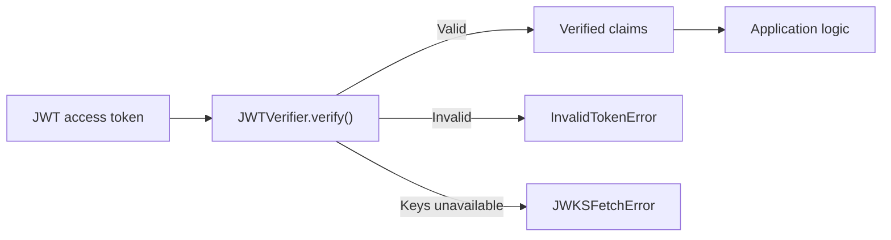
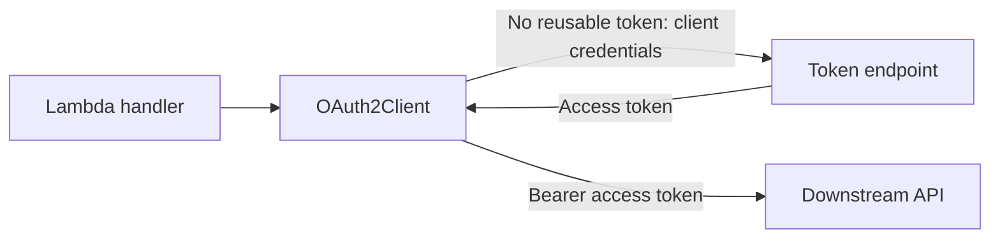

<!-- Generated by scripts/build_agent_skill_references.py from utilities/auth.md, utilities/oauth2.md. Do not edit by hand. -->
# Auth Jwt Oauth2

Source of truth: https://docs.powertools.aws.dev/lambda/python/latest/utilities/auth/, https://docs.powertools.aws.dev/lambda/python/latest/utilities/oauth2/

> **Warning: Alpha / experimental**

This utility ships under the `auth_alpha` namespace while we collect feedback. Its public API may change before GA. Pin your Powertools version before using it in production.

Auth verifies JWT access tokens in any Lambda workload. Use `verify()` directly, create Event Handler middleware with `require()`, or build a Lambda authorizer response with `authorize()`.

For client-credentials tokens used to call a downstream API, see [OAuth2 client (alpha)](oauth2.md).



## Key features

* Verify JWT signatures, issuer, audience, expiration, and required claims.
* Reuse signing keys across warm Lambda invocations and refresh them during rotation.
* Verify tokens directly in any Lambda event flow.
* Protect Event Handler routes with scopes and custom authorization.
* Build REST API and HTTP API Lambda authorizer responses.

## Getting started

### Install

```shell
pip install "aws-lambda-powertools[jwt]"
```

The `jwt` extra installs PyJWT, cryptography, and urllib3. Build dependencies for the same Python version and architecture as your Lambda function. See [cross-platform builds](../build_recipes/cross-platform.md).

> **Note: Using the Lambda layer**

The Powertools for AWS Lambda layer does not include urllib3. With the layer, this utility uses the urllib3 that comes with the Lambda runtime. To control the urllib3 version yourself, install the `jwt` extra and package it with your function.

#### Compatibility with boto3

If the function also uses boto3, including through Parameters, install and validate the SDK together with JWT verification:

```shell
pip install "aws-lambda-powertools[jwt,aws-sdk]"
python -m pip check
```

Resolve all function dependencies together, lock their versions, and package boto3, botocore, and urllib3 together. Make a failed `pip check` fail the build.

Packaged urllib3 overrides the runtime copy and can conflict with the runtime's SDK.
Build checks cannot validate dependencies supplied only by the runtime or separate layers. See [AWS packaging guidance](https://docs.aws.amazon.com/lambda/latest/dg/python-package.html#python-package-dependencies).

### Create a verifier

Create the verifier outside the Lambda handler so warm invocations reuse its signing-key cache. Configure the trusted issuer, this workload's audience, and the algorithms accepted from that issuer.

```python title="basic.py"
import os

from aws_lambda_powertools.utilities.auth_alpha import JWTVerifier
from aws_lambda_powertools.utilities.typing import LambdaContext

verifier = JWTVerifier(
    issuer=os.environ["ISSUER_URL"],
    audience=os.environ["RESOURCE_URL"],
    algorithms=["RS256"],
    required_claims=["sub"],
    # Adapt this constraint to your provider's access-token profile.
    expected_claims={"token_use": "access"},
)

def lambda_handler(event: dict, context: LambdaContext):
    claims = verifier.verify(event["access_token"])
    return {"subject": claims["sub"]}
```

Replace `token_use` with the access-token marker used by your identity provider. This prevents another JWT type from being accepted only because it has the same audience.

`JWTVerifier` provides the following operations:

| Method | Use when |
| ------ | -------- |
| `verify(token)` | You already have the encoded JWT |
| `verify_authorization_header(value)` | You have a complete HTTP `Authorization` header |
| `require(...)` | You use Powertools Event Handler and want to protect a route |
| `authorize(event, ...)` | The Lambda function is an API Gateway authorizer |
| `prefetch()` | You want to fetch signing keys during Lambda INIT |

### Verify a JWT

`verify()` accepts an encoded JWT without the `Bearer` prefix. It returns verified claims or raises `InvalidTokenError`. If discovery or the JWKS endpoint is unavailable, it raises `JWKSFetchError` instead. Your Lambda decides how those failures map to its event source.

### Required resources

JWT verification requires no additional IAM permissions. Discovery and remote JWKS require outbound HTTPS; private subnets may need NAT or private connectivity.
Static `jwks` avoids network access, but your application must rotate those keys.

### Protect an HTTP route

`verifier.require()` creates Event Handler middleware bound to the verifier and requested scopes. Create the verifier outside the handler to reuse its cache.

```python title="middleware.py"
import os

from aws_lambda_powertools.event_handler import APIGatewayHttpResolver
from aws_lambda_powertools.utilities.auth_alpha import JWTVerifier
from aws_lambda_powertools.utilities.typing import LambdaContext

app = APIGatewayHttpResolver()
verifier = JWTVerifier(
    issuer=os.environ["ISSUER_URL"],
    audience=os.environ["RESOURCE_URL"],
    algorithms=["RS256"],
    required_claims=["sub"],
    # Adapt this constraint to your provider's access-token profile.
    expected_claims={"token_use": "access"},
)

@app.get("/orders", middlewares=[verifier.require(scopes=["orders:read"])])
def list_orders():
    return {"subject": app.context["claims"]["sub"], "orders": []}

def lambda_handler(event: dict, context: LambdaContext):
    return app.resolve(event, context)
```

Here, `app.get()` registers the middleware only for `GET /orders`. For each matching request, the middleware:

1. Reads the Bearer token from the `Authorization` header.
2. Calls `verifier.verify(token)` to validate the signature and claims.
3. Checks that the token contains `orders:read`.
4. Stores verified claims in `app.context["claims"]` while the route handler runs.

The route handler does not run when authentication or authorization fails.

| Failure | Response |
| ------- | -------- |
| Missing or invalid token | 401 |
| Missing required scope or custom authorization denied | 403 |
| Discovery or JWKS endpoint unavailable | 503 |

Configure public routes and CORS preflight separately.

### Verify an Authorization header

Without middleware, pass the complete `Authorization` header to `verify_authorization_header()`. It validates the Bearer scheme and verifies the extracted JWT:

```python title="direct.py"
import os

from aws_lambda_powertools.event_handler import APIGatewayHttpResolver, Response
from aws_lambda_powertools.utilities.auth_alpha import JWTVerifier
from aws_lambda_powertools.utilities.auth_alpha.jwt.exceptions import InvalidTokenError, JWKSFetchError
from aws_lambda_powertools.utilities.typing import LambdaContext

app = APIGatewayHttpResolver()
verifier = JWTVerifier(
    issuer=os.environ["ISSUER_URL"],
    audience=os.environ["RESOURCE_URL"],
    algorithms=["RS256"],
    required_claims=["sub"],
    # Adapt this constraint to your provider's access-token profile.
    expected_claims={"token_use": "access"},
)

@app.get("/orders")
def list_orders():
    authorization = app.current_event.headers.get("authorization")
    try:
        claims = verifier.verify_authorization_header(authorization)
    except InvalidTokenError:
        return Response(
            status_code=401,
            body={"message": "Unauthorized"},
            headers={"WWW-Authenticate": 'Bearer error="invalid_token"'},
        )
    except JWKSFetchError:
        return Response(status_code=503, body={"message": "Service Unavailable"})

    return {"subject": claims["sub"], "orders": []}

def lambda_handler(event: dict, context: LambdaContext):
    return app.resolve(event, context)
```

Both verification methods require `iss`, `aud`, and `exp`; use `required_claims` to require additional claims.

## Advanced

### Customize route authorization

This complete Lambda adds provider-specific token checks, a required scope, a tenant authorization rule, and custom error handling:

```python title="custom_authorization.py"
import os

from aws_lambda_powertools import Logger
from aws_lambda_powertools.event_handler import APIGatewayHttpResolver, Response
from aws_lambda_powertools.utilities.auth_alpha import AuthErrorContext, JWTVerifier
from aws_lambda_powertools.utilities.typing import LambdaContext

app = APIGatewayHttpResolver()
logger = Logger()
verifier = JWTVerifier(
    issuer=os.environ["ISSUER_URL"],
    audience=os.environ["RESOURCE_URL"],
    algorithms=["RS256"],
    required_claims=["sub", "tenant"],
    expected_claims={"token_use": "access"},
)

def on_error(error: AuthErrorContext) -> Response:
    logger.warning("Authorization failed", reason=error.reason.value, retryable=error.retryable)
    return Response(
        status_code=error.status_code,
        content_type="application/json",
        body={"message": "Access denied"},
        headers=error.headers,
    )

def belongs_to_example_tenant(claims: dict) -> bool:
    return claims["tenant"] == "example"

@app.get(
    "/orders",
    middlewares=[
        verifier.require(
            scopes=["orders:read"],
            authorize=belongs_to_example_tenant,
            on_error=on_error,
        ),
    ],
)
def list_orders():
    return {"subject": app.context["claims"]["sub"], "orders": []}

def lambda_handler(event: dict, context: LambdaContext):
    return app.resolve(event, context)
```

Match `expected_claims` to your provider's access-token profile. `authorize` runs after verification and scope checks.
`on_error` can change the error response or emit logs/metrics, but cannot invoke the protected route.

The callback exposes `reason` and `retryable`, without token data. Preserve `error.status_code` and `error.headers` to retain the HTTP contract.

### Key freshness and Lambda timeouts

| Setting | Default | Purpose |
| ------- | ------- | ------- |
| `timeout_seconds` | 3 seconds | Limits discovery and JWKS requests |
| `jwks_max_age_seconds` | 5 minutes | Limits how long fetched keys remain trusted |
| `unknown_kid_cooldown_seconds` | 5 minutes | Limits repeated refreshes for unknown key IDs |

The first verification fetches keys unless `jwks` is static. Warm invocations reuse them; a refresh replaces the key set, dropping removed keys.
An expired cache with a failed refresh raises `JWKSFetchError`; stale keys are not used.

> **Warning: Leave time for Lambda to handle the error**

Set `timeout_seconds` lower than the Lambda function timeout. If both use the three-second default, Lambda can terminate the invocation before your code receives `JWKSFetchError`.

Call `prefetch()` after constructing the verifier to retrieve keys during Lambda INIT:

```python title="prefetch.py"
import os

from aws_lambda_powertools.utilities.auth_alpha import JWTVerifier
from aws_lambda_powertools.utilities.typing import LambdaContext

verifier = JWTVerifier(
    issuer=os.environ["ISSUER_URL"],
    audience=os.environ["RESOURCE_URL"],
    algorithms=["RS256"],
    required_claims=["sub"],
    # Adapt this constraint to your provider's access-token profile.
    expected_claims={"token_use": "access"},
)
verifier.prefetch()

def lambda_handler(event: dict, context: LambdaContext):
    claims = verifier.verify(event["access_token"])
    return {"subject": claims["sub"]}
```

Prefetching can reduce first-invocation latency, but a provider outage can fail the cold start. Without it, the first `verify()` fetches keys.

Static `jwks` avoids network access. Recreate the verifier or execution environment when the configured keys change.

### Cognito

Use the Cognito profile for resource-bound Cognito access tokens:

```python title="cognito.py"
import os

from aws_lambda_powertools.event_handler import APIGatewayHttpResolver
from aws_lambda_powertools.utilities.auth_alpha import JWTVerifier
from aws_lambda_powertools.utilities.typing import LambdaContext

app = APIGatewayHttpResolver()
verifier = JWTVerifier.cognito(
    user_pool_id=os.environ["COGNITO_USER_POOL_ID"],
    client_id=os.environ["COGNITO_CLIENT_ID"],
    audience=os.environ["RESOURCE_URL"],
)

@app.get("/orders", middlewares=[verifier.require(scopes=["orders:read"])])
def list_orders():
    return {"subject": app.context["claims"]["sub"], "orders": []}

def lambda_handler(event: dict, context: LambdaContext):
    return app.resolve(event, context)
```

This profile checks RS256, `token_use="access"`, the configured app client ID, and the resource audience. Cognito ID tokens and access tokens without the configured resource audience are rejected.

Use `JWTVerifier.any_of()` when the same Lambda trusts access tokens from multiple configured issuers. Unknown issuers are rejected without discovery.

### Lambda authorizers

Use `authorize()` when API Gateway invokes a dedicated Lambda authorizer:

```python title="authorizer.py"
import os

from aws_lambda_powertools import Logger
from aws_lambda_powertools.utilities.auth_alpha import JWTVerifier
from aws_lambda_powertools.utilities.auth_alpha.jwt.exceptions import AuthError
from aws_lambda_powertools.utilities.typing import LambdaContext

logger = Logger()
verifier = JWTVerifier(
    issuer=os.environ["ISSUER_URL"],
    audience=os.environ["RESOURCE_URL"],
    algorithms=["RS256"],
    required_claims=["sub"],
    # Adapt this constraint to the access-token profile issued by your provider.
    expected_claims={"token_use": "access"},
)

def record_failure(error: AuthError) -> None:
    # Opt-in application logging; never log the event, token, or claims.
    logger.warning("Authorization failed", reason=error.reason.value, retryable=error.retryable)

def iam_handler(event: dict, context: LambdaContext):
    return verifier.authorize(
        event,
        scopes=["orders:read"],
        response_format="iam",
        context_claims=["sub"],
        on_error=record_failure,
    )

def simple_handler(event: dict, context: LambdaContext):
    return verifier.authorize(event, scopes=["orders:read"], response_format="simple", on_error=record_failure)
```

The helper supports REST API TOKEN and REQUEST events and HTTP API REQUEST payloads. Choose `response_format="iam"` for an IAM policy or `response_format="simple"` for an HTTP API 2.0 simple response.

Invalid tokens and insufficient scopes return Deny or `isAuthorized=false`. If signing keys are unavailable, `JWKSFetchError` fails the authorizer invocation and API Gateway returns a 5xx response. Use `on_error` for logs and metrics; it cannot change the authorization result.

`context_claims` copies only explicitly selected scalar claims into authorizer context. Claims are not copied by default.

The example template disables API Gateway authorizer-result caching so every request is verified:

```yaml title="templates/sam.yaml"
AWSTemplateFormatVersion: "2010-09-09"
Transform: AWS::Serverless-2016-10-31
Description: JWT authorizers for REST and HTTP APIs with result caching disabled

Parameters:
  IssuerUrl:
    Type: String
    Description: HTTPS issuer issuing RS256 access tokens
  ResourceUrl:
    Type: String
    Description: Expected access token audience

Globals:
  Function:
    Runtime: python3.12
    Timeout: 10
    MemorySize: 256
    Environment:
      Variables:
        ISSUER_URL: !Ref IssuerUrl
        RESOURCE_URL: !Ref ResourceUrl

Resources:
  RestAuthorizer:
    Type: AWS::Serverless::Function
    Properties:
      Handler: authorizer.iam_handler
      CodeUri: ../src/authorizer/

  HttpAuthorizer:
    Type: AWS::Serverless::Function
    Properties:
      Handler: authorizer.simple_handler
      CodeUri: ../src/authorizer/

  RestApi:
    Type: AWS::Serverless::Api
    Properties:
      StageName: prod
      Auth:
        DefaultAuthorizer: JwtAuthorizer
        Authorizers:
          JwtAuthorizer:
            FunctionArn: !GetAtt RestAuthorizer.Arn
            FunctionPayloadType: REQUEST
            Identity:
              Headers:
                - Authorization
              ReauthorizeEvery: 0

  HttpApi:
    Type: AWS::Serverless::HttpApi
    Properties:
      Auth:
        DefaultAuthorizer: JwtAuthorizer
        Authorizers:
          JwtAuthorizer:
            FunctionArn: !GetAtt HttpAuthorizer.Arn
            AuthorizerPayloadFormatVersion: "2.0"
            EnableSimpleResponses: true
            EnableFunctionDefaultPermissions: true
            Identity:
              Headers:
                - Authorization
              ReauthorizeEvery: 0

  RestBackend:
    Type: AWS::Serverless::Function
    Properties:
      Handler: backend.lambda_handler
      CodeUri: ../src/backend/
      Events:
        Orders:
          Type: Api
          Properties:
            RestApiId: !Ref RestApi
            Path: /orders
            Method: GET

  HttpBackend:
    Type: AWS::Serverless::Function
    Properties:
      Handler: backend.lambda_handler
      CodeUri: ../src/backend/
      Events:
        Orders:
          Type: HttpApi
          Properties:
            ApiId: !Ref HttpApi
            Path: /orders
            Method: GET
```

If enabling Gateway caching, include every authorization input in its identity sources. A cached allow can still outlive JWT expiration until the cache TTL ends.
Keep it disabled when every request must respect token expiration. Gateway caching is independent of the JWKS cache.

### Errors and diagnostics

`AuthError` is the base exception. Invalid credentials raise `InvalidTokenError` or one of its specific subclasses. Problems retrieving signing keys raise `JWKSFetchError`. Every auth exception provides a stable `reason` and a `retryable` flag.

| Reason | Retryable |
| ------ | --------- |
| `missing_token` | false |
| `invalid_token` | false |
| `invalid_claims` | false |
| `token_expired` | false |
| `invalid_signature` | false |
| `insufficient_scope` | false |
| `forbidden` | false |
| `jwks_unavailable` | true |

Log `reason.value` and `retryable`, not exception messages, tokens, claims, or request headers. `retryable=true` means a later attempt might succeed after provider recovery.

> **Warning: Alpha / experimental**

This utility ships under the `auth_alpha` namespace while we collect feedback. Its public API may change before GA. Pin your Powertools version before using it in production.

`OAuth2Client` obtains bearer tokens for a Lambda function calling an API on its own behalf.
It uses the client-credentials grant with `client_secret_basic` (default) or explicit `client_secret_post` authentication.

Use [JWT verification](auth.md) to authenticate incoming requests. The OAuth client obtains separate credentials for outgoing requests; it does not forward an incoming caller's token.



## Key features

* Cache access tokens across warm Lambda invocations and reacquire them before expiration.
* Coordinate concurrent token requests within one client.
* Resolve a client secret for each exchange attempt.
* Authenticate using HTTP Basic or form-body credentials, as required by your provider.
* Select a downstream API using a provider-specific audience or an RFC 8707 resource indicator.
* Obtain headers for your HTTP client or send a synchronous authenticated request.
* Report fixed failure reasons without exposing credentials or provider responses.

## Getting started

### Install

```shell
pip install "aws-lambda-powertools[oauth2]"
```

The `oauth2` extra installs urllib3; PyJWT and cryptography are not required.

> **Note: Using the Lambda layer**

The Powertools for AWS Lambda layer does not include urllib3. With the layer, this utility uses the urllib3 that comes with the Lambda runtime. To control the urllib3 version yourself, install the `oauth2` extra and package it with your function.

#### Compatibility with boto3

If the function also uses boto3, including through Parameters, install and validate the SDK together with OAuth:

```shell
pip install "aws-lambda-powertools[oauth2,aws-sdk]"
python -m pip check
```

Resolve all function dependencies together, lock their versions, and package boto3, botocore, and urllib3 together. Make a failed `pip check` fail the build.

Packaged urllib3 overrides the runtime copy and can conflict with the runtime's SDK.
Build checks cannot validate dependencies supplied only by the runtime or separate layers. See [AWS packaging guidance](https://docs.aws.amazon.com/lambda/latest/dg/python-package.html#python-package-dependencies).

### Configure your identity provider

Register a client-credentials application with access to your API. Obtain its client ID, secret, HTTPS token endpoint, and required scopes or API identifier.
`OAuth2Client` does not register applications or discover endpoints.

### Call a downstream API

Create the client outside the Lambda handler so warm invocations reuse its token cache.
This complete Lambda loads a plain-string secret through Parameters and calls `GET /stock/{sku}` on an inventory API that returns JSON:

```python title="client_credentials.py"
import os
from urllib.parse import quote

from botocore.config import Config

from aws_lambda_powertools.utilities import parameters
from aws_lambda_powertools.utilities.auth_alpha import OAuth2Client
from aws_lambda_powertools.utilities.typing import LambdaContext

secrets = parameters.SecretsProvider(
    boto_config=Config(
        connect_timeout=1,
        read_timeout=2,
        retries={"total_max_attempts": 1},
    ),
)

def load_secret() -> str:
    secret = secrets.get(os.environ["CLIENT_SECRET_NAME"], max_age=300)
    if not isinstance(secret, str):
        raise ValueError("Expected a string client secret")
    return secret

INVENTORY_URL = os.environ["INVENTORY_URL"]

inventory_api = OAuth2Client(
    token_url=os.environ["TOKEN_URL"],
    client_id=os.environ["CLIENT_ID"],
    client_secret=load_secret,
    scopes=os.environ.get("SCOPES", "").split(),
    audience=os.environ.get("AUDIENCE"),
    resource=os.environ.get("RESOURCE"),
    timeout_seconds=5,
)

def lambda_handler(event: dict, context: LambdaContext):
    sku = quote(event["sku"], safe="")
    response = inventory_api.request("GET", f"{INVENTORY_URL}/stock/{sku}", timeout=5)
    if response.status != 200:
        raise RuntimeError("Inventory lookup failed")
    return response.json()
```

Configure these environment variables:

| Variable | Required | Value |
| -------- | -------- | ----- |
| `TOKEN_URL` | Yes | Trusted HTTPS token endpoint |
| `CLIENT_ID` | Yes | Registered application client ID |
| `CLIENT_SECRET_NAME` | Yes | Secrets Manager secret name or ARN; its value must be a plain string |
| `INVENTORY_URL` | Yes | Trusted HTTPS base URL of the downstream API |
| `SCOPES` | Provider-dependent | Space-separated scopes, such as `inventory:read inventory:write`; omit when none are needed |
| `AUDIENCE` | Provider-dependent | API identifier required by your provider; omit when unused |
| `RESOURCE` | Provider-dependent | RFC 8707 resource URI; omit when unused |

Set at most one of `AUDIENCE` and `RESOURCE`; neither is derived from `INVENTORY_URL`. See [provider configuration](#choose-the-resource).

Invoke with `{"sku": "item/123"}`; the handler URL-encodes the SKU.

The example allows five seconds for acquisition plus five for the API request. Set the Lambda timeout higher; see [timeouts and cold starts](#timeouts-and-cold-starts).

### Required resources

Parameters needs Secrets Manager connectivity, `secretsmanager:GetSecretValue`, and `kms:Decrypt` for a customer-managed key.
Local execution also needs SDK credentials and a region. OAuth token exchange itself requires no additional IAM permissions.

Allow outbound HTTPS to the token endpoint and API. Private subnets may require NAT or private connectivity.

### Choose the client authentication method

| `auth_method` | Credentials sent to the token endpoint |
| ------------- | -------------------------------------- |
| `client_secret_basic` (default) | Form-encoded client ID and secret in HTTP Basic authentication; neither is in the form body |
| `client_secret_post` | `client_id` and `client_secret` in the form body, without an Authorization header |

Select your provider's method; there is no automatic fallback. API requests always use the acquired bearer token.

This example uses `CLIENT_SECRET` instead of `CLIENT_SECRET_NAME` and calls `INVENTORY_URL` directly:

```python title="client_secret_post.py"
import os

from aws_lambda_powertools.utilities.auth_alpha import OAuth2Client
from aws_lambda_powertools.utilities.typing import LambdaContext

# Create outside the handler so warm invocations can reuse the token cache.
# A callable client_secret loader is also supported, as in client_credentials.py.
inventory_api = OAuth2Client(
    token_url=os.environ["TOKEN_URL"],
    client_id=os.environ["CLIENT_ID"],
    client_secret=os.environ["CLIENT_SECRET"],
    auth_method="client_secret_post",
    scopes=os.environ.get("SCOPES", "").split(),
    audience=os.environ.get("AUDIENCE"),
    resource=os.environ.get("RESOURCE"),
    timeout_seconds=5,
)
INVENTORY_URL = os.environ["INVENTORY_URL"]

def lambda_handler(event: dict, context: LambdaContext):
    response = inventory_api.request("GET", INVENTORY_URL, timeout=5)
    if response.status != 200:
        raise RuntimeError("Inventory lookup failed")
    return response.json()
```

You can also pass the Parameters `load_secret` function from the first example as `client_secret`.

### Choose how to send the API request

`OAuth2Client` provides two operations:

| Method | Use when |
| ------ | -------- |
| `auth_headers()` | You want an Authorization header for an application-owned HTTP client |
| `request(method, url, ...)` | You want the utility to send an authenticated HTTPS request |

Both acquire tokens on demand; construction fetches no secret or token.

### Choose the resource

| Parameter | Token-request field | Purpose |
| --------- | ------------------- | ------- |
| `audience` | `audience=<value>` | Provider-specific API selection, such as an Auth0 API identifier |
| `resource` | `resource=<value>` | One resource indicator for providers supporting RFC 8707 |

Use at most one parameter, as required by your provider. If omitted, API selection depends on the provider's client configuration or scope conventions.

`resource` must be an absolute URI without a fragment, such as `https://inventory.example.com` or `urn:example:inventory`.
`audience` accepts a provider-specific, nonempty string. Both are validated during construction.

Common provider configurations:

| Provider | Token endpoint path | API selection |
| -------- | ------------------- | ------------- |
| [Amazon Cognito](https://docs.aws.amazon.com/cognito/latest/developerguide/token-endpoint.html) | `/oauth2/token` on the user pool domain | Custom resource-server scopes such as `inventory/read` |
| [Auth0](https://auth0.com/docs/get-started/authentication-and-authorization-flow/client-credentials-flow/call-your-api-using-the-client-credentials-flow) | `/oauth/token` | `audience` set to the API identifier; scopes as configured for the API |
| [Microsoft Entra ID](https://learn.microsoft.com/en-us/entra/identity-platform/v2-oauth2-client-creds-grant-flow) | `/{tenant}/oauth2/v2.0/token` | One resource's `/.default` scope, such as `https://graph.microsoft.com/.default` |
| [Okta custom authorization server](https://developer.okta.com/docs/guides/implement-grant-type/clientcreds/main/) | `/oauth2/{authorizationServerId}/v1/token` | Custom API scopes |
| [Keycloak](https://www.keycloak.org/docs/latest/server_admin/index.html#_service_accounts) | `/realms/{realm}/protocol/openid-connect/token` | Service-account roles and client scopes configured in the realm |

Okta's organization authorization server [requires `private_key_jwt` for service apps](https://developer.okta.com/docs/guides/implement-oauth-for-okta-serviceapp/main/) requesting Okta management scopes. That authentication method is outside this client's scope.

Create one client per provider and resource. The request URL does not change token selection; changing the resource requires a new client.
Your application selects the client; routing and failover are not automatic.

### Use your own HTTP client

Pass the fresh `Authorization: Bearer <token>` dictionary from `auth_headers()` to your HTTP client:

```python title="headers.py"
import os
from urllib.parse import quote, urlsplit

import urllib3

from aws_lambda_powertools.utilities.auth_alpha import OAuth2Client
from aws_lambda_powertools.utilities.typing import LambdaContext

INVENTORY_URL = os.environ["INVENTORY_URL"]
inventory_url = urlsplit(INVENTORY_URL)
if (
    inventory_url.scheme != "https"
    or not inventory_url.hostname
    or inventory_url.username is not None
    or inventory_url.password is not None
    or "#" in INVENTORY_URL
):
    raise ValueError("INVENTORY_URL must be an HTTPS URL without user information or a fragment")

inventory_api = OAuth2Client(
    token_url=os.environ["TOKEN_URL"],
    client_id=os.environ["CLIENT_ID"],
    client_secret=lambda: os.environ["CLIENT_SECRET"],
    scopes=os.environ.get("SCOPES", "").split(),
    audience=os.environ.get("AUDIENCE"),
    resource=os.environ.get("RESOURCE"),
    timeout_seconds=5,
)
http = urllib3.PoolManager()

def lambda_handler(event: dict, context: LambdaContext):
    sku = quote(event["sku"], safe="")
    response = http.request(
        "GET",
        f"{INVENTORY_URL}/stock/{sku}",
        headers=inventory_api.auth_headers(),
        timeout=urllib3.Timeout(total=5),
        redirect=False,
        retries=False,
    )
    if response.status != 200:
        raise RuntimeError("Inventory lookup failed")
    return response.json()
```

This example validates HTTPS before acquiring credentials. Configure your HTTP client's timeouts, redirects, and retries yourself.
Never log the returned headers or send them to an untrusted destination.

## Advanced

### Lambda execution environments and token lifetimes

Each client caches tokens within one Lambda execution environment. Warm invocations may reuse them; new environments acquire their own tokens and can exchange concurrently.

Cached tokens are reused while more than 30 seconds remain. After that, the next call performs a new client-credentials exchange, not a refresh-token grant.
Tokens with missing or at most 30 seconds of advertised lifetime are returned uncached. Invalid lifetimes and tokens that expire during acquisition are rejected.

Lifetime accounting starts immediately before the token request. Secret lookup consumes the acquisition budget without shortening the token's lifetime.

Concurrent callers on one client share an exchange, including short-lived tokens and failures. Each waiting caller keeps its own acquisition deadline.

### Secret rotation

`client_secret` accepts a nonempty string or a callable, invoked for each exchange attempt including retries. The client does not cache the callable's result.

Cached access tokens may remain usable after rotation. Parameters' `max_age=300` can delay reading an updated secret by five minutes.

Environment-variable secrets are static; a callable reading `os.environ` does not fetch external updates.

### Timeouts and cold starts

| Setting | Default | Applies to |
| ------- | ------- | ---------- |
| `OAuth2Client(timeout_seconds=...)` | 3 seconds | One acquisition, including waiting, secret lookup, token requests, and retry backoff |
| `request(..., timeout=...)` | 5 seconds | The downstream request after token acquisition, including reading its response |
| Secret-provider SDK timeouts | Provider-specific | Each secret lookup; configure independently |

These budgets are sequential. Set the Lambda timeout above their sum, leaving time for application work and error handling.

Measure cold starts at your chosen memory and network settings: initial secret lookup and SDK setup can exceed the three-second default.
The Parameters example initializes the SDK outside the handler, uses one-second connect/two-second read timeouts with one SDK attempt, and allows five seconds for acquisition. Tune these values for your workload.

HTTP header and body reads use the remaining budget. DNS resolution, secret loaders, and upload producers cannot always be interrupted, although their elapsed time still counts.
Configure their own timeouts where supported.

### Retries and downstream responses

Token-endpoint transport failures, HTTP 429, and HTTP 5xx allow at most two retries, with 100 ms then 200 ms backoff within the acquisition budget.
Other HTTP errors, malformed token responses, and secret-loader failures are not retried.

`request()` returns an urllib3 HTTP response with `.status`, `.headers`, `.data`, and `.json()`.
Handle HTTP statuses in your application: even 401/403 does not invalidate the cached token or trigger another exchange. Downstream operations are never automatically replayed.

Responses are fully buffered in memory; use `auth_headers()` and a streaming client for large downloads.
The examples expect HTTP 200 with JSON. Handle other statuses or empty bodies according to your API.

### Destination safety

`request()` requires HTTPS, disables redirects, and forwards only `body`, `fields`, `json`, `encode_multipart`, and `multipart_boundary` options to urllib3.
Use `auth_headers()` for other transport options.

Header names must follow HTTP token syntax; values must fit Latin-1 without ASCII controls other than tabs.
Invalid headers and case-insensitive Authorization overrides are rejected before secret lookup.

> **Warning: Use trusted destination URLs**

Use configured, trusted URLs, never caller-controlled destinations. `request()` does not restrict URLs using the configured audience or resource.

### Errors and diagnostics

OAuth errors inherit from `AuthError` in `auth_alpha.exceptions`.

| Exception | Reason | Retryable |
| --------- | ------ | --------- |
| `TokenExchangeError` | `token_exchange_failed` | True for transient endpoint failures or acquisition timeouts; otherwise false |
| `DownstreamRequestError` | `downstream_request_failed` | False: the server may already have performed the operation |

Invalid client configuration, method, URL, timeout, headers, or option names raise `ValueError` before token acquisition.
`retryable=true` means a later acquisition might succeed.

Use the fixed `reason.value` and `retryable` fields for logs and metrics:

```python title="diagnostics.py"
import json
import os
from urllib.parse import quote

from aws_lambda_powertools import Logger
from aws_lambda_powertools.utilities.auth_alpha import OAuth2Client
from aws_lambda_powertools.utilities.auth_alpha.oauth2.exceptions import DownstreamRequestError, TokenExchangeError
from aws_lambda_powertools.utilities.typing import LambdaContext

logger = Logger()
INVENTORY_URL = os.environ["INVENTORY_URL"]
inventory_api = OAuth2Client(
    token_url=os.environ["TOKEN_URL"],
    client_id=os.environ["CLIENT_ID"],
    client_secret=lambda: os.environ["CLIENT_SECRET"],
    scopes=os.environ.get("SCOPES", "").split(),
    audience=os.environ.get("AUDIENCE"),
    resource=os.environ.get("RESOURCE"),
    timeout_seconds=5,
)

def lambda_handler(event: dict, context: LambdaContext):
    sku = quote(event["sku"], safe="")
    try:
        response = inventory_api.request("GET", f"{INVENTORY_URL}/stock/{sku}", timeout=5)
    except (TokenExchangeError, DownstreamRequestError) as error:
        logger.warning("Inventory request unavailable", reason=error.reason.value, retryable=error.retryable)
        return {"statusCode": 502, "body": "Inventory request unavailable"}
    if response.status != 200:
        return {"statusCode": 502, "body": "Inventory request unavailable"}
    return {"statusCode": 200, "body": json.dumps(response.json())}
```

This handler returns proxy-style responses and uses the environment-secret deployment settings.

The client emits no logs and removes provider exception chains. Never log secrets, tokens, request headers/bodies, or provider responses.

### Supported scope

The client treats bearer tokens, including JWTs, as opaque strings. The downstream API validates and authorizes them.

Other grants, introspection, revocation, JWT client authentication, mTLS, and DPoP are not supported. Calls are synchronous.

### Calling downstream APIs from an MCP tool

After authorizing the MCP caller, use `asyncio.to_thread()` to call the downstream API with separate client credentials:

```python
import asyncio
from urllib.parse import quote

from client_credentials import INVENTORY_URL, inventory_api
from mcp.server.auth.middleware.auth_context import get_access_token

async def check_stock(sku: str) -> dict:
    caller = get_access_token()
    if caller is None or "inventory:read" not in caller.scopes:
        raise PermissionError("Inventory read permission is required")
    response = await asyncio.to_thread(
        inventory_api.request,
        "GET",
        f"{INVENTORY_URL}/stock/{quote(sku, safe='')}",
        timeout=5,
    )
    if response.status != 200:
        raise RuntimeError("Inventory lookup failed")
    return response.json()
```

Package `client_credentials.py` alongside the tool and register `check_stock` with an authenticated MCP server. The SDK owns transport authentication and error responses.
Cancelling the task does not stop the worker's request; timeouts still apply. Install the MCP SDK separately.
