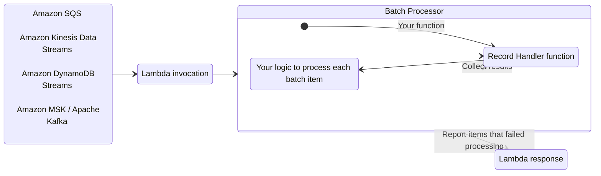
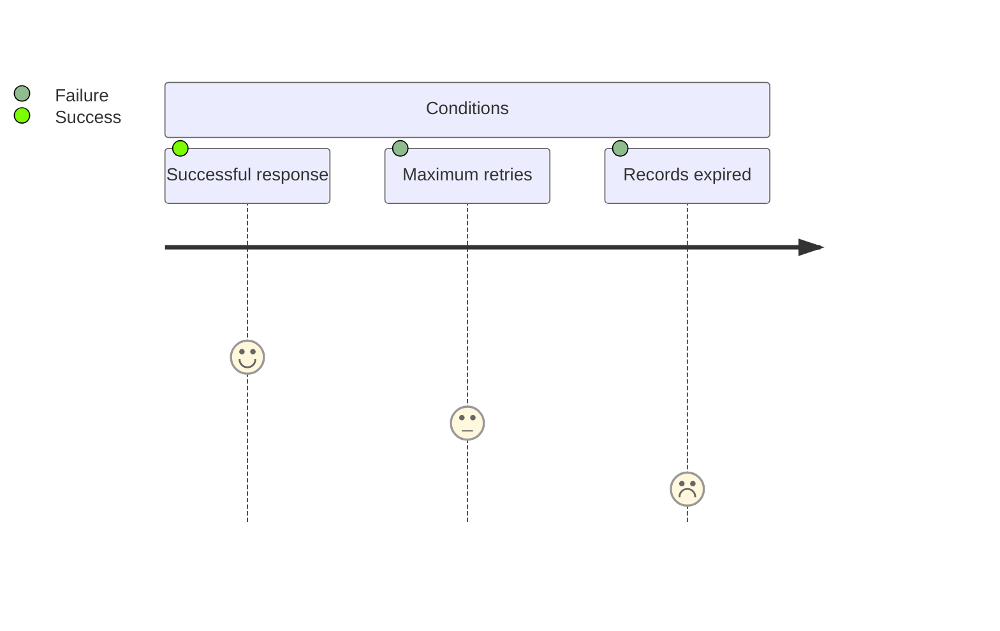
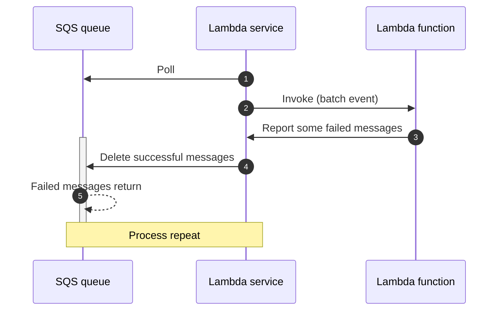
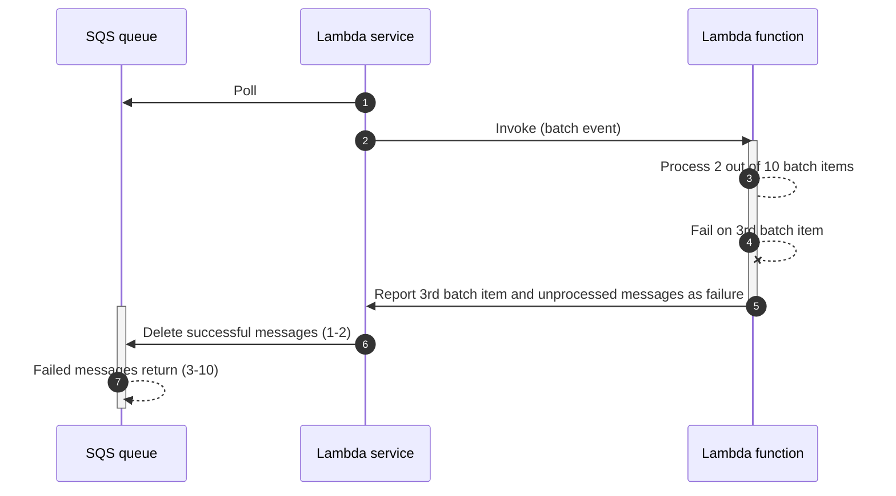
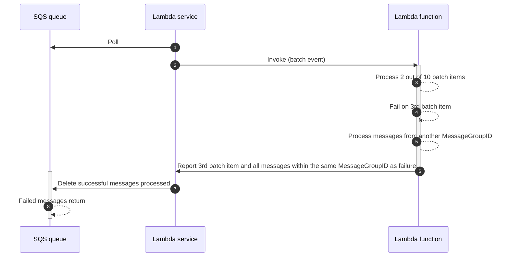
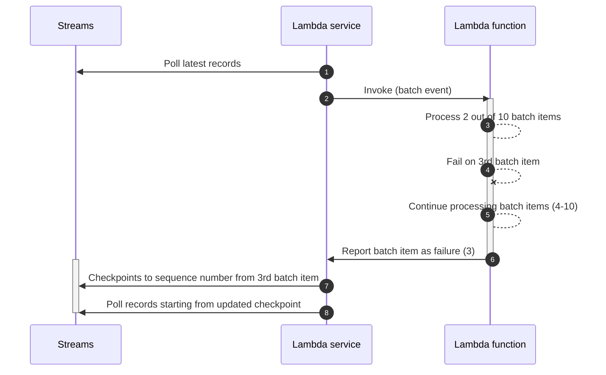
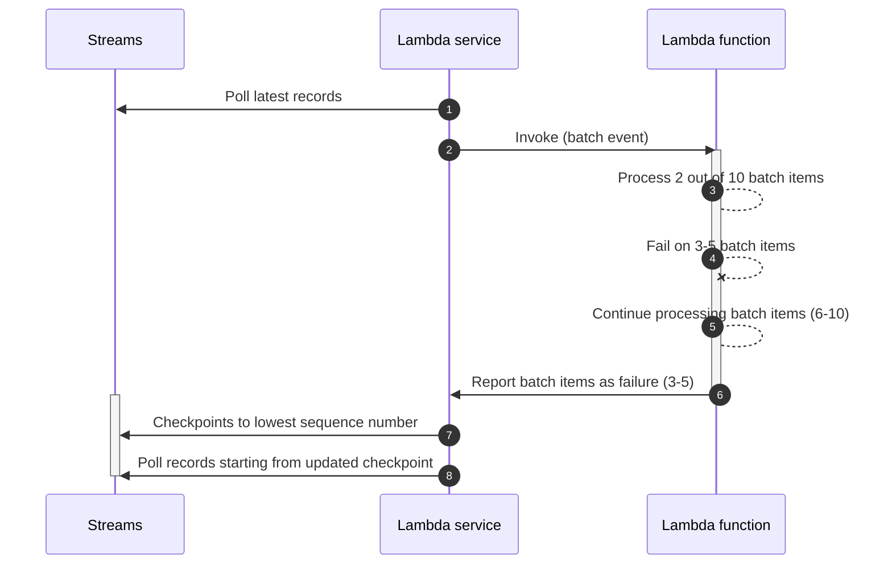
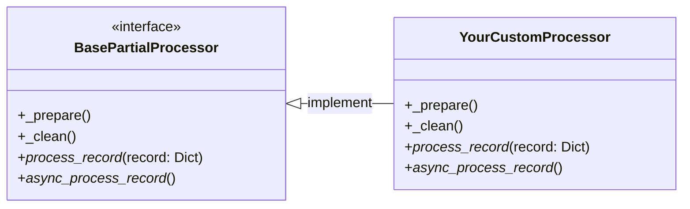

<!-- Generated by scripts/build_agent_skill_references.py from utilities/batch.md. Do not edit by hand. -->
# Batch Processing

Source of truth: https://docs.powertools.aws.dev/lambda/python/latest/utilities/batch/

The batch processing utility handles partial failures when processing batches from Amazon SQS, Amazon Kinesis Data Streams, Amazon DynamoDB Streams, and Amazon MSK/self-managed Apache Kafka.



## Key features

* Reports batch item failures to reduce number of retries for a record upon errors
* Simple interface to process each batch record
* Integrates with [Event Source Data Classes](./data_classes.md) and [Parser (Pydantic)](parser.md) for self-documenting record schema
* Build your own batch processor by extending primitives

## Background

When using SQS, Kinesis Data Streams, DynamoDB Streams, or Amazon MSK/Apache Kafka as a Lambda event source, your Lambda functions are triggered with a batch of messages.

If your function fails to process any message from the batch, the entire batch returns to your queue or stream. This same batch is then retried until either condition happens first: **a)** your Lambda function returns a successful response, **b)** record reaches maximum retry attempts, or **c)** records expire.



This behavior changes when you enable Report Batch Item Failures feature in your Lambda function event source configuration:

* [**SQS queues**](#sqs-standard). Only messages reported as failure will return to the queue for a retry, while successful ones will be deleted.
* [**Kinesis data streams**](#kinesis-and-dynamodb-streams) and [**DynamoDB streams**](#kinesis-and-dynamodb-streams). Single reported failure will use its sequence number as the stream checkpoint. Multiple  reported failures will use the lowest sequence number as checkpoint.
* [**Kafka (MSK and self-managed)**](#processing-messages-from-kafka). Failed records are identified by topic-partition and offset. Only failed records will be retried.

> **Warning: Warning: This utility lowers the chance of processing records more than once; it does not guarantee it**

We recommend implementing processing logic in an [idempotent manner](idempotency.md) wherever possible.

You can find more details on how Lambda works with either [SQS](https://docs.aws.amazon.com/lambda/latest/dg/with-sqs.html), [Kinesis](https://docs.aws.amazon.com/lambda/latest/dg/with-kinesis.html), [DynamoDB](https://docs.aws.amazon.com/lambda/latest/dg/with-ddb.html), or [MSK/Kafka](https://docs.aws.amazon.com/lambda/latest/dg/with-msk.html) in the AWS Documentation.

## Getting started

For this feature to work, you need to **(1)** configure your Lambda function event source to use `ReportBatchItemFailures`, and **(2)** return [a specific response](https://docs.aws.amazon.com/lambda/latest/dg/with-sqs.html#services-sqs-batchfailurereporting) to report which records failed to be processed.

You use your preferred deployment framework to set the correct configuration while this utility handles the correct response to be returned.

### Required resources

The remaining sections of the documentation will rely on these samples. For completeness, this demonstrates IAM permissions and Dead Letter Queue where batch records will be sent after 2 retries were attempted.

> **Note: You do not need any additional IAM permissions to use this utility, except for what each event source requires.**

**SQS**

```yaml title="template.yaml"
AWSTemplateFormatVersion: "2010-09-09"
Transform: AWS::Serverless-2016-10-31
Description: partial batch response sample

Globals:
  Function:
    Timeout: 5
    MemorySize: 256
    Runtime: python3.12
    Tracing: Active
    Environment:
      Variables:
        POWERTOOLS_LOG_LEVEL: INFO
        POWERTOOLS_SERVICE_NAME: hello

Resources:
  HelloWorldFunction:
    Type: AWS::Serverless::Function
    Properties:
      Handler: app.lambda_handler
      CodeUri: hello_world
      Policies:
        - SQSPollerPolicy:
            QueueName: !GetAtt SampleQueue.QueueName
      Events:
        Batch:
          Type: SQS
          Properties:
            Queue: !GetAtt SampleQueue.Arn
            FunctionResponseTypes:
              - ReportBatchItemFailures

  SampleDLQ:
    Type: AWS::SQS::Queue

  SampleQueue:
    Type: AWS::SQS::Queue
    Properties:
      VisibilityTimeout: 30 # Fn timeout * 6
      SqsManagedSseEnabled: true
      RedrivePolicy:
        maxReceiveCount: 2
        deadLetterTargetArn: !GetAtt SampleDLQ.Arn
```

**Kinesis Data Streams**

```yaml title="template.yaml"
AWSTemplateFormatVersion: "2010-09-09"
Transform: AWS::Serverless-2016-10-31
Description: partial batch response sample

Globals:
  Function:
    Timeout: 5
    MemorySize: 256
    Runtime: python3.12
    Tracing: Active
    Environment:
      Variables:
        POWERTOOLS_LOG_LEVEL: INFO
        POWERTOOLS_SERVICE_NAME: hello

Resources:
  HelloWorldFunction:
    Type: AWS::Serverless::Function
    Properties:
      Handler: app.lambda_handler
      CodeUri: hello_world
      Policies:
        # Lambda Destinations require additional permissions
        # to send failure records to DLQ from Kinesis/DynamoDB
        - Version: "2012-10-17"
          Statement:
            Effect: "Allow"
            Action:
              - sqs:GetQueueAttributes
              - sqs:GetQueueUrl
              - sqs:SendMessage
            Resource: !GetAtt SampleDLQ.Arn
      Events:
        KinesisStream:
          Type: Kinesis
          Properties:
            Stream: !GetAtt SampleStream.Arn
            BatchSize: 100
            StartingPosition: LATEST
            MaximumRetryAttempts: 2
            DestinationConfig:
              OnFailure:
                Destination: !GetAtt SampleDLQ.Arn
            FunctionResponseTypes:
              - ReportBatchItemFailures

  SampleDLQ:
    Type: AWS::SQS::Queue

  SampleStream:
    Type: AWS::Kinesis::Stream
    Properties:
      ShardCount: 1
      StreamEncryption:
        EncryptionType: KMS
        KeyId: alias/aws/kinesis
```

**DynamoDB Streams**

```yaml title="template.yaml"
AWSTemplateFormatVersion: '2010-09-09'
Transform: AWS::Serverless-2016-10-31
Description: partial batch response sample

Globals:
  Function:
    Timeout: 5
    MemorySize: 256
    Runtime: python3.12
    Tracing: Active
    Environment:
      Variables:
        POWERTOOLS_LOG_LEVEL: INFO
        POWERTOOLS_SERVICE_NAME: hello

Resources:
  HelloWorldFunction:
    Type: AWS::Serverless::Function
    Properties:
      Handler: app.lambda_handler
      CodeUri: hello_world
      Policies:
        # Lambda Destinations require additional permissions
        # to send failure records from Kinesis/DynamoDB
        - Version: "2012-10-17"
          Statement:
            Effect: "Allow"
            Action:
              - sqs:GetQueueAttributes
              - sqs:GetQueueUrl
              - sqs:SendMessage
            Resource: !GetAtt SampleDLQ.Arn
      Events:
        DynamoDBStream:
          Type: DynamoDB
          Properties:
            Stream: !GetAtt SampleTable.StreamArn
            StartingPosition: LATEST
            MaximumRetryAttempts: 2
            DestinationConfig:
              OnFailure:
                Destination: !GetAtt SampleDLQ.Arn
            FunctionResponseTypes:
              - ReportBatchItemFailures

  SampleDLQ:
    Type: AWS::SQS::Queue

  SampleTable:
    Type: AWS::DynamoDB::Table
    Properties:
      BillingMode: PAY_PER_REQUEST
      AttributeDefinitions:
        - AttributeName: pk
          AttributeType: S
        - AttributeName: sk
          AttributeType: S
      KeySchema:
        - AttributeName: pk
          KeyType: HASH
        - AttributeName: sk
          KeyType: RANGE
      SSESpecification:
        SSEEnabled: true
      StreamSpecification:
        StreamViewType: NEW_AND_OLD_IMAGES
```

**Kafka (MSK)**

```yaml title="template.yaml"
AWSTemplateFormatVersion: "2010-09-09"
Transform: AWS::Serverless-2016-10-31
Description: Kafka/MSK partial batch response sample

Globals:
  Function:
    Timeout: 30
    MemorySize: 256
    Runtime: python3.12
    Tracing: Active
    Environment:
      Variables:
        POWERTOOLS_LOG_LEVEL: INFO
        POWERTOOLS_SERVICE_NAME: kafka-processor

Parameters:
  MSKClusterArn:
    Type: String
    Description: ARN of the MSK cluster
  KafkaTopic:
    Type: String
    Description: Name of the Kafka topic to consume from
    Default: mytopic

Resources:
  KafkaConsumerFunction:
    Type: AWS::Serverless::Function
    Properties:
      Handler: app.lambda_handler
      CodeUri: hello_world
      Policies:
        # Permissions for MSK
        - Version: "2012-10-17"
          Statement:
            - Effect: "Allow"
              Action:
                - kafka:DescribeCluster
                - kafka:DescribeClusterV2
                - kafka:GetBootstrapBrokers
              Resource: !Ref MSKClusterArn
            - Effect: "Allow"
              Action:
                - kafka-cluster:Connect
                - kafka-cluster:DescribeGroup
                - kafka-cluster:AlterGroup
                - kafka-cluster:DescribeTopic
                - kafka-cluster:ReadData
                - kafka-cluster:DescribeClusterDynamicConfiguration
              Resource:
                - !Ref MSKClusterArn
                - !Sub "${MSKClusterArn}/*"
        # Lambda Destinations require additional permissions
        # to send failure records to DLQ
        - Version: "2012-10-17"
          Statement:
            Effect: "Allow"
            Action:
              - sqs:GetQueueAttributes
              - sqs:GetQueueUrl
              - sqs:SendMessage
            Resource: !GetAtt SampleDLQ.Arn
      Events:
        MSKEvent:
          Type: MSK
          Properties:
            Stream: !Ref MSKClusterArn
            Topics:
              - !Ref KafkaTopic
            StartingPosition: LATEST
            BatchSize: 100
            MaximumBatchingWindowInSeconds: 5
            DestinationConfig:
              OnFailure:
                Destination: !GetAtt SampleDLQ.Arn
            FunctionResponseTypes:
              - ReportBatchItemFailures

  SampleDLQ:
    Type: AWS::SQS::Queue

Outputs:
  KafkaConsumerFunctionArn:
    Description: "Kafka Consumer Lambda Function ARN"
    Value: !GetAtt KafkaConsumerFunction.Arn
  SampleDLQUrl:
    Description: "Dead Letter Queue URL"
    Value: !Ref SampleDLQ
```

### Processing messages from SQS

Processing batches from SQS works in three stages:

1. Instantiate **`BatchProcessor`** and choose **`EventType.SQS`** for the event type
2. Define your function to handle each batch record, and use [`SQSRecord`](data_classes.md#sqs) type annotation for autocompletion
3. Use **`process_partial_response`** to kick off processing

> **Info: This code example uses Tracer and Logger for completion.**

**Recommended**

```python
from aws_lambda_powertools import Logger, Tracer
from aws_lambda_powertools.utilities.batch import (
    BatchProcessor,
    EventType,
    process_partial_response,
)
from aws_lambda_powertools.utilities.data_classes.sqs_event import SQSRecord
from aws_lambda_powertools.utilities.typing import LambdaContext

processor = BatchProcessor(event_type=EventType.SQS)  # (1)!
tracer = Tracer()
logger = Logger()

@tracer.capture_method
def record_handler(record: SQSRecord):  # (2)!
    payload: str = record.json_body  # if json string data, otherwise record.body for str
    logger.info(payload)

@logger.inject_lambda_context
@tracer.capture_lambda_handler
def lambda_handler(event, context: LambdaContext):
    return process_partial_response(  # (3)!
        event=event,
        record_handler=record_handler,
        processor=processor,
        context=context,
    )
```

1.  **Step 1**. Creates a partial failure batch processor for SQS queues. See [partial failure mechanics for details](#partial-failure-mechanics)
2.  **Step 2**. Defines a function to receive one record at a time from the batch
3.  **Step 3**. Kicks off processing

**As a context manager**

```python
import json

from aws_lambda_powertools import Logger, Tracer
from aws_lambda_powertools.utilities.batch import BatchProcessor, EventType
from aws_lambda_powertools.utilities.data_classes.sqs_event import SQSRecord
from aws_lambda_powertools.utilities.typing import LambdaContext

processor = BatchProcessor(event_type=EventType.SQS)
tracer = Tracer()
logger = Logger()

@tracer.capture_method
def record_handler(record: SQSRecord):
    payload: str = record.body
    if payload:
        item: dict = json.loads(payload)
        logger.info(item)

@logger.inject_lambda_context
@tracer.capture_lambda_handler
def lambda_handler(event, context: LambdaContext):
    batch = event["Records"]
    with processor(records=batch, handler=record_handler):
        processed_messages = processor.process()  # kick off processing, return list[tuple]
        logger.info(f"Processed ${len(processed_messages)} messages")

    return processor.response()
```

**Sample response**

The second record failed to be processed, therefore the processor added its message ID in the response.

```json
{
  "batchItemFailures": [
    {
      "itemIdentifier": "244fc6b4-87a3-44ab-83d2-361172410c3a"
    }
  ]
}
```

**Sample event**

```json
{
  "Records": [
    {
      "messageId": "059f36b4-87a3-44ab-83d2-661975830a7d",
      "receiptHandle": "AQEBwJnKyrHigUMZj6rYigCgxlaS3SLy0a",
      "body": "{\"Message\": \"success\"}",
      "attributes": {
        "ApproximateReceiveCount": "1",
        "SentTimestamp": "1545082649183",
        "SenderId": "AIDAIENQZJOLO23YVJ4VO",
        "ApproximateFirstReceiveTimestamp": "1545082649185"
      },
      "messageAttributes": {},
      "md5OfBody": "e4e68fb7bd0e697a0ae8f1bb342846b3",
      "eventSource": "aws:sqs",
      "eventSourceARN": "arn:aws:sqs:us-east-2: 123456789012:my-queue",
      "awsRegion": "us-east-1"
    },
    {
      "messageId": "244fc6b4-87a3-44ab-83d2-361172410c3a",
      "receiptHandle": "AQEBwJnKyrHigUMZj6rYigCgxlaS3SLy0a",
      "body": "SGVsbG8sIHRoaXMgaXMgYSB0ZXN0Lg==",
      "attributes": {
        "ApproximateReceiveCount": "1",
        "SentTimestamp": "1545082649183",
        "SenderId": "AIDAIENQZJOLO23YVJ4VO",
        "ApproximateFirstReceiveTimestamp": "1545082649185"
      },
      "messageAttributes": {},
      "md5OfBody": "e4e68fb7bd0e697a0ae8f1bb342846b3",
      "eventSource": "aws:sqs",
      "eventSourceARN": "arn:aws:sqs:us-east-2: 123456789012:my-queue",
      "awsRegion": "us-east-1"
    }
  ]
}
```

#### FIFO queues

When working with [SQS FIFO queues](https://docs.aws.amazon.com/AWSSimpleQueueService/latest/SQSDeveloperGuide/FIFO-queues.html), a batch may include messages from different group IDs.

By default, we will stop processing at the first failure and mark unprocessed messages as failed to preserve ordering. However, this behavior may not be optimal for customers who wish to proceed with processing messages from a different group ID.

Enable the `skip_group_on_error` option for seamless processing of messages from various group IDs. This setup ensures that messages from a failed group ID are sent back to SQS, enabling uninterrupted processing of messages from the subsequent group ID.

**Recommended**

```python
from aws_lambda_powertools import Logger, Tracer
from aws_lambda_powertools.utilities.batch import (
    SqsFifoPartialProcessor,
    process_partial_response,
)
from aws_lambda_powertools.utilities.data_classes.sqs_event import SQSRecord
from aws_lambda_powertools.utilities.typing import LambdaContext

processor = SqsFifoPartialProcessor()  # (1)!
tracer = Tracer()
logger = Logger()

@tracer.capture_method
def record_handler(record: SQSRecord):
    payload: str = record.json_body  # if json string data, otherwise record.body for str
    logger.info(payload)

@logger.inject_lambda_context
@tracer.capture_lambda_handler
def lambda_handler(event, context: LambdaContext):
    return process_partial_response(event=event, record_handler=record_handler, processor=processor, context=context)
```

1.  **Step 1**. Creates a partial failure batch processor for SQS FIFO queues. See [partial failure mechanics for details](#partial-failure-mechanics)

**As a context manager**

```python
import json

from aws_lambda_powertools import Logger, Tracer
from aws_lambda_powertools.utilities.batch import SqsFifoPartialProcessor
from aws_lambda_powertools.utilities.data_classes.sqs_event import SQSRecord
from aws_lambda_powertools.utilities.typing import LambdaContext

processor = SqsFifoPartialProcessor()
tracer = Tracer()
logger = Logger()

@tracer.capture_method
def record_handler(record: SQSRecord):
    payload: str = record.body
    if payload:
        item: dict = json.loads(payload)
        logger.info(item)

@logger.inject_lambda_context
@tracer.capture_lambda_handler
def lambda_handler(event, context: LambdaContext):
    batch = event["Records"]
    with processor(records=batch, handler=record_handler):
        processor.process()  # kick off processing, return List[Tuple]

    return processor.response()
```

**Enabling skip_group_on_error flag**

```python
from aws_lambda_powertools import Logger, Tracer
from aws_lambda_powertools.utilities.batch import (
    SqsFifoPartialProcessor,
    process_partial_response,
)
from aws_lambda_powertools.utilities.data_classes.sqs_event import SQSRecord
from aws_lambda_powertools.utilities.typing import LambdaContext

processor = SqsFifoPartialProcessor(skip_group_on_error=True)
tracer = Tracer()
logger = Logger()

@tracer.capture_method
def record_handler(record: SQSRecord):
    payload: str = record.json_body  # if json string data, otherwise record.body for str
    logger.info(payload)

@logger.inject_lambda_context
@tracer.capture_lambda_handler
def lambda_handler(event, context: LambdaContext):
    return process_partial_response(event=event, record_handler=record_handler, processor=processor, context=context)
```

### Processing messages from Kinesis

Processing batches from Kinesis works in three stages:

1. Instantiate **`BatchProcessor`** and choose **`EventType.KinesisDataStreams`** for the event type
2. Define your function to handle each batch record, and use [`KinesisStreamRecord`](data_classes.md#kinesis-streams) type annotation for autocompletion
3. Use **`process_partial_response`** to kick off processing

> **Info: This code example uses Tracer and Logger for completion.**

**Recommended**

```python
from aws_lambda_powertools import Logger, Tracer
from aws_lambda_powertools.utilities.batch import (
    BatchProcessor,
    EventType,
    process_partial_response,
)
from aws_lambda_powertools.utilities.data_classes.kinesis_stream_event import (
    KinesisStreamRecord,
)
from aws_lambda_powertools.utilities.typing import LambdaContext

processor = BatchProcessor(event_type=EventType.KinesisDataStreams)  # (1)!
tracer = Tracer()
logger = Logger()

@tracer.capture_method
def record_handler(record: KinesisStreamRecord):
    logger.info(record.kinesis.data_as_text)
    payload: dict = record.kinesis.data_as_json()
    logger.info(payload)

@logger.inject_lambda_context
@tracer.capture_lambda_handler
def lambda_handler(event, context: LambdaContext):
    return process_partial_response(event=event, record_handler=record_handler, processor=processor, context=context)
```

1.  **Step 1**. Creates a partial failure batch processor for Kinesis Data Streams. See [partial failure mechanics for details](#partial-failure-mechanics)

**As a context manager**

```python
from aws_lambda_powertools import Logger, Tracer
from aws_lambda_powertools.utilities.batch import BatchProcessor, EventType
from aws_lambda_powertools.utilities.data_classes.kinesis_stream_event import (
    KinesisStreamRecord,
)
from aws_lambda_powertools.utilities.typing import LambdaContext

processor = BatchProcessor(event_type=EventType.KinesisDataStreams)
tracer = Tracer()
logger = Logger()

@tracer.capture_method
def record_handler(record: KinesisStreamRecord):
    logger.info(record.kinesis.data_as_text)
    payload: dict = record.kinesis.data_as_json()
    logger.info(payload)

@logger.inject_lambda_context
@tracer.capture_lambda_handler
def lambda_handler(event, context: LambdaContext):
    batch = event["Records"]
    with processor(records=batch, handler=record_handler):
        processed_messages = processor.process()  # kick off processing, return list[tuple]
        logger.info(f"Processed ${len(processed_messages)} messages")

    return processor.response()
```

**Sample response**

The second record failed to be processed, therefore the processor added its sequence number in the response.

```json
{
  "batchItemFailures": [
    {
      "itemIdentifier": "6006958808509702859251049540584488075644979031228738"
    }
  ]
}
```

**Sample event**

```json
{
  "Records": [
    {
      "kinesis": {
        "kinesisSchemaVersion": "1.0",
        "partitionKey": "1",
        "sequenceNumber": "4107859083838847772757075850904226111829882106684065",
        "data": "eyJNZXNzYWdlIjogInN1Y2Nlc3MifQ==",
        "approximateArrivalTimestamp": 1545084650.987
      },
      "eventSource": "aws:kinesis",
      "eventVersion": "1.0",
      "eventID": "shardId-000000000006:4107859083838847772757075850904226111829882106684065",
      "eventName": "aws:kinesis:record",
      "invokeIdentityArn": "arn:aws:iam::123456789012:role/lambda-role",
      "awsRegion": "us-east-2",
      "eventSourceARN": "arn:aws:kinesis:us-east-2:123456789012:stream/lambda-stream"
    },
    {
      "kinesis": {
        "kinesisSchemaVersion": "1.0",
        "partitionKey": "1",
        "sequenceNumber": "6006958808509702859251049540584488075644979031228738",
        "data": "c3VjY2Vzcw==",
        "approximateArrivalTimestamp": 1545084650.987
      },
      "eventSource": "aws:kinesis",
      "eventVersion": "1.0",
      "eventID": "shardId-000000000006:6006958808509702859251049540584488075644979031228738",
      "eventName": "aws:kinesis:record",
      "invokeIdentityArn": "arn:aws:iam::123456789012:role/lambda-role",
      "awsRegion": "us-east-2",
      "eventSourceARN": "arn:aws:kinesis:us-east-2:123456789012:stream/lambda-stream"
    }
  ]
}
```

### Processing messages from DynamoDB

Processing batches from DynamoDB Streams works in three stages:

1. Instantiate **`BatchProcessor`** and choose **`EventType.DynamoDBStreams`** for the event type
2. Define your function to handle each batch record, and use [`DynamoDBRecord`](data_classes.md#dynamodb-streams) type annotation for autocompletion
3. Use **`process_partial_response`** to kick off processing

> **Info: This code example uses Tracer and Logger for completion.**

**Recommended**

```python
import json

from aws_lambda_powertools import Logger, Tracer
from aws_lambda_powertools.utilities.batch import (
    BatchProcessor,
    EventType,
    process_partial_response,
)
from aws_lambda_powertools.utilities.data_classes.dynamo_db_stream_event import (
    DynamoDBRecord,
)
from aws_lambda_powertools.utilities.typing import LambdaContext

processor = BatchProcessor(event_type=EventType.DynamoDBStreams)  # (1)!
tracer = Tracer()
logger = Logger()

@tracer.capture_method
def record_handler(record: DynamoDBRecord):
    if record.dynamodb and record.dynamodb.new_image:
        logger.info(record.dynamodb.new_image)
        message = record.dynamodb.new_image.get("Message")
        if message:
            payload: dict = json.loads(message)
            logger.info(payload)

@logger.inject_lambda_context
@tracer.capture_lambda_handler
def lambda_handler(event, context: LambdaContext):
    return process_partial_response(event=event, record_handler=record_handler, processor=processor, context=context)
```

1.  **Step 1**. Creates a partial failure batch processor for DynamoDB Streams. See [partial failure mechanics for details](#partial-failure-mechanics)

**As a context manager**

```python
import json

from aws_lambda_powertools import Logger, Tracer
from aws_lambda_powertools.utilities.batch import BatchProcessor, EventType
from aws_lambda_powertools.utilities.data_classes.dynamo_db_stream_event import (
    DynamoDBRecord,
)
from aws_lambda_powertools.utilities.typing import LambdaContext

processor = BatchProcessor(event_type=EventType.DynamoDBStreams)
tracer = Tracer()
logger = Logger()

@tracer.capture_method
def record_handler(record: DynamoDBRecord):
    if record.dynamodb and record.dynamodb.new_image:
        logger.info(record.dynamodb.new_image)
        message = record.dynamodb.new_image.get("Message")
        if message:
            payload: dict = json.loads(message)
            logger.info(payload)

@logger.inject_lambda_context
@tracer.capture_lambda_handler
def lambda_handler(event, context: LambdaContext):
    batch = event["Records"]
    with processor(records=batch, handler=record_handler):
        processed_messages = processor.process()  # kick off processing, return list[tuple]
        logger.info(f"Processed ${len(processed_messages)} messages")

    return processor.response()
```

**Sample response**

The second record failed to be processed, therefore the processor added its sequence number in the response.

```json
{
  "batchItemFailures": [
    {
      "itemIdentifier": "8640712661"
    }
  ]
}
```

**Sample event**

```json

{
  "Records": [
    {
      "eventID": "1",
      "eventVersion": "1.0",
      "dynamodb": {
        "Keys": {
          "Id": {
            "N": "101"
          }
        },
        "NewImage": {
          "Message": {
            "S": "failure"
          }
        },
        "StreamViewType": "NEW_AND_OLD_IMAGES",
        "SequenceNumber": "3275880929",
        "SizeBytes": 26
      },
      "awsRegion": "us-west-2",
      "eventName": "INSERT",
      "eventSourceARN": "eventsource_arn",
      "eventSource": "aws:dynamodb"
    },
    {
      "eventID": "1",
      "eventVersion": "1.0",
      "dynamodb": {
        "Keys": {
          "Id": {
            "N": "101"
          }
        },
        "NewImage": {
          "SomethingElse": {
            "S": "success"
          }
        },
        "StreamViewType": "NEW_AND_OLD_IMAGES",
        "SequenceNumber": "8640712661",
        "SizeBytes": 26
      },
      "awsRegion": "us-west-2",
      "eventName": "INSERT",
      "eventSourceARN": "eventsource_arn",
      "eventSource": "aws:dynamodb"
    }
  ]
}
```

### Processing messages from Kafka

Processing batches from Amazon MSK or self-managed Apache Kafka works in three stages:

1. Instantiate **`BatchProcessor`** and choose **`EventType.Kafka`** for the event type
2. Define your function to handle each batch record, and use [`KafkaEventRecord`](data_classes.md#kafka) type annotation for autocompletion
3. Use **`process_partial_response`** to kick off processing

> **Info: This works with both MSK and self-managed Apache Kafka**

The batch processor automatically handles the different event structures from MSK and self-managed Kafka clusters.

**Recommended**

```python
from aws_lambda_powertools import Logger, Tracer
from aws_lambda_powertools.utilities.batch import (
    BatchProcessor,
    EventType,
    process_partial_response,
)
from aws_lambda_powertools.utilities.data_classes.kafka_event import (
    KafkaEventRecord,
)
from aws_lambda_powertools.utilities.typing import LambdaContext

processor = BatchProcessor(event_type=EventType.Kafka)  # (1)!
tracer = Tracer()
logger = Logger()

@tracer.capture_method
def record_handler(record: KafkaEventRecord):
    logger.info(f"Processing record from topic: {record.topic}, partition: {record.partition}, offset: {record.offset}")
    payload: dict = record.json_value
    logger.info(payload)

@logger.inject_lambda_context
@tracer.capture_lambda_handler
def lambda_handler(event, context: LambdaContext):
    return process_partial_response(event=event, record_handler=record_handler, processor=processor, context=context)
```

1.  **Step 1**. Creates a partial failure batch processor for Kafka. See [partial failure mechanics for details](#partial-failure-mechanics)

**Sample response**

The second record failed to be processed, therefore the processor added its topic-partition and offset in the response.

```json
{
  "batchItemFailures": [
    {
      "itemIdentifier": {
        "topic-partition": "mytopic-0",
        "offset": 1
      }
    }
  ]
}
```

**Sample event**

```json
{
  "eventSource": "aws:kafka",
  "eventSourceArn": "arn:aws:kafka:us-east-1:123456789012:cluster/MyCluster/abcd1234-abcd-cafe-abab-9876543210ab-4",
  "bootstrapServers": "b-2.demo-cluster-1.a1bcde.c1.kafka.us-east-1.amazonaws.com:9092,b-1.demo-cluster-1.a1bcde.c1.kafka.us-east-1.amazonaws.com:9092",
  "records": {
    "mytopic-0": [
      {
        "topic": "mytopic",
        "partition": 0,
        "offset": 0,
        "timestamp": 1545084650987,
        "timestampType": "CREATE_TIME",
        "key": "MQ==",
        "value": "eyJtZXNzYWdlIjogIlN1Y2Nlc3MifQ==",
        "headers": []
      },
      {
        "topic": "mytopic",
        "partition": 0,
        "offset": 1,
        "timestamp": 1545084650988,
        "timestampType": "CREATE_TIME",
        "key": "Mg==",
        "value": "eyJtZXNzYWdlIjogIkZhaWx1cmUifQ==",
        "headers": []
      },
      {
        "topic": "mytopic",
        "partition": 0,
        "offset": 2,
        "timestamp": 1545084650989,
        "timestampType": "CREATE_TIME",
        "key": "Mw==",
        "value": "eyJtZXNzYWdlIjogIlN1Y2Nlc3MifQ==",
        "headers": []
      }
    ]
  }
}
```

> **Tip: Extracting message value**

Use `record.json_value` to get the deserialized JSON body from the Kafka record. For raw bytes access, use `record.decoded_value`.

For advanced deserialization (Avro, Protobuf), see the [Kafka Consumer utility](kafka.md) which can be used alongside the batch processor.

### Error handling

By default, we catch any exception raised by your record handler function. This allows us to **(1)** continue processing the batch, **(2)** collect each batch item that failed processing, and **(3)** return the appropriate  response correctly without failing your Lambda function execution.

**Sample error handling with custom exception**

```python title=""
from aws_lambda_powertools import Logger, Tracer
from aws_lambda_powertools.utilities.batch import (
    BatchProcessor,
    EventType,
    process_partial_response,
)
from aws_lambda_powertools.utilities.data_classes.sqs_event import SQSRecord
from aws_lambda_powertools.utilities.typing import LambdaContext

processor = BatchProcessor(event_type=EventType.SQS)
tracer = Tracer()
logger = Logger()

class InvalidPayload(Exception): ...

@tracer.capture_method
def record_handler(record: SQSRecord):
    payload: str = record.body
    logger.info(payload)
    if not payload:
        raise InvalidPayload("Payload does not contain minimum information to be processed.")  # (1)!

@logger.inject_lambda_context
@tracer.capture_lambda_handler
def lambda_handler(event, context: LambdaContext):
    return process_partial_response(  # (2)!
        event=event,
        record_handler=record_handler,
        processor=processor,
        context=context,
    )
```

1. Any exception works here. See [extending BatchProcessor section, if you want to override this behavior.](#extending-batchprocessor)

2. Exceptions raised in `record_handler` will propagate to `process_partial_response`. <br/><br/> We catch them and include each failed batch item identifier in the response dictionary (see `Sample response` tab).

**Sample response**

```json
{
  "batchItemFailures": [
    {
      "itemIdentifier": "244fc6b4-87a3-44ab-83d2-361172410c3a"
    }
  ]
}
```

### Partial failure mechanics

All batch items will be passed to the record handler for processing, even if exceptions are thrown - Here's the behavior after completing the batch:

* **All records successfully processed**. We will return an empty list of item failures `{'batchItemFailures': []}`
* **Partial success with some exceptions**. We will return a list of all item IDs/sequence numbers that failed processing
* **All records failed to be processed**. We will raise `BatchProcessingError` exception with a list of all exceptions raised when processing

The following sequence diagrams explain how each Batch processor behaves under different scenarios.

#### SQS Standard

> Read more about [Batch Failure Reporting feature in AWS Lambda](https://docs.aws.amazon.com/lambda/latest/dg/with-sqs.html#services-sqs-batchfailurereporting).

Sequence diagram to explain how [`BatchProcessor` works](#processing-messages-from-sqs) with SQS Standard queues.

<center>

<i>SQS mechanism with Batch Item Failures</i>
</center>

#### SQS FIFO

> Read more about [Batch Failure Reporting feature in AWS Lambda](https://docs.aws.amazon.com/lambda/latest/dg/with-sqs.html#services-sqs-batchfailurereporting).

Sequence diagram to explain how [`SqsFifoPartialProcessor` works](#fifo-queues) with SQS FIFO queues without `skip_group_on_error` flag.

<center>

<i>SQS FIFO mechanism with Batch Item Failures</i>
</center>

Sequence diagram to explain how [`SqsFifoPartialProcessor` works](#fifo-queues) with SQS FIFO queues with `skip_group_on_error` flag.

<center>

<i>SQS FIFO mechanism with Batch Item Failures</i>
</center>

#### Kinesis and DynamoDB Streams

> Read more about [Batch Failure Reporting feature](https://docs.aws.amazon.com/lambda/latest/dg/with-kinesis.html#services-kinesis-batchfailurereporting).

Sequence diagram to explain how `BatchProcessor` works with both [Kinesis Data Streams](#processing-messages-from-kinesis) and [DynamoDB Streams](#processing-messages-from-dynamodb).

For brevity, we will use `Streams` to refer to either services. For theory on stream checkpoints, see this [blog post](https://aws.amazon.com/blogs/compute/optimizing-batch-processing-with-custom-checkpoints-in-aws-lambda/)

<center>

<i>Kinesis and DynamoDB streams mechanism with single batch item failure</i>
</center>

The behavior changes slightly when there are multiple item failures. Stream checkpoint is updated to the lowest sequence number reported.

> **Important: Note that the batch item sequence number could be different from batch item number in the illustration.**

<center>

<i>Kinesis and DynamoDB streams mechanism with multiple batch item failures</i>
</center>

### Processing messages asynchronously

> New to AsyncIO? Read this [comprehensive guide first](https://realpython.com/async-io-python/).

You can use `AsyncBatchProcessor` class and `async_process_partial_response` function to process messages concurrently.

> **Question: When is this useful?**

Your use case might be able to process multiple records at the same time without conflicting with one another.

For example, imagine you need to process multiple loyalty points and incrementally save them in the database. While you await the database to confirm your records are saved, you could start processing another request concurrently.

The reason this is not the default behaviour is that not all use cases can handle concurrency safely (e.g., loyalty points must be updated in order).

```python title="High-concurrency with AsyncBatchProcessor"
import httpx  # external dependency

from aws_lambda_powertools.utilities.batch import (
    AsyncBatchProcessor,
    EventType,
    async_process_partial_response,
)
from aws_lambda_powertools.utilities.data_classes.sqs_event import SQSRecord
from aws_lambda_powertools.utilities.typing import LambdaContext

processor = AsyncBatchProcessor(event_type=EventType.SQS)

async def async_record_handler(record: SQSRecord):
    # Yield control back to the event loop to schedule other tasks
    # while you await from a response from httpbin.org
    async with httpx.AsyncClient() as client:
        ret = await client.get("https://httpbin.org/get")

    return ret.status_code

def lambda_handler(event, context: LambdaContext):
    return async_process_partial_response(
        event=event,
        record_handler=async_record_handler,
        processor=processor,
        context=context,
    )
```

> **Warning: Using tracer?**

`AsyncBatchProcessor` uses `asyncio.gather`. This might cause [side effects and reach trace limits at high concurrency](../core/tracer.md#concurrent-asynchronous-functions).

## Advanced

### Pydantic integration

You can bring your own Pydantic models via **`model`** parameter when inheriting from **`SqsRecordModel`**, **`KinesisDataStreamRecord`**, or **`DynamoDBStreamRecordModel`**

Inheritance is importance because we need to access message IDs and sequence numbers from these records in the event of failure. Mypy is fully integrated with this utility, so it should identify whether you're passing the incorrect Model.

**SQS**

```python
from aws_lambda_powertools import Logger, Tracer
from aws_lambda_powertools.utilities.batch import (
    BatchProcessor,
    EventType,
    process_partial_response,
)
from aws_lambda_powertools.utilities.parser import BaseModel
from aws_lambda_powertools.utilities.parser.models import SqsRecordModel
from aws_lambda_powertools.utilities.parser.types import Json
from aws_lambda_powertools.utilities.typing import LambdaContext

class Order(BaseModel):
    item: dict

class OrderSqsRecord(SqsRecordModel):  # type: ignore[override]
    body: Json[Order]  # deserialize order data from JSON string

processor = BatchProcessor(event_type=EventType.SQS, model=OrderSqsRecord)
tracer = Tracer()
logger = Logger()

@tracer.capture_method
def record_handler(record: OrderSqsRecord):
    logger.info(record.body.item)
    return record.body.item

@logger.inject_lambda_context
@tracer.capture_lambda_handler
def lambda_handler(event, context: LambdaContext):
    return process_partial_response(event=event, record_handler=record_handler, processor=processor, context=context)
```

**SQS - Sample Event **

```json
{
    "Records": [
      {
        "messageId": "059f36b4-87a3-44ab-83d2-661975830a7d",
        "receiptHandle": "AQEBwJnKyrHigUMZj6rYigCgxlaS3SLy0a",
        "body": "{\"item\": {\"laptop\": \"amd\"}}",
        "attributes": {
          "ApproximateReceiveCount": "1",
          "SentTimestamp": "1545082649183",
          "SenderId": "AIDAIENQZJOLO23YVJ4VO",
          "ApproximateFirstReceiveTimestamp": "1545082649185"
        },
        "messageAttributes": {},
        "md5OfBody": "e4e68fb7bd0e697a0ae8f1bb342846b3",
        "eventSource": "aws:sqs",
        "eventSourceARN": "arn:aws:sqs:us-east-2: 123456789012:my-queue",
        "awsRegion": "us-east-1"
      },
      {
        "messageId": "244fc6b4-87a3-44ab-83d2-361172410c3a",
        "receiptHandle": "AQEBwJnKyrHigUMZj6rYigCgxlaS3SLy0a",
        "body": "{\"item\": {\"keyboard\": \"classic\"}}",
        "attributes": {
          "ApproximateReceiveCount": "1",
          "SentTimestamp": "1545082649183",
          "SenderId": "AIDAIENQZJOLO23YVJ4VO",
          "ApproximateFirstReceiveTimestamp": "1545082649185"
        },
        "messageAttributes": {},
        "md5OfBody": "e4e68fb7bd0e697a0ae8f1bb342846b3",
        "eventSource": "aws:sqs",
        "eventSourceARN": "arn:aws:sqs:us-east-2: 123456789012:my-queue",
        "awsRegion": "us-east-1"
      }
    ]
  }
```

**Kinesis Data Streams**

```python
from aws_lambda_powertools import Logger, Tracer
from aws_lambda_powertools.utilities.batch import (
    BatchProcessor,
    EventType,
    process_partial_response,
)
from aws_lambda_powertools.utilities.parser import BaseModel
from aws_lambda_powertools.utilities.parser.models import (
    KinesisDataStreamRecord,
    KinesisDataStreamRecordPayload,
)
from aws_lambda_powertools.utilities.parser.types import Json
from aws_lambda_powertools.utilities.typing import LambdaContext

class Order(BaseModel):
    item: dict

class OrderKinesisPayloadRecord(KinesisDataStreamRecordPayload):  # type: ignore[override]
    data: Json[Order]

class OrderKinesisRecord(KinesisDataStreamRecord):  # type: ignore[override]
    kinesis: OrderKinesisPayloadRecord

processor = BatchProcessor(event_type=EventType.KinesisDataStreams, model=OrderKinesisRecord)
tracer = Tracer()
logger = Logger()

@tracer.capture_method
def record_handler(record: OrderKinesisRecord):
    logger.info(record.kinesis.data.item)
    return record.kinesis.data.item

@logger.inject_lambda_context
@tracer.capture_lambda_handler
def lambda_handler(event, context: LambdaContext):
    return process_partial_response(event=event, record_handler=record_handler, processor=processor, context=context)
```

**Kinesis - Sample Event **

```json
{
    "Records": [
      {
        "kinesis": {
          "kinesisSchemaVersion": "1.0",
          "partitionKey": "1",
          "sequenceNumber": "4107859083838847772757075850904226111829882106684065",
          "data": "eyJpdGVtIjogeyJsYXB0b3AiOiAiYW1kIn19Cg==",
          "approximateArrivalTimestamp": 1545084650.987
        },
        "eventSource": "aws:kinesis",
        "eventVersion": "1.0",
        "eventID": "shardId-000000000006:4107859083838847772757075850904226111829882106684065",
        "eventName": "aws:kinesis:record",
        "invokeIdentityArn": "arn:aws:iam::123456789012:role/lambda-role",
        "awsRegion": "us-east-2",
        "eventSourceARN": "arn:aws:kinesis:us-east-2:123456789012:stream/lambda-stream"
      },
      {
        "kinesis": {
          "kinesisSchemaVersion": "1.0",
          "partitionKey": "1",
          "sequenceNumber": "6006958808509702859251049540584488075644979031228738",
          "data": "eyJpdGVtIjogeyJrZXlib2FyZCI6ICJjbGFzc2ljIn19Cg==",
          "approximateArrivalTimestamp": 1545084650.987
        },
        "eventSource": "aws:kinesis",
        "eventVersion": "1.0",
        "eventID": "shardId-000000000006:6006958808509702859251049540584488075644979031228738",
        "eventName": "aws:kinesis:record",
        "invokeIdentityArn": "arn:aws:iam::123456789012:role/lambda-role",
        "awsRegion": "us-east-2",
        "eventSourceARN": "arn:aws:kinesis:us-east-2:123456789012:stream/lambda-stream"
      }
    ]
  }
```

**DynamoDB Streams**

```python
import json
from typing import Literal

from aws_lambda_powertools import Logger, Tracer
from aws_lambda_powertools.utilities.batch import (
    BatchProcessor,
    EventType,
    process_partial_response,
)
from aws_lambda_powertools.utilities.parser import BaseModel, field_validator
from aws_lambda_powertools.utilities.parser.models import (
    DynamoDBStreamChangedRecordModel,
    DynamoDBStreamRecordModel,
)
from aws_lambda_powertools.utilities.typing import LambdaContext

class Order(BaseModel):
    item: dict

class OrderDynamoDB(BaseModel):
    Message: Order

    # auto transform json string
    # so Pydantic can auto-initialize nested Order model
    @field_validator("Message", mode="before")
    def transform_message_to_dict(cls, value: dict[Literal["S"], str]):
        return json.loads(value["S"])

class OrderDynamoDBChangeRecord(DynamoDBStreamChangedRecordModel):  # type: ignore[override]
    NewImage: OrderDynamoDB | None
    OldImage: OrderDynamoDB | None

class OrderDynamoDBRecord(DynamoDBStreamRecordModel):  # type: ignore[override]
    dynamodb: OrderDynamoDBChangeRecord

processor = BatchProcessor(event_type=EventType.DynamoDBStreams, model=OrderDynamoDBRecord)
tracer = Tracer()
logger = Logger()

@tracer.capture_method
def record_handler(record: OrderDynamoDBRecord):
    if record.dynamodb.NewImage and record.dynamodb.NewImage.Message:
        logger.info(record.dynamodb.NewImage.Message.item)
        return record.dynamodb.NewImage.Message.item

@logger.inject_lambda_context
@tracer.capture_lambda_handler
def lambda_handler(event, context: LambdaContext):
    return process_partial_response(event=event, record_handler=record_handler, processor=processor, context=context)
```

**DynamoDB - Sample Event **

```json
{
    "Records": [
      {
        "eventID": "1",
        "eventVersion": "1.0",
        "dynamodb": {
          "Keys": {
            "Id": {
              "N": "101"
            }
          },
          "NewImage": {
            "Message": {
              "S": "{\"item\": {\"laptop\": \"amd\"}}"
            }
          },
          "StreamViewType": "NEW_AND_OLD_IMAGES",
          "SequenceNumber": "3275880929",
          "SizeBytes": 26
        },
        "awsRegion": "us-west-2",
        "eventName": "INSERT",
        "eventSourceARN": "eventsource_arn",
        "eventSource": "aws:dynamodb"
      },
      {
        "eventID": "1",
        "eventVersion": "1.0",
        "dynamodb": {
          "Keys": {
            "Id": {
              "N": "101"
            }
          },
          "NewImage": {
            "SomethingElse": {
              "S": "success"
            }
          },
          "StreamViewType": "NEW_AND_OLD_IMAGES",
          "SequenceNumber": "8640712661",
          "SizeBytes": 26
        },
        "awsRegion": "us-west-2",
        "eventName": "INSERT",
        "eventSourceARN": "eventsource_arn",
        "eventSource": "aws:dynamodb"
      }
    ]
  }
```

### Working with full batch failures

By default, the `BatchProcessor` will raise `BatchProcessingError` if all records in the batch fail to process, we do this to reflect the failure in your operational metrics.

When working with functions that handle batches with a small number of records, or when you use errors as a flow control mechanism, this behavior might not be desirable as your function might generate an unnaturally high number of errors. When this happens, the [Lambda service will scale down the concurrency of your function](https://docs.aws.amazon.com/lambda/latest/dg/services-sqs-errorhandling.html#services-sqs-backoff-strategy), potentially impacting performance.

For these scenarios, you can set the `raise_on_entire_batch_failure` option to `False`.

**working_with_entire_batch_fail.py**

```python
from aws_lambda_powertools import Logger, Tracer
from aws_lambda_powertools.utilities.batch import (
    BatchProcessor,
    EventType,
    process_partial_response,
)
from aws_lambda_powertools.utilities.data_classes.sqs_event import SQSRecord
from aws_lambda_powertools.utilities.typing import LambdaContext

processor = BatchProcessor(event_type=EventType.SQS, raise_on_entire_batch_failure=False)
tracer = Tracer()
logger = Logger()

@tracer.capture_method
def record_handler(record: SQSRecord):
    payload: str = record.json_body  # if json string data, otherwise record.body for str
    logger.info(payload)

@logger.inject_lambda_context
@tracer.capture_lambda_handler
def lambda_handler(event, context: LambdaContext):
    return process_partial_response(
        event=event,
        record_handler=record_handler,
        processor=processor,
        context=context,
    )
```

### Accessing processed messages

Use the context manager to access a list of all returned values from your `record_handler` function.

* **When successful**. We include a tuple with **1/** `success`, **2/** the result of `record_handler`, and **3/** the batch item
* **When failed**. We include a tuple with **1/** `fail`, **2/** exception as a string, and **3/** the batch item serialized as Event Source Data Class or Pydantic model.

> **Note: If a Pydantic model fails validation early, we serialize its failure record as Event Source Data Class to be able to collect message ID/sequence numbers etc.**

**Accessing raw processed messages**

```python
from __future__ import annotations

import json
from typing import Literal

from aws_lambda_powertools import Logger, Tracer
from aws_lambda_powertools.utilities.batch import BatchProcessor, EventType
from aws_lambda_powertools.utilities.data_classes.sqs_event import SQSRecord
from aws_lambda_powertools.utilities.typing import LambdaContext

processor = BatchProcessor(event_type=EventType.SQS)
tracer = Tracer()
logger = Logger()

@tracer.capture_method
def record_handler(record: SQSRecord):
    payload: str = record.body
    if payload:
        item: dict = json.loads(payload)
        logger.info(item)

@logger.inject_lambda_context
@tracer.capture_lambda_handler
def lambda_handler(event, context: LambdaContext):
    batch = event["Records"]  # (1)!
    with processor(records=batch, handler=record_handler):
        processed_messages: list[tuple] = processor.process()

    for message in processed_messages:
        status: Literal["success", "fail"] = message[0]
        cause: str = message[1]  # (2)!
        record: SQSRecord = message[2]

        logger.info(status, record=record, cause=cause)

    return processor.response()
```

1. Context manager requires the records list. This is typically handled by `process_partial_response`.
2. Cause contains `exception` str if failed, or `success` otherwise.

**Sample processed messages**

```python
[
    (
        "fail",
        "<class 'Exception': Failed to process record",  # (1)!
        <aws_lambda_powertools.utilities.data_classes.sqs_event.SQSRecord object at 0x103c590a0>
    ),
    (
        "success",
        "success",
        {'messageId': '88891c36-32eb-4a25-9905-654a32916893', 'receiptHandle': 'AQEBwJnKyrHigUMZj6rYigCgxlaS3SLy0a', 'body': 'success', 'attributes': {'ApproximateReceiveCount': '1', 'SentTimestamp': '1545082649183', 'SenderId': 'AIDAIENQZJOLO23YVJ4VO', 'ApproximateFirstReceiveTimestamp': '1545082649185'}, 'messageAttributes': {}, 'md5OfBody': 'e4e68fb7bd0e697a0ae8f1bb342846b3', 'eventSource': 'aws:sqs', 'eventSourceARN': 'arn:aws:sqs:us-east-2:123456789012:my-queue', 'awsRegion': 'us-east-1'}
    )
]
```

1. Sample exception could have raised from within `record_handler` function.

**Sample processed messages (Pydantic)**

```python
[
    (
        "fail", # (1)!
        "<class 'pydantic.error_wrappers.ValidationError'>:1 validation error for OrderSqs\nbody\n  JSON object must be str, bytes or bytearray (type=type_error.json)",
        <aws_lambda_powertools.utilities.data_classes.sqs_event.SQSRecord object at 0x103c590a0>
    ),
    (
        "success",
        "success",
        {'messageId': '88891c36-32eb-4a25-9905-654a32916893', 'receiptHandle': 'AQEBwJnKyrHigUMZj6rYigCgxlaS3SLy0a', 'body': 'success', 'attributes': {'ApproximateReceiveCount': '1', 'SentTimestamp': '1545082649183', 'SenderId': 'AIDAIENQZJOLO23YVJ4VO', 'ApproximateFirstReceiveTimestamp': '1545082649185'}, 'messageAttributes': {}, 'md5OfBody': 'e4e68fb7bd0e697a0ae8f1bb342846b3', 'eventSource': 'aws:sqs', 'eventSourceARN': 'arn:aws:sqs:us-east-2:123456789012:my-queue', 'awsRegion': 'us-east-1'}
    ),
    (
        "fail",  # (2)!
        "<class 'Exception'>:Failed to process record.",
        OrderSqs(messageId='9d0bfba5-d213-4b64-89bd-f4fbd7e58358', receiptHandle='AQEBwJnKyrHigUMZj6rYigCgxlaS3SLy0a', body=Order(item={'type': 'fail'}), attributes=SqsAttributesModel(ApproximateReceiveCount='1', ApproximateFirstReceiveTimestamp=datetime.datetime(2018, 12, 17, 21, 37, 29, 185000, tzinfo=datetime.timezone.utc), MessageDeduplicationId=None, MessageGroupId=None, SenderId='AIDAIENQZJOLO23YVJ4VO', SentTimestamp=datetime.datetime(2018, 12, 17, 21, 37, 29, 183000, tzinfo=datetime.timezone.utc), SequenceNumber=None, AWSTraceHeader=None), messageAttributes={}, md5OfBody='e4e68fb7bd0e697a0ae8f1bb342846b3', md5OfMessageAttributes=None, eventSource='aws:sqs', eventSourceARN='arn:aws:sqs:us-east-2:123456789012:my-queue', awsRegion='us-east-1')
    )
]
```

1.  Sample when a model fails validation early. <br/><br/> Batch item (3rd item) is serialized to the respective Event Source Data Class event type.
2.  Sample when model validated successfully but another exception was raised during processing.

### Accessing Lambda Context

Within your `record_handler` function, you might need access to the Lambda context to determine how much time you have left before your function times out.

We can automatically inject the [Lambda context](https://docs.aws.amazon.com/lambda/latest/dg/python-context.html) into your `record_handler` if your function signature has a parameter named `lambda_context`. When using a context manager, you also need to pass the Lambda context object like in the example below.

**Recommended**

```python
from aws_lambda_powertools import Logger, Tracer
from aws_lambda_powertools.utilities.batch import (
    BatchProcessor,
    EventType,
    process_partial_response,
)
from aws_lambda_powertools.utilities.data_classes.sqs_event import SQSRecord
from aws_lambda_powertools.utilities.typing import LambdaContext

processor = BatchProcessor(event_type=EventType.SQS)
tracer = Tracer()
logger = Logger()

@tracer.capture_method
def record_handler(record: SQSRecord, lambda_context: LambdaContext | None = None):
    if lambda_context is not None:
        remaining_time = lambda_context.get_remaining_time_in_millis()
        logger.info(remaining_time)

@logger.inject_lambda_context
@tracer.capture_lambda_handler
def lambda_handler(event, context: LambdaContext):
    return process_partial_response(event=event, record_handler=record_handler, processor=processor, context=context)
```

**As a context manager**

```python
from aws_lambda_powertools import Logger, Tracer
from aws_lambda_powertools.utilities.batch import BatchProcessor, EventType
from aws_lambda_powertools.utilities.data_classes.sqs_event import SQSRecord
from aws_lambda_powertools.utilities.typing import LambdaContext

processor = BatchProcessor(event_type=EventType.SQS)
tracer = Tracer()
logger = Logger()

@tracer.capture_method
def record_handler(record: SQSRecord, lambda_context: LambdaContext | None = None):
    if lambda_context is not None:
        remaining_time = lambda_context.get_remaining_time_in_millis()
        logger.info(remaining_time)

@logger.inject_lambda_context
@tracer.capture_lambda_handler
def lambda_handler(event, context: LambdaContext):
    batch = event["Records"]
    with processor(records=batch, handler=record_handler, lambda_context=context):
        result = processor.process()

    return result
```

### Extending BatchProcessor

You might want to bring custom logic to the existing `BatchProcessor` to slightly override how we handle successes and failures.

For these scenarios, you can subclass `BatchProcessor` and quickly override `success_handler` and `failure_handler` methods:

* **`success_handler()`** is called for each successfully processed record
* **`failure_handler()`** is called for each failed record

> **Note**

These functions have a common `record` argument. For backward compatibility reasons, their type is not the same:

- `success_handler`: `record` type is `dict[str, Any]`, the raw record data.
- `failure_handler`: `record` type can be an Event Source Data Class or your [Pydantic model](#pydantic-integration). During Pydantic validation errors, we fall back and serialize `record` to Event Source Data Class to not break the processing pipeline.

Let's suppose you'd like to add metrics to track successes and failures of your batch records.

```python title="Extending failure handling mechanism in BatchProcessor"
import json
from typing import Any

from aws_lambda_powertools import Logger, Metrics, Tracer
from aws_lambda_powertools.metrics import MetricUnit
from aws_lambda_powertools.utilities.batch import (
    BatchProcessor,
    EventType,
    ExceptionInfo,
    FailureResponse,
    process_partial_response,
)
from aws_lambda_powertools.utilities.batch.base import SuccessResponse
from aws_lambda_powertools.utilities.data_classes.sqs_event import SQSRecord
from aws_lambda_powertools.utilities.typing import LambdaContext

class MyProcessor(BatchProcessor):
    def success_handler(self, record: dict[str, Any], result: Any) -> SuccessResponse:
        metrics.add_metric(name="BatchRecordSuccesses", unit=MetricUnit.Count, value=1)
        return super().success_handler(record, result)

    def failure_handler(self, record: SQSRecord, exception: ExceptionInfo) -> FailureResponse:
        metrics.add_metric(name="BatchRecordFailures", unit=MetricUnit.Count, value=1)
        return super().failure_handler(record, exception)

processor = MyProcessor(event_type=EventType.SQS)
metrics = Metrics(namespace="test")
logger = Logger()
tracer = Tracer()

@tracer.capture_method
def record_handler(record: SQSRecord):
    payload: str = record.body
    if payload:
        item: dict = json.loads(payload)
        logger.info(item)

@metrics.log_metrics(capture_cold_start_metric=True)
def lambda_handler(event, context: LambdaContext):
    return process_partial_response(event=event, record_handler=record_handler, processor=processor, context=context)
```

### Create your own partial processor

You can create your own partial batch processor from scratch by inheriting the `BasePartialProcessor` class, and implementing `_prepare()`, `_clean()`, `_process_record()` and `_async_process_record()`.

<center>

<i>Visual representation to bring your own processor</i>
</center>

* **`_process_record()`** – handles all processing logic for each individual message of a batch, including calling the `record_handler` (self.handler)
* **`_prepare()`** – called once as part of the processor initialization
* **`_clean()`** – teardown logic called once after `_process_record` completes
* **`_async_process_record()`** – If you need to implement asynchronous logic, use this method, otherwise define it in your class with empty logic
* **`response()`** - called upon completion of processing

You can utilize this class to instantiate a new processor and then pass it to the `process_partial_response` function.

**Creating a custom batch processor**

```python
import copy
import os
import sys
from random import randint
from typing import Any

import boto3

from aws_lambda_powertools import Logger
from aws_lambda_powertools.utilities.batch import (
    BasePartialProcessor,
    process_partial_response,
)
from aws_lambda_powertools.utilities.batch.types import PartialItemFailureResponse

table_name = os.getenv("TABLE_NAME", "table_store_batch")

logger = Logger()

class MyPartialProcessor(BasePartialProcessor):
    DEFAULT_RESPONSE: PartialItemFailureResponse = {"batchItemFailures": []}
    """
    Process a record and stores successful results at a Amazon DynamoDB Table

    Parameters
    ----------
    table_name: str
        DynamoDB table name to write results to
    """

    def __init__(self, table_name: str):
        self.table_name = table_name
        self.batch_response: PartialItemFailureResponse = copy.deepcopy(self.DEFAULT_RESPONSE)
        super().__init__()

    def _prepare(self):
        # It's called once, *before* processing
        # Creates table resource and clean previous results
        self.ddb_table = boto3.resource("dynamodb").Table(self.table_name)
        self.success_messages.clear()

    def response(self) -> PartialItemFailureResponse:
        return self.batch_response

    def _clean(self):
        # It's called once, *after* closing processing all records (closing the context manager)
        # Here we're sending, at once, all successful messages to a ddb table
        with self.ddb_table.batch_writer() as batch:
            for result in self.success_messages:
                batch.put_item(Item=result)

    def _process_record(self, record):
        # It handles how your record is processed
        # Here we're keeping the status of each run
        # where self.handler is the record_handler function passed as an argument
        try:
            result = self.handler(record)  # record_handler passed to decorator/context manager
            return self.success_handler(record, result)
        except Exception as exc:
            logger.error(exc)
            return self.failure_handler(record, sys.exc_info())

    def success_handler(self, record, result: Any):
        entry = ("success", result, record)
        self.success_messages.append(record)
        return entry

    async def _async_process_record(self, record: dict):
        raise NotImplementedError()

processor = MyPartialProcessor(table_name)

def record_handler(record):
    return randint(0, 100)

def lambda_handler(event, context):
    return process_partial_response(event=event, record_handler=record_handler, processor=processor, context=context)
```

**DynamoDB table used for storing processed records.**

```yaml
Transform: AWS::Serverless-2016-10-31
Resources:
  IdempotencyTable:
    Type: AWS::DynamoDB::Table
    Properties:
      AttributeDefinitions:
        - AttributeName: messageId
          AttributeType: S
      KeySchema:
        - AttributeName: messageId
          KeyType: HASH
      TimeToLiveSpecification:
        AttributeName: expiration
        Enabled: true
      BillingMode: PAY_PER_REQUEST
```

**Sample event**

```json
{
    "Records": [
      {
        "messageId": "059f36b4-87a3-44ab-83d2-661975830a7d",
        "receiptHandle": "AQEBwJnKyrHigUMZj6rYigCgxlaS3SLy0a",
        "body": "{\"Message\": \"success\"}"
      },
      {
        "messageId": "244fc6b4-87a3-44ab-83d2-361172410c3a",
        "receiptHandle": "AQEBwJnKyrHigUMZj6rYigCgxlaS3SLy0a",
        "body": "SGVsbG8sIHRoaXMgaXMgYSB0ZXN0Lg=="
      }
    ]
  }
```

### Caveats

#### Tracer response auto-capture for large batch sizes

When using Tracer to capture responses for each batch record processing, you might exceed 64K of tracing data depending on what you return from your `record_handler` function, or how big is your batch size.

If that's the case, you can configure [Tracer to disable response auto-capturing](../core/tracer.md#disabling-response-auto-capture).

```python title="Disabling Tracer response auto-capturing"
import json

from aws_lambda_powertools import Logger, Tracer
from aws_lambda_powertools.utilities.batch import (
    BatchProcessor,
    EventType,
    process_partial_response,
)
from aws_lambda_powertools.utilities.data_classes.sqs_event import SQSRecord
from aws_lambda_powertools.utilities.typing import LambdaContext

processor = BatchProcessor(event_type=EventType.SQS)
tracer = Tracer()
logger = Logger()

@tracer.capture_method(capture_response=False)
def record_handler(record: SQSRecord):
    payload: str = record.body
    if payload:
        item: dict = json.loads(payload)
        logger.info(item)

@logger.inject_lambda_context
@tracer.capture_lambda_handler
def lambda_handler(event, context: LambdaContext):
    return process_partial_response(event=event, record_handler=record_handler, processor=processor, context=context)
```
