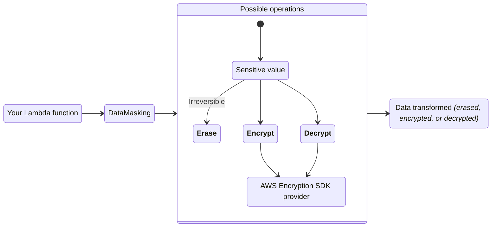
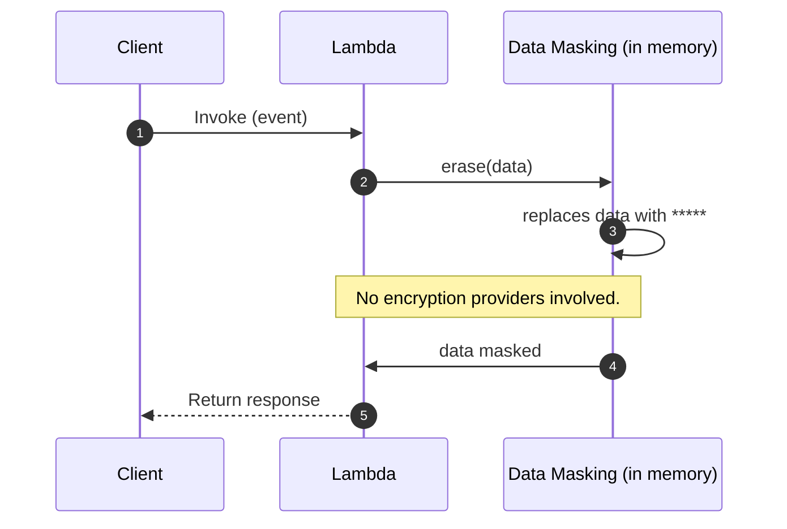
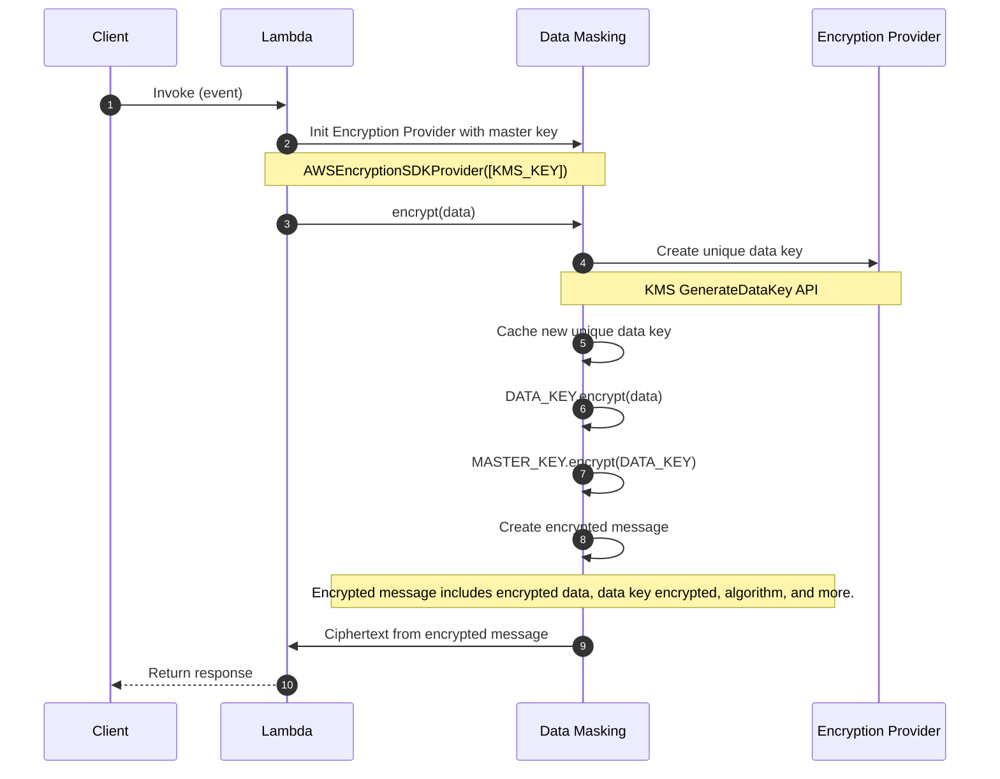
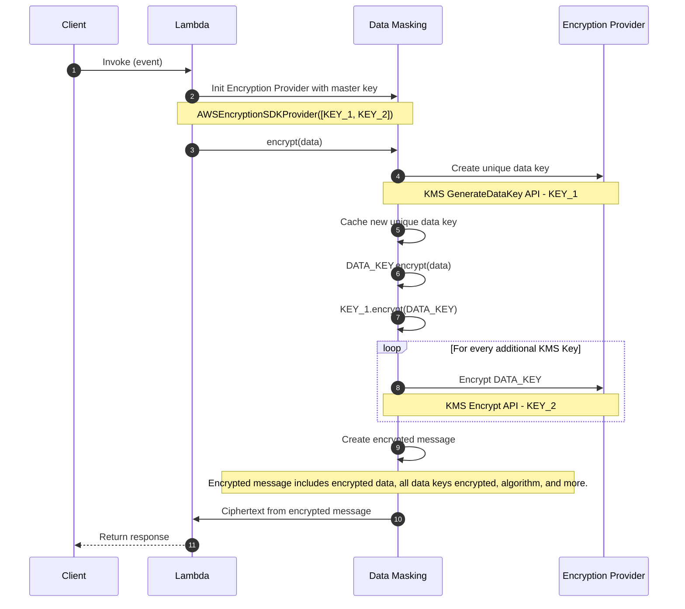
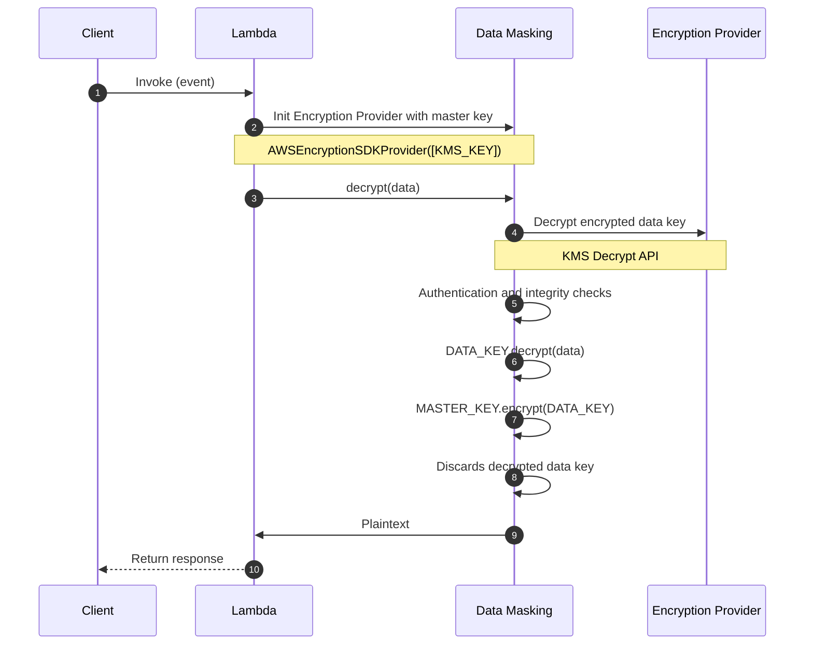
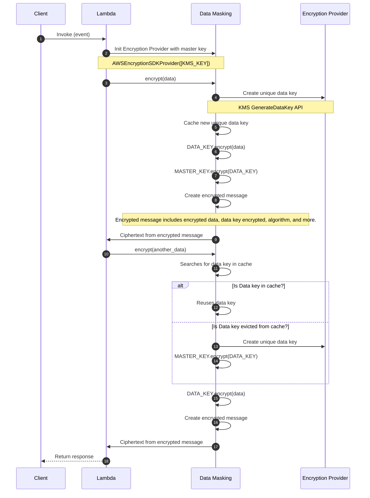

<!-- Generated by scripts/build_agent_skill_references.py from utilities/data_masking.md. Do not edit by hand. -->
# Data Masking

Source of truth: https://docs.powertools.aws.dev/lambda/python/latest/utilities/data_masking/

The data masking utility can encrypt, decrypt, or irreversibly erase sensitive information to protect data confidentiality.



## Key features

* Encrypt, decrypt, or irreversibly erase data with ease
* Erase sensitive information in one or more fields within nested data
* Seamless integration with [AWS Encryption SDK](https://docs.aws.amazon.com/encryption-sdk/latest/developer-guide/introduction.html) for industry and AWS security best practices

## Terminology

**Erasing** replaces sensitive information **irreversibly** with a non-sensitive placeholder _(`*****`)_, or with a customized mask. This operation replaces data in-memory, making it a one-way action.

**Encrypting** transforms plaintext into ciphertext using an encryption algorithm and a cryptographic key. It allows you to encrypt any sensitive data, so only allowed personnel to decrypt it. Learn more about encryption [here](https://aws.amazon.com/blogs/security/importance-of-encryption-and-how-aws-can-help/).

**Decrypting** transforms ciphertext back into plaintext using a decryption algorithm and the correct decryption key.

**Encryption context** is a non-secret `key=value` data used for authentication like `tenant_id:<id>`. This adds extra security and confirms encrypted data relationship with a context.

**[Encrypted message](https://docs.aws.amazon.com/encryption-sdk/latest/developer-guide/message-format.html)** is a portable data structure that includes encrypted data along with copies of the encrypted data key. It includes everything Encryption SDK needs to validate authenticity, integrity, and to decrypt with the right master key.

**[Envelope encryption](https://docs.aws.amazon.com/encryption-sdk/latest/developer-guide/concepts.html#envelope-encryption)** uses two different keys to encrypt data safely: master and data key. The data key encrypts the plaintext, and the master key encrypts the data key. It simplifies key management _(you own the master key)_, isolates compromises to data key, and scales better with large data volumes.

<center>

<i>Envelope encryption visualized.</i>
</center>

## Getting started

> **Tip**

All examples shared in this documentation are available within the [project repository](https://github.com/aws-powertools/powertools-lambda-python/tree/develop/examples).

### Install

Add `aws-lambda-powertools[datamasking]` as a dependency in your preferred tool: _e.g._, _requirements.txt_, _pyproject.toml_. This will install the [AWS Encryption SDK](https://docs.aws.amazon.com/encryption-sdk/latest/developer-guide/introduction.html).

AWS Encryption SDK contains non-Python dependencies. This means you should use [AWS SAM CLI](https://docs.aws.amazon.com/serverless-application-model/latest/developerguide/using-sam-cli-build.html#using-sam-cli-build-options-container) or [official build container images](https://gallery.ecr.aws/search?searchTerm=sam%2Fbuild-python&popularRegistries=amazon) when building your application for AWS Lambda. Local development should work as expected.

### Required resources

> **Info: By default, we use Amazon Key Management Service (KMS) for encryption and decryption operations.**

Before you start, you will need a KMS symmetric key to encrypt and decrypt your data. Your Lambda function will need read and write access to it.

**NOTE**. We recommend setting a minimum of 1024MB of memory _(CPU intensive)_, and separate Lambda functions for encrypt and decrypt. For more information, you can see the full reports of our [load tests](https://github.com/aws-powertools/powertools-lambda-python/pull/2197#issuecomment-1730571597) and [traces](https://github.com/aws-powertools/powertools-lambda-python/pull/2197#issuecomment-1732060923).

**AWS Serverless Application Model (SAM) example**

```yaml
AWSTemplateFormatVersion: "2010-09-09"
Transform: AWS::Serverless-2016-10-31
Description: >
  Powertools for AWS Lambda (Python) data masking example

Globals: # https://docs.aws.amazon.com/serverless-application-model/latest/developerguide/sam-specification-template-anatomy-globals.html
  Function:
    Timeout: 5
    Runtime: python3.11
    Tracing: Active
    Environment:
      Variables:
        POWERTOOLS_SERVICE_NAME: PowertoolsHelloWorld
        POWERTOOLS_LOG_LEVEL: INFO
        KMS_KEY_ARN: !GetAtt DataMaskingMasterKey.Arn

# In production, we recommend you split up the encrypt and decrypt for fine-grained security.
# For example, one function can act as the encryption proxy via HTTP requests, data pipeline, etc.,
# while only authorized personnel can call decrypt via a separate function.
Resources:
  DataMaskingEncryptFunctionExample:
    Type: AWS::Serverless::Function
    Properties:
      Handler: data_masking_function_example.lambda_handler
      CodeUri: ../src
      Description: Data Masking encryption function
      # Cryptographic operations demand more CPU. CPU is proportionally allocated based on memory size.
      # We recommend allocating a minimum of 1024MB of memory.
      MemorySize: 1024

  # DataMaskingDecryptFunctionExample:
  #   Type: AWS::Serverless::Function
  #   Properties:
  #     Handler: data_masking_function_decrypt.lambda_handler
  #     CodeUri: ../src
  #     Description: Data Masking decryption function
  #     MemorySize: 1024

  # KMS Key
  DataMaskingMasterKey:
    Type: "AWS::KMS::Key"
    Properties:
      Description: KMS Key for encryption and decryption using Powertools for AWS Lambda Data masking feature
      # KMS Key support both IAM Resource Policies and Key Policies
      # For more details: https://docs.aws.amazon.com/kms/latest/developerguide/key-policies.html
      KeyPolicy:
        Version: "2012-10-17"
        Id: data-masking-enc-dec
        Statement:
          # For security reasons, ensure your KMS Key has at least one administrator.
          # In this example, the root account is granted administrator permissions.
          # However, we recommended configuring specific IAM Roles for enhanced security in production.
          - Effect: Allow
            Principal:
              AWS: !Sub "arn:aws:iam::${AWS::AccountId}:root" # (1)!
            Action: "kms:*"
            Resource: "*"
          # We must grant Lambda's IAM Role access to the KMS Key
          - Effect: Allow
            Principal:
              AWS: !GetAtt DataMaskingEncryptFunctionExampleRole.Arn # (2)!
            Action:
              - kms:Decrypt # to decrypt encrypted data key
              - kms:GenerateDataKey # to create an unique and random data key for encryption
              # Encrypt permission is required only when using multiple keys
              - kms:Encrypt  # (3)!
            Resource: "*"
```

1. [Key policy examples using IAM Roles](https://docs.aws.amazon.com/kms/latest/developerguide/key-policy-default.html#key-policy-default-allow-administrators)
2. [SAM generated CloudFormation Resources](https://docs.aws.amazon.com/serverless-application-model/latest/developerguide/sam-specification-generated-resources-function.html#sam-specification-generated-resources-function-not-role)
3. Required only when using [multiple keys](#using-multiple-keys)

### Erasing data

Erasing will remove the original data and replace it with a `*****`. This means you cannot recover erased data, and the data type will change to `str` for all data unless the data to be erased is of an Iterable type (`list`, `tuple`, `set`), in which case the method will return a new object of the same type as the input data but with each element replaced by the string `*****`.

**getting_started_erase_data.py**

```python
from __future__ import annotations

from aws_lambda_powertools import Logger
from aws_lambda_powertools.utilities.data_masking import DataMasking
from aws_lambda_powertools.utilities.typing import LambdaContext

logger = Logger()
data_masker = DataMasking()

@logger.inject_lambda_context
def lambda_handler(event: dict, context: LambdaContext) -> dict:
    data: dict = event.get("body", {})

    logger.info("Erasing fields email, address.street, and company_address")

    erased = data_masker.erase(data, fields=["email", "address.street", "company_address"])  # (1)!

    return erased
```

1. See [choosing parts of your data](#choosing-parts-of-your-data) to learn more about the `fields` parameter. </br></br>If we omit `fields` parameter, the entire dictionary will be erased with `*****`.

**generic_data_input.json**

```json
{
    "body":
    {
        "id": 1,
        "name": "John Doe",
        "age": 30,
        "email": "johndoe@example.com",
        "address": {
            "street": "123 Main St",
            "city": "Anytown",
            "state": "CA",
            "zip": "12345"
        },
        "company_address": {
            "street": "456 ACME Ave",
            "city": "Anytown",
            "state": "CA",
            "zip": "12345"
        }
    }
}
```

**getting_started_erase_data_output.json**

```json
{
    "id": 1,
    "name": "John Doe",
    "age": 30,
    "email": "*****",
    "address": {
        "street": "*****",
        "city": "Anytown",
        "state": "CA",
        "zip": "12345"
    },
    "company_address": "*****"
}
```

#### Custom masking

The `erase` method also supports additional flags for more advanced and flexible masking:

**dynamic_mask**

(bool) Enables dynamic masking behavior when set to `True`, by maintaining the original length and structure of the text replacing with *.

> Expression: `data_masker.erase(data, fields=["address.zip"], dynamic_mask=True)`

> Field result: `'street': '*** **** **'`

**custom_mask**

(str) Specifies a simple pattern for masking data. This pattern is applied directly to the input string, replacing all the original characters. For example, with a `custom_mask` of "XX-XX" applied to "12345", the result would be "XX-XX".

> Expression: `data_masker.erase(data, fields=["address.zip"], custom_mask="XX")`

> Field result: `'zip': 'XX'`

**regex_pattern & mask_format**

(str) `regex_pattern` defines a regular expression pattern used to identify parts of the input string that should be masked. This allows for more complex and flexible masking rules. It's used in conjunction with `mask_format`.
`mask_format` specifies the format to use when replacing parts of the string matched by `regex_pattern`. It can include placeholders (like \1, \2) to refer to captured groups in the regex pattern, allowing some parts of the original string to be preserved.

> Expression: `data_masker.erase(data, fields=["email"], regex_pattern=r"(.)(.*)(@.*)", mask_format=r"\1****\3")`

> Field result: `'email': 'j****@example.com'`

> **Warning: Regular expressions and untrusted input**

Patterns run with Python's `re`, which has no protection against catastrophic backtracking. Keep `regex_pattern` under your control and avoid nested quantifiers such as `(a+)+` when the value comes from outside your function.

**masking_rules**

(dict) Allows you to apply different masking rules (flags) for each data field. Rules take the same options as the parameters above and accept a JSON string as input, like `fields` does.
A rule pointing at a dictionary or a list is applied to every value underneath it, keeping the structure.

`masking_rules` and `fields` cannot be combined in the same call: pass one or the other, or `erase` raises `DataMaskingError`.
```python
from __future__ import annotations

from aws_lambda_powertools.utilities.data_masking import DataMasking
from aws_lambda_powertools.utilities.typing import LambdaContext

data_masker = DataMasking()

def lambda_handler(event: dict, context: LambdaContext) -> dict:
    data: dict = event.get("body", {})

    # Masking rules for each field
    masking_rules = {
        "email": {"regex_pattern": "(.)(.*)(@.*)", "mask_format": r"\1****\3"},
        "age": {"dynamic_mask": True},
        "address.zip": {"custom_mask": "xxx"},
        "$.other_address[?(@.postcode > 12000)]": {"custom_mask": "Masked"},
    }

    result = data_masker.erase(data, masking_rules=masking_rules)

    return result
```
**Input example**

```json
{
    "body": {
        "id": 1,
        "name": "Jane Doe",
        "age": 30,
        "email": "janedoe@example.com",
        "address": {
            "street": "123 Main St",
            "city": "Anytown",
            "state": "CA",
            "zip": "12345",
            "postcode": 12345,
            "product": {
                "name": "Car"
            }
        },
        "other_address": [
            {
                "postcode": 11345,
                "street": "123 Any Drive"
            },
            {
                "postcode": 67890,
                "street": "100 Main Street,"
            }
        ],
        "company_address": {
            "street": "456 ACME Ave",
            "city": "Anytown",
            "state": "CA",
            "zip": "12345"
        }
    }
}
```
**Masking rules output example**

```json
{
    "id": 1,
    "name": "John Doe",
    "age": "**",
    "email": "j****@example.com",
    "address": {
        "street": "123 Main St",
        "city": "Anytown",
        "state": "CA",
        "zip": "xxx",
        "postcode": 12345,
        "product": {
            "name": "Car"
        }
    },
    "other_address": [
        {
            "postcode": 11345,
            "street": "123 Any Drive"
        },
        "Masked"
    ],
    "company_address": {
        "street": "456 ACME Ave",
        "city": "Anytown",
        "state": "CA",
        "zip": "12345"
    }
}
```

### Encrypting data

> **Note: About static typing and encryption**

Encrypting data may lead to a different data type, as it always transforms into a string _(`<ciphertext>`)_.

To encrypt, you will need an [encryption provider](#providers). Here, we will use `AWSEncryptionSDKProvider`.

Under the hood, we delegate a [number of operations](#encrypt-operation-with-encryption-sdk-kms) to AWS Encryption SDK to authenticate, create a portable encryption message, and actual data encryption.

**getting_started_encrypt_data.py**

```python
from __future__ import annotations

import os

from aws_lambda_powertools import Logger
from aws_lambda_powertools.utilities.data_masking import DataMasking
from aws_lambda_powertools.utilities.data_masking.provider.kms.aws_encryption_sdk import (
    AWSEncryptionSDKProvider,
)
from aws_lambda_powertools.utilities.typing import LambdaContext

KMS_KEY_ARN = os.getenv("KMS_KEY_ARN", "")

encryption_provider = AWSEncryptionSDKProvider(keys=[KMS_KEY_ARN])  # (1)!
data_masker = DataMasking(provider=encryption_provider)

logger = Logger()

@logger.inject_lambda_context
def lambda_handler(event: dict, context: LambdaContext) -> dict:
    data: dict = event.get("body", {})

    logger.info("Encrypting the whole object")

    encrypted = data_masker.encrypt(data)

    return {"body": encrypted}
```

1. You can use more than one KMS Key for higher availability but increased latency. </br></br>Encryption SDK will ensure the data key is encrypted with both keys.

**generic_data_input.json**

```json
{
    "body":
    {
        "id": 1,
        "name": "John Doe",
        "age": 30,
        "email": "johndoe@example.com",
        "address": {
            "street": "123 Main St",
            "city": "Anytown",
            "state": "CA",
            "zip": "12345"
        },
        "company_address": {
            "street": "456 ACME Ave",
            "city": "Anytown",
            "state": "CA",
            "zip": "12345"
        }
    }
}
```

**encrypt_data_output.json**

```json
{
    "body": "AgV4uF5K2YMtNhYrtviTwKNrUHhqQr73l/jNfukkh+qLOC8AXwABABVhd3MtY3J5cHRvLXB1YmxpYy1rZXkAREEvcjEyaFZHY1R5cjJuTDNKbTJ3UFA3R3ZjaytIdi9hekZqbXVUb25Ya3J5SzFBOUlJZDZxZXpSR1NTVnZDUUxoZz09AAEAB2F3cy1rbXMAS2Fybjphd3M6a21zOnVzLWVhc3QtMToyMDA5ODQxMTIzODY6a2V5LzZkODJiMzRlLTM2NjAtNDRlMi04YWJiLTdmMzA1OGJlYTIxMgC4AQIBAHjxYXAO7wQGd+7qxoyvXAajwqboF5FL/9lgYUNJTB8VtAHBP2hwVgw+zypp7GoMNTPAAAAAfjB8BgkqhkiG9w0BBwagbzBtAgEAMGgGCSqGSIb3DQEHATAeBglghkgBZQMEAS4wEQQMx/B25MTgWwpL7CmuAgEQgDtan3orAOKFUfyNm3v6rFcglb+BVVVDV71fj4aRljhpg1ixsYFaKsoej8NcwRktIiWE+mw9XmTEVb6xFQIAABAA9DeLzlRaRQgTcXMJG0iBu/YTyyDKiROD+bU1Y09X9RBz5LA1nWIENJKq2seAhNSB/////wAAAAEAAAAAAAAAAAAAAAEAAAEBExLJ9wI4n7t+wyPEEP4kjYFBdkmNuLLsVC2Yt8mv9Y1iH2G+/g9SaIcdK57pkoW0ECpBxZVOxCuhmK2s74AJCUdem9McjS1waUKyzYTi9vv2ySNBsABIDwT990rE7jZJ3tEZAqcWZg/eWlxvnksFR/akBWZKsKzFz6lF57+cTgdISCEJRV0E7fcUeCuaMaQGK1Qw2OCmIeHEG5j5iztBkZG2IB2CVND/AbxmDUFHwgjsrJPTzaDYSufcGMoZW1A9X1sLVfqNVKvnOFP5tNY7kPF5eAI9FhGBw8SjTqODXz4k6zuqzy9no8HtXowP265U8NZ5VbVTd/zuVEbZyK5KBqzP1sExW4RhnlpXMoOs9WSuAGcwZQIxANTeEwb9V7CacV2Urt/oCqysUzhoV2AcT2ZjryFqY79Tsg+FRpIx7cBizL4ieRzbhQIwcRasNncO5OZOcmVr0MqHv+gCVznndMgjXJmWwUa7h6skJKmhhMPlN0CsugxtVWnD"
}
```

### Decrypting data

> **Note: About static typing and decryption**

Decrypting data may lead to a different data type, as encrypted data is always a string _(`<ciphertext>`)_.

To decrypt, you will need an [encryption provider](#providers). Here, we will use `AWSEncryptionSDKProvider`.

Under the hood, we delegate a [number of operations](#decrypt-operation-with-encryption-sdk-kms) to AWS Encryption SDK to verify authentication, integrity, and actual ciphertext decryption.

**getting_started_decrypt_data.py**

**NOTE**. Decryption only works with KMS Key ARN.

```python
from __future__ import annotations

import os

from aws_lambda_powertools import Logger
from aws_lambda_powertools.utilities.data_masking import DataMasking
from aws_lambda_powertools.utilities.data_masking.provider.kms.aws_encryption_sdk import AWSEncryptionSDKProvider
from aws_lambda_powertools.utilities.typing import LambdaContext

KMS_KEY_ARN = os.getenv("KMS_KEY_ARN", "")  # (1)!

encryption_provider = AWSEncryptionSDKProvider(keys=[KMS_KEY_ARN])  # (2)!
data_masker = DataMasking(provider=encryption_provider)

logger = Logger()

@logger.inject_lambda_context
def lambda_handler(event: dict, context: LambdaContext) -> dict:
    data: dict = event.get("body", {})

    logger.info("Decrypting whole object")

    decrypted = data_masker.decrypt(data)

    return decrypted
```

1. Note that KMS key alias or key ID won't work.
2. You can use more than one KMS Key for higher availability but increased latency. </br></br>Encryption SDK will call `Decrypt` API with all master keys when trying to decrypt the data key.

**getting_started_decrypt_data_input.json**

```json
{
    "body": "AgV4uF5K2YMtNhYrtviTwKNrUHhqQr73l/jNfukkh+qLOC8AXwABABVhd3MtY3J5cHRvLXB1YmxpYy1rZXkAREEvcjEyaFZHY1R5cjJuTDNKbTJ3UFA3R3ZjaytIdi9hekZqbXVUb25Ya3J5SzFBOUlJZDZxZXpSR1NTVnZDUUxoZz09AAEAB2F3cy1rbXMAS2Fybjphd3M6a21zOnVzLWVhc3QtMToyMDA5ODQxMTIzODY6a2V5LzZkODJiMzRlLTM2NjAtNDRlMi04YWJiLTdmMzA1OGJlYTIxMgC4AQIBAHjxYXAO7wQGd+7qxoyvXAajwqboF5FL/9lgYUNJTB8VtAHBP2hwVgw+zypp7GoMNTPAAAAAfjB8BgkqhkiG9w0BBwagbzBtAgEAMGgGCSqGSIb3DQEHATAeBglghkgBZQMEAS4wEQQMx/B25MTgWwpL7CmuAgEQgDtan3orAOKFUfyNm3v6rFcglb+BVVVDV71fj4aRljhpg1ixsYFaKsoej8NcwRktIiWE+mw9XmTEVb6xFQIAABAA9DeLzlRaRQgTcXMJG0iBu/YTyyDKiROD+bU1Y09X9RBz5LA1nWIENJKq2seAhNSB/////wAAAAEAAAAAAAAAAAAAAAEAAAEBExLJ9wI4n7t+wyPEEP4kjYFBdkmNuLLsVC2Yt8mv9Y1iH2G+/g9SaIcdK57pkoW0ECpBxZVOxCuhmK2s74AJCUdem9McjS1waUKyzYTi9vv2ySNBsABIDwT990rE7jZJ3tEZAqcWZg/eWlxvnksFR/akBWZKsKzFz6lF57+cTgdISCEJRV0E7fcUeCuaMaQGK1Qw2OCmIeHEG5j5iztBkZG2IB2CVND/AbxmDUFHwgjsrJPTzaDYSufcGMoZW1A9X1sLVfqNVKvnOFP5tNY7kPF5eAI9FhGBw8SjTqODXz4k6zuqzy9no8HtXowP265U8NZ5VbVTd/zuVEbZyK5KBqzP1sExW4RhnlpXMoOs9WSuAGcwZQIxANTeEwb9V7CacV2Urt/oCqysUzhoV2AcT2ZjryFqY79Tsg+FRpIx7cBizL4ieRzbhQIwcRasNncO5OZOcmVr0MqHv+gCVznndMgjXJmWwUa7h6skJKmhhMPlN0CsugxtVWnD"
}
```

**getting_started_decrypt_data_output.json**

```json
{
    "id": 1,
    "name": "John Doe",
    "age": 30,
    "email": "johndoe@example.com",
    "address": {
        "street": "123 Main St",
        "city": "Anytown",
        "state": "CA",
        "zip": "12345"
    },
    "company_address": {
        "street": "456 ACME Ave",
        "city": "Anytown",
        "state": "CA",
        "zip": "12345"
    }
}
```

### Encryption context for integrity and authenticity

For a stronger security posture, you can add metadata to each encryption operation, and verify them during decryption. This is known as additional authenticated data (AAD). These are non-sensitive data that can help protect authenticity and integrity of your encrypted data, and even help to prevent a [confused deputy](https://docs.aws.amazon.com/IAM/latest/UserGuide/confused-deputy.html) situation.

> **Danger: Important considerations you should know**

1. **Exact match verification on decrypt**. Be careful using random data like `timestamps` as encryption context if you can't provide them on decrypt.
2. **Only `string` values are supported**. We will raise `DataMaskingUnsupportedTypeError` for non-string values.
3. **Use non-sensitive data only**. When using KMS, encryption context is available as plaintext in AWS CloudTrail, unless you [intentionally disabled KMS events](https://docs.aws.amazon.com/kms/latest/developerguide/logging-using-cloudtrail.html#filtering-kms-events).

**getting_started_encryption_context.py**

```python
from __future__ import annotations

import os

from aws_lambda_powertools import Logger
from aws_lambda_powertools.utilities.data_masking import DataMasking
from aws_lambda_powertools.utilities.data_masking.provider.kms.aws_encryption_sdk import AWSEncryptionSDKProvider
from aws_lambda_powertools.utilities.typing import LambdaContext

KMS_KEY_ARN = os.getenv("KMS_KEY_ARN", "")

encryption_provider = AWSEncryptionSDKProvider(keys=[KMS_KEY_ARN])
data_masker = DataMasking(provider=encryption_provider)

logger = Logger()

@logger.inject_lambda_context
def lambda_handler(event: dict, context: LambdaContext) -> str:
    data = event.get("body", {})

    logger.info("Encrypting whole object")

    encrypted: str = data_masker.encrypt(
        data,
        data_classification="confidential",  # (1)!
        data_type="customer-data",
        tenant_id="a06bf973-0734-4b53-9072-39d7ac5b2cba",
    )

    return encrypted
```

1. They must match on `decrypt()` otherwise the operation will fail with `DataMaskingContextMismatchError`.

**getting_started_decryption_context.py**

```python
from __future__ import annotations

import os

from aws_lambda_powertools import Logger
from aws_lambda_powertools.utilities.data_masking import DataMasking
from aws_lambda_powertools.utilities.data_masking.provider.kms.aws_encryption_sdk import AWSEncryptionSDKProvider
from aws_lambda_powertools.utilities.typing import LambdaContext

KMS_KEY_ARN = os.getenv("KMS_KEY_ARN", "")

encryption_provider = AWSEncryptionSDKProvider(keys=[KMS_KEY_ARN])
data_masker = DataMasking(provider=encryption_provider)

logger = Logger()

@logger.inject_lambda_context
def lambda_handler(event: dict, context: LambdaContext) -> dict:
    data = event.get("body", {})

    logger.info("Decrypting whole object")

    decrypted: dict = data_masker.decrypt(
        data,
        data_classification="confidential",  # (1)!
        data_type="customer-data",
        tenant_id="a06bf973-0734-4b53-9072-39d7ac5b2cba",
    )

    return decrypted
```

1. They must match otherwise the operation will fail with `DataMaskingContextMismatchError`.

### Choosing parts of your data

> **Note: Current limitations**

1. The `fields` parameter is not yet supported in `encrypt` and `decrypt` operations.
2. We support `JSON` data types only - see [data serialization for more details](#data-serialization).
3. `raise_on_missing_field` checks whether an expression matched anything. With a list expression such as `records[*].card_number`, one record without the field does not raise as long as another record has it.

You can use the `fields` parameter with the dot notation `.` to choose one or more parts of your data to `erase`. This is useful when you want to keep data structure intact except the confidential fields.

When `fields` is present, `erase` behaves differently:

| Operation | Behavior                                                    | Example                 | Result                      |
| --------- | ----------------------------------------------------------- | ----------------------- | ------------------------------- |
| `erase`    | Replace data while keeping collections type intact.         | `{"cards": ["a", "b"]}` | `{"cards": ["*****", "*****"]}` |

Here are common scenarios to best visualize how to use `fields`.

**Top keys only**

You want to erase data in the `card_number` field.

**Data**

> Expression: `data_masker.erase(data, fields=["card_number"])`

```json
{
    "name": "Carlos",
    "operation": "non sensitive",
    "card_number": "1111 2222 3333 4444"
}
```

**Result**

```json
{
    "name": "Carlos",
    "operation": "non sensitive",
    "card_number": "*****"
}
```

**Nested key**

You want to erase data in the `postcode` field.

**Data**

> Expression: `data_masker.erase(data, fields=["address.postcode"])`

```json
{
    "name": "Carlos",
    "operation": "non sensitive",
    "card_number": "1111 2222 3333 4444",
    "address": {
        "postcode": 12345
    }
}
```

**Result**

```json
{
    "name": "Carlos",
    "operation": "non sensitive",
    "card_number": "1111 2222 3333 4444",
    "address": {
        "postcode": "*****"
    }
}
```

**Multiple keys**

You want to erase data in both `postcode` and `street` fields.

**Data**

> Expression: `data_masker.erase(data, fields=["address.postcode", "address.street"])`

```json
{
    "name": "Carlos",
    "operation": "non sensitive",
    "card_number": "1111 2222 3333 4444",
    "address": {
        "postcode": 12345,
        "street": "123 Any Street"
    }
}
```

**Result**

```json
{
    "name": "Carlos",
    "operation": "non sensitive",
    "card_number": "1111 2222 3333 4444",
    "address": {
        "postcode": "*****",
        "street": "*****"
    }
}
```

**All key items**

You want to erase data under `address` field.

**Data**

> Expression: `data_masker.erase(data, fields=["address"])`

```json
{
    "name": "Carlos",
    "operation": "non sensitive",
    "card_number": "1111 2222 3333 4444",
    "address": [
        {
            "postcode": 12345,
            "street": "123 Any Street",
            "country": "United States",
            "timezone": "America/La_Paz"
        },
        {
            "postcode": 67890,
            "street": "100 Main Street",
            "country": "United States",
            "timezone": "America/Mazatlan"
        }
    ]
}
```

**Result**

```json
{
    "name": "Carlos",
    "operation": "non sensitive",
    "card_number": "1111 2222 3333 4444",
    "address": [
        "*****",
        "*****"
    ]
}
```

**Complex nested key**

You want to erase data under `name` field.

**Data**

> Expression: `data_masker.erase(data, fields=["category..name"])`

```json
{
    "category": {
        "subcategory": {
            "brand" : {
                "product": {
                    "name": "Car"
                }
            }
        }
    }
}
```

**Result**

```json
{
    "category": {
        "subcategory": {
            "brand" : {
                "product": {
                    "name": "*****"
                }
            }
        }
    }
}
```

**All fields in a list**

You want to erase data under `street` field located at the any index of the address list.

**Data**

> Expression: `data_masker.erase(data, fields=["address[*].street"])`

```json
{
    "name": "Carlos",
    "operation": "non sensitive",
    "card_number": "1111 2222 3333 4444",
    "address": [
        {
            "postcode": 12345,
            "street": "123 Any Drive"
        },
        {
            "postcode": 67890,
            "street": "100 Main Street,"
        }
    ]
}
```

**Result**

```json

{
    "name": "Carlos",
    "operation": "non sensitive",
    "card_number": "1111 2222 3333 4444",
    "address": [
        {
            "postcode": 12345,
            "street": "*****"
        },
        {
            "postcode": 67890,
            "street": "*****"
        }
    ]
}
```

**Slicing a list**

You want to erase data by slicing a list.

**Data**

> Expression: `data_masker.erase(data, fields=["address[-1].street"])`

```json
{
    "name": "Carlos",
    "operation": "non sensitive",
    "card_number": "1111 2222 3333 4444",
    "address": [
        {
            "postcode": 12345,
            "street": "123 Any Street"
        },
        {
            "postcode": 67890,
            "street": "100 Main Street"
        },
        {
            "postcode": 78495,
            "street": "111 Any Drive"
        }
    ]
}
```

**Result**

```json
{
    "name": "Carlos",
    "operation": "non sensitive",
    "card_number": "1111 2222 3333 4444",
    "address": [
        {
            "postcode": 12345,
            "street": "123 Any Street"
        },
        {
            "postcode": 67890,
            "street": "100 Main Street"
        },
        {
            "postcode": 11111,
            "street": "*****"
        }
    ]
}
```

**Complex expressions**

You want to erase data by finding for a field with conditional expression.

**Data**

> Expression: `data_masker.erase(data, fields=["$.address[?(@.postcode > 12000)]"])`

> `$`: Represents the root of the JSON structure.

> `.address`: Selects the "address" property within the JSON structure.

> `(@.postcode > 12000)`: Specifies the condition that elements should meet. It selects elements where the value of the `postcode` property is `greater than 12000`.

```json
{
    "name": "Carlos",
    "operation": "non sensitive",
    "card_number": "1111 2222 3333 4444",
    "address": [
        {
            "postcode": 12345,
            "street": "123 Any Drive"
        },
        {
            "postcode": 67890,
            "street": "111 Main Street"
        },
        {
            "postcode": 11111,
            "street": "100 Any Street"
        }
    ]
}
```

**Result**

```json
{
    "name": "Carlos",
    "operation": "non sensitive",
    "card_number": "1111 2222 3333 4444",
    "address": [
        {
            "postcode": 12345,
            "street": "*****"
        },
        {
            "postcode": 67890,
            "street": "*****"
        },
        {
            "postcode": 11111,
            "street": "100 Any Street"
        }
    ]
}
```

For comprehensive guidance on using JSONPath syntax, please refer to the official documentation available at [jsonpath-ng](https://github.com/h2non/jsonpath-ng#jsonpath-syntax)

#### JSON

We also support data in JSON string format as input. We automatically deserialize it, then handle each field operation as expected.

Note that the return will be a deserialized JSON and your desired fields updated.

**Data**

Expression: `data_masker.erase(data, fields=["card_number", "address.postcode"])`

```json
'{"name": "Carlos", "operation": "non sensitive", "card_number": "1111 2222 3333 4444", "address": {"postcode": 12345}}'
```

**Result**

```json
{
    "name": "Carlos",
    "operation": "non sensitive",
    "card_number": "*****",
    "address": {
        "postcode": "*****"
    }
}
```

## Advanced

### Data serialization

> **Tip: Extended input support**

We support `Pydantic models`, `Dataclasses`, and custom classes with `dict()`, `__dict__` or `__slots__` for input, including the same object referenced more than once in a payload.

These types are automatically converted into dictionaries before `masking` and `encrypting` operations.
Pydantic models are dumped in JSON mode, so `SecretStr` and `SecretBytes` fields keep Pydantic's masked rendering and types such as `UUID`, `datetime` and `Decimal` become strings.
Please note that we **don't convert back** to the original type, and the returned object will be a dictionary.

Before we traverse the data structure, we perform two important operations on input data:

1. If `JSON string`, **deserialize** using default or provided deserializer.
2. If `dictionary or complex types`, **normalize** into `JSON` to prevent traversing unsupported data types.

For compatibility or performance, you can optionally pass your own JSON serializer and deserializer to replace `json.dumps` and `json.loads` respectively:

**Working with custom types**

```python
from aws_lambda_powertools.utilities.data_masking import DataMasking

data_masker = DataMasking()

class User:
    def __init__(self, name, age):
        self.name = name
        self.age = age

    def dict(self):
        return {"name": self.name, "age": self.age}

def lambda_handler(event, context):
    user = User("powertools", 42)
    return data_masker.erase(user, fields=["age"])
```

**Working with Pydantic**

```python
from pydantic import BaseModel

from aws_lambda_powertools.utilities.data_masking import DataMasking

data_masker = DataMasking()

class User(BaseModel):
    name: str
    age: int

def lambda_handler(event, context):
    user = User(name="powertools", age=42)
    return data_masker.erase(user, fields=["age"])
```

**Working with dataclasses**

```python
from dataclasses import dataclass

from aws_lambda_powertools.utilities.data_masking import DataMasking

data_masker = DataMasking()

@dataclass
class User:
    name: str
    age: int

def lambda_handler(event, context):
    user = User(name="powertools", age=42)
    return data_masker.erase(user, fields=["age"])
```

**Working with serializer**

```python
from __future__ import annotations

import os

import ujson

from aws_lambda_powertools.utilities.data_masking import DataMasking
from aws_lambda_powertools.utilities.data_masking.provider.kms.aws_encryption_sdk import (
    AWSEncryptionSDKProvider,
)
from aws_lambda_powertools.utilities.typing import LambdaContext

KMS_KEY_ARN = os.getenv("KMS_KEY_ARN", "")

encryption_provider = AWSEncryptionSDKProvider(
    keys=[KMS_KEY_ARN],
    json_serializer=ujson.dumps,
    json_deserializer=ujson.loads,
)
data_masker = DataMasking(provider=encryption_provider)

def lambda_handler(event: dict, context: LambdaContext) -> str:
    data: dict = event.get("body", {})

    return data_masker.encrypt(data)
```

### Using multiple keys

You can use multiple KMS keys from more than one AWS account for higher availability, when instantiating `AWSEncryptionSDKProvider`.

```python title="using_multiple_keys.py"
from __future__ import annotations

import os

from aws_lambda_powertools import Logger
from aws_lambda_powertools.utilities.data_masking import DataMasking
from aws_lambda_powertools.utilities.data_masking.provider.kms.aws_encryption_sdk import (
    AWSEncryptionSDKProvider,
)
from aws_lambda_powertools.utilities.typing import LambdaContext

KMS_KEY_ARN_1 = os.getenv("KMS_KEY_ARN_1", "")
KMS_KEY_ARN_2 = os.getenv("KMS_KEY_ARN_2", "")

encryption_provider = AWSEncryptionSDKProvider(keys=[KMS_KEY_ARN_1, KMS_KEY_ARN_2])
data_masker = DataMasking(provider=encryption_provider)

logger = Logger()

@logger.inject_lambda_context
def lambda_handler(event: dict, context: LambdaContext) -> dict:
    data: dict = event.get("body", {})

    logger.info("Encrypting the whole object")

    encrypted = data_masker.encrypt(data)

    return {"body": encrypted}
```

### Providers

#### AWS Encryption SDK

You can modify the following values when initializing the `AWSEncryptionSDKProvider` to best accommodate your security and performance thresholds.

| Parameter                  | Default               | Description                                                                                   |
| -------------------------- | --------------------- | --------------------------------------------------------------------------------------------- |
| **local_cache_capacity**   | `100`                 | The maximum number of entries that can be retained in the local cryptographic materials cache |
| **max_cache_age_seconds**  | `300`                 | The maximum time (in seconds) that a cache entry may be kept in the cache                     |
| **max_messages_encrypted** | `4294967296`          | The maximum number of messages that may be encrypted under a cache entry                      |
| **max_bytes_encrypted**    | `9223372036854775807` | The maximum number of bytes that may be encrypted under a cache entry                         |

If required, you can customize the default values when initializing the `AWSEncryptionSDKProvider` class.

```python title="aws_encryption_provider_example.py"
from __future__ import annotations

import os

from aws_lambda_powertools import Logger
from aws_lambda_powertools.utilities.data_masking import DataMasking
from aws_lambda_powertools.utilities.data_masking.provider.kms.aws_encryption_sdk import (
    AWSEncryptionSDKProvider,
)
from aws_lambda_powertools.utilities.typing import LambdaContext

KMS_KEY_ARN = os.getenv("KMS_KEY_ARN", "")

encryption_provider = AWSEncryptionSDKProvider(
    keys=[KMS_KEY_ARN],
    local_cache_capacity=200,
    max_cache_age_seconds=400,
    max_messages_encrypted=200,
    max_bytes_encrypted=2000,
)

data_masker = DataMasking(provider=encryption_provider)

logger = Logger()

@logger.inject_lambda_context
def lambda_handler(event: dict, context: LambdaContext) -> dict:
    data: dict = event.get("body", {})

    logger.info("Encrypting the whole object")

    encrypted = data_masker.encrypt(data)

    return {"body": encrypted}
```

##### Passing additional SDK arguments

> **Note: See the [AWS Encryption SDK docs for more details](https://aws-encryption-sdk-python.readthedocs.io/en/latest/generated/aws_encryption_sdk.html#aws_encryption_sdk.EncryptionSDKClient.encrypt)**

As an escape hatch mechanism, you can pass additional arguments to the `AWSEncryptionSDKProvider` via the `provider_options` parameter.

For example, the AWS Encryption SDK defaults to using the `AES_256_GCM_HKDF_SHA512_COMMIT_KEY_ECDSA_P384` algorithm for encrypting your Data Key. If you want, you have the flexibility to customize and choose a different encryption algorithm.

```python title="changing_default_algorithm.py"
from __future__ import annotations

import os

from aws_encryption_sdk.identifiers import Algorithm

from aws_lambda_powertools import Logger
from aws_lambda_powertools.utilities.data_masking import DataMasking
from aws_lambda_powertools.utilities.data_masking.provider.kms.aws_encryption_sdk import AWSEncryptionSDKProvider
from aws_lambda_powertools.utilities.typing import LambdaContext

KMS_KEY_ARN = os.getenv("KMS_KEY_ARN", "")

encryption_provider = AWSEncryptionSDKProvider(keys=[KMS_KEY_ARN])
data_masker = DataMasking(provider=encryption_provider)

logger = Logger()

@logger.inject_lambda_context
def lambda_handler(event: dict, context: LambdaContext) -> str:
    data: dict = event.get("body", {})

    logger.info("Encrypting whole object with a different algorithm")

    provider_options = {"algorithm": Algorithm.AES_256_GCM_HKDF_SHA512_COMMIT_KEY}

    encrypted = data_masker.encrypt(
        data,
        provider_options=provider_options,
    )

    return encrypted
```

### Data masking request flow

The following sequence diagrams explain how `DataMasking` behaves under different scenarios.

#### Erase operation

Erasing operations occur in-memory and we cannot recover the original value.

<center>

<i>Simple masking operation</i>
</center>

#### Encrypt operation with Encryption SDK (KMS)

We call KMS to generate an unique data key that can be used for multiple `encrypt` operation in-memory. It improves performance, cost and prevent throttling.

To make this operation simpler to visualize, we keep caching details in a [separate sequence diagram](#caching-encrypt-operations-with-encryption-sdk). Caching is enabled by default.

<center>

<i>Encrypting operation using envelope encryption.</i>
</center>

#### Encrypt operation with multiple KMS Keys

When encrypting data with multiple KMS keys, the `aws_encryption_sdk` makes additional API calls to encrypt the data with each of the specified keys.

<center>

<i>Encrypting operation using envelope encryption.</i>
</center>

#### Decrypt operation with Encryption SDK (KMS)

We call KMS to decrypt the encrypted data key available in the encrypted message. If successful, we run authentication _(context)_ and integrity checks (_algorithm, data key length, etc_) to confirm its proceedings.

Lastly, we decrypt the original encrypted data, throw away the decrypted data key for security reasons, and return the original plaintext data.

<center>

<i>Decrypting operation using envelope encryption.</i>
</center>

#### Caching encrypt operations with Encryption SDK

Without caching, every `encrypt()` operation would generate a new data key. It significantly increases latency and cost for ephemeral and short running environments like Lambda.

With caching, we balance ephemeral Lambda environment performance characteristics with [adjustable thresholds](#aws-encryption-sdk) to meet your security needs.

> **Info: Data key recycling**

We request a new data key when a cached data key exceeds any of the following security thresholds:

1. **Max age in seconds**
2. **Max number of encrypted messages**
3. **Max bytes encrypted** across all operations

<center>

<i>Caching data keys during encrypt operation.</i>
</center>
