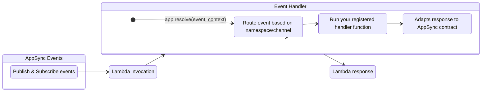
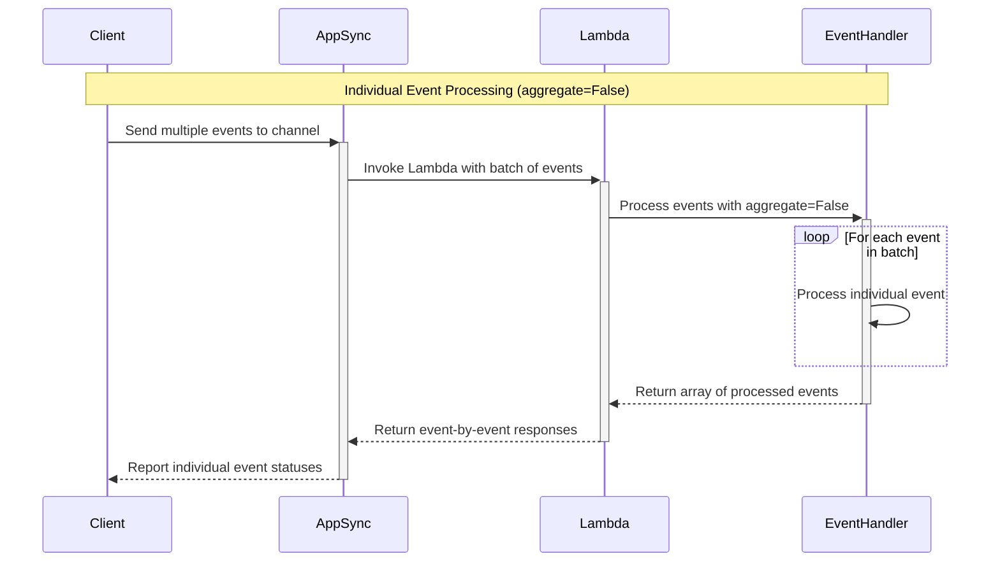
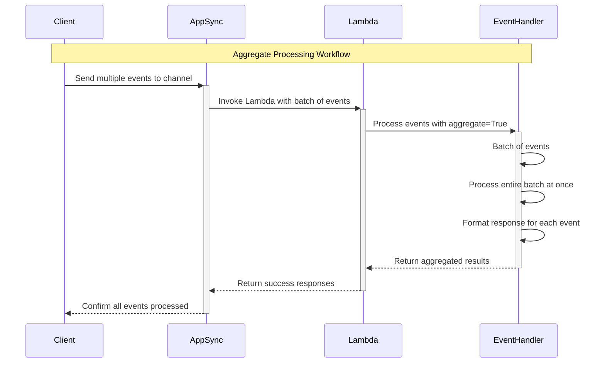
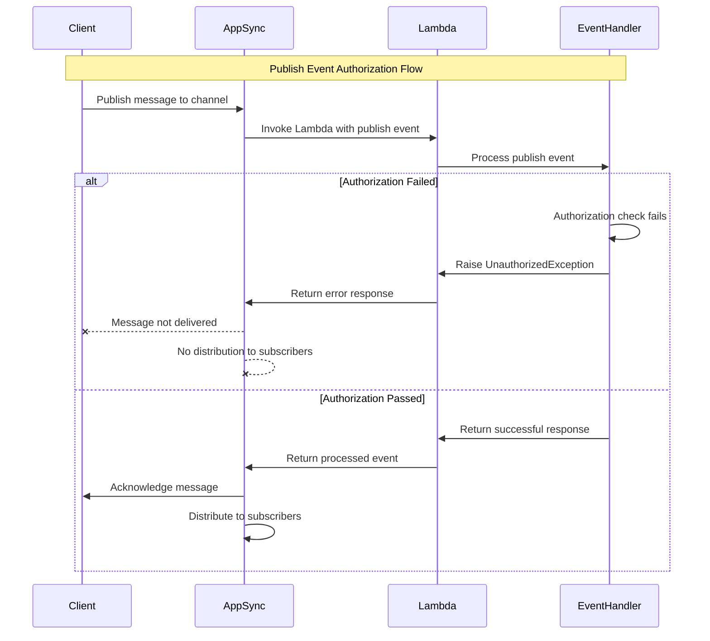
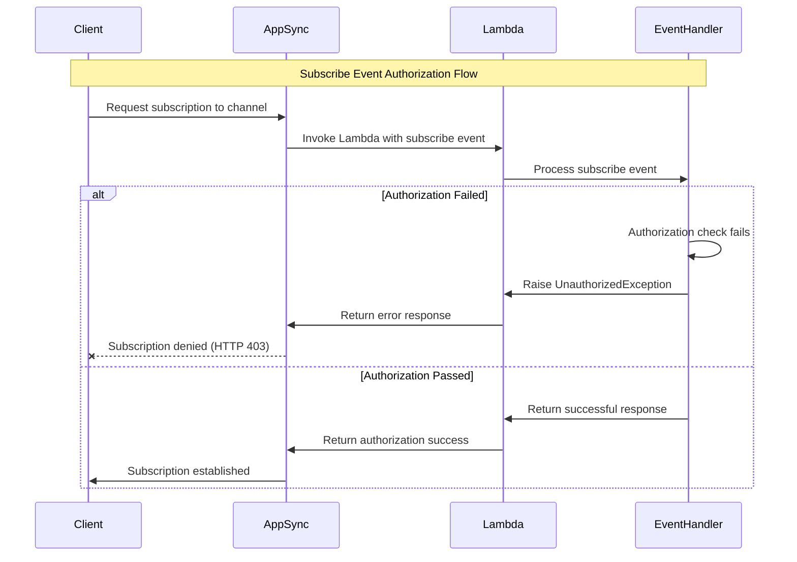

<!-- Generated by scripts/build_agent_skill_references.py from core/event_handler/appsync_events.md. Do not edit by hand. -->
# Event Handler Appsync Events

Source of truth: https://docs.powertools.aws.dev/lambda/python/latest/core/event_handler/appsync_events/

Event Handler for AWS AppSync real-time events.



## Key Features

* Easily handle publish and subscribe events with dedicated handler methods
* Automatic routing based on namespace and channel patterns
* Support for wildcard patterns to create catch-all handlers
* Support for async functions
* Aggregation for batch processing
* Graceful error handling for individual events

## Terminology

**[AWS AppSync Events](https://docs.aws.amazon.com/appsync/latest/eventapi/event-api-welcome.html)**. A service that enables you to quickly build secure, scalable real-time WebSocket APIs without managing infrastructure or writing API code.

It handles connection management, message broadcasting, authentication, and monitoring, reducing time to market and operational costs.

## Getting started

> **Tip: Tip: New to AppSync Real-time API?**

Visit [AWS AppSync Real-time documentation](https://docs.aws.amazon.com/appsync/latest/eventapi/event-api-getting-started.html) to understand how to set up subscriptions and pub/sub messaging.

### Required resources

You must have an existing AppSync Events API with real-time capabilities enabled and IAM permissions to invoke your Lambda function. That said, there are no additional permissions required to use Event Handler as routing requires no dependency (_standard library_).

**getting_started_with_appsync_events.yaml**

```yaml
AWSTemplateFormatVersion: '2010-09-09'
Transform: AWS::Serverless-2016-10-31

Metadata:
  cfn-lint:
    ignore_checks:
      - E3002

Globals:
  Function:
    Timeout: 5
    MemorySize: 256
    Runtime: python3.13
    Tracing: Active
    Environment:
      Variables:
        POWERTOOLS_LOG_LEVEL: INFO
        POWERTOOLS_SERVICE_NAME: hello

Resources:
  HelloWorldFunction:
    Type: AWS::Serverless::Function
    Properties:
      Handler: index.handler
      CodeUri: hello_world

  WebsocketAPI:
    Type: AWS::AppSync::Api
    Properties:
      EventConfig:
        AuthProviders:
          - AuthType: API_KEY
        ConnectionAuthModes:
          - AuthType: API_KEY
        DefaultPublishAuthModes:
          - AuthType: API_KEY
        DefaultSubscribeAuthModes:
          - AuthType: API_KEY
      Name: RealTimeEventAPI

  NameSpaceDataSource:
    Type: AWS::AppSync::DataSource
    Properties:
      ApiId: !GetAtt WebsocketAPI.ApiId
      LambdaConfig:
        LambdaFunctionArn: !GetAtt HelloWorldFunction.Arn
      Name: powertools_lambda
      ServiceRoleArn: !GetAtt DataSourceIAMRole.Arn
      Type: AWS_LAMBDA

  WebsocketApiKey:
    Type: AWS::AppSync::ApiKey
    Properties:
      ApiId: !GetAtt WebsocketAPI.ApiId

  WebsocketAPINamespace:
    Type: AWS::AppSync::ChannelNamespace
    Properties:
      ApiId: !GetAtt WebsocketAPI.ApiId
      Name: powertools
      HandlerConfigs:
        OnPublish:
          Behavior: DIRECT
          Integration:
            DataSourceName: powertools_lambda
            LambdaConfig:
              InvokeType: REQUEST_RESPONSE
        OnSubscribe:
          Behavior: DIRECT
          Integration:
            DataSourceName: powertools_lambda
            LambdaConfig:
              InvokeType: REQUEST_RESPONSE

  DataSourceIAMRole:
    Type: AWS::IAM::Role
    Properties:
      AssumeRolePolicyDocument:
        Version: '2012-10-17'
        Statement:
          - Effect: Allow
            Principal:
              Service: appsync.amazonaws.com
            Action: sts:AssumeRole
      Policies:
        - PolicyName: LambdaInvokePolicy
          PolicyDocument:
            Version: '2012-10-17'
            Statement:
              - Effect: Allow
                Action:
                  - lambda:InvokeFunction
                Resource: !GetAtt HelloWorldFunction.Arn
```

### AppSync request and response format

AppSync Events uses a specific event format for Lambda requests and responses. In most scenarios, Powertools for AWS simplifies this interaction by automatically formatting resolver returns to match the expected AppSync response structure.

**payload_request.json**

```json
{
   "identity":"None",
   "result":"None",
   "request":{
      "headers": {
      "x-forwarded-for": "1.1.1.1, 2.2.2.2",
      "user-agent": "Mozilla/5.0 (Macintosh; Intel Mac OS X 10_15_6) AppleWebKit/537.36 (KHTML, like Gecko) Chrome/85.0.4183.83 Safari/537.36",
   },
      "domainName":"None"
   },
   "info":{
      "channel":{
         "path":"/default/channel",
         "segments":[
            "default",
            "channel"
         ]
      },
      "channelNamespace":{
         "name":"default"
      },
      "operation":"PUBLISH"
   },
   "error":"None",
   "prev":"None",
   "stash":{

   },
   "outErrors":[

   ],
   "events":[
      {
         "payload":{
            "data":"data_1"
         },
         "id":"1"
      },
      {
         "payload":{
            "data":"data_2"
         },
         "id":"2"
      }
   ]
}
```

**payload_response.json**

```json
{
   "events":[
      {
         "payload":{
            "data":"data_1"
         },
         "id":"1"
      },
      {
         "payload":{
            "data":"data_2"
         },
         "id":"2"
      }
   ]
}
```

**payload_response_with_error.json**

```json
{
   "events":[
      {
         "error": "Error message",
         "id":"1"
      },
      {
         "payload":{
            "data":"data_2"
         },
         "id":"2"
      }
   ]
}
```

**payload_response_fail_request.json**

```json
{
  "error": "Exception - An exception occurred"
}
```

#### Events response with error

When processing events with Lambda, you can return errors to AppSync in three ways:

* **Item specific error:** Return an `error` key within each individual item's response. AppSync Events expects this format for item-specific errors.
* **Fail entire request:** Return a JSON object with a top-level `error` key. This signals a general failure, and AppSync treats the entire request as unsuccessful.
* **Unauthorized exception**: Raise the **UnauthorizedException** exception to reject a subscribe or publish request with HTTP 403.

### Resolver decorator

> **Important**

The event handler automatically parses the incoming event data and invokes the appropriate handler based on the namespace/channel pattern you register.

You can define your handlers for different event types using the `app.on_publish()`, `app.async_on_publish()`, and `app.on_subscribe()` methods.

By default, the resolver processes messages individually. For batch processing, see the [Aggregated Processing](#aggregated-processing) section.

**getting_started_with_publish_events.py**

```python
from __future__ import annotations

from typing import TYPE_CHECKING, Any

from aws_lambda_powertools.event_handler import AppSyncEventsResolver

if TYPE_CHECKING:
    from aws_lambda_powertools.utilities.typing import LambdaContext

app = AppSyncEventsResolver()

@app.on_publish("/default/channel")
def handle_channel1_publish(payload: dict[str, Any]):  # (1)!
    # Process the payload for this specific channel
    return {
        "processed": True,
        "original_payload": payload,
    }

def lambda_handler(event: dict, context: LambdaContext):
    return app.resolve(event, context)
```

1. The `payload` argument is mandatory and will be passed as a dictionary.

**getting_started_with_subscribe_events.py**

```python
from __future__ import annotations

from typing import TYPE_CHECKING

from aws_lambda_powertools import Metrics
from aws_lambda_powertools.event_handler import AppSyncEventsResolver
from aws_lambda_powertools.event_handler.events_appsync.exceptions import UnauthorizedException
from aws_lambda_powertools.metrics import MetricUnit

if TYPE_CHECKING:
    from aws_lambda_powertools.utilities.typing import LambdaContext

app = AppSyncEventsResolver()
metrics = Metrics(namespace="AppSyncEvents", service="GettingStartedWithSubscribeEvents")

@app.on_subscribe("/*")
def handle_all_subscriptions():
    path = app.current_event.info.channel_path

    # Perform access control checks
    if not is_authorized(path):
        raise UnauthorizedException("You are not authorized to subscribe to this channel")

    metrics.add_dimension(name="channel", value=path)
    metrics.add_metric(name="subscription", unit=MetricUnit.Count, value=1)

    return True

def is_authorized(path: str):
    # Your authorization logic here
    return path != "not_allowed_path_here"

@metrics.log_metrics(capture_cold_start_metric=True)
def lambda_handler(event: dict, context: LambdaContext):
    return app.resolve(event, context)
```

## Advanced

### Wildcard patterns and handler precedence

You can use wildcard patterns to create catch-all handlers for multiple channels or namespaces. This is particularly useful for centralizing logic that applies to multiple channels.

When an event matches with multiple handlers, the most specific pattern takes precedence.

> **Note: Supported wildcard patterns**

Only the following patterns are supported:

* `/namespace/*` - Matches all channels in the specified namespace
* `/*` - Matches all channels in all namespaces

Patterns like `/namespace/channel*` or `/namespace/*/subpath` are not supported.

More specific routes will always take precedence over less specific ones. For example, `/default/channel1` will take precedence over `/default/*`, which will take precedence over `/*`.

**working_with_wildcard_resolvers.py**

```python
from __future__ import annotations

from typing import TYPE_CHECKING, Any

from aws_lambda_powertools.event_handler import AppSyncEventsResolver

if TYPE_CHECKING:
    from aws_lambda_powertools.utilities.typing import LambdaContext

app = AppSyncEventsResolver()

@app.on_publish("/default/channel1")
def handle_specific_channel(payload: dict[str, Any]):
    # This handler will be called for events on /default/channel1
    return {"source": "specific_handler", "data": payload}

@app.on_publish("/default/*")
def handle_default_namespace(payload: dict[str, Any]):
    # This handler will be called for all channels in the default namespace
    # EXCEPT for /default/channel1 which has a more specific handler
    return {"source": "namespace_handler", "data": payload}

@app.on_publish("/*")
def handle_all_channels(payload: dict[str, Any]):
    # This handler will be called for all channels in all namespaces
    # EXCEPT for those that have more specific handlers
    return {"source": "catch_all_handler", "data": payload}

def lambda_handler(event: dict, context: LambdaContext):
    return app.resolve(event, context)
```

If the event doesn't match any registered handler, the Event Handler will log a warning and skip processing the event.

### Aggregated processing

> **Note: Aggregate Processing**

When `aggregate=True`, your handler receives a list of all events, requiring you to manage the response format. Ensure your response includes results for each event in the expected [AppSync Request and Response Format](#appsync-request-and-response-format).

In some scenarios, you might want to process all events for a channel as a batch rather than individually. This is useful when you need to:

* Optimize database operations by making a single batch query
* Ensure all events are processed together or not at all
* Apply custom error handling logic for the entire batch

You can enable this with the `aggregate` parameter:

**working_with_aggregated_events.py**

```python
from __future__ import annotations

from typing import TYPE_CHECKING, Any

import boto3
from boto3.dynamodb.types import TypeSerializer

from aws_lambda_powertools.event_handler import AppSyncEventsResolver

if TYPE_CHECKING:
    from aws_lambda_powertools.utilities.typing import LambdaContext

dynamodb = boto3.client("dynamodb")
serializer = TypeSerializer()
app = AppSyncEventsResolver()

def marshall(item: dict[str, Any]) -> dict[str, Any]:
    return {k: serializer.serialize(v) for k, v in item.items()}

@app.on_publish("/default/foo/*", aggregate=True)
async def handle_default_namespace_batch(payload: list[dict[str, Any]]):  # (1)!
    write_operations: list = []

    write_operations.extend({"PutRequest": {"Item": marshall(item)}} for item in payload)

    if write_operations:
        dynamodb.batch_write_item(
            RequestItems={
                "your-table-name": write_operations,
            },
        )

    return payload

def lambda_handler(event: dict, context: LambdaContext):
    return app.resolve(event, context)
```

1. The `payload` argument is mandatory and will be passed as a list of dictionary.

### Handling errors

You can filter or reject events by raising exceptions in your resolvers or by formatting the payload according to the expected response structure. This instructs AppSync not to propagate that specific message, so subscribers will not receive it.

#### Handling errors with individual items

When processing items individually with `aggregate=False`, you can raise an exception to fail a specific message. When this happens, the Event Handler will catch it and include the exception name and message in the response.

**working_with_error_handling.py**

```python
from __future__ import annotations

from typing import TYPE_CHECKING, Any

from aws_lambda_powertools.event_handler import AppSyncEventsResolver

if TYPE_CHECKING:
    from aws_lambda_powertools.utilities.typing import LambdaContext

app = AppSyncEventsResolver()

class ValidationError(Exception):
    pass

@app.on_publish("/default/channel")
def handle_channel1_publish(payload: dict[str, Any]):
    if not is_valid_payload(payload):
        raise ValidationError("Invalid payload format")

    return {"processed": payload["data"]}

def is_valid_payload(payload: dict[str, Any]):
    return "data" in payload

def lambda_handler(event: dict, context: LambdaContext):
    return app.resolve(event, context)
```

**working_with_error_handling_response.json**

```json
{
    "events":[
       {
          "error": "Error message",
          "id":"1"
       },
       {
          "payload":{
             "data":"data_2"
          },
          "id":"2"
       }
    ]
  }
```

#### Handling errors with batch of items

When processing batch of items with `aggregate=True`, you must format the payload according the expected response.

**working_with_error_handling_multiple.py**

```python
from __future__ import annotations

from typing import TYPE_CHECKING, Any

from aws_lambda_powertools.event_handler import AppSyncEventsResolver

if TYPE_CHECKING:
    from aws_lambda_powertools.utilities.typing import LambdaContext

app = AppSyncEventsResolver()

@app.on_publish("/default/*", aggregate=True)
def handle_default_namespace_batch(payload: list[dict[str, Any]]):
    results: list = []

    # Process all events in the batch together
    for event in payload:
        try:
            # Process each event
            results.append({"id": event.get("id"), "payload": {"processed": True, "originalEvent": event}})
        except Exception as e:
            # Handle errors for individual events
            results.append(
                {
                    "error": str(e),
                    "id": event.get("id"),
                },
            )

    return results

def lambda_handler(event: dict, context: LambdaContext):
    return app.resolve(event, context)
```

**working_with_error_handling_response.json**

```json
{
    "events":[
       {
          "error": "Error message",
          "id":"1"
       },
       {
          "payload":{
             "data":"data_2"
          },
          "id":"2"
       }
    ]
  }
```

If instead you want to fail the entire batch, you can throw an exception. This will cause the Event Handler to return an error response to AppSync and fail the entire batch.

**fail_entire_batch.py**

```python
from __future__ import annotations

from typing import TYPE_CHECKING, Any

from aws_lambda_powertools import Logger
from aws_lambda_powertools.event_handler import AppSyncEventsResolver

if TYPE_CHECKING:
    from aws_lambda_powertools.utilities.typing import LambdaContext

app = AppSyncEventsResolver()
logger = Logger()

class ChannelException(Exception):
    pass

@app.on_publish("/default/*", aggregate=True)
def handle_default_namespace_batch(payload: list[dict[str, Any]]):
    results: list = []

    # Process all events in the batch together
    for event in payload:
        try:
            # Process each event
            results.append({"id": event.get("id"), "payload": {"processed": True, "originalEvent": event}})
        except Exception as e:
            logger.error("Found and error")
            raise ChannelException("An exception occurred") from e

    return results

def lambda_handler(event: dict, context: LambdaContext):
    return app.resolve(event, context)
```

**fail_entire_batch_response.json**

```json
{
  "error": "ChannelException - An exception occurred"
}
```

#### Authorization control

> **Warning: Raising `UnauthorizedException` will cause the Lambda invocation to fail.**

You can also do content based authorization for channel by raising the `UnauthorizedException` exception. This can cause two situations:

* **When working with publish events** Powertools for AWS stop processing messages and subscribers will not receive any message.
* **When working with subscribe events** the subscription won't be established.

**working_with_authorization_control.py**

```python
from __future__ import annotations

from typing import TYPE_CHECKING, Any

from aws_lambda_powertools.event_handler import AppSyncEventsResolver
from aws_lambda_powertools.event_handler.events_appsync.exceptions import UnauthorizedException

if TYPE_CHECKING:
    from aws_lambda_powertools.utilities.typing import LambdaContext

app = AppSyncEventsResolver()

@app.on_publish("/default/foo")
def handle_specific_channel(payload: dict[str, Any]):
    return payload

@app.on_publish("/*")
def handle_root_channel(payload: dict[str, Any]):
    raise UnauthorizedException("You can only publish to /default/foo")

@app.on_subscribe("/default/foo")
def handle_subscription_specific_channel():
    return True

@app.on_subscribe("/*")
def handle_subscription_root_channel():
    raise UnauthorizedException("You can only subscribe to /default/foo")

def lambda_handler(event: dict, context: LambdaContext):
    return app.resolve(event, context)
```

### Processing events with async resolvers

Use the `@app.async_on_publish()` decorator to process events asynchronously.

We use `asyncio` module to support async functions, and we ensure reliable execution by managing the event loop.

> **Note: Events order and AppSync Events**

AppSync does not rely on event order. As long as each event includes the original `id`, AppSync processes them correctly regardless of the order in which they are received.

**working_with_async_resolvers.py**

```python
from __future__ import annotations

import asyncio
from typing import TYPE_CHECKING, Any

from aws_lambda_powertools.event_handler import AppSyncEventsResolver

if TYPE_CHECKING:
    from aws_lambda_powertools.utilities.typing import LambdaContext

app = AppSyncEventsResolver()

@app.async_on_publish("/default/channel1")
async def handle_channel1_publish(payload: dict[str, Any]):
    return await async_process_data(payload)

async def async_process_data(payload: dict[str, Any]):
    await asyncio.sleep(0.1)
    return {"processed": payload, "async": True}

def lambda_handler(event: dict, context: LambdaContext):
    return app.resolve(event, context)
```

### Accessing Lambda context and event

You can access to the original Lambda event or context for additional information. These are accessible via the app instance:

**accessing_event_and_context.py**

```python
from __future__ import annotations

from typing import TYPE_CHECKING, Any

from aws_lambda_powertools.event_handler import AppSyncEventsResolver
from aws_lambda_powertools.utilities.data_classes import AppSyncResolverEventsEvent

if TYPE_CHECKING:
    from aws_lambda_powertools.utilities.typing import LambdaContext

app = AppSyncEventsResolver()

@app.on_publish("/default/channel1")
def handle_channel1_publish(payload: dict[str, Any]):
    # Access the full event and context
    lambda_event: AppSyncResolverEventsEvent = app.current_event

    # Access request headers
    header_user_agent = lambda_event.request_headers["user-agent"]

    return {
        "originalMessage": payload,
        "userAgent": header_user_agent,
    }

def lambda_handler(event: dict, context: LambdaContext):
    return app.resolve(event, context)
```

## Event Handler workflow

### Working with single items

<center>

</center>

### Working with aggregated items

<center>

</center>

### Authorization fails for publish

<center>

</center>

### Authorization fails for subscribe

<center>

</center>
