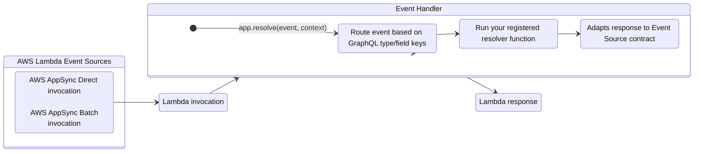
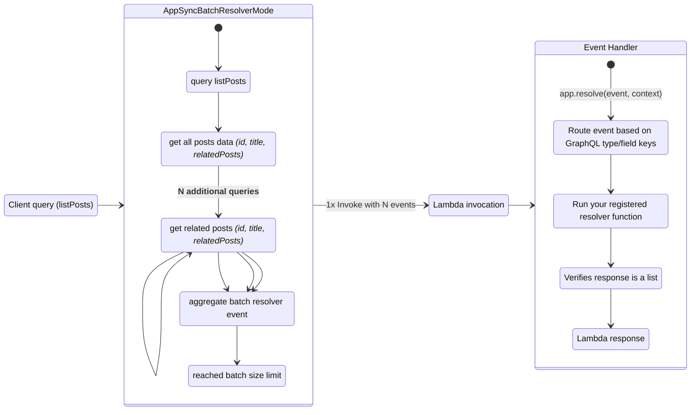
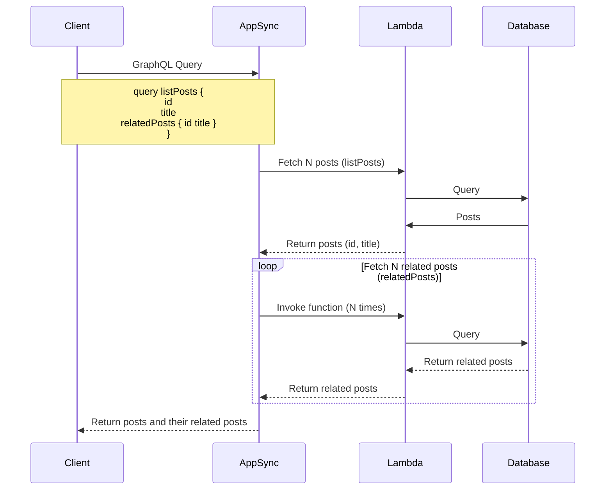
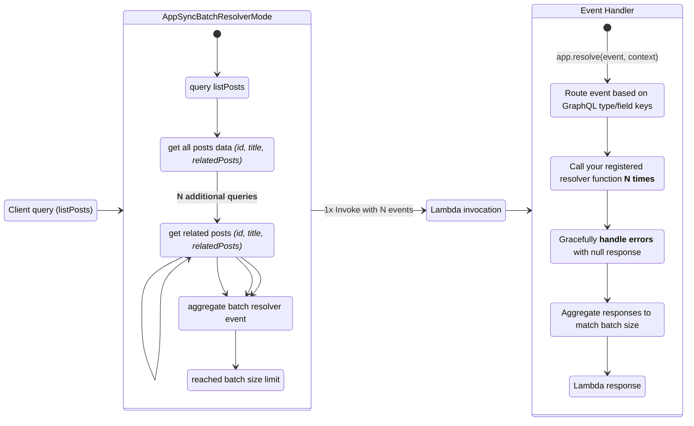
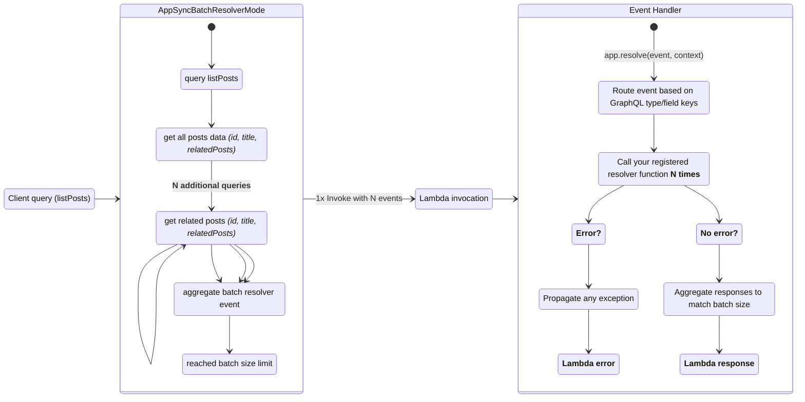

<!-- Generated by scripts/build_agent_skill_references.py from core/event_handler/appsync.md. Do not edit by hand. -->
# Event Handler Appsync

Source of truth: https://docs.powertools.aws.dev/lambda/python/latest/core/event_handler/appsync/

Event Handler for AWS AppSync GraphQL APIs simplifies routing and processing of events in AWS Lambda functions by allowing you to define resolvers for specific GraphQL types and fields.



## Key Features

* Choose between strictly match a GraphQL field name or all of them to a function
* Automatically parse API arguments to function arguments
* Integrates with [Event Source Data classes utilities](../../utilities/data_classes.md) to access resolver and identity information
* Support async Python 3.8+ functions and generators

## Terminology

**[Direct Lambda Resolver](https://docs.aws.amazon.com/appsync/latest/devguide/direct-lambda-reference.html)**. A custom AppSync Resolver to bypass the use of Apache Velocity Template (VTL) and automatically map your function's response to a GraphQL field.

**[Batching resolvers](https://docs.aws.amazon.com/appsync/latest/devguide/tutorial-lambda-resolvers.html#advanced-use-case-batching)**. A technique that allows you to batch multiple GraphQL requests into a single Lambda function invocation, reducing the number of calls and improving performance.

## Getting started

> **Tip: Tip: Designing GraphQL Schemas for the first time?**

Visit [AWS AppSync schema documentation](https://docs.aws.amazon.com/appsync/latest/devguide/designing-your-schema.html) to understand how to define types, nesting, and pagination.

### Required resources

You must have an existing AppSync GraphQL API and IAM permissions to invoke your Lambda function. That said, there is no additional permissions to use Event Handler as routing requires no dependency (_standard library_).

This is the sample infrastructure we are using for the initial examples with a AppSync Direct Lambda Resolver.

**getting_started_schema.graphql**

```typescript
schema {
    query: Query
    mutation: Mutation
}

type Query {
    # these are fields you can attach resolvers to (type_name: Query, field_name: getTodo)
    getTodo(id: ID!): Todo
    listTodos: [Todo]
}

type Mutation {
    createTodo(title: String!): Todo
}

type Todo {
    id: ID!
    userId: String
    title: String
    completed: Boolean
}
```

**template.yaml**

```yaml
AWSTemplateFormatVersion: "2010-09-09"
Transform: AWS::Serverless-2016-10-31
Description: Hello world Direct Lambda Resolver

Globals:
  Function:
    Timeout: 5
    Runtime: python3.12
    Tracing: Active
    Environment:
      Variables:
        # Powertools for AWS Lambda (Python) env vars: https://docs.powertools.aws.dev/lambda/python/latest/#environment-variables
        POWERTOOLS_LOG_LEVEL: INFO
        POWERTOOLS_LOGGER_SAMPLE_RATE: 0.1
        POWERTOOLS_LOGGER_LOG_EVENT: true
        POWERTOOLS_SERVICE_NAME: example

Resources:
  TodosFunction:
    Type: AWS::Serverless::Function
    Properties:
      Handler: getting_started_graphql_api_resolver.lambda_handler
      CodeUri: ../src
      Description: Sample Direct Lambda Resolver

  # IAM Permissions and Roles

  AppSyncServiceRole:
    Type: "AWS::IAM::Role"
    Properties:
      AssumeRolePolicyDocument:
        Version: "2012-10-17"
        Statement:
          - Effect: "Allow"
            Principal:
              Service:
                - "appsync.amazonaws.com"
            Action:
              - "sts:AssumeRole"

  InvokeLambdaResolverPolicy:
    Type: "AWS::IAM::Policy"
    Properties:
      PolicyName: "DirectAppSyncLambda"
      PolicyDocument:
        Version: "2012-10-17"
        Statement:
          - Effect: "Allow"
            Action: "lambda:invokeFunction"
            Resource:
              - !GetAtt TodosFunction.Arn
      Roles:
        - !Ref AppSyncServiceRole

  # GraphQL API

  TodosApi:
    Type: "AWS::AppSync::GraphQLApi"
    Properties:
      Name: TodosApi
      AuthenticationType: "API_KEY"
      XrayEnabled: true

  TodosApiKey:
    Type: AWS::AppSync::ApiKey
    Properties:
      ApiId: !GetAtt TodosApi.ApiId

  TodosApiSchema:
    Type: "AWS::AppSync::GraphQLSchema"
    Properties:
      ApiId: !GetAtt TodosApi.ApiId
      DefinitionS3Location: ../src/getting_started_schema.graphql
    Metadata:
      cfn-lint:
        config:
          ignore_checks:
            - W3002 # allow relative path in DefinitionS3Location

  # Lambda Direct Data Source and Resolver

  TodosFunctionDataSource:
    Type: "AWS::AppSync::DataSource"
    Properties:
      ApiId: !GetAtt TodosApi.ApiId
      Name: "HelloWorldLambdaDirectResolver"
      Type: "AWS_LAMBDA"
      ServiceRoleArn: !GetAtt AppSyncServiceRole.Arn
      LambdaConfig:
        LambdaFunctionArn: !GetAtt TodosFunction.Arn

  ListTodosResolver:
    Type: "AWS::AppSync::Resolver"
    Properties:
      ApiId: !GetAtt TodosApi.ApiId
      TypeName: "Query"
      FieldName: "listTodos"
      DataSourceName: !GetAtt TodosFunctionDataSource.Name

  GetTodoResolver:
    Type: "AWS::AppSync::Resolver"
    Properties:
      ApiId: !GetAtt TodosApi.ApiId
      TypeName: "Query"
      FieldName: "getTodo"
      DataSourceName: !GetAtt TodosFunctionDataSource.Name

  CreateTodoResolver:
    Type: "AWS::AppSync::Resolver"
    Properties:
      ApiId: !GetAtt TodosApi.ApiId
      TypeName: "Mutation"
      FieldName: "createTodo"
      DataSourceName: !GetAtt TodosFunctionDataSource.Name

Outputs:
  TodosFunction:
    Description: "Hello World Lambda Function ARN"
    Value: !GetAtt TodosFunction.Arn

  TodosApi:
    Value: !GetAtt TodosApi.GraphQLUrl
```

### Resolver decorator

You can define your functions to match GraphQL types and fields with the `app.resolver()` decorator.

> **Question: What is a type and field?**

A type would be a top-level **GraphQL Type** like `Query`, `Mutation`, `Todo`. A **GraphQL Field** would be `listTodos` under `Query`, `createTodo` under `Mutation`, etc.

Here's an example with two separate functions to resolve `getTodo` and `listTodos` fields within the `Query` type. For completion, we use [Scalar type utilities](#scalar-functions) to generate the right output based on our schema definition.

> **Important**

GraphQL arguments are passed as function keyword arguments.

**Example**

The GraphQL Query `getTodo(id: "todo_id_value")` will
call `get_todo` as `get_todo(id="todo_id_value")`.

**getting_started_graphql_api_resolver.py**

```python
from typing import TypedDict

import requests
from requests import Response

from aws_lambda_powertools import Logger, Tracer
from aws_lambda_powertools.event_handler import AppSyncResolver
from aws_lambda_powertools.logging import correlation_paths
from aws_lambda_powertools.utilities.data_classes.appsync import scalar_types_utils
from aws_lambda_powertools.utilities.typing import LambdaContext

tracer = Tracer()
logger = Logger()
app = AppSyncResolver()

class Todo(TypedDict, total=False):
    id: str  # noqa AA03 VNE003, required due to GraphQL Schema
    userId: str
    title: str
    completed: bool

@app.resolver(type_name="Query", field_name="getTodo")
@tracer.capture_method
def get_todo(
    id: str = "",  # noqa AA03 VNE003 shadows built-in id to match query argument, e.g., getTodo(id: "some_id")
) -> Todo:
    logger.info(f"Fetching Todo {id}")
    todos: Response = requests.get(f"https://jsonplaceholder.typicode.com/todos/{id}")
    todos.raise_for_status()

    return todos.json()

@app.resolver(type_name="Query", field_name="listTodos")
@tracer.capture_method
def list_todos() -> list[Todo]:
    todos: Response = requests.get("https://jsonplaceholder.typicode.com/todos")
    todos.raise_for_status()

    # for brevity, we'll limit to the first 10 only
    return todos.json()[:10]

@app.resolver(type_name="Mutation", field_name="createTodo")
@tracer.capture_method
def create_todo(title: str) -> Todo:
    payload = {"userId": scalar_types_utils.make_id(), "title": title, "completed": False}  # dummy UUID str
    todo: Response = requests.post("https://jsonplaceholder.typicode.com/todos", json=payload)
    todo.raise_for_status()

    return todo.json()

@logger.inject_lambda_context(correlation_id_path=correlation_paths.APPSYNC_RESOLVER)
@tracer.capture_lambda_handler
def lambda_handler(event: dict, context: LambdaContext) -> dict:
    return app.resolve(event, context)
```

**getting_started_schema.graphql**

```typescript
schema {
    query: Query
    mutation: Mutation
}

type Query {
    # these are fields you can attach resolvers to (type_name: Query, field_name: getTodo)
    getTodo(id: ID!): Todo
    listTodos: [Todo]
}

type Mutation {
    createTodo(title: String!): Todo
}

type Todo {
    id: ID!
    userId: String
    title: String
    completed: Boolean
}
```

**sample events**

**getting_started_get_todo.json**

```json
{
    "arguments": {
        "id": "7e362732-c8cd-4405-b090-144ac9b38960"
    },
    "identity": null,
    "source": null,
    "request": {
        "headers": {
            "x-forwarded-for": "1.2.3.4, 5.6.7.8",
            "accept-encoding": "gzip, deflate, br",
            "cloudfront-viewer-country": "NL",
            "cloudfront-is-tablet-viewer": "false",
            "referer": "https://eu-west-1.console.aws.amazon.com/appsync/home?region=eu-west-1",
            "via": "2.0 9fce949f3749407c8e6a75087e168b47.cloudfront.net (CloudFront)",
            "cloudfront-forwarded-proto": "https",
            "origin": "https://eu-west-1.console.aws.amazon.com",
            "x-api-key": "da1-c33ullkbkze3jg5hf5ddgcs4fq",
            "content-type": "application/json",
            "x-amzn-trace-id": "Root=1-606eb2f2-1babc433453a332c43fb4494",
            "x-amz-cf-id": "SJw16ZOPuMZMINx5Xcxa9pB84oMPSGCzNOfrbJLvd80sPa0waCXzYQ==",
            "content-length": "114",
            "x-amz-user-agent": "AWS-Console-AppSync/",
            "x-forwarded-proto": "https",
            "host": "ldcvmkdnd5az3lm3gnf5ixvcyy.appsync-api.eu-west-1.amazonaws.com",
            "accept-language": "en-US,en;q=0.5",
            "user-agent": "Mozilla/5.0 (Macintosh; Intel Mac OS X 10.15; rv:78.0) Gecko/20100101 Firefox/78.0",
            "cloudfront-is-desktop-viewer": "true",
            "cloudfront-is-mobile-viewer": "false",
            "accept": "*/*",
            "x-forwarded-port": "443",
            "cloudfront-is-smarttv-viewer": "false"
        }
    },
    "prev": null,
    "info": {
        "parentTypeName": "Query",
        "selectionSetList": [
            "title",
            "id"
        ],
        "selectionSetGraphQL": "{\n  title\n  id\n}",
        "fieldName": "getTodo",
        "variables": {}
    },
    "stash": {}
}
```

**getting_started_list_todos.json**

```json
{
    "arguments": {},
    "identity": null,
    "source": null,
    "request": {
        "headers": {
            "x-forwarded-for": "1.2.3.4, 5.6.7.8",
            "accept-encoding": "gzip, deflate, br",
            "cloudfront-viewer-country": "NL",
            "cloudfront-is-tablet-viewer": "false",
            "referer": "https://eu-west-1.console.aws.amazon.com/appsync/home?region=eu-west-1",
            "via": "2.0 9fce949f3749407c8e6a75087e168b47.cloudfront.net (CloudFront)",
            "cloudfront-forwarded-proto": "https",
            "origin": "https://eu-west-1.console.aws.amazon.com",
            "x-api-key": "da1-c33ullkbkze3jg5hf5ddgcs4fq",
            "content-type": "application/json",
            "x-amzn-trace-id": "Root=1-606eb2f2-1babc433453a332c43fb4494",
            "x-amz-cf-id": "SJw16ZOPuMZMINx5Xcxa9pB84oMPSGCzNOfrbJLvd80sPa0waCXzYQ==",
            "content-length": "114",
            "x-amz-user-agent": "AWS-Console-AppSync/",
            "x-forwarded-proto": "https",
            "host": "ldcvmkdnd5az3lm3gnf5ixvcyy.appsync-api.eu-west-1.amazonaws.com",
            "accept-language": "en-US,en;q=0.5",
            "user-agent": "Mozilla/5.0 (Macintosh; Intel Mac OS X 10.15; rv:78.0) Gecko/20100101 Firefox/78.0",
            "cloudfront-is-desktop-viewer": "true",
            "cloudfront-is-mobile-viewer": "false",
            "accept": "*/*",
            "x-forwarded-port": "443",
            "cloudfront-is-smarttv-viewer": "false"
        }
    },
    "prev": null,
    "info": {
        "parentTypeName": "Query",
        "selectionSetList": [
            "id",
            "title"
        ],
        "selectionSetGraphQL": "{\n  id\n  title\n}",
        "fieldName": "listTodos",
        "variables": {}
    },
    "stash": {}
}
```

**getting_started_create_todo.json**

```json
 {
    "arguments": {
      "title": "Sample todo mutation"
    },
    "identity": null,
    "source": null,
    "request": {
      "headers": {
        "x-forwarded-for": "203.0.113.1, 203.0.113.18",
        "cloudfront-viewer-country": "NL",
        "cloudfront-is-tablet-viewer": "false",
        "x-amzn-requestid": "fdc4f30b-44c2-475d-b2f9-9da0778d5275",
        "via": "2.0 f655cacd0d6f7c5dc935ea687af6f3c0.cloudfront.net (CloudFront)",
        "cloudfront-forwarded-proto": "https",
        "origin": "https://eu-west-1.console.aws.amazon.com",
        "content-length": "166",
        "x-forwarded-proto": "https",
        "accept-language": "en-US,en;q=0.5",
        "host": "kiuqayvn4jhhzio6whpnk7xj3a.appsync-api.eu-west-1.amazonaws.com",
        "user-agent": "Mozilla/5.0 (Macintosh; Intel Mac OS X 10.15; rv:102.0) Gecko/20100101 Firefox/102.0",
        "cloudfront-is-mobile-viewer": "false",
        "accept": "application/json, text/plain, */*",
        "cloudfront-viewer-asn": "1136",
        "cloudfront-is-smarttv-viewer": "false",
        "accept-encoding": "gzip, deflate, br",
        "referer": "https://eu-west-1.console.aws.amazon.com/",
        "content-type": "application/json",
        "x-api-key": "da2-vsqnxwyzgzf4nh6kvoaidtvs7y",
        "sec-fetch-mode": "cors",
        "x-amz-cf-id": "0kxqijFPsbGSWJ1u3Z_sUS4Wu2hRoG_2T77aJPuoh_Q4bXAB3x0a3g==",
        "x-amzn-trace-id": "Root=1-63fef2cf-6d566e9f4a35b99e6212388e",
        "sec-fetch-dest": "empty",
        "x-amz-user-agent": "AWS-Console-AppSync/",
        "cloudfront-is-desktop-viewer": "true",
        "sec-fetch-site": "cross-site",
        "x-forwarded-port": "443"
      },
      "domainName": null
    },
    "prev": null,
    "info": {
      "selectionSetList": [
        "id",
        "title",
        "completed"
      ],
      "selectionSetGraphQL": "{\n  id\n  title\n  completed\n}",
      "fieldName": "createTodo",
      "parentTypeName": "Mutation",
      "variables": {}
    },
    "stash": {}
}
```

### Scalar functions

When working with [AWS AppSync Scalar types](https://docs.aws.amazon.com/appsync/latest/devguide/scalars.html), you might want to generate the same values for data validation purposes.

For convenience, the most commonly used values are available as functions within `scalar_types_utils` module.

```python title="Creating key scalar values with scalar_types_utils"
from aws_lambda_powertools.utilities.data_classes.appsync.scalar_types_utils import (
    aws_date,
    aws_datetime,
    aws_time,
    aws_timestamp,
    make_id,
)

# Scalars: https://docs.aws.amazon.com/appsync/latest/devguide/scalars.html

my_id: str = make_id()  # Scalar: ID!
my_date: str = aws_date()  # Scalar: AWSDate
my_timestamp: str = aws_time()  # Scalar: AWSTime
my_datetime: str = aws_datetime()  # Scalar: AWSDateTime
my_epoch_timestamp: int = aws_timestamp()  # Scalar: AWSTimestamp
```

Here's a table with their related scalar as a quick reference:

| Scalar type      | Scalar function                    | Sample value                           |
| ---------------- | ---------------------------------- | -------------------------------------- |
| **ID**           | `scalar_types_utils.make_id`       | `e916c84d-48b6-484c-bef3-cee3e4d86ebf` |
| **AWSDate**      | `scalar_types_utils.aws_date`      | `2022-07-08Z`                          |
| **AWSTime**      | `scalar_types_utils.aws_time`      | `15:11:00.189Z`                        |
| **AWSDateTime**  | `scalar_types_utils.aws_datetime`  | `2022-07-08T15:11:00.189Z`             |
| **AWSTimestamp** | `scalar_types_utils.aws_timestamp` | `1657293060`                           |

## Advanced

### Nested mappings

> **Note**

The following examples use a more advanced schema. These schemas differ from [initial sample infrastructure we used earlier](#required-resources).

You can nest `app.resolver()` decorator multiple times when resolving fields with the same return value.

**nested_mappings.py**

```python
from typing import TypedDict

from aws_lambda_powertools import Logger, Tracer
from aws_lambda_powertools.event_handler import AppSyncResolver
from aws_lambda_powertools.logging import correlation_paths
from aws_lambda_powertools.utilities.typing import LambdaContext

tracer = Tracer()
logger = Logger()
app = AppSyncResolver()

class Location(TypedDict, total=False):
    id: str  # noqa AA03 VNE003, required due to GraphQL Schema
    name: str
    description: str
    address: str

@app.resolver(field_name="listLocations")
@app.resolver(field_name="locations")
@tracer.capture_method
def get_locations(name: str, description: str = "") -> list[Location]:  # match GraphQL Query arguments
    return [{"name": name, "description": description}]

@logger.inject_lambda_context(correlation_id_path=correlation_paths.APPSYNC_RESOLVER)
@tracer.capture_lambda_handler
def lambda_handler(event: dict, context: LambdaContext) -> dict:
    return app.resolve(event, context)
```

**nested_mappings_schema.graphql**

```typescript
schema {
    query: Query
}

type Query {
    listLocations: [Location]
}

type Location {
    id: ID!
    name: String!
    description: String
    address: String
}

type Merchant {
    id: String!
    name: String!
    description: String
    locations: [Location]
}
```

### Async functions

For Lambda Python3.8+ runtime, this utility supports async functions when you use in conjunction with `asyncio.run`.

```python title="Resolving GraphQL resolvers async"
import asyncio
from typing import TypedDict

import aiohttp

from aws_lambda_powertools import Logger, Tracer
from aws_lambda_powertools.event_handler import AppSyncResolver
from aws_lambda_powertools.logging import correlation_paths
from aws_lambda_powertools.tracing import aiohttp_trace_config
from aws_lambda_powertools.utilities.typing import LambdaContext

tracer = Tracer()
logger = Logger()
app = AppSyncResolver()

class Todo(TypedDict, total=False):
    id: str  # noqa AA03 VNE003, required due to GraphQL Schema
    userId: str
    title: str
    completed: bool

@app.resolver(type_name="Query", field_name="listTodos")
async def list_todos() -> list[Todo]:
    async with aiohttp.ClientSession(trace_configs=[aiohttp_trace_config()]) as session:
        async with session.get("https://jsonplaceholder.typicode.com/todos") as resp:
            return await resp.json()

@logger.inject_lambda_context(correlation_id_path=correlation_paths.APPSYNC_RESOLVER)
@tracer.capture_lambda_handler
def lambda_handler(event: dict, context: LambdaContext) -> dict:
    result = app.resolve(event, context)

    return asyncio.run(result)
```

### Custom data models

You can subclass [AppSyncResolverEvent](../../utilities/data_classes.md#appsync-resolver) to bring your own set of methods to handle incoming events, by using `data_model` param in the `resolve` method.

**custom_models.py.py**

```python
from typing import TypedDict

from aws_lambda_powertools import Logger, Tracer
from aws_lambda_powertools.event_handler import AppSyncResolver
from aws_lambda_powertools.logging import correlation_paths
from aws_lambda_powertools.utilities.data_classes.appsync import scalar_types_utils
from aws_lambda_powertools.utilities.data_classes.appsync_resolver_event import (
    AppSyncResolverEvent,
)
from aws_lambda_powertools.utilities.typing import LambdaContext

tracer = Tracer()
logger = Logger()
app = AppSyncResolver()

class Location(TypedDict, total=False):
    id: str  # noqa AA03 VNE003, required due to GraphQL Schema
    name: str
    description: str
    address: str
    commonField: str

class MyCustomModel(AppSyncResolverEvent):
    @property
    def country_viewer(self) -> str:
        return self.request_headers.get("cloudfront-viewer-country", "")

    @property
    def api_key(self) -> str:
        return self.request_headers.get("x-api-key", "")

@app.resolver(type_name="Query", field_name="listLocations")
def list_locations(page: int = 0, size: int = 10) -> list[Location]:
    # additional properties/methods will now be available under current_event
    if app.current_event:
        logger.debug(f"Request country origin: {app.current_event.country_viewer}")  # type: ignore[attr-defined]
    return [{"id": scalar_types_utils.make_id(), "name": "Perry, James and Carroll"}]

@tracer.capture_lambda_handler
@logger.inject_lambda_context(correlation_id_path=correlation_paths.APPSYNC_RESOLVER)
def lambda_handler(event: dict, context: LambdaContext) -> dict:
    return app.resolve(event, context, data_model=MyCustomModel)
```

**nested_mappings_schema.graphql**

```typescript
schema {
    query: Query
}

type Query {
    listLocations: [Location]
}

type Location {
    id: ID!
    name: String!
    description: String
    address: String
}

type Merchant {
    id: String!
    name: String!
    description: String
    locations: [Location]
}
```

**graphql_transformer_list_locations.json**

```json
 {
     "typeName": "Query",
     "fieldName": "listLocations",
     "arguments": {
         "page": 2,
         "size": 1
     },
     "identity": {
         "claims": {
             "iat": 1615366261
         },
         "username": "treid"
     },
     "request": {
         "headers": {
             "x-amzn-trace-id": "Root=1-60488877-0b0c4e6727ab2a1c545babd0",
             "x-forwarded-for": "127.0.0.1",
             "cloudfront-viewer-country": "NL",
             "x-api-key": "x"
         }
     }
 }
```

### Split operations with Router

> **Tip**

Read the **[considerations section for trade-offs between monolithic and micro functions](./api_gateway.md#considerations)**, as it's also applicable here.

As you grow the number of related GraphQL operations a given Lambda function should handle, it is natural to split them into separate files to ease maintenance - That's when the `Router` feature comes handy.

Let's assume you have `split_operation.py` as your Lambda function entrypoint and routes in `split_operation_module.py`. This is how you'd use the `Router` feature.

**split_operation_module.py**

We import **Router** instead of **AppSyncResolver**; syntax wise is exactly the same.

  	```python
    from typing import TypedDict

    from aws_lambda_powertools import Logger, Tracer
    from aws_lambda_powertools.event_handler.graphql_appsync.router import Router

    tracer = Tracer()
    logger = Logger()
    router = Router()

    class Location(TypedDict, total=False):
        id: str  # noqa AA03 VNE003, required due to GraphQL Schema
        name: str
        description: str
        address: str

    @router.resolver(field_name="listLocations")
    @router.resolver(field_name="locations")
    @tracer.capture_method
    def get_locations(name: str, description: str = "") -> list[Location]:  # match GraphQL Query arguments
        return [{"name": name, "description": description}]
  	```

**split_operation.py**

  	We use `include_router` method and include all `location` operations registered in the `router` global object.

    ```python
    import split_operation_module

    from aws_lambda_powertools import Logger, Tracer
    from aws_lambda_powertools.event_handler import AppSyncResolver
    from aws_lambda_powertools.logging import correlation_paths
    from aws_lambda_powertools.utilities.typing import LambdaContext

    tracer = Tracer()
    logger = Logger()
    app = AppSyncResolver()
    app.include_router(split_operation_module.router)

    @logger.inject_lambda_context(correlation_id_path=correlation_paths.APPSYNC_RESOLVER)
    @tracer.capture_lambda_handler
    def lambda_handler(event: dict, context: LambdaContext) -> dict:
        return app.resolve(event, context)
    ```

#### Sharing contextual data

You can use `append_context` when you want to share data between your App and Router instances. Any data you share will be available via the `context` dictionary available in your App or Router context.

> **Warning**

For safety, we clear the context after each invocation, except for async single resolvers. For these, use `app.context.clear()` before returning the function.

> **Tip**

This can also be useful for middlewares injecting contextual information before a request is processed.

**split_route_append_context.py**

	```python
    import split_operation_append_context_module

    from aws_lambda_powertools import Logger, Tracer
    from aws_lambda_powertools.event_handler import AppSyncResolver
    from aws_lambda_powertools.logging import correlation_paths
    from aws_lambda_powertools.utilities.typing import LambdaContext

    tracer = Tracer()
    logger = Logger()
    app = AppSyncResolver()
    app.include_router(split_operation_append_context_module.router)

    @logger.inject_lambda_context(correlation_id_path=correlation_paths.APPSYNC_RESOLVER)
    @tracer.capture_lambda_handler
    def lambda_handler(event: dict, context: LambdaContext) -> dict:
        app.append_context(is_admin=True)  # arbitrary number of key=value data
        return app.resolve(event, context)
	```

**split_route_append_context_module.py**

	```python
    from typing import TypedDict

    from aws_lambda_powertools import Logger, Tracer
    from aws_lambda_powertools.event_handler.appsync import Router

    tracer = Tracer()
    logger = Logger()
    router = Router()

    class Location(TypedDict, total=False):
        id: str  # noqa AA03 VNE003, required due to GraphQL Schema
        name: str
        description: str
        address: str

    @router.resolver(field_name="listLocations")
    @router.resolver(field_name="locations")
    @tracer.capture_method
    def get_locations(name: str, description: str = "") -> list[Location]:  # match GraphQL Query arguments
        is_admin: bool = router.context.get("is_admin", False)
        return [{"name": name, "description": description}] if is_admin else []
	```

### Exception handling

You can use **`exception_handler`** decorator with any Python exception. This allows you to handle a common exception outside your resolver, for example validation errors.

The `exception_handler` function also supports passing a list of exception types you wish to handle with one handler.

```python title="Exception handling"
from aws_lambda_powertools.event_handler import AppSyncResolver

app = AppSyncResolver()

@app.exception_handler(ValueError)
def handle_value_error(ex: ValueError):
    return {"message": "error"}

@app.resolver(field_name="createSomething")
def create_something():
    raise ValueError("Raising an exception")

def lambda_handler(event, context):
    return app.resolve(event, context)
```

> **Warning**

This is not supported when using async single resolvers.

### Batch processing



<em><center>Batch resolvers mechanics: visualizing N+1 in `relatedPosts` field.</center></em>

#### Understanding N+1 problem

When AWS AppSync has [batching enabled for Lambda Resolvers](https://docs.aws.amazon.com/appsync/latest/devguide/tutorial-lambda-resolvers.html#advanced-use-case-batching), it will group as many requests as possible before invoking your Lambda invocation. Effectively solving the [N+1 problem in GraphQL](https://aws.amazon.com/blogs/mobile/introducing-configurable-batching-size-for-aws-appsync-lambda-resolvers/).

For example, say you have a query named `listPosts`. For each post, you also want `relatedPosts`. **Without batching**, AppSync will:

1. Invoke your Lambda function to get the first post
2. Invoke your Lambda function for each related post
3. Repeat 1 until done



#### Batch resolvers

You can use `@batch_resolver` or `@async_batch_resolver` decorators to receive the entire batch of requests.

In this mode, you must return results in the same order of your batch items, so AppSync can associate the results back to the client.

**advanced_batch_resolver.py**

  	```python
    from __future__ import annotations

    from typing import Any

    from aws_lambda_powertools.event_handler import AppSyncResolver
    from aws_lambda_powertools.utilities.data_classes import AppSyncResolverEvent
    from aws_lambda_powertools.utilities.typing import LambdaContext

    app = AppSyncResolver()

    # mimic DB data for simplicity
    posts_related = {
        "1": {"title": "post1"},
        "2": {"title": "post2"},
        "3": {"title": "post3"},
    }

    def search_batch_posts(posts: list) -> dict[str, Any]:
        return {post_id: posts_related.get(post_id) for post_id in posts}

    @app.batch_resolver(type_name="Query", field_name="relatedPosts")
    def related_posts(event: list[AppSyncResolverEvent]) -> list[Any]:  # (1)!
        # Extract all post_ids in order
        post_ids: list = [record.source.get("post_id") for record in event]  # (2)!

        # Get unique post_ids while preserving order
        unique_post_ids = list(dict.fromkeys(post_ids))

        # Fetch posts in a single batch operation
        fetched_posts = search_batch_posts(unique_post_ids)

        # Return results in original order
        return [fetched_posts.get(post_id) for post_id in post_ids]

    def lambda_handler(event, context: LambdaContext) -> dict:
        return app.resolve(event, context)
  	```

    1. The entire batch is sent to the resolver. You need to iterate through it to process all records.
    2. We use `post_id` as our unique identifier of the GraphQL request.

**advanced_batch_resolver_payload.json**

  	```json
    [
       {
          "arguments":{},
          "identity":"None",
          "source":{
             "post_id":"1",
             "author":"Author1"
          },
          "prev":"None",
          "info":{
             "selectionSetList":[
                "post_id",
                "author"
             ],
             "selectionSetGraphQL":"{\n  post_id\n  author\n}",
             "fieldName":"relatedPosts",
             "parentTypeName":"Post",
             "variables":{}
          }
       },
       {
          "arguments":{},
          "identity":"None",
          "source":{
             "post_id":"2",
             "author":"Author2"
          },
          "prev":"None",
          "info":{
             "selectionSetList":[
                "post_id",
                "author"
             ],
             "selectionSetGraphQL":"{\n  post_id\n  author\n}",
             "fieldName":"relatedPosts",
             "parentTypeName":"Post",
             "variables":{}
          }
       },
       {
          "arguments":{},
          "identity":"None",
          "source":{
             "post_id":"1",
             "author":"Author1"
          },
          "prev":"None",
          "info":{
             "selectionSetList":[
                "post_id",
                "author"
             ],
             "selectionSetGraphQL":"{\n  post_id\n  author\n}",
             "fieldName":"relatedPosts",
             "parentTypeName":"Post",
             "variables":{}
          }
       }
    ]
  	```

**advanced_batch_query.graphql**

  	```typescript
    query MyQuery {
      getPost(post_id: "2") {
        relatedPosts {
          post_id
          author
          relatedPosts {
            post_id
            author
          }
        }
      }
    }
  	```

##### Processing items individually



<em><center>Batch resolvers: reducing Lambda invokes but fetching data N times (similar to single resolver).</center></em>

In rare scenarios, you might want to process each item individually, trading ease of use for increased latency as you handle one batch item at a time.

You can toggle `aggregate` parameter in `@batch_resolver` decorator for your resolver function to be called N times.

> **Note: This does not resolve the N+1 problem, but shifts it to the Lambda runtime.**

In this mode, we will:

1. Aggregate each response we receive from your function in the exact order it receives
2. Gracefully handle errors by adding `None` in the final response for each batch item that failed processing
    * You can customize `nul` or error responses back to the client in the [AppSync resolver mapping templates](https://docs.aws.amazon.com/appsync/latest/devguide/tutorial-lambda-resolvers.html#returning-individual-errors)

**advanced_batch_resolver_individual.py**

  	```python
    from typing import Any

    from aws_lambda_powertools import Logger
    from aws_lambda_powertools.event_handler import AppSyncResolver
    from aws_lambda_powertools.utilities.data_classes import AppSyncResolverEvent
    from aws_lambda_powertools.utilities.typing import LambdaContext

    logger = Logger()
    app = AppSyncResolver()

    posts_related = {
        "1": {"title": "post1"},
        "2": {"title": "post2"},
        "3": {"title": "post3"},
    }

    @app.batch_resolver(type_name="Query", field_name="relatedPosts", aggregate=False)  # (1)!
    def related_posts(event: AppSyncResolverEvent, post_id: str = "") -> dict[str, Any]:
        return posts_related[post_id]

    def lambda_handler(event, context: LambdaContext) -> dict:
        return app.resolve(event, context)
  	```

    1. You need to disable the aggregated event by using `aggregate` flag.
        The resolver receives and processes each record one at a time.

**advanced_batch_resolver_payload.json**

  	```json
    [
       {
          "arguments":{},
          "identity":"None",
          "source":{
             "post_id":"1",
             "author":"Author1"
          },
          "prev":"None",
          "info":{
             "selectionSetList":[
                "post_id",
                "author"
             ],
             "selectionSetGraphQL":"{\n  post_id\n  author\n}",
             "fieldName":"relatedPosts",
             "parentTypeName":"Post",
             "variables":{}
          }
       },
       {
          "arguments":{},
          "identity":"None",
          "source":{
             "post_id":"2",
             "author":"Author2"
          },
          "prev":"None",
          "info":{
             "selectionSetList":[
                "post_id",
                "author"
             ],
             "selectionSetGraphQL":"{\n  post_id\n  author\n}",
             "fieldName":"relatedPosts",
             "parentTypeName":"Post",
             "variables":{}
          }
       },
       {
          "arguments":{},
          "identity":"None",
          "source":{
             "post_id":"1",
             "author":"Author1"
          },
          "prev":"None",
          "info":{
             "selectionSetList":[
                "post_id",
                "author"
             ],
             "selectionSetGraphQL":"{\n  post_id\n  author\n}",
             "fieldName":"relatedPosts",
             "parentTypeName":"Post",
             "variables":{}
          }
       }
    ]
  	```

**advanced_batch_query.graphql**

  	```typescript
    query MyQuery {
      getPost(post_id: "2") {
        relatedPosts {
          post_id
          author
          relatedPosts {
            post_id
            author
          }
        }
      }
    }
  	```

##### Raise on error



<em><center>Batch resolvers: reducing Lambda invokes but fetching data N times (similar to single resolver).</center></em>

You can toggle `raise_on_error` parameter in `@batch_resolver` to propagate any exception instead of gracefully returning `None` for a given batch item.

This is useful when you want to stop processing immediately in the event of an unhandled or unrecoverable exception.

**advanced_batch_resolver_handling_error.py**

  	```python
    from typing import Any

    from aws_lambda_powertools import Logger
    from aws_lambda_powertools.event_handler import AppSyncResolver
    from aws_lambda_powertools.utilities.data_classes import AppSyncResolverEvent
    from aws_lambda_powertools.utilities.typing import LambdaContext

    logger = Logger()
    app = AppSyncResolver()

    posts_related = {
        "1": {"title": "post1"},
        "2": {"title": "post2"},
        "3": {"title": "post3"},
    }

    @app.batch_resolver(type_name="Query", field_name="relatedPosts", aggregate=False, raise_on_error=True)  # (1)!
    def related_posts(event: AppSyncResolverEvent, post_id: str = "") -> dict[str, Any]:
        return posts_related[post_id]

    def lambda_handler(event, context: LambdaContext) -> dict:
        return app.resolve(event, context)
  	```

    1. You can enable enable the error handling by using `raise_on_error` flag.

**advanced_batch_resolver_payload.json**

  	```json
    [
       {
          "arguments":{},
          "identity":"None",
          "source":{
             "post_id":"1",
             "author":"Author1"
          },
          "prev":"None",
          "info":{
             "selectionSetList":[
                "post_id",
                "author"
             ],
             "selectionSetGraphQL":"{\n  post_id\n  author\n}",
             "fieldName":"relatedPosts",
             "parentTypeName":"Post",
             "variables":{}
          }
       },
       {
          "arguments":{},
          "identity":"None",
          "source":{
             "post_id":"2",
             "author":"Author2"
          },
          "prev":"None",
          "info":{
             "selectionSetList":[
                "post_id",
                "author"
             ],
             "selectionSetGraphQL":"{\n  post_id\n  author\n}",
             "fieldName":"relatedPosts",
             "parentTypeName":"Post",
             "variables":{}
          }
       },
       {
          "arguments":{},
          "identity":"None",
          "source":{
             "post_id":"1",
             "author":"Author1"
          },
          "prev":"None",
          "info":{
             "selectionSetList":[
                "post_id",
                "author"
             ],
             "selectionSetGraphQL":"{\n  post_id\n  author\n}",
             "fieldName":"relatedPosts",
             "parentTypeName":"Post",
             "variables":{}
          }
       }
    ]
  	```

**advanced_batch_query.graphql**

  	```typescript
    query MyQuery {
      getPost(post_id: "2") {
        relatedPosts {
          post_id
          author
          relatedPosts {
            post_id
            author
          }
        }
      }
    }
  	```

#### Async batch resolver

Similar to `@batch_resolver` explained in [batch resolvers](#batch-resolvers), you can use `async_batch_resolver` to handle async functions.

**advanced_batch_async_resolver.py**

  	```python
    from __future__ import annotations

    from typing import Any

    from aws_lambda_powertools.event_handler import AppSyncResolver
    from aws_lambda_powertools.utilities.data_classes import AppSyncResolverEvent
    from aws_lambda_powertools.utilities.typing import LambdaContext

    app = AppSyncResolver()

    # mimic DB data for simplicity
    posts_related = {
        "1": {"title": "post1"},
        "2": {"title": "post2"},
        "3": {"title": "post3"},
    }

    async def search_batch_posts(posts: list) -> dict[str, Any]:
        return {post_id: posts_related.get(post_id) for post_id in posts}

    @app.async_batch_resolver(type_name="Query", field_name="relatedPosts")
    async def related_posts(event: list[AppSyncResolverEvent]) -> list[Any]:
        # Extract all post_ids in order
        post_ids: list = [record.source.get("post_id") for record in event]

        # Get unique post_ids while preserving order
        unique_post_ids = list(dict.fromkeys(post_ids))

        # Fetch posts in a single batch operation
        fetched_posts = await search_batch_posts(unique_post_ids)

        # Return results in original order
        return [fetched_posts.get(post_id) for post_id in post_ids]

    def lambda_handler(event, context: LambdaContext) -> dict:
        return app.resolve(event, context)  # (1)!
  	```

    1. `async_batch_resolver` takes care of running and waiting for coroutine completion.

**advanced_batch_resolver_payload.json**

  	```json
    [
       {
          "arguments":{},
          "identity":"None",
          "source":{
             "post_id":"1",
             "author":"Author1"
          },
          "prev":"None",
          "info":{
             "selectionSetList":[
                "post_id",
                "author"
             ],
             "selectionSetGraphQL":"{\n  post_id\n  author\n}",
             "fieldName":"relatedPosts",
             "parentTypeName":"Post",
             "variables":{}
          }
       },
       {
          "arguments":{},
          "identity":"None",
          "source":{
             "post_id":"2",
             "author":"Author2"
          },
          "prev":"None",
          "info":{
             "selectionSetList":[
                "post_id",
                "author"
             ],
             "selectionSetGraphQL":"{\n  post_id\n  author\n}",
             "fieldName":"relatedPosts",
             "parentTypeName":"Post",
             "variables":{}
          }
       },
       {
          "arguments":{},
          "identity":"None",
          "source":{
             "post_id":"1",
             "author":"Author1"
          },
          "prev":"None",
          "info":{
             "selectionSetList":[
                "post_id",
                "author"
             ],
             "selectionSetGraphQL":"{\n  post_id\n  author\n}",
             "fieldName":"relatedPosts",
             "parentTypeName":"Post",
             "variables":{}
          }
       }
    ]
  	```

**advanced_batch_query.graphql**

  	```typescript
    query MyQuery {
      getPost(post_id: "2") {
        relatedPosts {
          post_id
          author
          relatedPosts {
            post_id
            author
          }
        }
      }
    }
  	```
