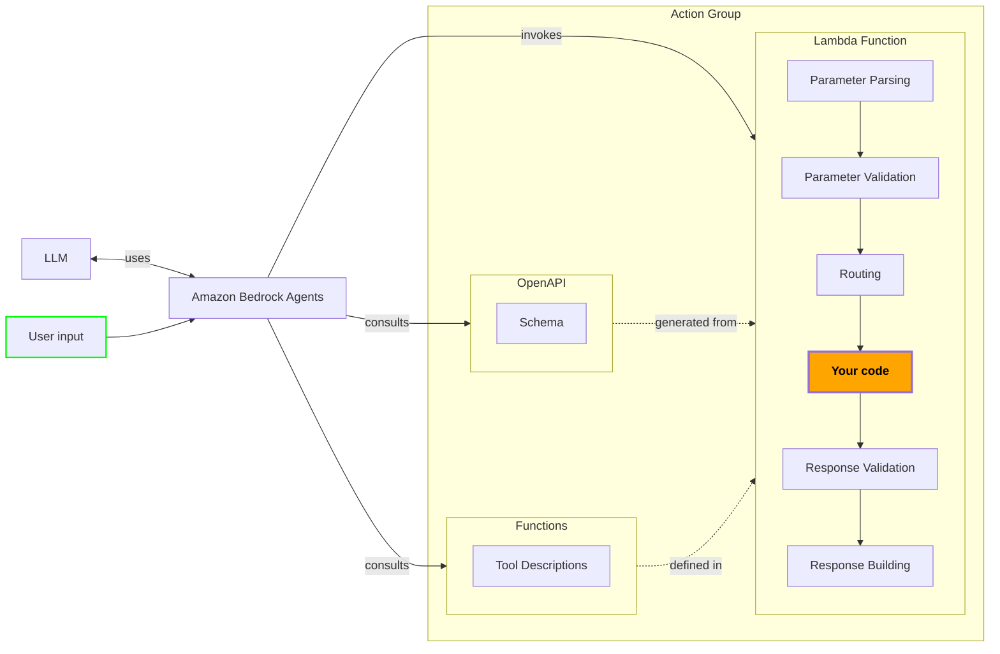
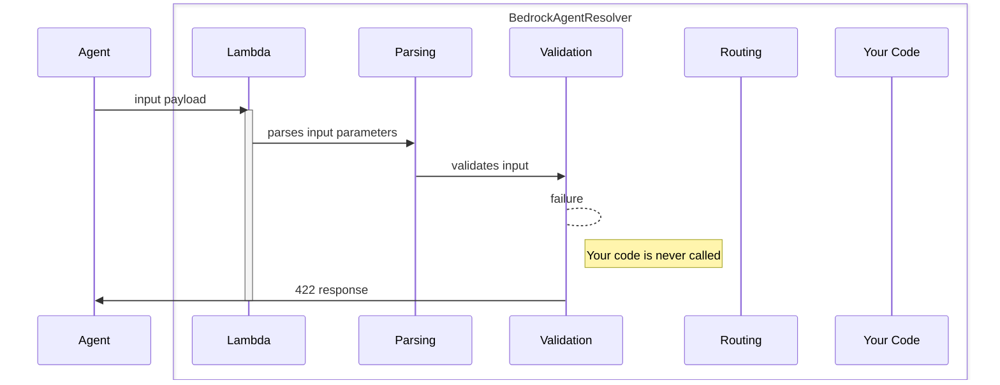
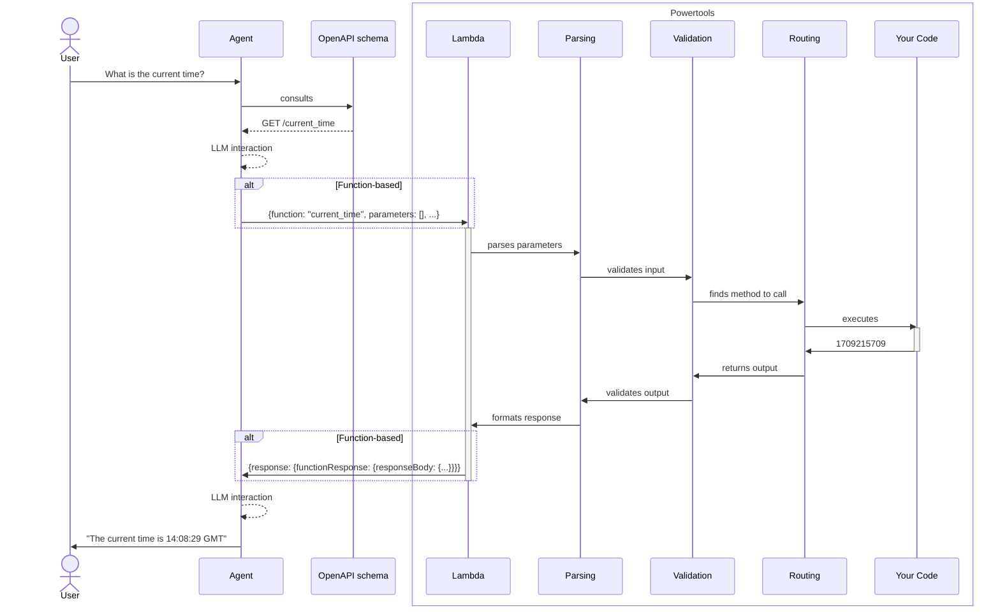

<!-- Generated by scripts/build_agent_skill_references.py from core/event_handler/bedrock_agents.md. Do not edit by hand. -->
# Event Handler Bedrock Agents

Source of truth: https://docs.powertools.aws.dev/lambda/python/latest/core/event_handler/bedrock_agents/

Create [Amazon Bedrock Agents](https://docs.aws.amazon.com/bedrock/latest/userguide/agents.html#agents-how) using event handlers with two different action groups approaches:

* OpenAPI schema
* Function details

<center>

</center>

## Key features

* Minimal boilerplate to build Amazon Bedrock Agents
* Support for both OpenAPI-based and Function-based actions
* Automatic generation of [OpenAPI schemas](https://www.openapis.org/) from your business logic code
* Built-in data validation for requests and responses
* Similar experience to authoring [REST and HTTP APIs](api_gateway.md)

## Terminology

**Data validation** automatically validates the user input and the response of your AWS Lambda function against a set of constraints defined by you.

**Event handler** is a Powertools for AWS feature that processes an event, runs data parsing and validation, routes the request to a specific function, and returns a response to the caller in the proper format.

**[OpenAPI schema](https://www.openapis.org/)** is an industry standard JSON-serialized string that represents the structure and parameters of your API.

**Function details** consist of a list of parameters, defined by their name, [data type](https://docs.aws.amazon.com/bedrock/latest/APIReference/API_agent_ParameterDetail.html), and whether they are required. The agent uses these configurations to determine what information it needs to elicit from the user.

**Action group** is a collection of two resources where you define the actions that the agent should carry out when invoking your Lambda function.

**Large Language Models (LLM)** are very large deep learning models that are pre-trained on vast amounts of data, capable of extracting meanings from a sequence of text and understanding the relationship between words and phrases on it.

**Amazon Bedrock Agent** is an Amazon Bedrock feature to build and deploy conversational agents that can interact with your customers using Large Language Models (LLM) and AWS Lambda functions.

> **Tip: All examples shared in this documentation are available within the [project repository](https://github.com/aws-powertools/powertools-lambda-python/tree/develop/examples)**

## Choose your Action Group

An action group defines actions that the agent can help the user perform. You can define action groups as OpenAPI-based or Function-based.

| Aspect               | OpenAPI-based Actions                                           | Function-based Actions                                          |
|----------------------|------------------------------------------------------------------|----------------------------------------------------------------|
| Definition Style      | `@app.get("/path", description="")`<br>`@app.post("/path", description="")` | `@app.tool(name="")`                               |
| Parameter Handling    | Path, query, and body parameters                                 | Function parameters                                           |
| Use Case              | REST-like APIs, complex request/response structures              | Direct function calls, simpler input                          |
| Response object       | Via `BedrockResponse`                                            | Via `BedrockFunctionResponse`                                 |
| Best For              | - Complex APIs with multiple endpoints<br>- When OpenAPI spec is required<br>- Integration with existing REST APIs | - Simple function-based actions<br>- Direct LLM-to-function mapping |

## Getting started

### Install

> **Info: This is unnecessary if you're installing Powertools for AWS Lambda (Python) via [Lambda Layer/SAR](../../getting-started/install.md#lambda-layer).**

If you define the action group setting up an **OpenAPI schema**, you need to add `pydantic` as a dependency in your preferred tool _e.g., requirements.txt, pyproject.toml_. At this time, we only support Pydantic V2.

### Your first Agent

To create an agent, use the `BedrockAgentResolver` or the `BedrockAgentFunctionResolver` to annotate your actions.
This is similar to the way [all the other Event Handler](api_gateway.md) resolvers work.

The resolvers used by Amazon Bedrock Agents are compatible with all Powertools for AWS Lambda [features](../../index.md#features).
For reference, we use [Logger](../logger.md) and [Tracer](../tracer.md) in this example.

**OpenAPI-based actions**

**Lambda handler**

```python
from time import time

from aws_lambda_powertools import Logger, Tracer
from aws_lambda_powertools.event_handler import BedrockAgentResolver
from aws_lambda_powertools.utilities.typing import LambdaContext

tracer = Tracer()
logger = Logger()
app = BedrockAgentResolver()

@app.get("/current_time", description="Gets the current time in seconds")  # (1)!
@tracer.capture_method
def current_time() -> int:
    return int(time())

@logger.inject_lambda_context
@tracer.capture_lambda_handler
def lambda_handler(event: dict, context: LambdaContext):
    return app.resolve(event, context)  # (2)!
```

	1. `description` is a **required** field that should contain a human readable description of your action.
	2. We take care of **parsing**, **validating**, **routing** and **responding** to the request.

**OpenAPI schema**

	Powertools for AWS Lambda [generates this automatically](#generating-openapi-schemas) from the Lambda handler.

	```json
	{
	  "openapi": "3.0.3",
	  "info": {
	    "title": "Powertools API",
	    "version": "1.0.0"
	  },
	  "servers": [
	    {
	      "url": "/"
	    }
	  ],
	  "paths": {
	    "/current_time": {
	      "get": {
	        "summary": "GET /current_time",
	        "description": "Gets the current time in seconds",
	        "operationId": "current_time_current_time_get",
	        "responses": {
	          "200": {
	            "description": "Successful Response",
	            "content": {
	              "application/json": {
	                "schema": {
	                  "type": "integer",
	                  "title": "Return"
	                }
	              }
	            }
	          },
	          "422": {
	            "description": "Validation Error",
	            "content": {
	              "application/json": {
	                "schema": {
	                  "$ref": "#/components/schemas/HTTPValidationError"
	                }
	              }
	            }
	          }
	        }
	      }
	    }
	  },
	  "components": {
	    "schemas": {
	      "HTTPValidationError": {
	        "properties": {
	          "detail": {
	            "items": {
	              "$ref": "#/components/schemas/ValidationError"
	            },
	            "type": "array",
	            "title": "Detail"
	          }
	        },
	        "type": "object",
	        "title": "HTTPValidationError"
	      },
	      "ValidationError": {
	        "properties": {
	          "loc": {
	            "items": {
	              "anyOf": [
	                {
	                  "type": "string"
	                },
	                {
	                  "type": "integer"
	                }
	              ]
	            },
	            "type": "array",
	            "title": "Location"
	          },
	          "msg": {
	            "type": "string",
	            "title": "Message"
	          },
	          "type": {
	            "type": "string",
	            "title": "Error Type"
	          }
	        },
	        "type": "object",
	        "required": [
	          "loc",
	          "msg",
	          "type"
	        ],
	        "title": "ValidationError"
	      }
	    }
	  }
	}
	```

**Input payload**

	```json
	{
	  "sessionId": "123456789012345",
	  "sessionAttributes": {},
	  "inputText": "What is the current time?",
	  "promptSessionAttributes": {},
	  "apiPath": "/current_time",
	  "agent": {
	    "name": "TimeAgent",
	    "version": "DRAFT",
	    "id": "XLHH72XNF2",
	    "alias": "TSTALIASID"
	  },
	  "httpMethod": "GET",
	  "messageVersion": "1.0",
	  "actionGroup": "CurrentTime"
	}
	```

**Output payload**

	```json
	{
	  "messageVersion": "1.0",
	  "response": {
	    "actionGroup": "CurrentTime",
	    "apiPath": "/current_time",
	    "httpMethod": "GET",
	    "httpStatusCode": 200,
	    "responseBody": {
	      "application/json": {
	        "body": "1704708165"
	      }
	    }
	  }
	}
	```

**Function-based actions**
**Lambda handler**

```python
from time import time

from aws_lambda_powertools import Logger, Tracer
from aws_lambda_powertools.event_handler import BedrockAgentFunctionResolver
from aws_lambda_powertools.utilities.typing import LambdaContext

tracer = Tracer()
logger = Logger()
app = BedrockAgentFunctionResolver()

@app.tool(name="currentTime", description="Gets the current time in seconds")  # (1)!
@tracer.capture_method
def current_time() -> int:
    return int(time())

@logger.inject_lambda_context
@tracer.capture_lambda_handler
def lambda_handler(event: dict, context: LambdaContext):
    return app.resolve(event, context)  # (2)!
```

	1. `name` and `description` are optional here.
	2. We take care of **parsing**, **validating**, **routing** and **responding** to the request.

**Input payload**

	```json
	{
	  "messageVersion": "1.0",
	  "agent": {
	    "name": "TimeAgent",
	    "id": "XLHH72XNF2",
	    "alias": "TSTALIASID",
	    "version": "DRAFT"
	  },
	  "inputText": "What is the current time?",
	  "sessionId": "123456789012345",
	  "actionGroup": "CurrentTime",
	  "function": "CurrentTime",
	  "parameters": [],
	  "sessionAttributes": {},
	  "promptSessionAttributes": {}
	}
	```

**Output payload**

	```json
	{
	    "messageVersion": "1.0",
	    "response": {
	        "actionGroup": "CurrentTime",
	        "function": "CurrentTime",
	        "functionResponse": {
	            "responseBody": {
	                "application/json": {
	                    "body": "1704708165"
	                }
	            }
	        }
	    }
	}
	```

### Accessing custom request fields

The event sent by Amazon Bedrock Agents into your Lambda function contains a [number of extra event fields](#request_fields_table), exposed in the `app.current_event` field.

> **Note: Why is this useful?**

	You can for instance identify new conversations (`session_id`) or store and analyze entire conversations (`input_text`).

**Accessing request fields**

	In this example, we [append correlation data](../logger.md#appending-additional-keys) to all generated logs.
 	This can be used to aggregate logs by `session_id` and observe the entire conversation between a user and the Agent.

	```python
	from time import time

	from aws_lambda_powertools import Logger
	from aws_lambda_powertools.event_handler import BedrockAgentResolver
	from aws_lambda_powertools.utilities.typing import LambdaContext

	logger = Logger()
	app = BedrockAgentResolver()

	@app.get("/current_time", description="Gets the current time in seconds")
	def current_time() -> int:
	    logger.append_keys(
	        session_id=app.current_event.session_id,
	        action_group=app.current_event.action_group,
	        input_text=app.current_event.input_text,
	    )

	    logger.info("Serving current_time")
	    return int(time())

	@logger.inject_lambda_context
	def lambda_handler(event: dict, context: LambdaContext):
	    return app.resolve(event, context)
	```

<a id="request_fields_table"></a>

The input event fields available depend on your Agent's configuration (OpenAPI-based or Function-based):

| Name | Type | Description | OpenAPI | Function |
|------|------|-------------|----------|-----------|
| message_version | str | The version of the message format. Amazon Bedrock only supports version 1.0. | ✅ | ✅ |
| agent | BedrockAgentInfo | Contains information about the name, ID, alias, and version of the agent. | ✅ | ✅ |
| input_text | str | The user input for the conversation turn. | ✅ | ✅ |
| session_id | str | The unique identifier of the agent session. | ✅ | ✅ |
| action_group | str | The name of the action group. | ✅ | ✅ |
| api_path | str | The path to the API operation, as defined in the OpenAPI schema. | ✅ | ❌ |
| http_method | str | The method of the API operation, as defined in the OpenAPI schema. | ✅ | ❌ |
| function | str | The name of the function being called. | ❌ | ✅ |
| parameters | List[Parameter] | Contains parameters with name, type, and value properties. | ✅ | ✅ |
| request_body | BedrockAgentRequestBody | Contains the request body and its properties. | ✅ | ❌ |
| session_attributes | Dict[str, str] | Contains session attributes and their values. | ✅ | ✅ |
| prompt_session_attributes | Dict[str, str] | Contains prompt attributes and their values. | ✅ | ✅ |

## OpenAPI-based actions

### Generating OpenAPI schemas

Use the `get_openapi_json_schema` function provided by the resolver to produce a JSON-serialized string that represents your OpenAPI schema.
You can print this string or save it to a file. You'll use the file later when creating the Agent.

You'll need to regenerate the OpenAPI schema and update your Agent everytime your API changes.

**app.py**

```python
from time import time

from aws_lambda_powertools import Logger, Tracer
from aws_lambda_powertools.event_handler import BedrockAgentResolver
from aws_lambda_powertools.utilities.typing import LambdaContext

tracer = Tracer()
logger = Logger()
app = BedrockAgentResolver()

@app.get("/current_time", description="Gets the current time in seconds")
@tracer.capture_method
def current_time() -> int:
    return int(time())

@logger.inject_lambda_context
@tracer.capture_lambda_handler
def lambda_handler(event: dict, context: LambdaContext):
    return app.resolve(event, context)

if __name__ == "__main__":  # (1)!
    print(app.get_openapi_json_schema())  # (2)!
```

	1. This ensures that it's only executed when running the file directly, and not when running on the Lambda runtime.
    2. You can use [additional options](#customizing-api-operations) to customize the OpenAPI schema.

**OpenAPI schema**

```json
{
  "openapi": "3.0.3",
  "info": {
    "title": "Powertools API",
    "version": "1.0.0"
  },
  "servers": [
    {
      "url": "/"
    }
  ],
  "paths": {
    "/current_time": {
      "get": {
        "summary": "GET /current_time",
        "description": "Gets the current time in seconds",
        "operationId": "current_time_current_time_get",
        "responses": {
          "200": {
            "description": "Successful Response",
            "content": {
              "application/json": {
                "schema": {
                  "type": "integer",
                  "title": "Return"
                }
              }
            }
          },
          "422": {
            "description": "Validation Error",
            "content": {
              "application/json": {
                "schema": {
                  "$ref": "#/components/schemas/HTTPValidationError"
                }
              }
            }
          }
        }
      }
    }
  },
  "components": {
    "schemas": {
      "HTTPValidationError": {
        "properties": {
          "detail": {
            "items": {
              "$ref": "#/components/schemas/ValidationError"
            },
            "type": "array",
            "title": "Detail"
          }
        },
        "type": "object",
        "title": "HTTPValidationError"
      },
      "ValidationError": {
        "properties": {
          "loc": {
            "items": {
              "anyOf": [
                {
                  "type": "string"
                },
                {
                  "type": "integer"
                }
              ]
            },
            "type": "array",
            "title": "Location"
          },
          "msg": {
            "type": "string",
            "title": "Message"
          },
          "type": {
            "type": "string",
            "title": "Error Type"
          }
        },
        "type": "object",
        "required": [
          "loc",
          "msg",
          "type"
        ],
        "title": "ValidationError"
      }
    }
  }
}
```

To get the OpenAPI schema, run the Python script from your terminal.
The script will generate the schema directly to standard output, which you can redirect to a file.

```sh
python3 app.py > schema.json
```

### Crafting effective OpenAPI schemas

Working with Amazon Bedrock Agents will introduce [non-deterministic behaviour to your system](https://docs.aws.amazon.com/bedrock/latest/userguide/agents-how.html#agents-rt).

> **Note: Why is that?**

	Amazon Bedrock uses LLMs to understand and respond to user input.
	These models are trained on vast amounts of data and are capable of extracting meanings from a sequence of text and understanding the relationship between words and phrases on it.
	However, this means that the same input can result in different outputs, depending on the characteristics of the LLM being used.

The OpenAPI schema provides context and semantics to the Agent that will support the decision process for invoking our Lambda function.
Sparse or ambiguous schemas can result in unexpected outcomes.

We recommend enriching your OpenAPI schema with as many details as possible to help the Agent understand your functions, and make correct invocations.
To achieve that, keep the following suggestions in mind:

* Always describe your function behaviour using the `description` field in your annotations
* When refactoring, update your description field to match the function outcomes
* Use distinct `description` for each function to have clear separation of semantics

### Validating input and output

You can define the expected format for incoming data and responses by using type annotations.
Define constraints using standard Python types, [dataclasses](https://docs.python.org/3/library/dataclasses.html) or [Pydantic models](https://docs.pydantic.dev/latest/concepts/models/).
Pydantic is a popular library for data validation using Python type annotations.

The examples below uses [Pydantic's EmailStr](https://docs.pydantic.dev/2.0/usage/types/string_types/#emailstr) to validate the email address passed to the `schedule_meeting` function.
The function then returns a boolean indicating if the meeting was successfully scheduled.

**Lambda handler**

	```python
	from typing import Annotated

	from pydantic import EmailStr

	from aws_lambda_powertools import Logger, Tracer
	from aws_lambda_powertools.event_handler import BedrockAgentResolver
	from aws_lambda_powertools.event_handler.openapi.params import Body, Query
	from aws_lambda_powertools.utilities.typing import LambdaContext

	tracer = Tracer()
	logger = Logger()
	app = BedrockAgentResolver()  # (1)!

	@app.get("/schedule_meeting", description="Schedules a meeting with the team")
	@tracer.capture_method
	def schedule_meeting(
	    email: Annotated[EmailStr, Query(description="The email address of the customer")],  # (2)!
	) -> Annotated[bool, Body(description="Whether the meeting was scheduled successfully")]:  # (3)!
	    logger.info("Scheduling a meeting", email=email)
	    return True

	@logger.inject_lambda_context
	@tracer.capture_lambda_handler
	def lambda_handler(event: dict, context: LambdaContext):
	    return app.resolve(event, context)
	```

	1. No need to add the `enable_validation` parameter, as it's enabled by default.
	2. Describe each input using human-readable descriptions
	3. Add the typing annotations to your parameters and return types, and let the event handler take care of the rest

**OpenAPI schema**

	```json
	{
	  "openapi": "3.0.3",
	  "info": {
	    "title": "Powertools API",
	    "version": "1.0.0"
	  },
	  "servers": [
	    {
	      "url": "/"
	    }
	  ],
	  "paths": {
	    "/schedule_meeting": {
	      "get": {
	        "summary": "GET /schedule_meeting",
	        "description": "Schedules a meeting with the team",
	        "operationId": "schedule_meeting_schedule_meeting_get",
	        "parameters": [
	          {
	            "description": "The email address of the customer",
	            "required": true,
	            "schema": {
	              "type": "string",
	              "format": "email",
	              "title": "Email",
	              "description": "The email address of the customer"
	            },
	            "name": "email",
	            "in": "query"
	          }
	        ],
	        "responses": {
	          "200": {
	            "description": "Successful Response",
	            "content": {
	              "application/json": {
	                "schema": {
	                  "type": "boolean",
	                  "title": "Return",
	                  "description": "Whether the meeting was scheduled successfully"
	                }
	              }
	            }
	          },
	          "422": {
	            "description": "Validation Error",
	            "content": {
	              "application/json": {
	                "schema": {
	                  "$ref": "#/components/schemas/HTTPValidationError"
	                }
	              }
	            }
	          }
	        }
	      }
	    }
	  },
	  "components": {
	    "schemas": {
	      "HTTPValidationError": {
	        "properties": {
	          "detail": {
	            "items": {
	              "$ref": "#/components/schemas/ValidationError"
	            },
	            "type": "array",
	            "title": "Detail"
	          }
	        },
	        "type": "object",
	        "title": "HTTPValidationError"
	      },
	      "ValidationError": {
	        "properties": {
	          "loc": {
	            "items": {
	              "anyOf": [
	                {
	                  "type": "string"
	                },
	                {
	                  "type": "integer"
	                }
	              ]
	            },
	            "type": "array",
	            "title": "Location"
	          },
	          "msg": {
	            "type": "string",
	            "title": "Message"
	          },
	          "type": {
	            "type": "string",
	            "title": "Error Type"
	          }
	        },
	        "type": "object",
	        "required": [
	          "loc",
	          "msg",
	          "type"
	        ],
	        "title": "ValidationError"
	      }
	    }
	  }
	}
	```

**Input payload**

	```json
	{
	  "sessionId": "123456789012345",
	  "sessionAttributes": {},
	  "inputText": "Schedule a meeting with the team. My email is foo@example.org",
	  "promptSessionAttributes": {},
	  "apiPath": "/schedule_meeting",
	  "parameters": [
	    {
	      "name": "email",
	      "type": "string",
	      "value": "foo@example.org"
	    }
	  ],
	  "agent": {
	    "name": "TimeAgent",
	    "version": "DRAFT",
	    "id": "XLHH72XNF2",
	    "alias": "TSTALIASID"
	  },
	  "httpMethod": "GET",
	  "messageVersion": "1.0",
	  "actionGroup": "SupportAssistant"
	}
	```

**Output payload**

	```json
	{
	  "messageVersion": "1.0",
	  "response": {
	    "actionGroup": "SupportAssistant",
	    "apiPath": "/schedule_meeting",
	    "httpMethod": "GET",
	    "httpStatusCode": 200,
	    "responseBody": {
	      "application/json": {
	        "body": "true"
	      }
	    }
	  }
	}
	```

#### When validation fails

If the request validation fails, your event handler will not be called, and an error message is returned to Bedrock.
Similarly, if the response fails validation, your handler will abort the response.

> **Info: What does this mean for my Agent?**

	The event handler will always return a response according to the schema (OpenAPI) or type hints (Function-based).
	A validation failure in OpenAPI-based actions results in a [422 response](https://developer.mozilla.org/en-US/docs/Web/HTTP/Status/422).
	For both approaches, how Amazon Bedrock interprets that failure is non-deterministic, since it depends on the characteristics of the LLM being used.

**OpenAPI-based Input payload**

	```json
	{
	  "sessionId": "123456789012345",
	  "sessionAttributes": {},
	  "inputText": "Schedule a meeting with the team. My email is foo@example@org",
	  "promptSessionAttributes": {},
	  "apiPath": "/schedule_meeting",
	  "parameters": [
	    {
	      "name": "email",
	      "type": "string",
	      "value": "foo@example@org"
	    }
	  ],
	  "agent": {
	    "name": "TimeAgent",
	    "version": "DRAFT",
	    "id": "XLHH72XNF2",
	    "alias": "TSTALIASID"
	  },
	  "httpMethod": "GET",
	  "messageVersion": "1.0",
	  "actionGroup": "SupportAssistant"
	}
	```

**OpenAPI-based Output payload**

	```json
	{
	  "messageVersion": "1.0",
	  "response": {
	    "actionGroup": "SupportAssistant",
	    "apiPath": "/schedule_meeting",
	    "httpMethod": "GET",
	    "httpStatusCode": 200,
	    "responseBody": {
	      "application/json": {
	        "body": "{\"statusCode\":422,\"detail\":[{\"loc\":[\"query\",\"email\"],\"type\":\"value_error.email\"}]}"
	      }
	    }
	  }
	}
	```

<center>

</center>

### Video walkthrough

To create an Agent for Amazon Bedrock, refer to the [official documentation](https://docs.aws.amazon.com/bedrock/latest/userguide/agents-create.html) provided by AWS.

The following video demonstrates the end-to-end process:

<center>
<iframe width="720" height="405" src="https://www.youtube-nocookie.com/embed/NWoC5FTSt7s?si=AG2qpLJbxCkyiLma&amp;controls=1" title="YouTube video player" frameborder="0" allow="accelerometer; autoplay; clipboard-write; encrypted-media; gyroscope; picture-in-picture; web-share" allowfullscreen></iframe>
</center>

During the creation process, you should use the schema [previously generated](#generating-openapi-schemas) when prompted for an OpenAPI specification.

### Advanced

#### Additional metadata

To enrich the view that Amazon Bedrock Agents has of your Lambda functions,
use a combination of [Pydantic Models](https://docs.pydantic.dev/latest/concepts/models/) and [OpenAPI](https://www.openapis.org/) type annotations to add constraints to your APIs parameters.

> **Info: When is this useful?**

	Adding constraints to your function parameters can help you to enforce data validation and improve the understanding of your APIs by Amazon Bedrock.

#### Customizing OpenAPI parameters

Whenever you use OpenAPI parameters to validate [query strings](api_gateway.md#validating-query-strings) or [path parameters](api_gateway.md#validating-path-parameters), you can enhance validation and OpenAPI documentation by using any of these parameters:

| Field name            | Type                 | Description                                                                                                       |
| --------------------- | -------------------- | ----------------------------------------------------------------------------------------------------------------- |
| `alias`               | `str`                | Alternative name for a field, used when serializing and deserializing data                                        |
| `validation_alias`    | `str`                | Alternative name for a field during validation (but not serialization)                                            |
| `serialization_alias` | `str`                | Alternative name for a field during serialization (but not during validation)                                     |
| `description`         | `str`                | Human-readable description                                                                                        |
| `gt`                  | `float`              | Greater than. If set, value must be greater than this. Only applicable to numbers                                 |
| `ge`                  | `float`              | Greater than or equal. If set, value must be greater than or equal to this. Only applicable to numbers            |
| `lt`                  | `float`              | Less than. If set, value must be less than this. Only applicable to numbers                                       |
| `le`                  | `float`              | Less than or equal. If set, value must be less than or equal to this. Only applicable to numbers                  |
| `min_length`          | `int`                | Minimum length for strings                                                                                        |
| `max_length`          | `int`                | Maximum length for strings                                                                                        |
| `pattern`             | `string`             | A regular expression that the string must match.                                                                  |
| `strict`              | `bool`               | If `True`, strict validation is applied to the field. See [Strict Mode](https://docs.pydantic.dev/latest/concepts/strict_mode/){target"_blank" rel="nofollow"} for details |
| `multiple_of`         | `float`              | Value must be a multiple of this. Only applicable to numbers                                                      |
| `allow_inf_nan`       | `bool`               | Allow `inf`, `-inf`, `nan`. Only applicable to numbers                                                            |
| `max_digits`          | `int`                | Maximum number of allow digits for strings                                                                        |
| `decimal_places`      | `int`                | Maximum number of decimal places allowed for numbers                                                              |
| `openapi_examples`    | `dict[str, Example]` | A list of examples to be displayed in the SwaggerUI interface. Avoid using the `examples` field for this purpose. |
| `deprecated`          | `bool`               | Marks the field as deprecated                                                                                     |
| `include_in_schema`   | `bool`               | If `False` the field will not be part of the exported OpenAPI schema                                              |
| `json_schema_extra`   | `JsonDict`           | Any additional JSON schema data for the schema property                                                           |

To implement these customizations, include extra constraints when defining your parameters:

```python title="customizing_api_parameters.py" title="Customizing API parameters"
from typing import Annotated

import requests

from aws_lambda_powertools import Logger
from aws_lambda_powertools.event_handler import BedrockAgentResolver
from aws_lambda_powertools.event_handler.openapi.params import Body, Query
from aws_lambda_powertools.utilities.typing import LambdaContext

app = BedrockAgentResolver()

logger = Logger()

@app.post(
    "/todos",
    description="Creates a TODO",
)
def create_todo(
    title: Annotated[str, Query(max_length=200, strict=True, description="The TODO title")],  # (1)!
) -> Annotated[bool, Body(description="Was the TODO created correctly?")]:
    todo = requests.post("https://jsonplaceholder.typicode.com/todos", data={"title": title})
    try:
        todo.raise_for_status()
        return True
    except Exception:
        logger.exception("Error creating TODO")
        return False

def lambda_handler(event: dict, context: LambdaContext) -> dict:
    return app.resolve(event, context)
```

1. Title should not be larger than 200 characters and [strict mode](https://docs.pydantic.dev/latest/concepts/strict_mode/) is activated

#### Customizing API operations

Customize your API endpoints by adding metadata to endpoint definitions.

Here's a breakdown of various customizable fields:

| Field Name             | Type                                    | Description                                                                                                                                                                                                                                                                                                                |
| ---------------------- | --------------------------------------- | -------------------------------------------------------------------------------------------------------------------------------------------------------------------------------------------------------------------------------------------------------------------------------------------------------------------------- |
| `summary`              | `str`                                   | A concise overview of the main functionality of the endpoint. This brief introduction is usually displayed in autogenerated API documentation and helps consumers quickly understand what the endpoint does.                                                                                                               |
| `description`          | `str`                                   | A more detailed explanation of the endpoint, which can include information about the operation's behavior, including side effects, error states, and other operational guidelines.                                                                                                                                         |
| `responses`            | `Dict[int, Dict[str, OpenAPIResponse]]` | A dictionary that maps each HTTP status code to a Response Object as defined by the [OpenAPI Specification](https://swagger.io/specification/#response-object). This allows you to describe expected responses, including default or error messages, and their corresponding schemas or models for different status codes. |
| `response_description` | `str`                                   | Provides the default textual description of the response sent by the endpoint when the operation is successful. It is intended to give a human-readable understanding of the result.                                                                                                                                       |
| `tags`                 | `List[str]`                             | Tags are a way to categorize and group endpoints within the API documentation. They can help organize the operations by resources or other heuristic.                                                                                                                                                                      |
| `operation_id`         | `str`                                   | A unique identifier for the operation, which can be used for referencing this operation in documentation or code. This ID must be unique across all operations described in the API.                                                                                                                                       |
| `include_in_schema`    | `bool`                                  | A boolean value that determines whether or not this operation should be included in the OpenAPI schema. Setting it to `False` can hide the endpoint from generated documentation and schema exports, which might be useful for private or experimental endpoints.                                                          |
| `deprecated`           | `bool`                                  | A boolean value that determines whether or not this operation should be marked as deprecated in the OpenAPI schema.                                                                                                                                                                                                        |
| `status_code`          | `int`                                   | The default HTTP status code for successful responses. Defaults to `200`. This value is used both in the OpenAPI schema and as the actual response status code when the handler returns a dictionary or plain value (not a `Response` object or tuple).                                                                    |

To implement these customizations, include extra parameters when defining your routes:

```python title="customizing_api_operations.py" title="Customzing API operations"
from typing import Annotated

import requests

from aws_lambda_powertools.event_handler import BedrockAgentResolver
from aws_lambda_powertools.event_handler.openapi.params import Body, Path
from aws_lambda_powertools.utilities.typing import LambdaContext

app = BedrockAgentResolver()

@app.get(
    "/todos/<todo_id>",
    summary="Retrieves a TODO item, returning it's title",
    description="Loads a TODO item identified by the `todo_id`",
    response_description="The TODO title",
    responses={
        200: {"description": "TODO item found"},
        404: {
            "description": "TODO not found",
        },
    },
    tags=["todos"],
)
def get_todo_title(
    todo_id: Annotated[int, Path(description="The ID of the TODO item from which to retrieve the title")],
) -> Annotated[str, Body(description="The TODO title")]:
    todo = requests.get(f"https://jsonplaceholder.typicode.com/todos/{todo_id}")
    todo.raise_for_status()

    return todo.json()["title"]

def lambda_handler(event: dict, context: LambdaContext) -> dict:
    return app.resolve(event, context)
```

#### Enabling user confirmation

You can enable user confirmation with Bedrock Agents to have your application ask for explicit user approval before invoking an action.

```python title="enabling_user_confirmation.py" title="Enabling user confirmation"
from time import time

from aws_lambda_powertools import Logger
from aws_lambda_powertools.event_handler import BedrockAgentResolver
from aws_lambda_powertools.utilities.typing import LambdaContext

logger = Logger()
app = BedrockAgentResolver()

@app.get(
    "/current_time",
    description="Gets the current time in seconds",
    openapi_extensions={"x-requireConfirmation": "ENABLED"},  # (1)!
)
def current_time() -> int:
    return int(time())

@logger.inject_lambda_context
def lambda_handler(event: dict, context: LambdaContext):
    return app.resolve(event, context)

if __name__ == "__main__":
    print(app.get_openapi_json_schema())
```

1. Add an openapi extension

#### OpenAPI-based Responses

> **Info: Note**

	The default response only includes the essential fields to keep the payload size minimal, as AWS Lambda has a maximum response size of 25 KB.

You can use `BedrockResponse` class to add additional fields as needed, such as [session attributes, prompt session attributes, and knowledge base configurations](https://docs.aws.amazon.com/bedrock/latest/userguide/agents-lambda.html#agents-lambda-response).

> **Tip: Content Type Behavior**

	Amazon Bedrock Agents only support TEXT content type in the responseBody. All response bodies are automatically serialized as JSON strings regardless of the `content_type` parameter you provide. The `content_type` parameter exists for API consistency but does not affect the actual format sent to Bedrock Agents.
	Learn more: [AWS Bedrock Lambda Integration](https://docs.aws.amazon.com/bedrock/latest/userguide/agents-lambda.html)

```python title="working_with_bedrockresponse.py" title="Customzing your Bedrock Response"
from http import HTTPStatus

from aws_lambda_powertools import Logger, Tracer
from aws_lambda_powertools.event_handler import BedrockAgentResolver
from aws_lambda_powertools.event_handler.api_gateway import BedrockResponse
from aws_lambda_powertools.utilities.typing import LambdaContext

tracer = Tracer()
logger = Logger()
app = BedrockAgentResolver()

@app.get("/return_with_session", description="Returns a hello world with session attributes")
@tracer.capture_method
def hello_world():
    return BedrockResponse(
        status_code=HTTPStatus.OK.value,
        body={"message": "Hello from Bedrock!"},
        session_attributes={"user_id": "123"},
        prompt_session_attributes={"context": "testing"},
        knowledge_bases_configuration=[
            {
                "knowledgeBaseId": "kb-123",
                "retrievalConfiguration": {
                    "vectorSearchConfiguration": {"numberOfResults": 3, "overrideSearchType": "HYBRID"},
                },
            },
        ],
    )

@logger.inject_lambda_context
@tracer.capture_lambda_handler
def lambda_handler(event: dict, context: LambdaContext):
    return app.resolve(event, context)
```

#### Bedrock requests under the hood

Powertools handle the request from the Agent, parse, validate, and route it to the correct method in your code. The response is then validated and formatted back to the Agent.

<center>

</center>

### Testing your code

Test your routes by passing an [Agent for Amazon Bedrock proxy event](https://docs.aws.amazon.com/bedrock/latest/userguide/agents-lambda.html#agents-lambda-input) request:

**assert_bedrock_agent_response.py**

	```python
	from dataclasses import dataclass

	import assert_bedrock_agent_response_module
	import pytest

	@dataclass
	class LambdaContext:
	    function_name: str = "test"
	    memory_limit_in_mb: int = 128
	    invoked_function_arn: str = "arn:aws:lambda:eu-west-1:123456789012:function:test"
	    aws_request_id: str = "da658bd3-2d6f-4e7b-8ec2-937234644fdc"

	@pytest.fixture
	def lambda_context() -> LambdaContext:
	    return LambdaContext()

	def test_lambda_handler(lambda_context: LambdaContext):
	    minimal_event = {
	        "apiPath": "/current_time",
	        "httpMethod": "GET",
	        "inputText": "What is the current time?",
	    }
	    # Example of Bedrock Agent API request event:
	    # https://docs.aws.amazon.com/bedrock/latest/userguide/agents-lambda.html#agents-lambda-input
	    ret = assert_bedrock_agent_response_module.lambda_handler(minimal_event, lambda_context)
	    assert ret["response"]["httpStatuScode"] == 200
	    assert ret["response"]["responseBody"]["application/json"]["body"] != ""
	```

**assert_bedrock_agent_response_module.py**

	```python
	import time
	from typing import Annotated

	from aws_lambda_powertools import Logger, Tracer
	from aws_lambda_powertools.event_handler import BedrockAgentResolver
	from aws_lambda_powertools.event_handler.openapi.params import Body
	from aws_lambda_powertools.utilities.typing import LambdaContext

	tracer = Tracer()
	logger = Logger()
	app = BedrockAgentResolver()

	@app.get("/current_time", description="Gets the current time")
	@tracer.capture_method
	def current_time() -> Annotated[int, Body(description="Current time in milliseconds")]:
	    return round(time.time() * 1000)

	@logger.inject_lambda_context
	@tracer.capture_lambda_handler
	def lambda_handler(event: dict, context: LambdaContext) -> dict:
	    return app.resolve(event, context)
	```

## Function-based Actions

The `BedrockAgentFunctionResolver` streamlines agent function development through three core capabilities:

* **Register Functions**: Use the `@app.tool()` decorator to expose your functions to Bedrock Agents

| Field | Required | Description |
|-------|----------|-------------|
| name | No | Custom name for your function. Uses the actual function name if omitted. |
| description | No | Explain what your function does to guide the agent's usage. |

* **Process Parameters**: Automatically maps input parameters from the agent to your function arguments
* **Format Responses**: Transforms your function outputs into properly structured Bedrock Agent responses

### Function-based Responses

> **Info: Note**

	The default response only includes the essential fields to keep the payload size minimal, as AWS Lambda has a maximum response size of 25 KB.

You can use `BedrockFunctionResponse` class to customize your response [with additional fields](https://docs.aws.amazon.com/bedrock/latest/userguide/agents-lambda.html#agents-lambda-response). This class allows you to:

* Return a response body
* Set session and prompt session attributes
* Set knowledge bases configurations
* Control the response state ("FAILURE" or "REPROMPT")

```python title="working_with_bedrockresponse.py" title="Customzing your Bedrock Function Response"
from aws_lambda_powertools.event_handler import BedrockAgentFunctionResolver, BedrockFunctionResponse
from aws_lambda_powertools.utilities.typing.lambda_context import LambdaContext

app = BedrockAgentFunctionResolver()

@app.tool(description="Function that demonstrates response customization")
def custom_response():
    return BedrockFunctionResponse(
        body="Hello World",
        session_attributes={"user_id": "123"},
        prompt_session_attributes={"last_action": "greeting"},
        response_state="REPROMPT",
        knowledge_bases=[{"name": "kb1", "enabled": True}],
    )

def lambda_handler(event: dict, context: LambdaContext):
    return app.resolve(event, context)
```
