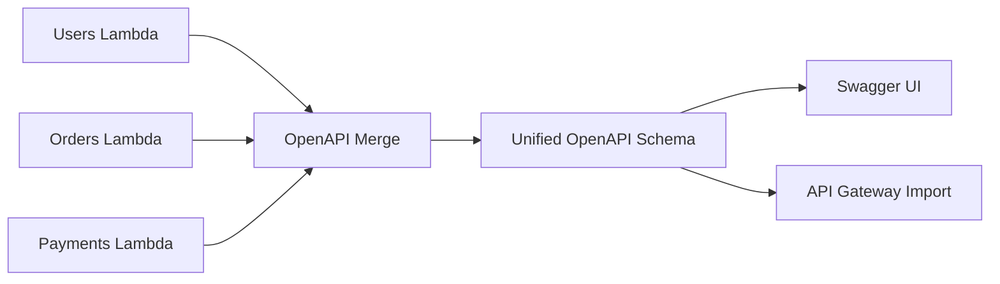

<!-- Generated by scripts/build_agent_skill_references.py from core/event_handler/openapi.md. Do not edit by hand. -->
# Event Handler Openapi

Source of truth: https://docs.powertools.aws.dev/lambda/python/latest/core/event_handler/openapi/

Powertools for AWS Lambda supports automatic OpenAPI schema generation from your route definitions and type annotations. This includes Swagger UI integration, schema customization, and OpenAPI Merge for micro-functions architectures.

## Key features

* **Automatic schema generation** from Pydantic models and type annotations
* **Swagger UI** for interactive API documentation
* **OpenAPI Merge** for generating unified schemas from multiple Lambda handlers
* **Security schemes** support (OAuth2, API Key, HTTP auth, etc.)
* **Customizable** metadata, operations, and parameters

## Swagger UI

Behind the scenes, the [data validation](api_gateway.md#data-validation) feature auto-generates an OpenAPI specification from your routes and type annotations. You can use [Swagger UI](https://swagger.io/tools/swagger-ui/) to visualize and interact with your API.

> **Note: This feature requires [data validation](api_gateway.md#data-validation) to be enabled.**

> **Warning: Important caveats**

| Caveat | Description |
| ------ | ----------- |
| Swagger UI is **publicly accessible by default** | Implement a [custom middleware](#customizing-swagger-ui) for authorization |
| You need to expose a **new route** | Expose `/swagger` path to Lambda |
| JS and CSS files are **embedded within Swagger HTML** | Consider enabling `compress` option for better performance |
| Authorization data is **lost** on browser close/refresh | Use `enable_swagger(persist_authorization=True)` to persist |

**enabling_swagger.py**

```python
import requests
from pydantic import BaseModel, Field

from aws_lambda_powertools import Logger, Tracer
from aws_lambda_powertools.event_handler import APIGatewayRestResolver
from aws_lambda_powertools.utilities.typing import LambdaContext

tracer = Tracer()
logger = Logger()
app = APIGatewayRestResolver(enable_validation=True)
app.enable_swagger(path="/swagger")  # (1)!

class Todo(BaseModel):
    userId: int
    id_: int = Field(alias="id")
    title: str
    completed: bool

@app.post("/todos")
def create_todo(todo: Todo) -> str:
    response = requests.post("https://jsonplaceholder.typicode.com/todos", json=todo.dict(by_alias=True))
    response.raise_for_status()

    return response.json()["id"]

@app.get("/todos")
def get_todos() -> list[Todo]:
    todo = requests.get("https://jsonplaceholder.typicode.com/todos")
    todo.raise_for_status()

    return todo.json()

def lambda_handler(event: dict, context: LambdaContext) -> dict:
    return app.resolve(event, context)
```

1. `enable_swagger` creates a route to serve Swagger UI and allows quick customizations.

Here's an example of what it looks like by default:


### Customizing Swagger UI

The Swagger UI appears by default at the `/swagger` path, but you can customize this to serve the documentation from another path and specify the source for Swagger UI assets.

**customizing_swagger.py**

```python
import requests
from pydantic import BaseModel, EmailStr, Field

from aws_lambda_powertools.event_handler import APIGatewayRestResolver
from aws_lambda_powertools.utilities.typing import LambdaContext

app = APIGatewayRestResolver(enable_validation=True)
app.enable_swagger(path="/_swagger", swagger_base_url="https://cdn.example.com/path/to/assets/")

class Todo(BaseModel):
    userId: int
    id_: int = Field(alias="id")
    title: str
    completed: bool

@app.get("/todos")
def get_todos_by_email(email: EmailStr) -> list[Todo]:
    todos = requests.get(f"https://jsonplaceholder.typicode.com/todos?email={email}")
    todos.raise_for_status()

    return todos.json()

def lambda_handler(event: dict, context: LambdaContext) -> dict:
    return app.resolve(event, context)
```

**customizing_swagger_middlewares.py**

Use middleware for security headers, authentication, or other request processing.

```python
import requests
from pydantic import BaseModel, EmailStr, Field

from aws_lambda_powertools.event_handler import APIGatewayRestResolver, Response
from aws_lambda_powertools.event_handler.middlewares import NextMiddleware
from aws_lambda_powertools.utilities.typing import LambdaContext

app = APIGatewayRestResolver(enable_validation=True)

def swagger_middleware(app: APIGatewayRestResolver, next_middleware: NextMiddleware) -> Response:
    is_authenticated = ...
    if not is_authenticated:
        return Response(status_code=400, body="Unauthorized")

    return next_middleware(app)

app.enable_swagger(middlewares=[swagger_middleware])

class Todo(BaseModel):
    userId: int
    id_: int = Field(alias="id")
    title: str
    completed: bool

@app.get("/todos")
def get_todos_by_email(email: EmailStr) -> list[Todo]:
    todos = requests.get(f"https://jsonplaceholder.typicode.com/todos?email={email}")
    todos.raise_for_status()

    return todos.json()

def lambda_handler(event: dict, context: LambdaContext) -> dict:
    return app.resolve(event, context)
```

## Customization

### Customizing parameters

Whenever you use OpenAPI parameters to validate [query strings](api_gateway.md#validating-query-strings) or [path parameters](api_gateway.md#validating-path-parameters), you can enhance validation and OpenAPI documentation by using any of these parameters:

| Field name            | Type                 | Description                                                                                                       |
| --------------------- | -------------------- | ----------------------------------------------------------------------------------------------------------------- |
| `alias`               | `str`                | Alternative name for a field, used when serializing and deserializing data                                        |
| `validation_alias`    | `str`                | Alternative name for a field during validation (but not serialization)                                            |
| `serialization_alias` | `str`                | Alternative name for a field during serialization (but not during validation)                                     |
| `description`         | `str`                | Human-readable description                                                                                        |
| `gt`                  | `float`              | Greater than. If set, value must be greater than this. Only applicable to numbers                                 |
| `ge`                  | `float`              | Greater than or equal. If set, value must be greater than or equal to this. Only applicable to numbers            |
| `lt`                  | `float`              | Less than. If set, value must be less than this. Only applicable to numbers                                       |
| `le`                  | `float`              | Less than or equal. If set, value must be less than or equal to this. Only applicable to numbers                  |
| `min_length`          | `int`                | Minimum length for strings                                                                                        |
| `max_length`          | `int`                | Maximum length for strings                                                                                        |
| `pattern`             | `string`             | A regular expression that the string must match.                                                                  |
| `strict`              | `bool`               | If `True`, strict validation is applied to the field. See [Strict Mode](https://docs.pydantic.dev/latest/concepts/strict_mode/){target"_blank" rel="nofollow"} for details |
| `multiple_of`         | `float`              | Value must be a multiple of this. Only applicable to numbers                                                      |
| `allow_inf_nan`       | `bool`               | Allow `inf`, `-inf`, `nan`. Only applicable to numbers                                                            |
| `max_digits`          | `int`                | Maximum number of allow digits for strings                                                                        |
| `decimal_places`      | `int`                | Maximum number of decimal places allowed for numbers                                                              |
| `openapi_examples`    | `dict[str, Example]` | A list of examples to be displayed in the SwaggerUI interface. Avoid using the `examples` field for this purpose. |
| `deprecated`          | `bool`               | Marks the field as deprecated                                                                                     |
| `include_in_schema`   | `bool`               | If `False` the field will not be part of the exported OpenAPI schema                                              |
| `json_schema_extra`   | `JsonDict`           | Any additional JSON schema data for the schema property                                                           |

### Customizing operations

Customize your API endpoints by adding metadata to endpoint definitions.

Here's a breakdown of various customizable fields:

| Field Name             | Type                                    | Description                                                                                                                                                                                                                                                                                                                |
| ---------------------- | --------------------------------------- | -------------------------------------------------------------------------------------------------------------------------------------------------------------------------------------------------------------------------------------------------------------------------------------------------------------------------- |
| `summary`              | `str`                                   | A concise overview of the main functionality of the endpoint. This brief introduction is usually displayed in autogenerated API documentation and helps consumers quickly understand what the endpoint does.                                                                                                               |
| `description`          | `str`                                   | A more detailed explanation of the endpoint, which can include information about the operation's behavior, including side effects, error states, and other operational guidelines.                                                                                                                                         |
| `responses`            | `Dict[int, Dict[str, OpenAPIResponse]]` | A dictionary that maps each HTTP status code to a Response Object as defined by the [OpenAPI Specification](https://swagger.io/specification/#response-object). This allows you to describe expected responses, including default or error messages, and their corresponding schemas or models for different status codes. |
| `response_description` | `str`                                   | Provides the default textual description of the response sent by the endpoint when the operation is successful. It is intended to give a human-readable understanding of the result.                                                                                                                                       |
| `tags`                 | `List[str]`                             | Tags are a way to categorize and group endpoints within the API documentation. They can help organize the operations by resources or other heuristic.                                                                                                                                                                      |
| `operation_id`         | `str`                                   | A unique identifier for the operation, which can be used for referencing this operation in documentation or code. This ID must be unique across all operations described in the API.                                                                                                                                       |
| `include_in_schema`    | `bool`                                  | A boolean value that determines whether or not this operation should be included in the OpenAPI schema. Setting it to `False` can hide the endpoint from generated documentation and schema exports, which might be useful for private or experimental endpoints.                                                          |
| `deprecated`           | `bool`                                  | A boolean value that determines whether or not this operation should be marked as deprecated in the OpenAPI schema.                                                                                                                                                                                                        |
| `status_code`          | `int`                                   | The default HTTP status code for successful responses. Defaults to `200`. This value is used both in the OpenAPI schema and as the actual response status code when the handler returns a dictionary or plain value (not a `Response` object or tuple).                                                                    |

To implement these customizations, include extra parameters when defining your routes:

**customizing_api_operations.py**

```python
import requests

from aws_lambda_powertools.event_handler import APIGatewayRestResolver
from aws_lambda_powertools.utilities.typing import LambdaContext

app = APIGatewayRestResolver(enable_validation=True)

@app.get(
    "/todos/<todo_id>",
    summary="Retrieves a todo item",
    description="Loads a todo item identified by the `todo_id`",
    response_description="The todo object",
    responses={
        200: {"description": "Todo item found"},
        404: {
            "description": "Item not found",
        },
    },
    tags=["Todos"],
)
def get_todo_title(todo_id: int) -> str:
    todo = requests.get(f"https://jsonplaceholder.typicode.com/todos/{todo_id}")
    todo.raise_for_status()

    return todo.json()["title"]

@app.post(
    "/todos",
    summary="Creates a new todo item",
    description="Creates a new todo item and returns it",
    response_description="The created todo object",
    status_code=201,
    tags=["Todos"],
)
def create_todo(title: str) -> dict:
    return {"id": 1, "title": title}

def lambda_handler(event: dict, context: LambdaContext) -> dict:
    return app.resolve(event, context)
```

### Customizing metadata

Defining and customizing OpenAPI metadata gives detailed, top-level information about your API. Use the method `app.configure_openapi` to set and tailor this metadata:

| Field Name         | Type           | Description                                                                                                                                                                         |
| ------------------ | -------------- | ----------------------------------------------------------------------------------------------------------------------------------------------------------------------------------- |
| `title`            | `str`          | The title for your API. It should be a concise, specific name that can be used to identify the API in documentation or listings.                                                    |
| `version`          | `str`          | The version of the API you are documenting. This could reflect the release iteration of the API and helps clients understand the evolution of the API.                              |
| `openapi_version`  | `str`          | Specifies the version of the OpenAPI Specification on which your API is based. When using Pydantic v1 it defaults to 3.0.3, and when using Pydantic v2, it defaults to 3.1.0.       |
| `summary`          | `str`          | A short and informative summary that can provide an overview of what the API does. This can be the same as or different from the title but should add context or information.       |
| `description`      | `str`          | A verbose description that can include Markdown formatting, providing a full explanation of the API's purpose, functionalities, and general usage instructions.                     |
| `tags`             | `List[str]`    | A collection of tags that categorize endpoints for better organization and navigation within the documentation. This can group endpoints by their functionality or other criteria.  |
| `servers`          | `List[Server]` | An array of Server objects, which specify the URL to the server and a description for its environment (production, staging, development, etc.), providing connectivity information. |
| `terms_of_service` | `str`          | A URL that points to the terms of service for your API. This could provide legal information and user responsibilities related to the usage of the API.                             |
| `contact`          | `Contact`      | A Contact object containing contact details of the organization or individuals maintaining the API. This may include fields such as name, URL, and email.                           |
| `license_info`     | `License`      | A License object providing the license details for the API, typically including the name of the license and the URL to the full license text.                                       |

Include extra parameters when exporting your OpenAPI specification:

**customizing_api_metadata.py**

```python
import requests

from aws_lambda_powertools.event_handler import APIGatewayRestResolver
from aws_lambda_powertools.event_handler.openapi.models import Contact, Server
from aws_lambda_powertools.utilities.typing import LambdaContext

app = APIGatewayRestResolver(enable_validation=True)
app.configure_openapi(
    title="TODO's API",
    version="1.21.3",
    summary="API to manage TODOs",
    description="This API implements all the CRUD operations for the TODO app",
    tags=["todos"],
    servers=[Server(url="https://stg.example.org/orders", description="Staging server")],
    contact=Contact(name="John Smith", email="john@smith.com"),
)

@app.get("/todos/<todo_id>")
def get_todo_title(todo_id: int) -> str:
    todo = requests.get(f"https://jsonplaceholder.typicode.com/todos/{todo_id}")
    todo.raise_for_status()

    return todo.json()["title"]

def lambda_handler(event: dict, context: LambdaContext) -> dict:
    return app.resolve(event, context)

if __name__ == "__main__":
    print(app.get_openapi_json_schema())
```

### Security schemes

> **Info: Does Powertools implement any of the security schemes?**

No. Powertools adds support for generating OpenAPI documentation with [security schemes](https://swagger.io/docs/specification/authentication/), but you must implement the security mechanisms separately.

Security schemes are declared at the top-level first, then referenced globally or per operation.

**Global security schemes**

```python
from aws_lambda_powertools import Logger, Tracer
from aws_lambda_powertools.event_handler import (
    APIGatewayRestResolver,
)
from aws_lambda_powertools.event_handler.openapi.models import (
    OAuth2,
    OAuthFlowAuthorizationCode,
    OAuthFlows,
)

tracer = Tracer()
logger = Logger()

app = APIGatewayRestResolver(enable_validation=True)
app.configure_openapi(
    title="My API",
    security_schemes={
        "oauth": OAuth2(
            flows=OAuthFlows(
                authorizationCode=OAuthFlowAuthorizationCode(
                    authorizationUrl="https://xxx.amazoncognito.com/oauth2/authorize",
                    tokenUrl="https://xxx.amazoncognito.com/oauth2/token",
                ),
            ),
        ),
    },
    security=[{"oauth": ["admin"]}],  # (1)!)
)

@app.get("/")
def helloworld() -> dict:
    return {"hello": "world"}

@logger.inject_lambda_context
@tracer.capture_lambda_handler
def lambda_handler(event, context):
    return app.resolve(event, context)

if __name__ == "__main__":
    print(app.get_openapi_json_schema())
```

1. Using the oauth security scheme defined earlier, scoped to the "admin" role.

**Per operation security**

```python
from aws_lambda_powertools import Logger, Tracer
from aws_lambda_powertools.event_handler import (
    APIGatewayRestResolver,
)
from aws_lambda_powertools.event_handler.openapi.models import (
    OAuth2,
    OAuthFlowAuthorizationCode,
    OAuthFlows,
)

tracer = Tracer()
logger = Logger()

app = APIGatewayRestResolver(enable_validation=True)
app.configure_openapi(
    title="My API",
    security_schemes={
        "oauth": OAuth2(
            flows=OAuthFlows(
                authorizationCode=OAuthFlowAuthorizationCode(
                    authorizationUrl="https://xxx.amazoncognito.com/oauth2/authorize",
                    tokenUrl="https://xxx.amazoncognito.com/oauth2/token",
                ),
            ),
        ),
    },
)

@app.get("/", security=[{"oauth": ["admin"]}])  # (1)!
def helloworld() -> dict:
    return {"hello": "world"}

@logger.inject_lambda_context
@tracer.capture_lambda_handler
def lambda_handler(event, context):
    return app.resolve(event, context)

if __name__ == "__main__":
    print(app.get_openapi_json_schema())
```

1. Using the oauth security scheme scoped to the "admin" role.

**Optional security per route**

```python
from aws_lambda_powertools import Logger, Tracer
from aws_lambda_powertools.event_handler import (
    APIGatewayRestResolver,
)
from aws_lambda_powertools.event_handler.openapi.models import (
    OAuth2,
    OAuthFlowAuthorizationCode,
    OAuthFlows,
)

tracer = Tracer()
logger = Logger()

app = APIGatewayRestResolver(enable_validation=True)
app.configure_openapi(
    title="My API",
    security_schemes={
        "oauth": OAuth2(
            flows=OAuthFlows(
                authorizationCode=OAuthFlowAuthorizationCode(
                    authorizationUrl="https://xxx.amazoncognito.com/oauth2/authorize",
                    tokenUrl="https://xxx.amazoncognito.com/oauth2/token",
                ),
            ),
        ),
    },
)

@app.get("/protected", security=[{"oauth": ["admin"]}])
def protected() -> dict:
    return {"hello": "world"}

@app.get("/unprotected", security=[{}])  # (1)!
def unprotected() -> dict:
    return {"hello": "world"}

@logger.inject_lambda_context
@tracer.capture_lambda_handler
def lambda_handler(event, context):
    return app.resolve(event, context)

if __name__ == "__main__":
    print(app.get_openapi_json_schema())
```

1. An empty security requirement ({}) makes security optional for this route.

OpenAPI 3 supports these security schemes:

| Security Scheme | Type | Description |
| --------------- | ---- | ----------- |
| [HTTP auth](https://www.iana.org/assignments/http-authschemes/http-authschemes.xhtml) | `HTTPBase` | HTTP authentication (Basic, Bearer) |
| [API keys](https://swagger.io/docs/specification/authentication/api-keys/) | `APIKey` | API keys in headers, query strings or cookies |
| [OAuth 2](https://swagger.io/docs/specification/authentication/oauth2/) | `OAuth2` | OAuth 2.0 authorization |
| [OpenID Connect](https://swagger.io/docs/specification/authentication/openid-connect-discovery/) | `OpenIdConnect` | OpenID Connect Discovery |
| [Mutual TLS](https://swagger.io/specification/#security-scheme-object) | `MutualTLS` | Client/server certificate authentication |

> **Note: Using OAuth2 with Swagger UI?**

Use `OAuth2Config` to configure a default OAuth2 app:

```python
from aws_lambda_powertools import Logger, Tracer
from aws_lambda_powertools.event_handler import (
    APIGatewayRestResolver,
)
from aws_lambda_powertools.event_handler.openapi.models import (
    OAuth2,
    OAuthFlowAuthorizationCode,
    OAuthFlows,
)
from aws_lambda_powertools.event_handler.openapi.swagger_ui import OAuth2Config

tracer = Tracer()
logger = Logger()

oauth2 = OAuth2Config(
    client_id="xxxxxxxxxxxxxxxxxxxxxxxxxxxx",
    app_name="OAuth2 app",
)

app = APIGatewayRestResolver(enable_validation=True)
app.enable_swagger(
    oauth2_config=oauth2,
    security_schemes={
        "oauth": OAuth2(
            flows=OAuthFlows(
                authorizationCode=OAuthFlowAuthorizationCode(
                    authorizationUrl="https://xxx.amazoncognito.com/oauth2/authorize",
                    tokenUrl="https://xxx.amazoncognito.com/oauth2/token",
                ),
            ),
        ),
    },
    security=[{"oauth": []}],
)

@app.get("/")
def hello() -> str:
    return "world"

@logger.inject_lambda_context
@tracer.capture_lambda_handler
def lambda_handler(event, context):
    return app.resolve(event, context)
```

### OpenAPI extensions

Define extensions using `openapi_extensions` parameter at Root, Servers, Operation, and Security Schemes levels.

> **Warning**

We do not support `x-amazon-apigateway-any-method` and `x-amazon-apigateway-integrations` extensions.

**working_with_openapi_extensions.py**

```python
from aws_lambda_powertools.event_handler import APIGatewayRestResolver
from aws_lambda_powertools.event_handler.openapi.models import APIKey, APIKeyIn, Server

app = APIGatewayRestResolver(enable_validation=True)

servers = Server(
    url="http://example.com",
    description="Example server",
    openapi_extensions={"x-amazon-apigateway-endpoint-configuration": {"vpcEndpoint": "myendpointid"}},  # (1)!
)

@app.get(
    "/hello",
    openapi_extensions={"x-amazon-apigateway-integration": {"type": "aws", "uri": "my_lambda_arn"}},  # (2)!
)
def hello():
    return app.get_openapi_json_schema(
        servers=[servers],
        security_schemes={
            "apikey": APIKey(
                name="X-API-KEY",
                description="API KeY",
                in_=APIKeyIn.header,
                openapi_extensions={"x-amazon-apigateway-authorizer": "custom"},  # (3)!
            ),
        },
        openapi_extensions={"x-amazon-apigateway-gateway-responses": {"DEFAULT_4XX"}},  # (4)!
    )

def lambda_handler(event, context):
    return app.resolve(event, context)
```

1. Server level
2. Operation level
3. Security scheme level
4. Root level

## OpenAPI Merge

OpenAPI Merge generates a unified OpenAPI schema from multiple Lambda handlers. This is designed for micro-functions architectures where each Lambda has its own resolver.

### Why OpenAPI Merge?

In a micro-functions architecture, each Lambda function handles a specific domain (users, orders, payments). Each has its own resolver with routes, but you need a single OpenAPI specification for documentation and API Gateway imports.



### How it works

OpenAPI Merge uses AST (Abstract Syntax Tree) analysis to detect resolver instances in your handler files. **No code is executed during discovery** - it's pure static analysis. This means:

* No side effects from importing handler code
* No Lambda cold starts
* No security concerns from arbitrary code execution
* Fast discovery across many files

> **Warning: Handler modules must be side-effect-free at import time**

While discovery uses static analysis (AST), **schema generation requires importing your handler modules** to extract route definitions. If a handler module runs code at import time - such as validating environment variables, opening database connections, or calling external services — the import will fail silently and its routes will be missing from the final schema.

If your schema is unexpectedly empty, check whether your handler files have decorators or top-level code that depends on runtime state. Move these to the handler function body or guard them with `if __name__ == "__main__"`.

### Discovery parameters

The `discover()` method accepts the following parameters:

| Parameter | Type | Default | Description |
| --------- | ---- | ------- | ----------- |
| `path` | `str` or `Path` | required | Root directory to search for handler files |
| `pattern` | `str` or `list[str]` | `"handler.py"` | Glob pattern(s) to match handler files |
| `exclude` | `list[str]` | `["**/tests/**", "**/__pycache__/**", "**/.venv/**"]` | Patterns to exclude from discovery |
| `resolver_name` | `str` | `"app"` | Variable name of the resolver instance in handler files |
| `recursive` | `bool` | `False` | Whether to search recursively in subdirectories |
| `project_root` | `str` or `Path` | Same as `path` | Root directory for resolving Python imports |

#### Pattern examples

Patterns use glob syntax:

| Pattern | Matches |
| ------- | ------- |
| `handler.py` | Files named exactly `handler.py` in the root directory |
| `*_handler.py` | Files ending with `_handler.py` (e.g., `users_handler.py`) |
| `**/*.py` | All Python files recursively (requires `recursive=True`) |
| `["handler.py", "api.py"]` | Multiple patterns |

#### Recursive search

By default, `recursive=False` searches only in the specified `path` directory. Set `recursive=True` to search subdirectories:

```python
# Only searches in ./src (not subdirectories)
merge.discover(path="./src", pattern="handler.py")

# Searches ./src and all subdirectories
merge.discover(path="./src", pattern="handler.py", recursive=True)

# Pattern with **/ also searches recursively
merge.discover(path="./src", pattern="**/handler.py")
```

#### Project root for imports

When handler files use absolute imports (e.g., `from myapp.utils.resolver import app`), set `project_root` to the directory that serves as the Python package root:

```python
merge.discover(
    path="./src/myapp/handlers",
    pattern="*.py",
    project_root="./src",  # Allows resolving "from myapp.x import y"
)
```

### Getting started example

Here's a typical micro-functions project structure and how to configure OpenAPI Merge:

```text
my-api/
├── functions/
│   ├── users/
│   │   └── handler.py      # app = APIGatewayRestResolver() with /users routes
│   ├── orders/
│   │   └── handler.py      # app = APIGatewayRestResolver() with /orders routes
│   ├── payments/
│   │   └── handler.py      # app = APIGatewayRestResolver() with /payments routes
│   └── docs/
│       └── handler.py      # Dedicated Lambda to serve unified OpenAPI docs
├── scripts/
│   └── generate_openapi.py # CI/CD script to generate openapi.json
└── template.yaml           # SAM/CloudFormation template
```

Each handler file defines its own resolver with domain-specific routes:

**functions/users/handler.py**

```python
from aws_lambda_powertools.event_handler import APIGatewayRestResolver

app = APIGatewayRestResolver(enable_validation=True)

@app.get("/users")
def list_users():
    return {"users": []}

@app.get("/users/<user_id>")
def get_user(user_id: str):
    return {"id": user_id, "name": "John"}

def handler(event, context):
    return app.resolve(event, context)
```

**functions/orders/handler.py**

```python
from aws_lambda_powertools.event_handler import APIGatewayRestResolver

app = APIGatewayRestResolver(enable_validation=True)

@app.get("/orders")
def list_orders():
    return {"orders": []}

@app.post("/orders")
def create_order():
    return {"id": "order-123"}

def handler(event, context):
    return app.resolve(event, context)
```

To generate a unified OpenAPI schema, you have two options:

**Option 1: CI/CD script**

Generate `openapi.json` at build time:

```python
# scripts/generate_openapi.py
from pathlib import Path
from aws_lambda_powertools.event_handler.openapi import OpenAPIMerge

merge = OpenAPIMerge(
    title="My API",
    version="1.0.0",
    description="Unified API documentation",
)

merge.discover(
    path="./functions",
    pattern="handler.py",
    exclude=["**/docs/**"],  # Exclude the docs Lambda
    recursive=True,
)

output = Path("openapi.json")
output.write_text(merge.get_openapi_json_schema())
print(f"Generated {output}")
```

**Option 2: Dedicated docs Lambda**

Serve Swagger UI from a dedicated Lambda:

```python
# functions/docs/handler.py
from aws_lambda_powertools.event_handler import APIGatewayRestResolver

app = APIGatewayRestResolver()

app.configure_openapi_merge(
    path="../",  # Parent directory containing other handlers
    pattern="handler.py",
    exclude=["**/docs/**"],
    recursive=True,
    title="My API",
    version="1.0.0",
)

app.enable_swagger(path="/")

def handler(event, context):
    return app.resolve(event, context)
```

### Standalone class

Use `OpenAPIMerge` class to generate schemas. This is pure Python code where you control the paths and output.

**openapi_merge_standalone.py**

```python
from pathlib import Path

from aws_lambda_powertools.event_handler.openapi import OpenAPIMerge

merge = OpenAPIMerge(
    title="My Unified API",
    version="1.0.0",
    description="Consolidated API from multiple Lambda functions",
)

# Discover handlers
merge.discover(
    path="./src/functions",
    pattern="*_handler.py",
    recursive=True,
)

# Generate schema
schema_json = merge.get_openapi_json_schema()

# Write to file
output = Path("openapi.json")
output.write_text(schema_json)
```

**openapi_merge_with_exclusions.py**

```python
from aws_lambda_powertools.event_handler.openapi import OpenAPIMerge

merge = OpenAPIMerge(title="API", version="1.0.0")

merge.discover(
    path="./src",
    pattern="**/*_handler.py",
    exclude=["**/tests/**", "**/legacy/**"],
    recursive=True,
)
```

**openapi_merge_multiple_patterns.py**

```python
from aws_lambda_powertools.event_handler.openapi import OpenAPIMerge

merge = OpenAPIMerge(title="API", version="1.0.0")

merge.discover(
    path="./src",
    pattern=["handler.py", "api.py", "*_routes.py"],
    recursive=True,
)
```

### Resolver integration

Use `configure_openapi_merge()` on any resolver to serve merged schemas via Swagger UI. This is useful when you want a dedicated Lambda to serve the unified documentation.

**openapi_merge_resolver.py**

```python
from aws_lambda_powertools.event_handler import APIGatewayRestResolver

app = APIGatewayRestResolver()

# Configure merge - discovers handlers but doesn't execute them
app.configure_openapi_merge(
    path="./functions",
    pattern="**/handler.py",
    title="My API",
    version="1.0.0",
)

# Swagger UI will show the merged schema
app.enable_swagger(path="/docs")

def handler(event, context):
    return app.resolve(event, context)
```

> **Warning: Routes from other Lambdas are documentation only**

The merged schema includes routes from all discovered handlers for documentation purposes. However, only routes defined in the current Lambda are actually executable. Other routes exist only in the OpenAPI spec - unless you configure API Gateway to route them to their respective Lambdas.

### Shared resolver pattern

In some architectures, instead of each handler file defining its own resolver, you have a central resolver file that is imported by multiple route files. Each route file registers its routes on the shared resolver instance.

```text
src/
├── myapp/
│   ├── resolver.py          # Defines: app = APIGatewayRestResolver()
│   ├── users_routes.py      # Imports app, registers /users routes
│   ├── orders_routes.py     # Imports app, registers /orders routes
│   └── payments_routes.py   # Imports app, registers /payments routes
```

OpenAPI Merge automatically detects this pattern. When you point `discover()` to the resolver file, it finds all files that import from it and loads them to ensure all routes are registered before extracting the schema.

**shared_resolver.py**

```python
# Central resolver definition - shared_resolver.py
from aws_lambda_powertools.event_handler import APIGatewayRestResolver

app = APIGatewayRestResolver()
```

**shared_users_routes.py**

```python
# Imports and registers routes on shared resolver - users_routes.py
from myapp.shared_resolver import app  # type: ignore[import-not-found]

@app.get("/users")
def get_users():
    return []

@app.get("/users/<user_id>")
def get_user(user_id: str):
    return {"id": user_id}
```

**shared_orders_routes.py**

```python
# Imports and registers routes on shared resolver - orders_routes.py
from myapp.shared_resolver import app  # type: ignore[import-not-found]

@app.get("/orders")
def get_orders():
    return []
```

**Discovery**

```python
from aws_lambda_powertools.event_handler.openapi import OpenAPIMerge

merge = OpenAPIMerge(title="API", version="1.0.0")

# Use project_root to resolve absolute imports like "from myapp.shared_resolver import app"
merge.discover(
    path="./src/myapp",
    pattern="shared_resolver.py",
    project_root="./src",  # Root for import resolution
)

# Automatically finds users_routes.py and orders_routes.py
# that import from shared_resolver.py
```

### Conflict handling

When the same path+method is defined in multiple handlers, use `on_conflict` to control behavior:

| Strategy | Behavior |
| -------- | -------- |
| `warn` (default) | Log warning, keep first definition |
| `error` | Raise `OpenAPIMergeError` |
| `first` | Silently keep first definition |
| `last` | Use last definition (override) |

**openapi_merge_conflict.py**

```python
from aws_lambda_powertools.event_handler.openapi import OpenAPIMerge

merge = OpenAPIMerge(
    title="API",
    version="1.0.0",
    on_conflict="error",  # Raise OpenAPIMergeError on conflicts
)

merge.discover(path="./src", pattern="**/handler.py")
```

### Full configuration

**openapi_merge_full_config.py**

```python
from aws_lambda_powertools.event_handler.openapi import OpenAPIMerge
from aws_lambda_powertools.event_handler.openapi.models import Contact, License, Server, Tag

merge = OpenAPIMerge(
    title="My API",
    version="1.0.0",
    summary="API summary",
    description="Full API description",
    terms_of_service="https://example.com/tos",
    contact=Contact(name="Support", email="support@example.com"),
    license_info=License(name="MIT"),
    servers=[Server(url="https://api.example.com")],
    tags=[Tag(name="users", description="User operations")],
    on_conflict="warn",
)

merge.discover(path="./src", pattern="**/handler.py", recursive=True)
schema = merge.get_openapi_json_schema()
```
