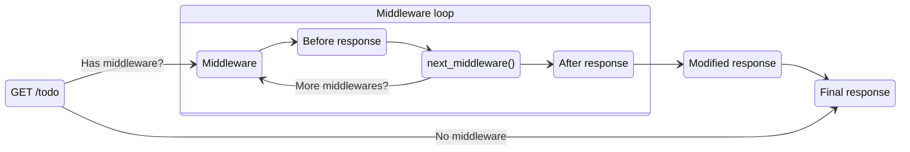

<!-- Generated by scripts/build_agent_skill_references.py from core/event_handler/api_gateway.md. Do not edit by hand. -->
# Event Handler Rest Http

Source of truth: https://docs.powertools.aws.dev/lambda/python/latest/core/event_handler/api_gateway/

Event handler for Amazon API Gateway REST and HTTP APIs, Application Load Balancer (ALB), Lambda Function URLs, and VPC Lattice.

## Key Features

* Lightweight routing to reduce boilerplate for API Gateway REST/HTTP API, ALB and Lambda Function URLs
* Support for CORS, binary and Gzip compression, Decimals JSON encoding and bring your own JSON serializer
* Built-in integration with [Event Source Data Classes utilities](../../utilities/data_classes.md) for self-documented event schema
* Works with micro function (one or a few routes) and monolithic functions (all routes)
* Native async handler support with `resolve_async()` for non-blocking I/O
* Support for Middleware
* Support for OpenAPI schema generation
* Support data validation for requests/responses

## Getting started

> **Tip**

All examples shared in this documentation are available within the [project repository](https://github.com/aws-powertools/powertools-lambda-python/tree/develop/examples).

### Install

> **Info: This is not necessary if you're installing Powertools for AWS Lambda (Python) via [Lambda Layer/SAR](../../getting-started/install.md#lambda-layer).**

**When using the data validation feature**, you need to add `pydantic` as a dependency in your preferred tool _e.g., requirements.txt, pyproject.toml_. At this time, we only support Pydantic V2.

### Required resources

If you're using any API Gateway integration, you must have an existing [API Gateway Proxy integration](https://docs.aws.amazon.com/apigateway/latest/developerguide/set-up-lambda-proxy-integrations.html) or [ALB](https://docs.aws.amazon.com/elasticloadbalancing/latest/application/lambda-functions.html) configured to invoke your Lambda function.

In case of using [VPC Lattice](https://docs.aws.amazon.com/lambda/latest/dg/services-vpc-lattice.html), you must have a service network configured to invoke your Lambda function.

This is the sample infrastructure for API Gateway and Lambda Function URLs we are using for the examples in this documentation.

> **Info: There is no additional permissions or dependencies required to use this utility.**

**API Gateway SAM Template**

```yaml title="AWS Serverless Application Model (SAM) example"
AWSTemplateFormatVersion: "2010-09-09"
Transform: AWS::Serverless-2016-10-31
Description: Hello world event handler API Gateway

Globals:
  Api:
    TracingEnabled: true
    Cors: # see CORS section
      AllowOrigin: "'https://example.com'"
      AllowHeaders: "'Content-Type,Authorization,X-Amz-Date'"
      MaxAge: "'300'"
    BinaryMediaTypes: # see Binary responses section
      - "*~1*" # converts to */* for any binary type
      # NOTE: use this stricter version if you're also using CORS; */* doesn't work with CORS
      # see: https://github.com/aws-powertools/powertools-lambda-python/issues/3373#issuecomment-1821144779
      # - "image~1*" # converts to image/*
      # - "*~1csv" # converts to */csv, eg text/csv, application/csv

  Function:
    Timeout: 5
    Runtime: python3.12
    Tracing: Active
    Environment:
      Variables:
        POWERTOOLS_LOG_LEVEL: INFO
        POWERTOOLS_LOGGER_SAMPLE_RATE: 0.1
        POWERTOOLS_LOGGER_LOG_EVENT: true
        POWERTOOLS_SERVICE_NAME: example

Resources:
  ApiFunction:
    Type: AWS::Serverless::Function
    Properties:
      Handler: getting_started_rest_api_resolver.lambda_handler
      CodeUri: ../src
      Description: API handler function
      Events:
        AnyApiEvent:
          Type: Api
          Properties:
            # NOTE: this is a catch-all rule to simplify the documentation.
            # explicit routes and methods are recommended for prod instead (see below)
            Path: /{proxy+} # Send requests on any path to the lambda function
            Method: ANY # Send requests using any http method to the lambda function

        # GetAllTodos:
        #   Type: Api
        #   Properties:
        #     Path: /todos
        #     Method: GET
        # GetTodoById:
        #   Type: Api
        #   Properties:
        #     Path: /todos/{todo_id}
        #     Method: GET
        # CreateTodo:
        #   Type: Api
        #   Properties:
        #     Path: /todos
        #     Method: POST

        ## Swagger UI specific routes

        # SwaggerUI:
        #     Type: Api
        #     Properties:
        #         Path: /swagger
        #         Method: GET
```

**Lambda Function URL SAM Template**

```yaml title="AWS Serverless Application Model (SAM) example"
AWSTemplateFormatVersion: "2010-09-09"
Transform: AWS::Serverless-2016-10-31
Description: Hello world event handler Lambda Function URL

Globals:
  Function:
    Timeout: 5
    Runtime: python3.12
    Tracing: Active
    Environment:
      Variables:
        POWERTOOLS_LOG_LEVEL: INFO
        POWERTOOLS_LOGGER_SAMPLE_RATE: 0.1
        POWERTOOLS_LOGGER_LOG_EVENT: true
        POWERTOOLS_SERVICE_NAME: example
    FunctionUrlConfig:
      Cors: # see CORS section
        # Notice that values here are Lists of Strings, vs comma-separated values on API Gateway
        AllowOrigins: ["https://example.com"]
        AllowHeaders: ["Content-Type", "Authorization", "X-Amz-Date"]
        MaxAge: 300

Resources:
  ApiFunction:
    Type: AWS::Serverless::Function
    Properties:
      Handler: getting_started_lambda_function_url_resolver.lambda_handler
      CodeUri: ../src
      Description: API handler function
      FunctionUrlConfig:
        AuthType: NONE # AWS_IAM for added security beyond sample documentation
```

### Event Resolvers

Before you decorate your functions to handle a given path and HTTP method(s), you need to initialize a resolver. A resolver will handle request resolution, including [one or more routers](#split-routes-with-router), and give you access to the current event via typed properties.

By default, we will use `APIGatewayRestResolver` throughout the documentation. You can use any of the following:

| Resolver                                                | AWS service                            |
| ------------------------------------------------------- | -------------------------------------- |
| **[`APIGatewayRestResolver`](#api-gateway-rest-api)**   | Amazon API Gateway REST API            |
| **[`APIGatewayHttpResolver`](#api-gateway-http-api)**   | Amazon API Gateway HTTP API            |
| **[`ALBResolver`](#application-load-balancer)**         | Amazon Application Load Balancer (ALB) |
| **[`LambdaFunctionUrlResolver`](#lambda-function-url)** | AWS Lambda Function URL                |
| **[`VPCLatticeResolver`](#vpc-lattice)**                | Amazon VPC Lattice                     |
| **[`HttpResolverLocal`](#http-resolver-asgi)**         | ASGI-compatible resolver               |

#### Response auto-serialization

> Want full control of the response, headers and status code? [Read about `Response` object here](#fine-grained-responses).

For your convenience, we automatically perform these if you return a dictionary response:

1. Auto-serialize `dictionary` responses to JSON and trim it
2. Include the response under each resolver's equivalent of a `body`
3. Set `Content-Type` to `application/json`
4. Set `status_code` to 200 (OK)

**getting_started_resolvers_response_serialization.py**

```python
from aws_lambda_powertools.event_handler import APIGatewayRestResolver
from aws_lambda_powertools.utilities.typing.lambda_context import LambdaContext

app = APIGatewayRestResolver()

@app.get("/ping")
def ping():
    return {"message": "pong"}  # (1)!

def lambda_handler(event: dict, context: LambdaContext) -> dict:
    return app.resolve(event, context)
```

1. This dictionary will be serialized, trimmed, and included under the `body` key

**getting_started_resolvers_response_serialization_output.json**

```json
{
    "statusCode": 200,
    "multiValueHeaders": {
        "Content-Type": [
            "application/json"
        ]
    },
    "body": "{'message':'pong'}",
    "isBase64Encoded": false
}
```

> **Info: Coming from Flask? We also support tuple response**

You can optionally set a different HTTP status code as the second argument of the tuple.

```python
import requests
from requests import Response

from aws_lambda_powertools.event_handler import ALBResolver
from aws_lambda_powertools.utilities.typing import LambdaContext

app = ALBResolver()

@app.post("/todo")
def create_todo():
    data: dict = app.current_event.json_body
    todo: Response = requests.post("https://jsonplaceholder.typicode.com/todos", data=data)

    # Returns the created todo object, with a HTTP 201 Created status
    return {"todo": todo.json()}, 201

def lambda_handler(event: dict, context: LambdaContext) -> dict:
    return app.resolve(event, context)
```

#### API Gateway REST API

When using Amazon API Gateway REST API to front your Lambda functions, you can use `APIGatewayRestResolver`.

Here's an example on how we can handle the `/todos` path.

> **Info: Trailing slash in routes**

For `APIGatewayRestResolver`, we seamless handle routes with a trailing slash (`/todos/`).

**getting_started_rest_api_resolver.py**

```python
import requests
from requests import Response

from aws_lambda_powertools import Logger, Tracer
from aws_lambda_powertools.event_handler import APIGatewayRestResolver
from aws_lambda_powertools.logging import correlation_paths
from aws_lambda_powertools.utilities.typing import LambdaContext

tracer = Tracer()
logger = Logger()
app = APIGatewayRestResolver()

@app.get("/todos")
@tracer.capture_method
def get_todos():
    todos: Response = requests.get("https://jsonplaceholder.typicode.com/todos")
    todos.raise_for_status()

    # for brevity, we'll limit to the first 10 only
    return {"todos": todos.json()[:10]}

# You can continue to use other utilities just as before
@logger.inject_lambda_context(correlation_id_path=correlation_paths.API_GATEWAY_REST)
@tracer.capture_lambda_handler
def lambda_handler(event: dict, context: LambdaContext) -> dict:
    return app.resolve(event, context)
```

**getting_started_rest_api_resolver.json**

This utility uses `path` and `httpMethod` to route to the right function. This helps make unit tests and local invocation easier too.

```json
{
    "body": "",
    "resource": "/todos",
    "path": "/todos",
    "httpMethod": "GET",
    "isBase64Encoded": false,
    "queryStringParameters": {},
    "multiValueQueryStringParameters": {},
    "pathParameters": {},
    "stageVariables": {},
    "headers": {
        "Accept": "text/html,application/xhtml+xml,application/xml;q=0.9,image/webp,*/*;q=0.8",
        "Accept-Encoding": "gzip, deflate, sdch",
        "Accept-Language": "en-US,en;q=0.8",
        "Cache-Control": "max-age=0",
        "CloudFront-Forwarded-Proto": "https",
        "CloudFront-Is-Desktop-Viewer": "true",
        "CloudFront-Is-Mobile-Viewer": "false",
        "CloudFront-Is-SmartTV-Viewer": "false",
        "CloudFront-Is-Tablet-Viewer": "false",
        "CloudFront-Viewer-Country": "US",
        "Host": "1234567890.execute-api.us-east-1.amazonaws.com",
        "Upgrade-Insecure-Requests": "1",
        "User-Agent": "Custom User Agent String",
        "Via": "1.1 08f323deadbeefa7af34d5feb414ce27.cloudfront.net (CloudFront)",
        "X-Amz-Cf-Id": "cDehVQoZnx43VYQb9j2-nvCh-9z396Uhbp027Y2JvkCPNLmGJHqlaA==",
        "X-Forwarded-For": "127.0.0.1, 127.0.0.2",
        "X-Forwarded-Port": "443",
        "X-Forwarded-Proto": "https"
    },
    "multiValueHeaders": {},
    "requestContext": {
        "accountId": "123456789012",
        "resourceId": "123456",
        "stage": "Prod",
        "requestId": "c6af9ac6-7b61-11e6-9a41-93e8deadbeef",
        "requestTime": "25/Jul/2020:12:34:56 +0000",
        "requestTimeEpoch": 1428582896000,
        "identity": {
            "cognitoIdentityPoolId": null,
            "accountId": null,
            "cognitoIdentityId": null,
            "caller": null,
            "accessKey": null,
            "sourceIp": "127.0.0.1",
            "cognitoAuthenticationType": null,
            "cognitoAuthenticationProvider": null,
            "userArn": null,
            "userAgent": "Custom User Agent String",
            "user": null
        },
        "path": "/Prod/todos",
        "resourcePath": "/todos",
        "httpMethod": "GET",
        "apiId": "1234567890",
        "protocol": "HTTP/1.1"
    }
}
```

**getting_started_rest_api_resolver_output.json**

```json
{
    "statusCode": 200,
    "multiValueHeaders": {
        "Content-Type": ["application/json"]
    },
    "body": "{\"todos\":[{\"userId\":1,\"id\":1,\"title\":\"delectus aut autem\",\"completed\":false},{\"userId\":1,\"id\":2,\"title\":\"quis ut nam facilis et officia qui\",\"completed\":false},{\"userId\":1,\"id\":3,\"title\":\"fugiat veniam minus\",\"completed\":false},{\"userId\":1,\"id\":4,\"title\":\"et porro tempora\",\"completed\":true},{\"userId\":1,\"id\":5,\"title\":\"laboriosam mollitia et enim quasi adipisci quia provident illum\",\"completed\":false},{\"userId\":1,\"id\":6,\"title\":\"qui ullam ratione quibusdam voluptatem quia omnis\",\"completed\":false},{\"userId\":1,\"id\":7,\"title\":\"illo expedita consequatur quia in\",\"completed\":false},{\"userId\":1,\"id\":8,\"title\":\"quo adipisci enim quam ut ab\",\"completed\":true},{\"userId\":1,\"id\":9,\"title\":\"molestiae perspiciatis ipsa\",\"completed\":false},{\"userId\":1,\"id\":10,\"title\":\"illo est ratione doloremque quia maiores aut\",\"completed\":true}]}",
    "isBase64Encoded": false
}
```

#### API Gateway HTTP API

When using Amazon API Gateway HTTP API to front your Lambda functions, you can use `APIGatewayHttpResolver`.

> **Note**

Using HTTP API v1 payload? Use `APIGatewayRestResolver` instead. `APIGatewayHttpResolver` defaults to v2 payload.

If you're using Terraform to deploy a HTTP API, note that it defaults the [payload_format_version](https://registry.terraform.io/providers/hashicorp/aws/latest/docs/resources/apigatewayv2_integration#payload_format_version) value to 1.0 if not specified.

```python title="Using HTTP API resolver"
import requests
from requests import Response

from aws_lambda_powertools import Logger, Tracer
from aws_lambda_powertools.event_handler import APIGatewayHttpResolver
from aws_lambda_powertools.logging import correlation_paths
from aws_lambda_powertools.utilities.typing import LambdaContext

tracer = Tracer()
logger = Logger()
app = APIGatewayHttpResolver()

@app.get("/todos")
@tracer.capture_method
def get_todos():
    todos: Response = requests.get("https://jsonplaceholder.typicode.com/todos")
    todos.raise_for_status()

    # for brevity, we'll limit to the first 10 only
    return {"todos": todos.json()[:10]}

# You can continue to use other utilities just as before
@logger.inject_lambda_context(correlation_id_path=correlation_paths.API_GATEWAY_HTTP)
@tracer.capture_lambda_handler
def lambda_handler(event: dict, context: LambdaContext) -> dict:
    return app.resolve(event, context)
```

#### Application Load Balancer

When using Amazon Application Load Balancer (ALB) to front your Lambda functions, you can use `ALBResolver`.

```python title="Using ALB resolver"
import requests
from requests import Response

from aws_lambda_powertools import Logger, Tracer
from aws_lambda_powertools.event_handler import ALBResolver
from aws_lambda_powertools.logging import correlation_paths
from aws_lambda_powertools.utilities.typing import LambdaContext

tracer = Tracer()
logger = Logger()
app = ALBResolver()

@app.get("/todos")
@tracer.capture_method
def get_todos():
    todos: Response = requests.get("https://jsonplaceholder.typicode.com/todos")
    todos.raise_for_status()

    # for brevity, we'll limit to the first 10 only
    return {"todos": todos.json()[:10]}

# You can continue to use other utilities just as before
@logger.inject_lambda_context(correlation_id_path=correlation_paths.APPLICATION_LOAD_BALANCER)
@tracer.capture_lambda_handler
def lambda_handler(event: dict, context: LambdaContext) -> dict:
    return app.resolve(event, context)
```

##### Validate response size

ALB limits the complete response JSON returned by Lambda to [1 MB](https://docs.aws.amazon.com/elasticloadbalancing/latest/application/lambda-functions.html). An oversized response can produce a 502 error even when the Lambda handler finishes successfully.

Set `enable_response_size_validation=True` to check the response against the 1,048,576-byte limit before returning it to ALB. This option is disabled by default and applies only to `ALBResolver`, through both `resolve()` and `resolve_async()`.

The check includes the JSON envelope, serialized body, headers, and cookies after compression and base64 encoding. It follows the Lambda Python runtime's JSON encoding, including escaping and UTF-8 byte lengths.

When the limit is exceeded, `ResponseSizeExceededError` exposes `actual_size` and `max_size`, both in bytes. Without a registered exception handler, the exception propagates and fails the invocation. You can register a handler to log the sizes and return a small 500 response:

```python title="Validate ALB response size"
from aws_lambda_powertools import Logger
from aws_lambda_powertools.event_handler import ALBResolver, Response, content_types
from aws_lambda_powertools.event_handler.exceptions import ResponseSizeExceededError
from aws_lambda_powertools.utilities.typing import LambdaContext

logger = Logger()
app = ALBResolver(enable_response_size_validation=True)

@app.exception_handler(ResponseSizeExceededError)
def handle_large_response(error: ResponseSizeExceededError) -> Response:
    logger.error(
        "Response exceeds the ALB limit",
        actual_size=error.actual_size,
        max_size=error.max_size,
    )
    return Response(
        status_code=500,
        content_type=content_types.APPLICATION_JSON,
        body={"message": "Unable to return the response"},
    )

@app.get("/reports")
def get_report():
    return {"report": "Report contents"}

def lambda_handler(event: dict, context: LambdaContext) -> dict:
    return app.resolve(event, context)
```

The handler's response is also validated. If it exceeds the limit, the exception propagates without invoking the handler again.

#### Lambda Function URL

When using [AWS Lambda Function URL](https://docs.aws.amazon.com/lambda/latest/dg/urls-configuration.html), you can use `LambdaFunctionUrlResolver`.

**getting_started_lambda_function_url_resolver.py**

```python title="Using Lambda Function URL resolver"
import requests
from requests import Response

from aws_lambda_powertools import Logger, Tracer
from aws_lambda_powertools.event_handler import LambdaFunctionUrlResolver
from aws_lambda_powertools.logging import correlation_paths
from aws_lambda_powertools.utilities.typing import LambdaContext

tracer = Tracer()
logger = Logger()
app = LambdaFunctionUrlResolver()

@app.get("/todos")
@tracer.capture_method
def get_todos():
    todos: Response = requests.get("https://jsonplaceholder.typicode.com/todos")
    todos.raise_for_status()

    # for brevity, we'll limit to the first 10 only
    return {"todos": todos.json()[:10]}

# You can continue to use other utilities just as before
@logger.inject_lambda_context(correlation_id_path=correlation_paths.LAMBDA_FUNCTION_URL)
@tracer.capture_lambda_handler
def lambda_handler(event: dict, context: LambdaContext) -> dict:
    return app.resolve(event, context)
```

**getting_started_lambda_function_url_resolver.json**

```json title="Example payload delivered to the handler"
{
  "version": "2.0",
  "routeKey": "$default",
  "rawPath": "/todos",
  "rawQueryString": "",
  "headers": {
    "x-amz-content-sha256": "e3b0c44298fc1c149afbf4c8996fb92427ae41e4649b934ca495991b7852b855",
    "x-amzn-tls-version": "TLSv1.2",
    "x-amz-date": "20220803T092917Z",
    "x-forwarded-proto": "https",
    "x-forwarded-port": "443",
    "x-forwarded-for": "123.123.123.123",
    "accept": "application/xml",
    "x-amzn-tls-cipher-suite": "ECDHE-RSA-AES128-GCM-SHA256",
    "x-amzn-trace-id": "Root=1-63ea3fee-51ba94542feafa3928745ba3",
    "host": "xxxxxxxxxxxxx.lambda-url.eu-central-1.on.aws",
    "content-type": "application/json",
    "accept-encoding": "gzip, deflate",
    "user-agent": "Custom User Agent"
  },
  "requestContext": {
    "accountId": "123457890",
    "apiId": "xxxxxxxxxxxxxxxxxxxx",
    "authorizer": {
      "iam": {
        "accessKey": "AAAAAAAAAAAAAAAAAA",
        "accountId": "123457890",
        "callerId": "AAAAAAAAAAAAAAAAAA",
        "cognitoIdentity": null,
        "principalOrgId": "o-xxxxxxxxxxxx",
        "userArn": "arn:aws:iam::AAAAAAAAAAAAAAAAAA:user/user",
        "userId": "AAAAAAAAAAAAAAAAAA"
      }
    },
    "domainName": "xxxxxxxxxxxxx.lambda-url.eu-central-1.on.aws",
    "domainPrefix": "xxxxxxxxxxxxx",
    "http": {
      "method": "GET",
      "path": "/todos",
      "protocol": "HTTP/1.1",
      "sourceIp": "123.123.123.123",
      "userAgent": "Custom User Agent"
    },
    "requestId": "24f9ef37-8eb7-45fe-9dbc-a504169fd2f8",
    "routeKey": "$default",
    "stage": "$default",
    "time": "03/Aug/2022:09:29:18 +0000",
    "timeEpoch": 1659518958068
  },
  "isBase64Encoded": false
}
```

#### VPC Lattice

When using [VPC Lattice with AWS Lambda](https://docs.aws.amazon.com/lambda/latest/dg/services-vpc-lattice.html), you can use `VPCLatticeV2Resolver`.

**Payload v2 (Recommended)**

```python title="Using VPC Lattice resolver"
import requests
from requests import Response

from aws_lambda_powertools import Logger, Tracer
from aws_lambda_powertools.event_handler import VPCLatticeV2Resolver
from aws_lambda_powertools.logging import correlation_paths
from aws_lambda_powertools.utilities.typing import LambdaContext

tracer = Tracer()
logger = Logger()
app = VPCLatticeV2Resolver()

@app.get("/todos")
@tracer.capture_method
def get_todos():
    todos: Response = requests.get("https://jsonplaceholder.typicode.com/todos")
    todos.raise_for_status()

    # for brevity, we'll limit to the first 10 only
    return {"todos": todos.json()[:10]}

# You can continue to use other utilities just as before
@logger.inject_lambda_context(correlation_id_path=correlation_paths.APPLICATION_LOAD_BALANCER)
@tracer.capture_lambda_handler
def lambda_handler(event: dict, context: LambdaContext) -> dict:
    return app.resolve(event, context)
```

**Payload v2 (Recommended) - Sample Event**

```json title="Example payload delivered to the handler"
{
  "version": "2.0",
  "path": "/todos",
  "method": "GET",
  "headers": {
    "user_agent": "curl/7.64.1",
    "x-forwarded-for": "10.213.229.10",
    "host": "test-lambda-service-3908sdf9u3u.dkfjd93.vpc-lattice-svcs.us-east-2.on.aws",
    "accept": "*/*"
  },
  "queryStringParameters": {
    "order-id": "1"
  },
  "body": "{\"message\": \"Hello from Lambda!\"}",
  "requestContext": {
      "serviceNetworkArn": "arn:aws:vpc-lattice:us-east-2:123456789012:servicenetwork/sn-0bf3f2882e9cc805a",
      "serviceArn": "arn:aws:vpc-lattice:us-east-2:123456789012:service/svc-0a40eebed65f8d69c",
      "targetGroupArn": "arn:aws:vpc-lattice:us-east-2:123456789012:targetgroup/tg-6d0ecf831eec9f09",
      "identity": {
        "sourceVpcArn": "arn:aws:ec2:region:123456789012:vpc/vpc-0b8276c84697e7339",
        "type" : "AWS_IAM",
        "principal": "arn:aws:sts::123456789012:assumed-role/example-role/057d00f8b51257ba3c853a0f248943cf",
        "sessionName": "057d00f8b51257ba3c853a0f248943cf",
        "x509SanDns": "example.com"
      },
      "region": "us-east-2",
      "timeEpoch": "1696331543569073"
  }
}
```

**Payload v1**

```python title="Using VPC Lattice resolver"
import requests
from requests import Response

from aws_lambda_powertools import Logger, Tracer
from aws_lambda_powertools.event_handler import VPCLatticeResolver
from aws_lambda_powertools.logging import correlation_paths
from aws_lambda_powertools.utilities.typing import LambdaContext

tracer = Tracer()
logger = Logger()
app = VPCLatticeResolver()

@app.get("/todos")
@tracer.capture_method
def get_todos():
    todos: Response = requests.get("https://jsonplaceholder.typicode.com/todos")
    todos.raise_for_status()

    # for brevity, we'll limit to the first 10 only
    return {"todos": todos.json()[:10]}

# You can continue to use other utilities just as before
@logger.inject_lambda_context(correlation_id_path=correlation_paths.APPLICATION_LOAD_BALANCER)
@tracer.capture_lambda_handler
def lambda_handler(event: dict, context: LambdaContext) -> dict:
    return app.resolve(event, context)
```

**Payload v1 - Sample Event**

```json title="Example payload delivered to the handler"
{
    "raw_path": "/testpath",
    "method": "GET",
    "headers": {
      "user_agent": "curl/7.64.1",
      "x-forwarded-for": "10.213.229.10",
      "host": "test-lambda-service-3908sdf9u3u.dkfjd93.vpc-lattice-svcs.us-east-2.on.aws",
      "accept": "*/*"
    },
    "query_string_parameters": {
      "order-id": "1"
    },
    "body": "eyJ0ZXN0IjogImV2ZW50In0=",
    "is_base64_encoded": true
  }
```

#### Http Resolver (ASGI)

`HttpResolver` is an ASGI-compatible resolver that lets you run your Powertools application with any ASGI server like [uvicorn](https://uvicorn.dev/). It implements the [ASGI specification](https://asgi.readthedocs.io/), is lightweight with no external dependencies, and works seamlessly with Lambda or any environment that speaks HTTP.

If your Lambda is behind [Lambda Web Adapter](https://github.com/awslabs/aws-lambda-web-adapter) or any other HTTP proxy that speaks the HTTP protocol, it works seamlessly.

All existing resolver features work out of the box: routing, middleware, validation, OpenAPI/Swagger, CORS, exception handling, and more.

**Install uvicorn**:

```bash
pip install uvicorn
```

**Basic Usage**

```python
from aws_lambda_powertools.event_handler import HttpResolver

app = HttpResolver()

@app.get("/hello/<name>")
def hello(name: str):
    return {"message": f"Hello, {name}!"}

# Lambda handler - same code works in Lambda
handler = app
```

Run locally: `uvicorn app:app --reload`

**With Validation & Swagger**

```python
from pydantic import BaseModel

from aws_lambda_powertools.event_handler import HttpResolver

class User(BaseModel):
    name: str
    age: int

app = HttpResolver(enable_validation=True)

app.enable_swagger(
    title="My API",
    version="1.0.0",
)

@app.post("/users")
def create_user(user: User) -> dict:
    return {"id": "123", "user": user.model_dump()}

handler = app
```

Access Swagger UI at `http://localhost:8000/swagger`

**Exception Handling**

```python
from aws_lambda_powertools.event_handler import HttpResolver, Response

app = HttpResolver()

class NotFoundError(Exception):
    def __init__(self, resource: str):
        self.resource = resource

@app.exception_handler(NotFoundError)
def handle_not_found_error(exc: NotFoundError):
    return Response(
        status_code=404,
        content_type="application/json",
        body={"error": "Not Found", "resource": exc.resource},
    )

@app.not_found
def handle_not_found(exc: Exception):
    return Response(
        status_code=404,
        content_type="application/json",
        body={"error": "Route not found", "path": app.current_event.path},
    )

@app.get("/users/<user_id>")
def get_user(user_id: str):
    if user_id == "0":
        raise NotFoundError(f"User {user_id}")
    return {"user_id": user_id}

handler = app
```

### Dynamic routes

You can use `/todos/<todo_id>` to configure dynamic URL paths, where `<todo_id>` will be resolved at runtime.

Each dynamic route you set must be part of your function signature. This allows us to call your function using keyword arguments when matching your dynamic route.

> **Tip**

You can also nest dynamic paths, for example `/todos/<todo_id>/<todo_status>`.

**dynamic_routes.py**

```python
from urllib.parse import quote

import requests
from requests import Response

from aws_lambda_powertools import Logger, Tracer
from aws_lambda_powertools.event_handler import APIGatewayRestResolver
from aws_lambda_powertools.logging import correlation_paths
from aws_lambda_powertools.utilities.typing import LambdaContext

tracer = Tracer()
logger = Logger()
app = APIGatewayRestResolver()

@app.get("/todos/<todo_id>")
@tracer.capture_method
def get_todo_by_id(todo_id: str):  # value come as str
    todo_id = quote(todo_id, safe="")
    todos: Response = requests.get(f"https://jsonplaceholder.typicode.com/todos/{todo_id}")
    todos.raise_for_status()

    return {"todos": todos.json()}

# You can continue to use other utilities just as before
@logger.inject_lambda_context(correlation_id_path=correlation_paths.API_GATEWAY_REST)
@tracer.capture_lambda_handler
def lambda_handler(event: dict, context: LambdaContext) -> dict:
    return app.resolve(event, context)
```

**dynamic_routes.json**

```json
{
    "resource": "/todos/{id}",
    "path": "/todos/1",
    "httpMethod": "GET"
}
```

#### Dynamic path mechanism

Dynamic path parameters are defined using angle brackets `<parameter_name>` syntax. These parameters are automatically converted to regex patterns for efficient route matching and performance gains.

**Syntax**: `/path/<parameter_name>`

* **Parameter names** must contain only word characters (letters, numbers, underscore)
* **Captured values** can contain letters, numbers, underscores, and these special characters: `-._~()'!*:@,;=+&$%<> \[]{}|^`. Reserved characters must be percent-encoded in URLs to prevent errors.

| Route Pattern            | Matches                                          | Doesn't Match                |
| ------------------------ | ------------------------------------------------ | ---------------------------- |
| `/users/<user_id>`       | `/users/123`, `/users/user-456`                  | `/users/123/profile`         |
| `/api/<version>/users`   | `/api/v1/users`, `/api/2.0/users`                | `/api/users`                 |
| `/files/<path>`          | `/files/document.pdf`, `/files/folder%20name`    | `/files/sub/folder/file.txt` |
| `/files/<folder>/<name>` | `/files/src/document.pdf`, `/files/src/test.txt` | `/files/sub/folder/file.txt` |

**routing_syntax_basic.py**

```python
from aws_lambda_powertools import Logger, Tracer
from aws_lambda_powertools.event_handler import APIGatewayRestResolver
from aws_lambda_powertools.logging import correlation_paths
from aws_lambda_powertools.utilities.typing import LambdaContext

tracer = Tracer()
logger = Logger()
app = APIGatewayRestResolver()

@app.get("/users/<user_id>")
@tracer.capture_method
def get_user(user_id: str):
    # user_id value comes as a string with special chars support
    return {"user_id": user_id}

@app.get("/orders/<order_id>/items/<item_id>")
@tracer.capture_method
def get_order_item(order_id: str, item_id: str):
    # multiple dynamic parameters are supported
    return {"order_id": order_id, "item_id": item_id}

@logger.inject_lambda_context(correlation_id_path=correlation_paths.API_GATEWAY_REST)
@tracer.capture_lambda_handler
def lambda_handler(event: dict, context: LambdaContext) -> dict:
    return app.resolve(event, context)
```

**routing_advanced_examples.py**

```python
from aws_lambda_powertools import Logger, Tracer
from aws_lambda_powertools.event_handler import APIGatewayRestResolver
from aws_lambda_powertools.logging import correlation_paths
from aws_lambda_powertools.utilities.typing import LambdaContext

tracer = Tracer()
logger = Logger()
app = APIGatewayRestResolver()

@app.get("/api/<api_version>/resources/<resource_type>/<resource_id>")
@tracer.capture_method
def get_resource(api_version: str, resource_type: str, resource_id: str):
    # handles nested dynamic parameters in API versioned routes
    return {
        "version": api_version,
        "type": resource_type,
        "id": resource_id,
    }

@app.get("/organizations/<org_id>/teams/<team_id>/members")
@tracer.capture_method
def list_team_members(org_id: str, team_id: str):
    # combines dynamic paths with static segments
    return {"org": org_id, "team": team_id, "action": "list_members"}

@logger.inject_lambda_context(correlation_id_path=correlation_paths.API_GATEWAY_REST)
@tracer.capture_lambda_handler
def lambda_handler(event: dict, context: LambdaContext) -> dict:
    return app.resolve(event, context)
```

> **Tip: Function parameter names must match**

The parameter names in your route (`<user_id>`) must exactly match the parameter names in your function signature (`user_id: str`). This is how the framework knows which captured values to pass to which parameters.

#### Catch-all routes

For scenarios where you need to handle arbitrary or deeply nested paths, you can use regex patterns directly in your route definitions. These are particularly useful for proxy routes or when dealing with file paths.

**We recommend** having explicit routes whenever possible; use catch-all routes sparingly.

##### Using Regex Patterns

You can use standard [Python regex patterns](https://docs.python.org/3/library/re.html#regular-expression-syntax) in your route definitions, for example:

| Pattern | Description                              | Examples                                               |
| ------- | ---------------------------------------- | ------------------------------------------------------ |
| `.+`    | Matches one or more characters (greedy)  | `/proxy/.+` matches `/proxy/any/deep/path`             |
| `.*`    | Matches zero or more characters (greedy) | `/files/.*` matches `/files/` and `/files/deep/path`   |
| `[^/]+` | Matches one or more non-slash characters | `/api/[^/]+` matches `/api/v1` but not `/api/v1/users` |
| `\w+`   | Matches one or more word characters      | `/users/\w+` matches `/users/john123`                  |

**dynamic_routes_catch_all.py**

```python
from aws_lambda_powertools import Logger, Tracer
from aws_lambda_powertools.event_handler import APIGatewayRestResolver
from aws_lambda_powertools.logging import correlation_paths
from aws_lambda_powertools.utilities.typing import LambdaContext

tracer = Tracer()
logger = Logger()
app = APIGatewayRestResolver()

@app.get(".+")
@tracer.capture_method
def catch_any_route_get_method():
    return {"path_received": app.current_event.path}

# File path proxy - captures everything after /files/
@app.get("/files/.+")
def serve_file():
    file_path = app.current_event.path.replace("/files/", "")
    return {"file_path": file_path}

# API versioning with any format
@app.get(r"/api/v\d+/.*")  # Matches /api/v1/users, /api/v2/posts/123
def handle_versioned_api():
    return {"api_version": "handled"}

# Catch-all for unmatched routes
@app.route(".*", method=["GET", "POST"])  # Must be last route
def catch_all():
    return {"message": "Route not found", "path": app.current_event.path}

# Mixed: dynamic parameter + regex catch-all
@app.get("/users/<user_id>/files/.+")
def get_user_files(user_id: str):
    file_path = app.current_event.path.split(f"/users/{user_id}/files/")[1]
    return {"user_id": user_id, "file_path": file_path}

# You can continue to use other utilities just as before
@logger.inject_lambda_context(correlation_id_path=correlation_paths.API_GATEWAY_REST)
@tracer.capture_lambda_handler
def lambda_handler(event: dict, context: LambdaContext) -> dict:
    return app.resolve(event, context)
```

> **Warning: Route Matching Priority**

- Routes are matched in **order of specificity**, not registration order
- More specific routes (exact matches) take precedence over regex patterns
- Among regex routes, the first registered matching route wins
- Always place catch-all routes (`.*`) last

### HTTP Methods

You can use named decorators to specify the HTTP method that should be handled in your functions. That is, `app.<http_method>`, where the HTTP method could be `get`, `post`, `put`, `patch` and `delete`.

**http_methods.py**

```python
import requests
from requests import Response

from aws_lambda_powertools import Logger, Tracer
from aws_lambda_powertools.event_handler import APIGatewayRestResolver
from aws_lambda_powertools.logging import correlation_paths
from aws_lambda_powertools.utilities.typing import LambdaContext

tracer = Tracer()
logger = Logger()
app = APIGatewayRestResolver()

@app.post("/todos")
@tracer.capture_method
def create_todo():
    todo_data: dict = app.current_event.json_body  # deserialize json str to dict
    todo: Response = requests.post("https://jsonplaceholder.typicode.com/todos", data=todo_data)
    todo.raise_for_status()

    return {"todo": todo.json()}

# You can continue to use other utilities just as before
@logger.inject_lambda_context(correlation_id_path=correlation_paths.API_GATEWAY_REST)
@tracer.capture_lambda_handler
def lambda_handler(event: dict, context: LambdaContext) -> dict:
    return app.resolve(event, context)
```

**http_methods.json**

```json
{
    "resource": "/todos",
    "path": "/todos",
    "httpMethod": "POST",
    "body": "{\"title\": \"foo\", \"userId\": 1, \"completed\": false}"
}
```

If you need to accept multiple HTTP methods in a single function, or support a HTTP method for which no decorator exists (e.g. [TRACE](https://developer.mozilla.org/en-US/docs/Web/HTTP/Methods/TRACE)), you can use the `route` method and pass a list of HTTP methods.

```python title="Handling multiple HTTP Methods"
import requests
from requests import Response

from aws_lambda_powertools import Logger, Tracer
from aws_lambda_powertools.event_handler import APIGatewayRestResolver
from aws_lambda_powertools.logging import correlation_paths
from aws_lambda_powertools.utilities.typing import LambdaContext

tracer = Tracer()
logger = Logger()
app = APIGatewayRestResolver()

# PUT and POST HTTP requests to the path /hello will route to this function
@app.route("/todos", method=["PUT", "POST"])
@tracer.capture_method
def create_todo():
    todo_data: dict = app.current_event.json_body  # deserialize json str to dict
    todo: Response = requests.post("https://jsonplaceholder.typicode.com/todos", data=todo_data)
    todo.raise_for_status()

    return {"todo": todo.json()}

# You can continue to use other utilities just as before
@logger.inject_lambda_context(correlation_id_path=correlation_paths.API_GATEWAY_REST)
@tracer.capture_lambda_handler
def lambda_handler(event: dict, context: LambdaContext) -> dict:
    return app.resolve(event, context)
```

> **Note**

It is generally better to have separate functions for each HTTP method, as the functionality tends to differ depending on which method is used.

### Data validation

> **Note: This changes the authoring experience by relying on Python's type annotations**

It's inspired by [FastAPI framework](https://fastapi.tiangolo.com/) for ergonomics and to ease migrations in either direction. We support both Pydantic models and Python's dataclass.

For brevity, we'll focus on Pydantic only.

All resolvers can optionally coerce and validate incoming requests by setting `enable_validation=True`. You can use Pydantic models to validate request bodies, query strings, headers, and form parameters.

With this feature, we can now express how we expect our incoming data and response to look like. This moves data validation responsibilities to Event Handler resolvers, reducing a ton of boilerplate code.

Let's rewrite the previous examples to signal our resolver what shape we expect our data to be.

**data_validation.py**

```python
import requests
from pydantic import BaseModel, Field

from aws_lambda_powertools import Logger, Tracer
from aws_lambda_powertools.event_handler import APIGatewayRestResolver
from aws_lambda_powertools.logging import correlation_paths
from aws_lambda_powertools.utilities.typing import LambdaContext

tracer = Tracer()
logger = Logger()
app = APIGatewayRestResolver(enable_validation=True)  # (1)!

class Todo(BaseModel):  # (2)!
    userId: int
    id_: int | None = Field(alias="id", default=None)
    title: str
    completed: bool

@app.get("/todos/<todo_id>")  # (3)!
@tracer.capture_method
def get_todo_by_id(todo_id: int) -> Todo:  # (4)!
    todo = requests.get(f"https://jsonplaceholder.typicode.com/todos/{todo_id}")
    todo.raise_for_status()

    return todo.json()  # (5)!

@logger.inject_lambda_context(correlation_id_path=correlation_paths.API_GATEWAY_HTTP)
@tracer.capture_lambda_handler
def lambda_handler(event: dict, context: LambdaContext) -> dict:
    return app.resolve(event, context)
```

1. This enforces data validation at runtime. Any validation error will return `HTTP 422: Unprocessable Entity error`.
2. We create a Pydantic model to define how our data looks like.
3. Defining a route remains exactly as before.
4. By default, URL Paths will be `str`. Here, we are telling our resolver it should be `int`, so it converts it for us. <br/><br/> Lastly, we're also saying the return should be our `Todo`. This will help us later when we touch OpenAPI auto-documentation.
5. `todo.json()` returns a dictionary. However, Event Handler knows the response should be `Todo` so it converts and validates accordingly.

**data_validation.json**

```json
{
  "version": "1.0",
  "resource": "/todos/1",
  "path": "/todos/1",
  "httpMethod": "GET",
  "headers": {
    "Origin": "https://aws.amazon.com"
  },
  "multiValueHeaders": {},
  "queryStringParameters": {},
  "multiValueQueryStringParameters": {},
  "requestContext": {
    "accountId": "123456789012",
    "apiId": "id",
    "authorizer": {
      "claims": null,
      "scopes": null
    },
    "domainName": "id.execute-api.us-east-1.amazonaws.com",
    "domainPrefix": "id",
    "extendedRequestId": "request-id",
    "httpMethod": "GET",
    "path": "/todos/1",
    "protocol": "HTTP/1.1",
    "requestId": "id=",
    "requestTime": "04/Mar/2020:19:15:17 +0000",
    "requestTimeEpoch": 1583349317135,
    "resourceId": null,
    "resourcePath": "/todos/1",
    "stage": "$default"
  },
  "pathParameters": null,
  "stageVariables": null,
  "body": "",
  "isBase64Encoded": false
}
```

**data_validation_output.json**

```json
{
  "statusCode": 200,
  "body": "Hello world",
  "isBase64Encoded": false,
  "multiValueHeaders": {
    "Content-Type": [
      "application/json"
    ]
  }
}
```

#### Handling validation errors

> **Info: By default, we hide extended error details for security reasons _(e.g., pydantic url, Pydantic code)_.**

Any incoming request or and outgoing response that fails validation will lead to a `HTTP 422: Unprocessable Entity error` response that will look similar to this:

```json title="data_validation_error_unsanitized_output.json"
{
  "statusCode": 422,
  "body": "{\"statusCode\": 422, \"detail\": [{\"type\": \"int_parsing\", \"loc\": [\"path\", \"todo_id\"]}]}",
  "isBase64Encoded": false,
  "headers": {
    "Content-Type": "application/json"
  },
  "cookies": []
}
```

You can customize the error message by catching the `RequestValidationError` exception. This is useful when you might have a security policy to return opaque validation errors, or have a company standard for API validation errors.

Here's an example where we catch validation errors, log all details for further investigation, and return the same `HTTP 422` with an opaque error.

**data_validation_sanitized_error.py**

```python
import requests
from pydantic import BaseModel, Field

from aws_lambda_powertools import Logger, Tracer
from aws_lambda_powertools.event_handler import APIGatewayRestResolver, Response, content_types
from aws_lambda_powertools.event_handler.openapi.exceptions import RequestValidationError
from aws_lambda_powertools.logging import correlation_paths
from aws_lambda_powertools.utilities.typing import LambdaContext

tracer = Tracer()
logger = Logger()
app = APIGatewayRestResolver(enable_validation=True)

class Todo(BaseModel):
    userId: int
    id_: int | None = Field(alias="id", default=None)
    title: str
    completed: bool

@app.exception_handler(RequestValidationError)  # (1)!
def handle_validation_error(ex: RequestValidationError):
    logger.error("Request failed validation", path=app.current_event.path, errors=ex.errors())

    return Response(
        status_code=422,
        content_type=content_types.APPLICATION_JSON,
        body="Invalid data",
    )

@app.post("/todos")
def create_todo(todo: Todo) -> int:
    response = requests.post("https://jsonplaceholder.typicode.com/todos", json=todo.dict(by_alias=True))
    response.raise_for_status()

    return response.json()["id"]

@logger.inject_lambda_context(correlation_id_path=correlation_paths.API_GATEWAY_HTTP)
@tracer.capture_lambda_handler
def lambda_handler(event: dict, context: LambdaContext) -> dict:
    return app.resolve(event, context)
```

1. We use [exception handler](#exception-handling) decorator to catch **any** request validation errors. <br/><br/> Then, we log the detailed reason as to why it failed while returning a custom `Response` object to hide that from them.

**data_validation_sanitized_error_output.json**

```json
{
  "statusCode": 422,
  "body": "Invalid data",
  "isBase64Encoded": false,
  "headers": {
    "Content-Type": "application/json"
  },
  "cookies": []
}
```

#### Validating payloads

> **Info: We will automatically validate, inject, and convert incoming request payloads based on models via type annotation.**

Let's improve our previous example by handling the creation of todo items via `HTTP POST`.

What we want is for Event Handler to convert the incoming payload as an instance of our `Todo` model. We handle the creation of that `todo`, and then return the `ID` of the newly created `todo`.

Even better, we can also let Event Handler validate and convert our response according to type annotations, further reducing boilerplate.

**validating_payloads.py**

```python
import requests
from pydantic import BaseModel, Field

from aws_lambda_powertools import Logger, Tracer
from aws_lambda_powertools.event_handler import APIGatewayRestResolver
from aws_lambda_powertools.logging import correlation_paths
from aws_lambda_powertools.utilities.typing import LambdaContext

tracer = Tracer()
logger = Logger()
app = APIGatewayRestResolver(enable_validation=True)  # (1)!

class Todo(BaseModel):  # (2)!
    userId: int
    id_: int | None = Field(alias="id", default=None)
    title: str
    completed: bool

@app.post("/todos")
def create_todo(todo: Todo) -> str:  # (3)!
    response = requests.post("https://jsonplaceholder.typicode.com/todos", json=todo.dict(by_alias=True))
    response.raise_for_status()

    return response.json()["id"]  # (4)!

@app.get("/todos")
@tracer.capture_method
def get_todos() -> list[Todo]:
    todo = requests.get("https://jsonplaceholder.typicode.com/todos")
    todo.raise_for_status()

    return todo.json()  # (5)!

@logger.inject_lambda_context(correlation_id_path=correlation_paths.API_GATEWAY_HTTP)
@tracer.capture_lambda_handler
def lambda_handler(event: dict, context: LambdaContext) -> dict:
    return app.resolve(event, context)
```

1. This enforces data validation at runtime. Any validation error will return `HTTP 422: Unprocessable Entity error`.
2. We create a Pydantic model to define how our data looks like.
3. We define `Todo` as our type annotation. Event Handler then uses this model to validate and inject the incoming request as `Todo`.
4. Lastly, we return the ID of our newly created `todo` item. <br/><br/> Because we specify the return type (`str`), Event Handler will take care of serializing this as a JSON string.
5. Note that the return type is `List[Todo]`. <br><br> Event Handler will take the return (`todo.json`), and validate each list item against `Todo` model before returning the response accordingly.

**validating_payloads.json**

```json
{
  "version": "1.0",
  "body": "{\"title\": \"foo\", \"userId\": \"1\", \"completed\": false}",
  "resource": "/todos",
  "path": "/todos",
  "httpMethod": "POST",
  "headers": {
    "Origin": "https://aws.amazon.com"
  },
  "multiValueHeaders": {},
  "queryStringParameters": {},
  "multiValueQueryStringParameters": {},
  "requestContext": {
    "accountId": "123456789012",
    "apiId": "id",
    "authorizer": {
      "claims": null,
      "scopes": null
    },
    "domainName": "id.execute-api.us-east-1.amazonaws.com",
    "domainPrefix": "id",
    "extendedRequestId": "request-id",
    "httpMethod": "POST",
    "path": "/todos",
    "protocol": "HTTP/1.1",
    "requestId": "id=",
    "requestTime": "04/Mar/2020:19:15:17 +0000",
    "requestTimeEpoch": 1583349317135,
    "resourceId": null,
    "resourcePath": "/todos",
    "stage": "$default"
  },
  "pathParameters": null,
  "stageVariables": null,
  "isBase64Encoded": false
}
```

**validating_payloads_output.json**

```json
{
  "statusCode": 200,
  "body": "2008821",
  "isBase64Encoded": false,
  "multiValueHeaders": {
    "Content-Type": [
      "application/json"
    ]
  }
}
```

##### Validating payload subset

With the addition of the [`Annotated` type starting in Python 3.10](https://docs.python.org/3/library/typing.html#typing.Annotated), types can contain additional metadata, allowing us to represent anything we want.

We use the `Annotated` and OpenAPI `Body` type to instruct Event Handler that our payload is located in a particular JSON key.

> **Note: Event Handler will match the parameter name with the JSON key to validate and inject what you want.**

**validating_payload_subset.py**

```python
from typing import Annotated

import requests
from pydantic import BaseModel, Field

from aws_lambda_powertools.event_handler import APIGatewayRestResolver
from aws_lambda_powertools.event_handler.openapi.params import Body  # (1)!
from aws_lambda_powertools.utilities.typing import LambdaContext

app = APIGatewayRestResolver(enable_validation=True)

class Todo(BaseModel):
    userId: int
    id_: int | None = Field(alias="id", default=None)
    title: str
    completed: bool

@app.post("/todos")
def create_todo(todo: Annotated[Todo, Body(embed=True)]) -> int:  # (2)!
    response = requests.post("https://jsonplaceholder.typicode.com/todos", json=todo.dict(by_alias=True))
    response.raise_for_status()

    return response.json()["id"]

def lambda_handler(event: dict, context: LambdaContext) -> dict:
    return app.resolve(event, context)
```

1. `Body` is a special OpenAPI type that can add additional constraints to a request payload.
2. `Body(embed=True)` instructs Event Handler to look up inside the payload for a key.<br><br> This means Event Handler will look up for a key named `todo`, validate the value against `Todo`, and inject it.

**validating_payload_subset.json**

```json
{
  "version": "1.0",
  "body": "{ \"todo\": {\"title\": \"foo\", \"userId\": \"1\", \"completed\": false } }",
  "resource": "/todos",
  "path": "/todos",
  "httpMethod": "POST",
  "headers": {
    "Origin": "https://aws.amazon.com"
  },
  "multiValueHeaders": {},
  "queryStringParameters": {},
  "multiValueQueryStringParameters": {},
  "requestContext": {
    "accountId": "123456789012",
    "apiId": "id",
    "authorizer": {
      "claims": null,
      "scopes": null
    },
    "domainName": "id.execute-api.us-east-1.amazonaws.com",
    "domainPrefix": "id",
    "extendedRequestId": "request-id",
    "httpMethod": "POST",
    "path": "/todos",
    "protocol": "HTTP/1.1",
    "requestId": "id=",
    "requestTime": "04/Mar/2020:19:15:17 +0000",
    "requestTimeEpoch": 1583349317135,
    "resourceId": null,
    "resourcePath": "/todos",
    "stage": "$default"
  },
  "pathParameters": null,
  "stageVariables": null,
  "isBase64Encoded": false
}
```

**validating_payload_subset_output.json**

```json
{
  "statusCode": 200,
  "body": "2008822",
  "isBase64Encoded": false,
  "multiValueHeaders": {
    "Content-Type": [
      "application/json"
    ]
  }
}
```

##### Discriminated unions

You can use Pydantic's `Field(discriminator="...")` with union types to create discriminated unions (also known as tagged unions). This allows the Event Handler to automatically determine which model to use based on a discriminator field in the request body.

```python title="discriminated_unions.py"
from typing import Annotated, Literal

from pydantic import BaseModel, Field

from aws_lambda_powertools import Logger, Tracer
from aws_lambda_powertools.event_handler import APIGatewayRestResolver
from aws_lambda_powertools.event_handler.openapi.params import Body
from aws_lambda_powertools.logging import correlation_paths
from aws_lambda_powertools.utilities.typing import LambdaContext

tracer = Tracer()
logger = Logger()
app = APIGatewayRestResolver(enable_validation=True)

class FooAction(BaseModel):
    """Action type for foo operations."""

    action: Literal["foo"] = "foo"
    foo_data: str

class BarAction(BaseModel):
    """Action type for bar operations."""

    action: Literal["bar"] = "bar"
    bar_data: int

ActionType = Annotated[FooAction | BarAction, Field(discriminator="action")]  # (1)!

@app.post("/actions")
@tracer.capture_method
def handle_action(action: Annotated[ActionType, Body(description="Action to perform")]):  # (2)!
    """Handle different action types using discriminated unions."""
    if isinstance(action, FooAction):
        return {"message": f"Handling foo action with data: {action.foo_data}"}
    elif isinstance(action, BarAction):
        return {"message": f"Handling bar action with data: {action.bar_data}"}

@logger.inject_lambda_context(correlation_id_path=correlation_paths.API_GATEWAY_HTTP)
@tracer.capture_lambda_handler
def lambda_handler(event: dict, context: LambdaContext) -> dict:
    return app.resolve(event, context)
```

1. `Field(discriminator="action")` tells Pydantic to use the `action` field to determine which model to instantiate
2. `Body()` annotation tells the Event Handler to parse the request body using the discriminated union

#### Validating responses

You can use `response_validation_error_http_code` to set a custom HTTP code for failed response validation. When this field is set, we will raise a `ResponseValidationError` instead of a `RequestValidationError`.

For a more granular control over the failed response validation http code, the `custom_response_validation_http_code` argument can be set per route.
This value will override the value of the failed response validation http code set at constructor level (if any).

**customizing_response_validation.py**

```python
from http import HTTPStatus

import requests
from pydantic import BaseModel, Field

from aws_lambda_powertools import Logger, Tracer
from aws_lambda_powertools.event_handler import APIGatewayRestResolver
from aws_lambda_powertools.logging import correlation_paths
from aws_lambda_powertools.utilities.typing import LambdaContext

tracer = Tracer()
logger = Logger()
app = APIGatewayRestResolver(
    enable_validation=True,
    response_validation_error_http_code=HTTPStatus.INTERNAL_SERVER_ERROR,  # (1)!
)

class Todo(BaseModel):
    userId: int
    id_: int | None = Field(alias="id", default=None)
    title: str
    completed: bool

@app.get("/todos_bad_response/<todo_id>")
@tracer.capture_method
def get_todo_by_id(todo_id: int) -> Todo:
    todo = requests.get(f"https://jsonplaceholder.typicode.com/todos/{todo_id}")
    todo.raise_for_status()

    return todo.json()["title"]  # (2)!

@app.get(
    "/todos_bad_response_with_custom_http_code/<todo_id>",
    custom_response_validation_http_code=HTTPStatus.UNPROCESSABLE_ENTITY,  # (3)!
)
@tracer.capture_method
def get_todo_by_id_custom(todo_id: int) -> Todo:
    todo = requests.get(f"https://jsonplaceholder.typicode.com/todos/{todo_id}")
    todo.raise_for_status()

    return todo.json()["title"]

@logger.inject_lambda_context(correlation_id_path=correlation_paths.API_GATEWAY_HTTP)
@tracer.capture_lambda_handler
def lambda_handler(event: dict, context: LambdaContext) -> dict:
    return app.resolve(event, context)
```

1. A response with status code set here will be returned if response data is not valid.
2. Operation returns a string as oppose to a `Todo` object. This will lead to a `500` response as set in line 16.
3. Operation will return a `422 Unprocessable Entity` response if response is not a `Todo` object. This overrides the custom http code set in line 16.

**customizing_route_response_validation.py**

```python
from http import HTTPStatus

import requests
from pydantic import BaseModel, Field

from aws_lambda_powertools import Logger, Tracer
from aws_lambda_powertools.event_handler import APIGatewayRestResolver
from aws_lambda_powertools.logging import correlation_paths
from aws_lambda_powertools.utilities.typing import LambdaContext

tracer = Tracer()
logger = Logger()
app = APIGatewayRestResolver(
    enable_validation=True,
    response_validation_error_http_code=HTTPStatus.INTERNAL_SERVER_ERROR,  # (1)!
)

class Todo(BaseModel):
    userId: int
    id_: int | None = Field(alias="id", default=None)
    title: str
    completed: bool

@app.get("/todos_bad_response/<todo_id>")
@tracer.capture_method
def get_todo_by_id(todo_id: int) -> Todo:
    todo = requests.get(f"https://jsonplaceholder.typicode.com/todos/{todo_id}")
    todo.raise_for_status()

    return todo.json()["title"]  # (2)!

@app.get(
    "/todos_bad_response_with_custom_http_code/<todo_id>",
    custom_response_validation_http_code=HTTPStatus.UNPROCESSABLE_ENTITY,  # (3)!
)
@tracer.capture_method
def get_todo_by_id_custom(todo_id: int) -> Todo:
    todo = requests.get(f"https://jsonplaceholder.typicode.com/todos/{todo_id}")
    todo.raise_for_status()

    return todo.json()["title"]

@logger.inject_lambda_context(correlation_id_path=correlation_paths.API_GATEWAY_HTTP)
@tracer.capture_lambda_handler
def lambda_handler(event: dict, context: LambdaContext) -> dict:
    return app.resolve(event, context)
```

1. A response with status code set here will be returned if response data is not valid.
2. Operation returns a string as oppose to a `Todo` object. This will lead to a `500` response as set in line 18.

**customizing_response_validation_exception.py**

```python
from http import HTTPStatus

import requests
from pydantic import BaseModel, Field

from aws_lambda_powertools import Logger, Tracer
from aws_lambda_powertools.event_handler import APIGatewayRestResolver, content_types
from aws_lambda_powertools.event_handler.api_gateway import Response
from aws_lambda_powertools.event_handler.openapi.exceptions import ResponseValidationError
from aws_lambda_powertools.logging import correlation_paths
from aws_lambda_powertools.utilities.typing import LambdaContext

tracer = Tracer()
logger = Logger()
app = APIGatewayRestResolver(
    enable_validation=True,
    response_validation_error_http_code=HTTPStatus.INTERNAL_SERVER_ERROR,
)

class Todo(BaseModel):
    userId: int
    id_: int | None = Field(alias="id", default=None)
    title: str
    completed: bool

@app.get("/todos_bad_response/<todo_id>")
@tracer.capture_method
def get_todo_by_id(todo_id: int) -> Todo:
    todo = requests.get(f"https://jsonplaceholder.typicode.com/todos/{todo_id}")
    todo.raise_for_status()

    return todo.json()["title"]

@app.exception_handler(ResponseValidationError)  # (1)!
def handle_response_validation_error(ex: ResponseValidationError):
    logger.error("Request failed validation", path=app.current_event.path, errors=ex.errors())

    return Response(
        status_code=500,
        content_type=content_types.APPLICATION_JSON,
        body="Unexpected response.",
    )

@logger.inject_lambda_context(correlation_id_path=correlation_paths.API_GATEWAY_HTTP)
@tracer.capture_lambda_handler
def lambda_handler(event: dict, context: LambdaContext) -> dict:
    return app.resolve(event, context)
```

1. The distinct `ResponseValidationError` exception can be caught to customise the response.

#### Validating query strings

> **Info: You must set `enable_validation=True` to have access to the incoming query strings parameters via type annotation.**

We use the `Annotated` type to tell the Event Handler that a particular parameter is not only an optional string, but also a query string with constraints.

In the following example, we use a new `Query` OpenAPI type to add [one out of many possible constraints](openapi.md#customizing-parameters), which should read as:

* `completed` is a query string with a `None` as its default value
* `completed`, when set, should have at minimum 4 characters
* No match? Event Handler will return a validation error response

**validating_query_strings.py**

```python
from typing import (
    Annotated,  # (1)!
)

import requests
from pydantic import BaseModel, Field

from aws_lambda_powertools import Logger, Tracer
from aws_lambda_powertools.event_handler import APIGatewayRestResolver
from aws_lambda_powertools.event_handler.openapi.params import Query  # (2)!
from aws_lambda_powertools.logging import correlation_paths
from aws_lambda_powertools.utilities.typing import LambdaContext

tracer = Tracer()
logger = Logger()
app = APIGatewayRestResolver(enable_validation=True)

class Todo(BaseModel):
    userId: int
    id_: int | None = Field(alias="id", default=None)
    title: str
    completed: bool

@app.get("/todos")
@tracer.capture_method
def get_todos(completed: Annotated[str | None, Query(min_length=4)] = None) -> list[Todo]:  # (3)!
    url = "https://jsonplaceholder.typicode.com/todos"

    if completed is not None:
        url = f"{url}/?completed={completed}"

    todo = requests.get(url)
    todo.raise_for_status()

    return todo.json()

@logger.inject_lambda_context(correlation_id_path=correlation_paths.API_GATEWAY_HTTP)
@tracer.capture_lambda_handler
def lambda_handler(event: dict, context: LambdaContext) -> dict:
    return app.resolve(event, context)
```

1. If you're not using Python 10 or higher, you can install and use [`typing_extensions`](https://pypi.org/project/typing-extensions/) to the same effect
2. `Query` is a special OpenAPI type that can add constraints to a query string as well as document them
3. **First time seeing `Annotated`?** <br><br> This special type uses the first argument as the actual type, and subsequent arguments as metadata. <br><br> At runtime, static checkers will also see the first argument, but any receiver can inspect it to get the metadata.

**skip_validating_query_strings.py**

If you don't want to validate query strings but simply let Event Handler inject them as parameters, you can omit `Query` type annotation.

This is merely for your convenience.

```python
import requests
from pydantic import BaseModel, Field

from aws_lambda_powertools import Logger, Tracer
from aws_lambda_powertools.event_handler import APIGatewayRestResolver
from aws_lambda_powertools.logging import correlation_paths
from aws_lambda_powertools.utilities.typing import LambdaContext

tracer = Tracer()
logger = Logger()
app = APIGatewayRestResolver(enable_validation=True)

class Todo(BaseModel):
    userId: int
    id_: int | None = Field(alias="id", default=None)
    title: str
    completed: bool

@app.get("/todos")
@tracer.capture_method
def get_todos(completed: str | None = None) -> list[Todo]:  # (1)!
    url = "https://jsonplaceholder.typicode.com/todos"

    if completed is not None:
        url = f"{url}/?completed={completed}"

    todo = requests.get(url)
    todo.raise_for_status()

    return todo.json()

@logger.inject_lambda_context(correlation_id_path=correlation_paths.API_GATEWAY_HTTP)
@tracer.capture_lambda_handler
def lambda_handler(event: dict, context: LambdaContext) -> dict:
    return app.resolve(event, context)
```

1. `completed` is still the same query string as before, except we simply state it's an string. No `Query` or `Annotated` to validate it.

**working_with_multi_query_values.py**

If you need to handle multi-value query parameters, you can create a list of the desired type.

```python
from enum import Enum
from typing import Annotated

from aws_lambda_powertools.event_handler import APIGatewayRestResolver
from aws_lambda_powertools.event_handler.openapi.params import Query
from aws_lambda_powertools.utilities.typing import LambdaContext

app = APIGatewayRestResolver(enable_validation=True)

class ExampleEnum(Enum):
    """Example of an Enum class."""

    ONE = "value_one"
    TWO = "value_two"
    THREE = "value_three"

@app.get("/todos")
def get(
    example_multi_value_param: Annotated[
        list[ExampleEnum],  # (1)!
        Query(
            description="This is multi value query parameter.",
        ),
    ],
):
    """Return validated multi-value param values."""
    return example_multi_value_param

def lambda_handler(event: dict, context: LambdaContext) -> dict:
    return app.resolve(event, context)
```

1. `example_multi_value_param` is a list containing values from the `ExampleEnum` enumeration.

**validating_query_string_with_pydantic.py**

You can use Pydantic models to define your query string parameters.

```python
from typing import Annotated, Any

from pydantic import BaseModel, Field

from aws_lambda_powertools import Logger, Tracer
from aws_lambda_powertools.event_handler import APIGatewayRestResolver
from aws_lambda_powertools.event_handler.openapi.params import Query
from aws_lambda_powertools.logging import correlation_paths
from aws_lambda_powertools.utilities.typing import LambdaContext

tracer = Tracer()
logger = Logger()
app = APIGatewayRestResolver(enable_validation=True)

class Todo(BaseModel):
    userId: int
    id_: int | None = Field(alias="id", default=None)
    title: str
    completed: bool

@app.get("/todos")
@tracer.capture_method
def get_todos(todo: Annotated[Todo, Query()]) -> dict[str, Any]:  # (1)!
    return todo.model_dump()

@logger.inject_lambda_context(correlation_id_path=correlation_paths.API_GATEWAY_HTTP)
@tracer.capture_lambda_handler
def lambda_handler(event: dict, context: LambdaContext) -> dict:
    return app.resolve(event, context)
```

1. `todo` is a Pydantic model.

#### Validating path parameters

Just like we learned in [query string validation](#validating-query-strings), we can use a new `Path` OpenAPI type to [add constraints](openapi.md#customizing-parameters).

For example, we could validate that `<todo_id>` dynamic path should be no greater than three digits.

```python title="validating_path.py"
from typing import Annotated

import requests
from pydantic import BaseModel, Field

from aws_lambda_powertools import Logger, Tracer
from aws_lambda_powertools.event_handler import APIGatewayRestResolver
from aws_lambda_powertools.event_handler.openapi.params import Path
from aws_lambda_powertools.logging import correlation_paths
from aws_lambda_powertools.utilities.typing import LambdaContext

tracer = Tracer()
logger = Logger()
app = APIGatewayRestResolver(enable_validation=True)

class Todo(BaseModel):
    userId: int
    id_: int | None = Field(alias="id", default=None)
    title: str
    completed: bool

@app.get("/todos/<todo_id>")
@tracer.capture_method
def get_todo_by_id(todo_id: Annotated[int, Path(lt=999)]) -> Todo:  # (1)!
    todo = requests.get(f"https://jsonplaceholder.typicode.com/todos/{todo_id}")
    todo.raise_for_status()

    return todo.json()

@logger.inject_lambda_context(correlation_id_path=correlation_paths.API_GATEWAY_HTTP)
@tracer.capture_lambda_handler
def lambda_handler(event: dict, context: LambdaContext) -> dict:
    return app.resolve(event, context)
```

1. `Path` is a special OpenAPI type that allows us to constrain todo_id to be less than 999.

#### Validating headers

> **Info: You must set `enable_validation=True` to have access to the incoming headers parameters via type annotation.**

We use the `Annotated` type to tell the Event Handler that a particular parameter is a header that needs to be validated. Also, we adhere to [HTTP RFC standards](https://www.rfc-editor.org/rfc/rfc7540#section-8.1.2), which means we treat HTTP headers as case-insensitive.

In the following example, we use a new `Header` OpenAPI type to add [one out of many possible constraints](openapi.md#customizing-parameters), which should read as:

* `correlation_id` is a header that must be present in the request
* `correlation_id` should have 16 characters
* No match? Event Handler will return a validation error response

**validating_headers.py**

```python
from typing import Annotated  # (1)!

import requests
from pydantic import BaseModel, Field

from aws_lambda_powertools import Logger, Tracer
from aws_lambda_powertools.event_handler import APIGatewayRestResolver
from aws_lambda_powertools.event_handler.openapi.params import Header  # (2)!
from aws_lambda_powertools.logging import correlation_paths
from aws_lambda_powertools.utilities.typing import LambdaContext

tracer = Tracer()
logger = Logger()
app = APIGatewayRestResolver(enable_validation=True)

class Todo(BaseModel):
    userId: int
    id_: int | None = Field(alias="id", default=None)
    title: str
    completed: bool

@app.get("/todos")
@tracer.capture_method
def get_todos(correlation_id: Annotated[str, Header(min_length=16, max_length=16)]) -> list[Todo]:  # (3)!
    url = "https://jsonplaceholder.typicode.com/todos"

    todo = requests.get(url, headers={"correlation_id": correlation_id})
    todo.raise_for_status()

    return todo.json()

@logger.inject_lambda_context(correlation_id_path=correlation_paths.API_GATEWAY_HTTP)
@tracer.capture_lambda_handler
def lambda_handler(event: dict, context: LambdaContext) -> dict:
    return app.resolve(event, context)
```

1. If you're not using Python 3.10 or higher, you can install and use [`typing_extensions`](https://pypi.org/project/typing-extensions/) to the same effect
2. `Header` is a special OpenAPI type that can add constraints and documentation to a header
3. **First time seeing `Annotated`?** <br><br> This special type uses the first argument as the actual type, and subsequent arguments as metadata. <br><br> At runtime, static checkers will also see the first argument, but any receiver can inspect it to get the metadata.

**working_with_headers_multi_value.py**

You can handle multi-value headers by declaring it as a list of the desired type.

```python
from enum import Enum
from typing import Annotated

from aws_lambda_powertools.event_handler import APIGatewayRestResolver
from aws_lambda_powertools.event_handler.openapi.params import Header
from aws_lambda_powertools.utilities.typing import LambdaContext

app = APIGatewayRestResolver(enable_validation=True)

class CountriesAllowed(Enum):
    """Example of an Enum class."""

    US = "US"
    PT = "PT"
    BR = "BR"

@app.get("/hello")
def get(
    cloudfront_viewer_country: Annotated[
        list[CountriesAllowed],  # (1)!
        Header(
            description="This is multi value header parameter.",
        ),
    ],
):
    """Return validated multi-value header values."""
    return cloudfront_viewer_country

def lambda_handler(event: dict, context: LambdaContext) -> dict:
    return app.resolve(event, context)
```

1. `cloudfront_viewer_country` is a list that must contain values from the `CountriesAllowed` enumeration.

**validating_headers_with_pydantic.py**

You can use Pydantic models to define your headers parameters.

```python
from typing import Annotated, Any

from pydantic import BaseModel, Field

from aws_lambda_powertools import Logger, Tracer
from aws_lambda_powertools.event_handler import APIGatewayRestResolver
from aws_lambda_powertools.event_handler.openapi.params import Header
from aws_lambda_powertools.logging import correlation_paths
from aws_lambda_powertools.utilities.typing import LambdaContext

tracer = Tracer()
logger = Logger()
app = APIGatewayRestResolver(enable_validation=True)

class Todo(BaseModel):
    userId: int
    id_: int | None = Field(alias="id", default=None)
    title: str
    completed: bool

@app.get("/todos")
@tracer.capture_method
def get_todos(todo: Annotated[Todo, Header()]) -> dict[str, Any]:  # (1)!
    return todo.model_dump()

@logger.inject_lambda_context(correlation_id_path=correlation_paths.API_GATEWAY_HTTP)
@tracer.capture_lambda_handler
def lambda_handler(event: dict, context: LambdaContext) -> dict:
    return app.resolve(event, context)
```

1. `todo` is a Pydantic model.

#### Handling form data

> **Info: You must set `enable_validation=True` to handle file uploads and form data via type annotation.**

You can use the `Form` type to tell the Event Handler that a parameter expects file upload or form data. This automatically sets the correct OpenAPI schema for `application/x-www-form-urlencoded` requests.

**working_with_form_data.py**

```python
from typing import Annotated

from aws_lambda_powertools.event_handler import APIGatewayRestResolver
from aws_lambda_powertools.event_handler.openapi.params import Form

app = APIGatewayRestResolver(enable_validation=True)

@app.post("/submit_form")
def upload_file(
    name: Annotated[str, Form(description="Your name")],
    age: Annotated[str, Form(description="Your age")],
):
    # You can access form data
    return {"message": f"Your name is {name} and age is {age}"}

def lambda_handler(event, context):
    return app.resolve(event, context)
```

#### Handling file uploads

> **Info: You must set `enable_validation=True` to handle file uploads via type annotation.**

You can use the `File` type to accept `multipart/form-data` file uploads. This automatically sets the correct OpenAPI schema, and Swagger UI will render a file picker for each `File()` parameter.

There are two ways to receive uploaded files:

* **`bytes`** — receive raw file content only
* **`UploadFile`** — receive file content along with metadata (filename, content type)

**working_with_file_uploads.py**

```python
from typing import Annotated

from aws_lambda_powertools.event_handler import APIGatewayRestResolver
from aws_lambda_powertools.event_handler.openapi.params import File

app = APIGatewayRestResolver(enable_validation=True)

@app.post("/upload")
def upload_file(
    file_data: Annotated[bytes, File(description="File to upload")],  # (1)!
):
    return {"file_size": len(file_data)}

def lambda_handler(event, context):
    return app.resolve(event, context)
```

1. `File` is a special OpenAPI type for `multipart/form-data` file uploads. When annotated as `bytes`, you receive the raw file content.

**working_with_file_uploads_metadata.py**

```python
from typing import Annotated

from aws_lambda_powertools.event_handler import APIGatewayRestResolver
from aws_lambda_powertools.event_handler.openapi.params import File, UploadFile

app = APIGatewayRestResolver(enable_validation=True)

@app.post("/upload")
def upload_file(
    file_data: Annotated[UploadFile, File(description="File to upload")],  # (1)!
):
    return {
        "filename": file_data.filename,  # (2)!
        "content_type": file_data.content_type,
        "file_size": len(file_data),
    }

def lambda_handler(event, context):
    return app.resolve(event, context)
```

1. Using `UploadFile` instead of `bytes` gives you access to file metadata.
2. `filename` and `content_type` come from the multipart headers sent by the client.

**working_with_file_uploads_mixed.py**

You can combine `File()` and `Form()` parameters in the same route to accept file uploads with additional form fields.

```python
import csv
import io
from typing import Annotated

from aws_lambda_powertools.event_handler import APIGatewayRestResolver
from aws_lambda_powertools.event_handler.openapi.params import File, Form, UploadFile

app = APIGatewayRestResolver(enable_validation=True)

@app.post("/upload-csv")
def upload_csv(
    file_data: Annotated[UploadFile, File(description="CSV file to parse")],  # (1)!
    separator: Annotated[str, Form(description="CSV separator")] = ",",  # (2)!
):
    text = file_data.content.decode("utf-8")
    reader = csv.DictReader(io.StringIO(text), delimiter=separator)
    rows = list(reader)

    return {
        "filename": file_data.filename,
        "total_rows": len(rows),
        "columns": list(rows[0].keys()) if rows else [],
        "data": rows,
    }

def lambda_handler(event, context):
    return app.resolve(event, context)
```

1. File upload parameter — receives the uploaded file with metadata.
2. Regular form field — receives a string value from the same multipart request.

> **Warning: API Gateway REST API (v1) requires Binary Media Types configuration**

When using API Gateway REST API (v1), you must configure Binary Media Types to include `multipart/form-data`, otherwise binary file content will be corrupted.

```yaml title="SAM template.yaml"
Globals:
  Api:
    BinaryMediaTypes:
      - "multipart~1form-data"
```

API Gateway HTTP API (v2), Lambda Function URL, and ALB handle binary encoding automatically — no extra configuration needed.

#### Supported types for response serialization

With data validation enabled, we natively support serializing the following data types to JSON:

| Data type                                                            | Serialized type                                                                                                                               |
| -------------------------------------------------------------------- | --------------------------------------------------------------------------------------------------------------------------------------------- |
| **Pydantic models**                                                  | `dict`                                                                                                                                        |
| **Python Dataclasses**                                               | `dict`                                                                                                                                        |
| **Enum**                                                             | Enum values                                                                                                                                   |
| **Datetime**                                                         | Datetime ISO format string                                                                                                                    |
| **Decimal**                                                          | `int` if no exponent, or `float`                                                                                                              |
| **Path**                                                             | `str`                                                                                                                                         |
| **UUID**                                                             | `str`                                                                                                                                         |
| **Set**                                                              | `list`                                                                                                                                        |
| **Python primitives** _(dict, string, sequences, numbers, booleans)_ | [Python's default JSON serializable types](https://docs.python.org/3/library/json.html#encoders-and-decoders) |

> **Info: See [custom serializer section](#custom-serializer) for bringing your own.**

Otherwise, we will raise `SerializationError` for any unsupported types _e.g., SQLAlchemy models_.

#### Pydantic serialization behavior

> **Warning: Important: Pydantic models are serialized using aliases by default**

When `enable_validation=True` is set, **all Pydantic models in responses are automatically serialized using `by_alias=True`**. This differs from Pydantic's default behavior (`by_alias=False`).

When you return Pydantic models from your handlers, Event Handler will serialize them using field aliases defined in your model configuration:

**pydantic_alias_serialization.py**

```python
from pydantic import BaseModel, ConfigDict
from pydantic.alias_generators import to_snake

from aws_lambda_powertools.event_handler import APIGatewayRestResolver
from aws_lambda_powertools.utilities.typing import LambdaContext

app = APIGatewayRestResolver(enable_validation=True)

class UserResponse(BaseModel):
    model_config = ConfigDict(alias_generator=to_snake, populate_by_name=True)  # (1)!

    firstName: str  # Will be serialized as "first_name"
    lastName: str  # Will be serialized as "last_name"

@app.get("/user")
def get_user() -> UserResponse:
    return UserResponse(firstName="John", lastName="Doe")  # (2)!
    # Response will be: {"first_name": "John", "last_name": "Doe"}

def lambda_handler(event: dict, context: LambdaContext) -> dict:
    return app.resolve(event, context)
```

1. The `alias_generator=to_snake` converts camelCase field names to snake_case aliases
2. `firstName` becomes `first_name` and lastName` becomes `last_name` in the JSON response

**pydantic_alias_serialization_output.json**

```json
{
    "statusCode": 200,
    "body": "{\"first_name\":\"John\",\"last_name\":\"Doe\"}",
    "headers": {
        "Content-Type": "application/json"
    },
    "multiValueHeaders": {},
    "isBase64Encoded": false
}
```

##### Serializing using field name

If you need to serialize using field names instead of aliases, you can dump the model:

**pydantic_field_name_serialization.py**

```python
from pydantic import BaseModel, ConfigDict
from pydantic.alias_generators import to_snake

from aws_lambda_powertools.event_handler import APIGatewayRestResolver
from aws_lambda_powertools.utilities.typing import LambdaContext

app = APIGatewayRestResolver(enable_validation=True)

class UserResponse(BaseModel):
    model_config = ConfigDict(alias_generator=to_snake, populate_by_name=True)

    firstName: str
    lastName: str

@app.get("/user")
def get_user_manual() -> dict:
    user = UserResponse(firstName="John", lastName="Doe")
    return user.model_dump(by_alias=False)  # Returns dict, not UserResponse

def lambda_handler(event: dict, context: LambdaContext) -> dict:
    return app.resolve(event, context)
```

### Accessing request details

Event Handler integrates with [Event Source Data Classes utilities](../../utilities/data_classes.md), and it exposes their respective resolver request details and convenient methods under `app.current_event`.

That is why you see `app.resolve(event, context)` in every example. This allows Event Handler to resolve requests, and expose data like `app.lambda_context` and  `app.current_event`.

#### Query strings and payload

Within `app.current_event` property, you can access all available query strings as a dictionary via `query_string_parameters`.

You can access the raw payload via `body` property, or if it's a JSON string you can quickly deserialize it via `json_body` property - like the earlier example in the [HTTP Methods](#http-methods) section.

```python title="Accessing query strings and raw payload"
import requests
from requests import Response

from aws_lambda_powertools import Logger, Tracer
from aws_lambda_powertools.event_handler import APIGatewayRestResolver
from aws_lambda_powertools.logging import correlation_paths
from aws_lambda_powertools.utilities.typing import LambdaContext

tracer = Tracer()
logger = Logger()
app = APIGatewayRestResolver()

@app.get("/todos")
@tracer.capture_method
def get_todos():
    todo_id: str = app.current_event.query_string_parameters["id"]
    # alternatively
    _: str | None = app.current_event.query_string_parameters.get("id")

    # or multi-value query string parameters; ?category="red"&?category="blue"
    _: list[str] = app.current_event.multi_value_query_string_parameters["category"]

    # Payload
    _: str | None = app.current_event.body  # raw str | None

    endpoint = "https://jsonplaceholder.typicode.com/todos"
    if todo_id:
        endpoint = f"{endpoint}/{todo_id}"

    todos: Response = requests.get(endpoint)
    todos.raise_for_status()

    return {"todos": todos.json()}

# You can continue to use other utilities just as before
@logger.inject_lambda_context(correlation_id_path=correlation_paths.API_GATEWAY_REST)
@tracer.capture_lambda_handler
def lambda_handler(event: dict, context: LambdaContext) -> dict:
    return app.resolve(event, context)
```

#### Headers

Similarly to [Query strings](#query-strings-and-payload), you can access headers as dictionary via `app.current_event.headers`. Specifically for headers, it's a case-insensitive dictionary, so all lookups are case-insensitive.

```python title="Accessing HTTP Headers"
import requests
from requests import Response

from aws_lambda_powertools import Logger, Tracer
from aws_lambda_powertools.event_handler import APIGatewayRestResolver
from aws_lambda_powertools.logging import correlation_paths
from aws_lambda_powertools.utilities.typing import LambdaContext

tracer = Tracer()
logger = Logger()
app = APIGatewayRestResolver()

@app.get("/todos")
@tracer.capture_method
def get_todos():
    endpoint = "https://jsonplaceholder.typicode.com/todos"

    api_key = app.current_event.headers.get("X-Api-Key")
    todos: Response = requests.get(endpoint, headers={"X-Api-Key": api_key})
    todos.raise_for_status()

    return {"todos": todos.json()}

# You can continue to use other utilities just as before
@logger.inject_lambda_context(correlation_id_path=correlation_paths.API_GATEWAY_REST)
@tracer.capture_lambda_handler
def lambda_handler(event: dict, context: LambdaContext) -> dict:
    return app.resolve(event, context)
```

### Handling not found routes

By default, we return `404` for any unmatched route.

You can use **`not_found`** decorator to override this behavior, and return a custom **`Response`**.

```python title="Handling not found"
import requests

from aws_lambda_powertools import Logger, Tracer
from aws_lambda_powertools.event_handler import (
    APIGatewayRestResolver,
    Response,
    content_types,
)
from aws_lambda_powertools.event_handler.exceptions import NotFoundError
from aws_lambda_powertools.logging import correlation_paths
from aws_lambda_powertools.utilities.typing import LambdaContext

tracer = Tracer()
logger = Logger()
app = APIGatewayRestResolver()

@app.not_found
@tracer.capture_method
def handle_not_found_errors(exc: NotFoundError) -> Response:
    logger.info(f"Not found route: {app.current_event.path}")
    return Response(status_code=418, content_type=content_types.TEXT_PLAIN, body="I'm a teapot!")

@app.get("/todos")
@tracer.capture_method
def get_todos():
    todos: requests.Response = requests.get("https://jsonplaceholder.typicode.com/todos")
    todos.raise_for_status()

    # for brevity, we'll limit to the first 10 only
    return {"todos": todos.json()[:10]}

# You can continue to use other utilities just as before
@logger.inject_lambda_context(correlation_id_path=correlation_paths.API_GATEWAY_REST)
@tracer.capture_lambda_handler
def lambda_handler(event: dict, context: LambdaContext) -> dict:
    return app.resolve(event, context)
```

### Exception handling

You can use **`exception_handler`** decorator with any Python exception. This allows you to handle a common exception outside your route, for example validation errors.

```python title="Exception handling"
import requests

from aws_lambda_powertools import Logger, Tracer
from aws_lambda_powertools.event_handler import (
    APIGatewayRestResolver,
    Response,
    content_types,
)
from aws_lambda_powertools.logging import correlation_paths
from aws_lambda_powertools.utilities.typing import LambdaContext

tracer = Tracer()
logger = Logger()
app = APIGatewayRestResolver()

@app.exception_handler(ValueError)
def handle_invalid_limit_qs(ex: ValueError):  # receives exception raised
    metadata = {"path": app.current_event.path, "query_strings": app.current_event.query_string_parameters}
    logger.error(f"Malformed request: {ex}", extra=metadata)

    return Response(
        status_code=400,
        content_type=content_types.TEXT_PLAIN,
        body="Invalid request parameters.",
    )

@app.get("/todos")
@tracer.capture_method
def get_todos():
    # educational purpose only: we should receive a `ValueError`
    # if a query string value for `limit` cannot be coerced to int
    max_results = int(app.current_event.query_string_parameters.get("limit", 0))

    todos: requests.Response = requests.get(f"https://jsonplaceholder.typicode.com/todos?limit={max_results}")
    todos.raise_for_status()

    return {"todos": todos.json()}

# You can continue to use other utilities just as before
@logger.inject_lambda_context(correlation_id_path=correlation_paths.API_GATEWAY_REST)
@tracer.capture_lambda_handler
def lambda_handler(event: dict, context: LambdaContext) -> dict:
    return app.resolve(event, context)
```

> **Info**

The `exception_handler` also supports passing a list of exception types you wish to handle with one handler.

### Raising HTTP errors

You can easily raise any HTTP Error back to the client using `ServiceError` exception. This ensures your Lambda function doesn't fail but return the correct HTTP response signalling the error.

> **Info**

If you need to send custom headers, use [Response](#fine-grained-responses) class instead.

We provide pre-defined errors for the most popular ones based on [AWS Lambda API Reference Common Erros](https://docs.aws.amazon.com/lambda/latest/api/CommonErrors.html).

```python title="Raising common HTTP Status errors (4xx, 5xx)"
import requests
from requests import Response

from aws_lambda_powertools import Logger, Tracer
from aws_lambda_powertools.event_handler import APIGatewayRestResolver
from aws_lambda_powertools.event_handler.exceptions import (
    BadRequestError,
    ForbiddenError,
    InternalServerError,
    NotFoundError,
    RequestEntityTooLargeError,
    RequestTimeoutError,
    ServiceError,
    ServiceUnavailableError,
    UnauthorizedError,
)
from aws_lambda_powertools.logging import correlation_paths
from aws_lambda_powertools.utilities.typing import LambdaContext

tracer = Tracer()
logger = Logger()
app = APIGatewayRestResolver()

@app.get(rule="/bad-request-error")
def bad_request_error():
    raise BadRequestError("Missing required parameter")  # HTTP  400

@app.get(rule="/unauthorized-error")
def unauthorized_error():
    raise UnauthorizedError("Unauthorized")  # HTTP 401

@app.get(rule="/forbidden-error")
def forbidden_error():
    raise ForbiddenError("Access denied")  # HTTP 403

@app.get(rule="/not-found-error")
def not_found_error():
    raise NotFoundError  # HTTP 404

@app.get(rule="/request-timeout-error")
def request_timeout_error():
    raise RequestTimeoutError("Request timed out")  # HTTP 408

@app.get(rule="/internal-server-error")
def internal_server_error():
    raise InternalServerError("Internal server error")  # HTTP 500

@app.get(rule="/request-entity-too-large-error")
def request_entity_too_large_error():
    raise RequestEntityTooLargeError("Request payload too large")  # HTTP 413

@app.get(rule="/service-error", cors=True)
def service_error():
    raise ServiceError(502, "Something went wrong!")

@app.get(rule="/service-unavailable-error")
def service_unavailable_error():
    raise ServiceUnavailableError("Service is temporarily unavailable")  # HTTP 503

@app.get("/todos")
@tracer.capture_method
def get_todos():
    todos: Response = requests.get("https://jsonplaceholder.typicode.com/todos")
    todos.raise_for_status()

    return {"todos": todos.json()[:10]}

# You can continue to use other utilities just as before
@logger.inject_lambda_context(correlation_id_path=correlation_paths.API_GATEWAY_REST)
@tracer.capture_lambda_handler
def lambda_handler(event: dict, context: LambdaContext) -> dict:
    return app.resolve(event, context)
```

### Enabling SwaggerUI

> **Tip: OpenAPI documentation has moved**

For complete OpenAPI documentation including Swagger UI customization, security schemes, and OpenAPI Merge for micro-functions, see the dedicated [OpenAPI documentation](openapi.md).

Use `enable_swagger()` to serve interactive API documentation:

```python title="enabling_swagger.py"
import requests
from pydantic import BaseModel, Field

from aws_lambda_powertools import Logger, Tracer
from aws_lambda_powertools.event_handler import APIGatewayRestResolver
from aws_lambda_powertools.utilities.typing import LambdaContext

tracer = Tracer()
logger = Logger()
app = APIGatewayRestResolver(enable_validation=True)
app.enable_swagger(path="/swagger")  # (1)!

class Todo(BaseModel):
    userId: int
    id_: int = Field(alias="id")
    title: str
    completed: bool

@app.post("/todos")
def create_todo(todo: Todo) -> str:
    response = requests.post("https://jsonplaceholder.typicode.com/todos", json=todo.dict(by_alias=True))
    response.raise_for_status()

    return response.json()["id"]

@app.get("/todos")
def get_todos() -> list[Todo]:
    todo = requests.get("https://jsonplaceholder.typicode.com/todos")
    todo.raise_for_status()

    return todo.json()

def lambda_handler(event: dict, context: LambdaContext) -> dict:
    return app.resolve(event, context)
```


### Custom Domain API Mappings

When using [Custom Domain API Mappings feature](https://docs.aws.amazon.com/apigateway/latest/developerguide/rest-api-mappings.html), you must use **`strip_prefixes`** param in the `APIGatewayRestResolver` constructor.

**Scenario**: You have a custom domain `api.mydomain.dev`. Then you set `/payment` API Mapping to forward any payment requests to your Payments API.

**Challenge**: This means your `path` value for any API requests will always contain `/payment/<actual_request>`, leading to HTTP 404 as Event Handler is trying to match what's after `payment/`. This gets further complicated with an [arbitrary level of nesting](https://github.com/aws-powertools/powertools-lambda/issues/34).

To address this API Gateway behavior, we use `strip_prefixes` parameter to account for these prefixes that are now injected into the path regardless of which type of API Gateway you're using.

**custom_api_mapping.py**

```python
from aws_lambda_powertools import Logger, Tracer
from aws_lambda_powertools.event_handler import APIGatewayRestResolver
from aws_lambda_powertools.logging import correlation_paths
from aws_lambda_powertools.utilities.typing import LambdaContext

tracer = Tracer()
logger = Logger()
app = APIGatewayRestResolver(strip_prefixes=["/payment"])

@app.get("/subscriptions/<subscription>")
@tracer.capture_method
def get_subscription(subscription):
    return {"subscription_id": subscription}

@logger.inject_lambda_context(correlation_id_path=correlation_paths.API_GATEWAY_REST)
@tracer.capture_lambda_handler
def lambda_handler(event: dict, context: LambdaContext) -> dict:
    return app.resolve(event, context)
```

**custom_api_mapping.json**

```json
{
    "resource": "/subscriptions/{subscription}",
    "path": "/payment/subscriptions/123",
    "httpMethod": "GET"
}
```

> **Note**

After removing a path prefix with `strip_prefixes`, the new root path will automatically be mapped to the path argument of `/`.

	For example, when using `strip_prefixes` value of `/pay`, there is no difference between a request path of `/pay` and `/pay/`; and the path argument would be defined as `/`.

For added flexibility, you can use regexes to strip a prefix. This is helpful when you have many options due to different combinations of prefixes (e.g: multiple environments, multiple versions).

**strip_route_prefix_regex.py**

```python
import re

from aws_lambda_powertools.event_handler import APIGatewayRestResolver
from aws_lambda_powertools.utilities.typing import LambdaContext

# This will support:
# /v1/dev/subscriptions/<subscription>
# /v1/stg/subscriptions/<subscription>
# /v1/qa/subscriptions/<subscription>
# /v2/dev/subscriptions/<subscription>
# ...
app = APIGatewayRestResolver(strip_prefixes=[re.compile(r"/v[1-3]+/(dev|stg|qa)")])

@app.get("/subscriptions/<subscription>")
def get_subscription(subscription):
    return {"subscription_id": subscription}

def lambda_handler(event: dict, context: LambdaContext) -> dict:
    return app.resolve(event, context)
```

## Advanced

### CORS

You can configure CORS at the `APIGatewayRestResolver` constructor via `cors` parameter using the `CORSConfig` class.

This will ensure that CORS headers are returned as part of the response when your functions match the path invoked and the `Origin`
matches one of the allowed values.

> **Tip**

Optionally disable CORS on a per path basis with `cors=False` parameter.

**setting_cors.py**

```python
from urllib.parse import quote

import requests
from requests import Response

from aws_lambda_powertools import Logger, Tracer
from aws_lambda_powertools.event_handler import APIGatewayRestResolver, CORSConfig
from aws_lambda_powertools.logging import correlation_paths
from aws_lambda_powertools.utilities.typing import LambdaContext

tracer = Tracer()
logger = Logger()
# CORS will match when Origin is only https://www.example.com
cors_config = CORSConfig(allow_origin="https://www.example.com", max_age=300)
app = APIGatewayRestResolver(cors=cors_config)

@app.get("/todos")
@tracer.capture_method
def get_todos():
    todos: Response = requests.get("https://jsonplaceholder.typicode.com/todos")
    todos.raise_for_status()

    # for brevity, we'll limit to the first 10 only
    return {"todos": todos.json()[:10]}

@app.get("/todos/<todo_id>")
@tracer.capture_method
def get_todo_by_id(todo_id: str):  # value come as str
    todo_id = quote(todo_id, safe="")
    todos: Response = requests.get(f"https://jsonplaceholder.typicode.com/todos/{todo_id}")
    todos.raise_for_status()

    return {"todos": todos.json()}

@app.get("/healthcheck", cors=False)  # optionally removes CORS for a given route
@tracer.capture_method
def am_i_alive():
    return {"am_i_alive": "yes"}

# You can continue to use other utilities just as before
@logger.inject_lambda_context(correlation_id_path=correlation_paths.API_GATEWAY_REST)
@tracer.capture_lambda_handler
def lambda_handler(event: dict, context: LambdaContext) -> dict:
    return app.resolve(event, context)
```

**setting_cors_output.json**

```json
{
    "statusCode": 200,
    "multiValueHeaders": {
        "Content-Type": ["application/json"],
        "Access-Control-Allow-Origin": ["https://www.example.com"],
        "Access-Control-Allow-Headers": ["Authorization,Content-Type,X-Amz-Date,X-Amz-Security-Token,X-Api-Key"]
    },
    "body": "{\"todos\":[{\"userId\":1,\"id\":1,\"title\":\"delectus aut autem\",\"completed\":false},{\"userId\":1,\"id\":2,\"title\":\"quis ut nam facilis et officia qui\",\"completed\":false},{\"userId\":1,\"id\":3,\"title\":\"fugiat veniam minus\",\"completed\":false},{\"userId\":1,\"id\":4,\"title\":\"et porro tempora\",\"completed\":true},{\"userId\":1,\"id\":5,\"title\":\"laboriosam mollitia et enim quasi adipisci quia provident illum\",\"completed\":false},{\"userId\":1,\"id\":6,\"title\":\"qui ullam ratione quibusdam voluptatem quia omnis\",\"completed\":false},{\"userId\":1,\"id\":7,\"title\":\"illo expedita consequatur quia in\",\"completed\":false},{\"userId\":1,\"id\":8,\"title\":\"quo adipisci enim quam ut ab\",\"completed\":true},{\"userId\":1,\"id\":9,\"title\":\"molestiae perspiciatis ipsa\",\"completed\":false},{\"userId\":1,\"id\":10,\"title\":\"illo est ratione doloremque quia maiores aut\",\"completed\":true}]}",
    "isBase64Encoded": false
}
```

**setting_cors_extra_origins.py**

```python
from urllib.parse import quote

import requests
from requests import Response

from aws_lambda_powertools import Logger, Tracer
from aws_lambda_powertools.event_handler import APIGatewayRestResolver, CORSConfig
from aws_lambda_powertools.logging import correlation_paths
from aws_lambda_powertools.utilities.typing import LambdaContext

tracer = Tracer()
logger = Logger()
# CORS will match when Origin is https://www.example.com OR https://dev.example.com
cors_config = CORSConfig(allow_origin="https://www.example.com", extra_origins=["https://dev.example.com"], max_age=300)
app = APIGatewayRestResolver(cors=cors_config)

@app.get("/todos")
@tracer.capture_method
def get_todos():
    todos: Response = requests.get("https://jsonplaceholder.typicode.com/todos")
    todos.raise_for_status()

    # for brevity, we'll limit to the first 10 only
    return {"todos": todos.json()[:10]}

@app.get("/todos/<todo_id>")
@tracer.capture_method
def get_todo_by_id(todo_id: str):  # value come as str
    todo_id = quote(todo_id, safe="")
    todos: Response = requests.get(f"https://jsonplaceholder.typicode.com/todos/{todo_id}")
    todos.raise_for_status()

    return {"todos": todos.json()}

@app.get("/healthcheck", cors=False)  # optionally removes CORS for a given route
@tracer.capture_method
def am_i_alive():
    return {"am_i_alive": "yes"}

# You can continue to use other utilities just as before
@logger.inject_lambda_context(correlation_id_path=correlation_paths.API_GATEWAY_REST)
@tracer.capture_lambda_handler
def lambda_handler(event: dict, context: LambdaContext) -> dict:
    return app.resolve(event, context)
```

**setting_cors_extra_origins_output.json**

```json
{
    "statusCode": 200,
    "multiValueHeaders": {
        "Content-Type": ["application/json"],
        "Access-Control-Allow-Origin": ["https://www.example.com","https://dev.example.com"],
        "Access-Control-Allow-Headers": ["Authorization,Content-Type,X-Amz-Date,X-Amz-Security-Token,X-Api-Key"]
    },
    "body": "{\"todos\":[{\"userId\":1,\"id\":1,\"title\":\"delectus aut autem\",\"completed\":false},{\"userId\":1,\"id\":2,\"title\":\"quis ut nam facilis et officia qui\",\"completed\":false},{\"userId\":1,\"id\":3,\"title\":\"fugiat veniam minus\",\"completed\":false},{\"userId\":1,\"id\":4,\"title\":\"et porro tempora\",\"completed\":true},{\"userId\":1,\"id\":5,\"title\":\"laboriosam mollitia et enim quasi adipisci quia provident illum\",\"completed\":false},{\"userId\":1,\"id\":6,\"title\":\"qui ullam ratione quibusdam voluptatem quia omnis\",\"completed\":false},{\"userId\":1,\"id\":7,\"title\":\"illo expedita consequatur quia in\",\"completed\":false},{\"userId\":1,\"id\":8,\"title\":\"quo adipisci enim quam ut ab\",\"completed\":true},{\"userId\":1,\"id\":9,\"title\":\"molestiae perspiciatis ipsa\",\"completed\":false},{\"userId\":1,\"id\":10,\"title\":\"illo est ratione doloremque quia maiores aut\",\"completed\":true}]}",
    "isBase64Encoded": false
}
```

#### Pre-flight

Pre-flight (OPTIONS) calls are typically handled at the API Gateway or Lambda Function URL level as per [our sample infrastructure](#required-resources), no Lambda integration is necessary. However, ALB expects you to handle pre-flight requests.

For convenience, we automatically handle that for you as long as you [setup CORS in the constructor level](#cors).

#### Defaults

For convenience, these are the default values when using `CORSConfig` to enable CORS:

> **Warning**

Always configure `allow_origin` when using in production.

> **Tip: Multiple origins?**

If you need to allow multiple origins, pass the additional origins using the `extra_origins` key.

| Key                                                                                                                                                         | Value                                                                        | Note                                                                                                                                                                                     |
| ----------------------------------------------------------------------------------------------------------------------------------------------------------- | ---------------------------------------------------------------------------- | ---------------------------------------------------------------------------------------------------------------------------------------------------------------------------------------- |
| **[allow_origin](https://developer.mozilla.org/en-US/docs/Web/HTTP/Headers/Access-Control-Allow-Origin)**: `str`            | `*`                                                                          | Only use the default value for development. **Never use `*` for production** unless your use case requires it                                                                            |
| **[extra_origins](https://developer.mozilla.org/en-US/docs/Web/HTTP/Headers/Access-Control-Allow-Origin)**: `List[str]`     | `[]`                                                                         | Additional origins to be allowed, in addition to the one specified in `allow_origin`                                                                                                     |
| **[allow_headers](https://developer.mozilla.org/en-US/docs/Web/HTTP/Headers/Access-Control-Allow-Headers)**: `List[str]`    | `[Authorization, Content-Type, X-Amz-Date, X-Api-Key, X-Amz-Security-Token]` | Additional headers will be appended to the default list for your convenience                                                                                                             |
| **[expose_headers](https://developer.mozilla.org/en-US/docs/Web/HTTP/Headers/Access-Control-Expose-Headers)**: `List[str]`  | `[]`                                                                         | Any additional header beyond the [safe listed by CORS specification](https://developer.mozilla.org/en-US/docs/Glossary/CORS-safelisted_response_header). |
| **[max_age](https://developer.mozilla.org/en-US/docs/Web/HTTP/Headers/Access-Control-Max-Age)**: `int`                      | ``                                                                           | Only for pre-flight requests if you choose to have your function to handle it instead of API Gateway                                                                                     |
| **[allow_credentials](https://developer.mozilla.org/en-US/docs/Web/HTTP/Headers/Access-Control-Allow-Credentials)**: `bool` | `False`                                                                      | Only necessary when you need to expose cookies, authorization headers or TLS client certificates.                                                                                        |

### Middleware



A middleware is a function you register per route to **intercept** or **enrich** a **request before** or **after** any response.

Each middleware function receives the following arguments:

1. **app**. An Event Handler instance so you can access incoming request information, Lambda context, etc.
2. **next_middleware**. A function to get the next middleware or route's response.

Here's a sample middleware that extracts and injects correlation ID, using `APIGatewayRestResolver` (works for any [Resolver](#event-resolvers)):

**middleware_getting_started.py**

```python title="Your first middleware to extract and inject correlation ID"
import requests

from aws_lambda_powertools import Logger
from aws_lambda_powertools.event_handler import APIGatewayRestResolver, Response
from aws_lambda_powertools.event_handler.middlewares import NextMiddleware

app = APIGatewayRestResolver()
logger = Logger()

def inject_correlation_id(app: APIGatewayRestResolver, next_middleware: NextMiddleware) -> Response:
    request_id = app.current_event.request_context.request_id  # (1)!

    # Use API Gateway REST API request ID if caller didn't include a correlation ID
    correlation_id = logger.get_correlation_id() or request_id  # (2)!

    # Inject correlation ID in shared context and Logger
    app.append_context(correlation_id=correlation_id)  # (3)!
    logger.set_correlation_id(correlation_id)

    # Get response from next middleware OR /todos route
    result = next_middleware(app)  # (4)!

    # Include Correlation ID in the response back to caller
    result.headers["x-correlation-id"] = correlation_id  # (5)!
    return result

@app.get("/todos", middlewares=[inject_correlation_id])  # (6)!
def get_todos():
    todos: Response = requests.get("https://jsonplaceholder.typicode.com/todos")
    todos.raise_for_status()

    # for brevity, we'll limit to the first 10 only
    return {"todos": todos.json()[:10]}

@logger.inject_lambda_context(correlation_id_path='headers."x-correlation-id"')  # (7)!
def lambda_handler(event, context):
    return app.resolve(event, context)
```

1. You can access current request like you normally would.
2. Logger extracts it first in the request path, so we can use it. <br><br> If this was available before, we'd use `app.context.get("correlation_id")`.
3. [Shared context is available](#sharing-contextual-data) to any middleware, Router and App instances. <br><br> For example, another middleware can now use `app.context.get("correlation_id")` to retrieve it.
4. Get response from the next middleware (if any) or from `/todos` route.
5. You can manipulate headers, body, or status code before returning it.
6. Register one or more middlewares in order of execution.
7. Logger extracts correlation ID from header and makes it available under `correlation_id` key, and `get_correlation_id()` method.

**middleware_getting_started_output.json**

```json
{
    "statusCode": 200,
    "body": "{\"todos\":[{\"userId\":1,\"id\":1,\"title\":\"delectus aut autem\",\"completed\":false}]}",
    "isBase64Encoded": false,
    "multiValueHeaders": {
        "Content-Type": [
            "application/json"
        ],
        "x-correlation-id": [
            "ccd87d70-7a3f-4aec-b1a8-a5a558c239b2"
        ]
    }
}
```

#### Accessing the Request object

After route resolution, Event Handler creates a `Request` object with the **resolved** route context. You can access it in two ways:

1. **`app.request`** - available in middleware functions.
2. **`request: Request` type annotation** - injected automatically into route handlers as a parameter.

`Request` gives you the resolved route context that `app.current_event` doesn't have:

| Property              | Example                                  | Description                                           |
| --------------------- | ---------------------------------------- | ----------------------------------------------------- |
| `route`               | `/todos/{todo_id}`                       | Matched route pattern in OpenAPI path-template format |
| `path_parameters`     | `{"todo_id": "123"}`                     | Powertools-resolved path parameters                   |
| `method`              | `GET`                                    | HTTP method (upper-case)                              |
| `headers`             | `{"content-type": "application/json"}`   | Request headers                                       |
| `query_parameters`    | `{"page": "1"}`                          | Query string parameters                               |
| `body`                | `'{"name": "task"}'`                     | Raw request body                                      |
| `json_body`           | `{"name": "task"}`                       | Deserialized request body                             |

**Using `app.request` in middleware**

```python title="Accessing Request via app.request"
from aws_lambda_powertools import Logger
from aws_lambda_powertools.event_handler import APIGatewayRestResolver, Response
from aws_lambda_powertools.event_handler.middlewares import NextMiddleware

app = APIGatewayRestResolver()
logger = Logger()

def request_context_middleware(app: APIGatewayRestResolver, next_middleware: NextMiddleware) -> Response:
    request = app.request  # (1)!

    logger.append_keys(
        route=request.route,  # (2)!
        method=request.method,
        path_parameters=request.path_parameters,  # (3)!
    )

    response = next_middleware(app)

    response.headers["x-route-pattern"] = request.route  # (4)!
    return response

@app.get("/todos/<todo_id>", middlewares=[request_context_middleware])
def get_todo(todo_id: str):
    return {"id": todo_id}

def lambda_handler(event, context):
    return app.resolve(event, context)
```

1. Access the resolved `Request` object from the app instance.
2. `request.route` returns the matched route pattern, e.g. `/todos/{todo_id}`.
3. `request.path_parameters` returns the Powertools-resolved parameters, e.g. `{"todo_id": "123"}`.
4. You can include route metadata in the response headers.

**Using `request: Request` in route handlers**

```python title="Accessing Request via type annotation"
from aws_lambda_powertools.event_handler import APIGatewayRestResolver, Request

app = APIGatewayRestResolver()

@app.get("/todos/<todo_id>")
def get_todo(todo_id: str, request: Request):  # (1)!
    return {
        "id": todo_id,
        "route": request.route,  # (2)!
        "user_agent": request.headers.get("user-agent", ""),
    }

def lambda_handler(event, context):
    return app.resolve(event, context)
```

1. Add `request: Request` as a parameter - Event Handler injects it automatically.
2. Access resolved route, path parameters, headers, query parameters, and body.

> **Note: When to use `Request` vs `app.current_event`**

Use `Request` for **route-aware** logic like authorization, logging, and metrics - it gives you the matched route pattern and Powertools-resolved path parameters.

Use `app.current_event` when you need the **raw event** data like request context, stage variables, or authorizer context that is available from the start of the request, before route resolution.

#### Global middlewares

<figure markdown="span">
  
  
  <figcaption>Request flowing through multiple registered middlewares</figcaption>
</figure>

You can use `app.use` to register middlewares that should always run regardless of the route, also known as global middlewares.

Event Handler **calls global middlewares first**, then middlewares defined at the route level. Here's an example with both middlewares:

**middleware_global_middlewares.py**

> Use [debug mode](#debug-mode) if you need to log request/response.

```python
import middleware_global_middlewares_module  # (1)!
import requests

from aws_lambda_powertools import Logger
from aws_lambda_powertools.event_handler import APIGatewayRestResolver, Response

app = APIGatewayRestResolver()
logger = Logger()

app.use(middlewares=[middleware_global_middlewares_module.log_request_response])  # (2)!

@app.get("/todos", middlewares=[middleware_global_middlewares_module.inject_correlation_id])
def get_todos():
    todos: Response = requests.get("https://jsonplaceholder.typicode.com/todos")
    todos.raise_for_status()

    # for brevity, we'll limit to the first 10 only
    return {"todos": todos.json()[:10]}

@logger.inject_lambda_context
def lambda_handler(event, context):
    return app.resolve(event, context)
```

1. A separate file where our middlewares are to keep this example focused.
2. We register `log_request_response` as a global middleware to run before middleware.
   ```mermaid
   stateDiagram
       direction LR

       GlobalMiddleware: Log request response
       RouteMiddleware: Inject correlation ID
       EventHandler: Event Handler

       EventHandler --> GlobalMiddleware
       GlobalMiddleware --> RouteMiddleware
   ```

**middleware_global_middlewares_module.py**

```python
from aws_lambda_powertools import Logger
from aws_lambda_powertools.event_handler import APIGatewayRestResolver, Response
from aws_lambda_powertools.event_handler.middlewares import NextMiddleware

logger = Logger()

def log_request_response(app: APIGatewayRestResolver, next_middleware: NextMiddleware) -> Response:
    logger.info("Incoming request", path=app.current_event.path, request=app.current_event.raw_event)

    result = next_middleware(app)
    logger.info("Response received", response=result.__dict__)

    return result

def inject_correlation_id(app: APIGatewayRestResolver, next_middleware: NextMiddleware) -> Response:
    request_id = app.current_event.request_context.request_id

    # Use API Gateway REST API request ID if caller didn't include a correlation ID
    correlation_id = logger.get_correlation_id() or request_id  # elsewhere becomes app.context.get("correlation_id")

    # Inject correlation ID in shared context and Logger
    app.append_context(correlation_id=correlation_id)
    logger.set_correlation_id(correlation_id)

    # Get response from next middleware OR /todos route
    result = next_middleware(app)

    # Include Correlation ID in the response back to caller
    result.headers["x-correlation-id"] = correlation_id
    return result

def enforce_correlation_id(app: APIGatewayRestResolver, next_middleware: NextMiddleware) -> Response:
    # If missing mandatory header raise an error
    if not app.current_event.headers.get("x-correlation-id"):
        return Response(status_code=400, body="Correlation ID header is now mandatory.")  # (1)!

    # Get the response from the next middleware and return it
    return next_middleware(app)
```

#### Returning early

<center>


_Interrupting request flow by returning early_
</center>

Imagine you want to stop processing a request if something is missing, or return immediately if you've seen this request before.

In these scenarios, you short-circuit the middleware processing logic by returning a [Response object](#fine-grained-responses), or raising a [HTTP Error](#raising-http-errors). This signals to Event Handler to stop and run each `After` logic left in the chain all the way back.

Here's an example where we prevent any request that doesn't include a correlation ID header:

**middleware_early_return.py**

```python
import middleware_global_middlewares_module
import requests

from aws_lambda_powertools import Logger
from aws_lambda_powertools.event_handler import APIGatewayRestResolver, Response

app = APIGatewayRestResolver()
logger = Logger()
app.use(
    middlewares=[
        middleware_global_middlewares_module.log_request_response,
        middleware_global_middlewares_module.enforce_correlation_id,  # (1)!
    ],
)

@app.get("/todos")
def get_todos():
    todos: Response = requests.get("https://jsonplaceholder.typicode.com/todos")  # (2)!
    todos.raise_for_status()

    # for brevity, we'll limit to the first 10 only
    return {"todos": todos.json()[:10]}

@logger.inject_lambda_context
def lambda_handler(event, context):
    return app.resolve(event, context)
```

1. This middleware will raise an exception if correlation ID header is missing.
2. This code section will not run if `enforce_correlation_id` returns early.

**middleware_global_middlewares_module.py**

```python
from aws_lambda_powertools import Logger
from aws_lambda_powertools.event_handler import APIGatewayRestResolver, Response
from aws_lambda_powertools.event_handler.middlewares import NextMiddleware

logger = Logger()

def log_request_response(app: APIGatewayRestResolver, next_middleware: NextMiddleware) -> Response:
    logger.info("Incoming request", path=app.current_event.path, request=app.current_event.raw_event)

    result = next_middleware(app)
    logger.info("Response received", response=result.__dict__)

    return result

def inject_correlation_id(app: APIGatewayRestResolver, next_middleware: NextMiddleware) -> Response:
    request_id = app.current_event.request_context.request_id

    # Use API Gateway REST API request ID if caller didn't include a correlation ID
    correlation_id = logger.get_correlation_id() or request_id  # elsewhere becomes app.context.get("correlation_id")

    # Inject correlation ID in shared context and Logger
    app.append_context(correlation_id=correlation_id)
    logger.set_correlation_id(correlation_id)

    # Get response from next middleware OR /todos route
    result = next_middleware(app)

    # Include Correlation ID in the response back to caller
    result.headers["x-correlation-id"] = correlation_id
    return result

def enforce_correlation_id(app: APIGatewayRestResolver, next_middleware: NextMiddleware) -> Response:
    # If missing mandatory header raise an error
    if not app.current_event.headers.get("x-correlation-id"):
        return Response(status_code=400, body="Correlation ID header is now mandatory.")  # (1)!

    # Get the response from the next middleware and return it
    return next_middleware(app)
```

1. Raising an exception OR returning a Response object early will short-circuit the middleware chain.

**middleware_early_return_output.json**

```python
{
    "statusCode": 400,
    "body": "Correlation ID header is now mandatory",
    "isBase64Encoded": false,
    "multiValueHeaders": {}
}
```

#### Handling exceptions

> **Tip: For catching exceptions more broadly, we recommend you use the [exception_handler](#exception-handling) decorator.**

By default, any unhandled exception in the middleware chain is eventually propagated as a HTTP 500 back to the client.

While there isn't anything special on how to use [`try/catch`](https://docs.python.org/3/tutorial/errors.html#handling-exceptions) for middlewares, it is important to visualize how Event Handler deals with them under the following scenarios:

**Unhandled exception from route handler**

An exception wasn't caught by any middleware during `next_middleware()` block, therefore it propagates all the way back to the client as HTTP 500.

<center>


_Unhandled route exceptions propagate back to the client_
</center>

**Route handler exception caught by a middleware**

An exception was only caught by the third middleware, resuming the normal execution of each `After` logic for the second and first middleware.

<center>


_Unhandled route exceptions propagate back to the client_
</center>

**Middleware short-circuit by raising exception**

The third middleware short-circuited the chain by raising an exception and completely skipping the fourth middleware. Because we only caught it in  the first middleware, it skipped the `After` logic in the second middleware.

<center>


_Middleware handling short-circuit exceptions_
</center>

#### Extending middlewares

You can implement `BaseMiddlewareHandler` interface to create middlewares that accept configuration, or perform complex operations (_see [being a good citizen section](#being-a-good-citizen)_).

As a practical example, let's refactor our correlation ID middleware so it accepts a custom HTTP Header to look for.

```python title="Authoring class-based middlewares with BaseMiddlewareHandler"
import requests

from aws_lambda_powertools import Logger
from aws_lambda_powertools.event_handler import APIGatewayRestResolver, Response
from aws_lambda_powertools.event_handler.middlewares import BaseMiddlewareHandler, NextMiddleware

app = APIGatewayRestResolver()
logger = Logger()

class CorrelationIdMiddleware(BaseMiddlewareHandler):
    def __init__(self, header: str):  # (1)!
        """Extract and inject correlation ID in response

        Parameters
        ----------
        header : str
            HTTP Header to extract correlation ID
        """
        super().__init__()
        self.header = header

    def handler(self, app: APIGatewayRestResolver, next_middleware: NextMiddleware) -> Response:  # (2)!
        request_id = app.current_event.request_context.request_id
        correlation_id = app.current_event.headers.get(self.header, request_id)

        response = next_middleware(app)  # (3)!
        response.headers[self.header] = correlation_id

        return response

@app.get("/todos", middlewares=[CorrelationIdMiddleware(header="x-correlation-id")])  # (4)!
def get_todos():
    todos: requests.Response = requests.get("https://jsonplaceholder.typicode.com/todos")
    todos.raise_for_status()

    # for brevity, we'll limit to the first 10 only
    return {"todos": todos.json()[:10]}

@logger.inject_lambda_context
def lambda_handler(event, context):
    return app.resolve(event, context)
```

1. You can add any constructor argument like you normally would
2. We implement `handler` just like we [did before](#middleware) with the only exception of the `self` argument, since it's a method.
3. Get response from the next middleware (if any) or from `/todos` route.
4. Register an instance of `CorrelationIdMiddleware`.

> **Note: Class-based **vs** function-based middlewares**

When registering a middleware, we expect a callable in both cases. For class-based middlewares, `BaseMiddlewareHandler` is doing the work of calling your `handler` method with the correct parameters, hence why we expect an instance of it.

#### Middleware and data validation

When you enable data validation with `enable_validation=True`, we split validation into two separate middlewares:

1. **Request validation** runs first to validate incoming data
2. **Your middlewares** run in the middle and can return early responses
3. **Response validation** runs last, only for route handler responses

This ensures your middlewares can return early responses (401, 403, 429, etc.) without triggering validation errors, while still validating actual route handler responses for data integrity.

```python title="Middleware early returns work seamlessly with validation"
from __future__ import annotations

from aws_lambda_powertools.event_handler import APIGatewayRestResolver, Response
from aws_lambda_powertools.event_handler.middlewares import NextMiddleware

app = APIGatewayRestResolver(enable_validation=True)

def auth_middleware(app: APIGatewayRestResolver, next_middleware: NextMiddleware) -> Response:
    # This 401 response won't trigger validation errors
    return Response(status_code=401, content_type="application/json", body="{}")

app.use(middlewares=[auth_middleware])

@app.get("/protected")
def protected_route() -> list[str]:
    # Only this response will be validated against OpenAPI schema
    return ["protected", "route"]
```

#### Native middlewares

These are native middlewares that may become native features depending on customer demand.

| Middleware                 | Purpose                                                                                                                                 |
| -------------------------- | --------------------------------------------------------------------------------------------------------------------------------------- |
| SchemaValidationMiddleware | Validates API request body and response against JSON Schema, using [Validation utility](../../utilities/validation.md) |

#### Being a good citizen

Middlewares can add subtle improvements to request/response processing, but also add significant complexity if you're not careful.

Keep the following in mind when authoring middlewares for Event Handler:

1. **Use built-in features over middlewares**. We include built-in features like [CORS](#cors), [compression](#compress), [binary responses](#binary-responses), [global exception handling](#exception-handling), and [debug mode](#debug-mode) to reduce the need for middlewares.
2. **Call the next middleware**. Return the result of `next_middleware(app)`, or a [Response object](#fine-grained-responses) when you want to [return early](#returning-early).
3. **Keep a lean scope**. Focus on a single task per middleware to ease composability and maintenance. In [debug mode](#debug-mode), we also print out the order middlewares will be triggered to ease operations.
4. **Catch your own exceptions**. Catch and handle known exceptions to your logic. Unless you want to raise [HTTP Errors](#raising-http-errors), or propagate specific exceptions to the client. To catch all and any exceptions, we recommend you use the [exception_handler](#exception-handling) decorator.
5. **Use context to share data**. Use `app.append_context` to [share contextual data](#sharing-contextual-data) between middlewares and route handlers, and `app.context.get(key)` to fetch them. We clear all contextual data at the end of every request. For route-aware request data, use [`app.request`](#accessing-the-request-object) instead.

### Fine grained responses

You can use the `Response` class to have full control over the response. For example, you might want to add additional headers, cookies, or set a custom Content-type.

> **Info**

Powertools for AWS Lambda (Python) serializes headers and cookies according to the type of input event.
Some event sources require headers and cookies to be encoded as `multiValueHeaders`.

> **Warning: Using multiple values for HTTP headers in ALB?**

Make sure you [enable the multi value headers feature](https://docs.aws.amazon.com/elasticloadbalancing/latest/application/lambda-functions.html#multi-value-headers) to serialize response headers correctly.

**fine_grained_responses.py**

```python
from http import HTTPStatus
from uuid import uuid4

import requests

from aws_lambda_powertools import Logger, Tracer
from aws_lambda_powertools.event_handler import (
    APIGatewayRestResolver,
    Response,
    content_types,
)
from aws_lambda_powertools.logging import correlation_paths
from aws_lambda_powertools.shared.cookies import Cookie
from aws_lambda_powertools.utilities.typing import LambdaContext

tracer = Tracer()
logger = Logger()
app = APIGatewayRestResolver()

@app.get("/todos")
@tracer.capture_method
def get_todos():
    todos: requests.Response = requests.get("https://jsonplaceholder.typicode.com/todos")
    todos.raise_for_status()

    custom_headers = {"X-Transaction-Id": [f"{uuid4()}"]}

    return Response(
        status_code=HTTPStatus.OK.value,  # 200
        content_type=content_types.APPLICATION_JSON,
        body=todos.json()[:10],
        headers=custom_headers,
        cookies=[Cookie(name="session_id", value="12345")],
    )

# You can continue to use other utilities just as before
@logger.inject_lambda_context(correlation_id_path=correlation_paths.API_GATEWAY_REST)
@tracer.capture_lambda_handler
def lambda_handler(event: dict, context: LambdaContext) -> dict:
    return app.resolve(event, context)
```

**fine_grained_responses_output.json**

```json
{
    "statusCode": 200,
    "multiValueHeaders": {
        "Content-Type": ["application/json"],
        "X-Transaction-Id": ["3490eea9-791b-47a0-91a4-326317db61a9"],
        "Set-Cookie": ["session_id=12345; Secure"]
    },
    "body": "{\"todos\":[{\"userId\":1,\"id\":1,\"title\":\"delectus aut autem\",\"completed\":false},{\"userId\":1,\"id\":2,\"title\":\"quis ut nam facilis et officia qui\",\"completed\":false},{\"userId\":1,\"id\":3,\"title\":\"fugiat veniam minus\",\"completed\":false},{\"userId\":1,\"id\":4,\"title\":\"et porro tempora\",\"completed\":true},{\"userId\":1,\"id\":5,\"title\":\"laboriosam mollitia et enim quasi adipisci quia provident illum\",\"completed\":false},{\"userId\":1,\"id\":6,\"title\":\"qui ullam ratione quibusdam voluptatem quia omnis\",\"completed\":false},{\"userId\":1,\"id\":7,\"title\":\"illo expedita consequatur quia in\",\"completed\":false},{\"userId\":1,\"id\":8,\"title\":\"quo adipisci enim quam ut ab\",\"completed\":true},{\"userId\":1,\"id\":9,\"title\":\"molestiae perspiciatis ipsa\",\"completed\":false},{\"userId\":1,\"id\":10,\"title\":\"illo est ratione doloremque quia maiores aut\",\"completed\":true}]}",
    "isBase64Encoded": false
}
```

> **Note: Using `Response` with data validation?**

When using the [data validation](#data-validation) feature with `enable_validation=True`, you must specify the concrete type for the `Response` class. This allows the validation middleware to infer the underlying type and perform validation correctly.

```python
from http import HTTPStatus

import requests
from pydantic import BaseModel, Field

from aws_lambda_powertools import Logger, Tracer
from aws_lambda_powertools.event_handler import APIGatewayRestResolver, Response, content_types
from aws_lambda_powertools.logging import correlation_paths
from aws_lambda_powertools.utilities.typing import LambdaContext

tracer = Tracer()
logger = Logger()
app = APIGatewayRestResolver(enable_validation=True)

class Todo(BaseModel):
    userId: int
    id_: int | None = Field(alias="id", default=None)
    title: str
    completed: bool

@app.get("/todos/<todo_id>")
@tracer.capture_method
def get_todo_by_id(todo_id: int) -> Response[Todo]:
    todo = requests.get(f"https://jsonplaceholder.typicode.com/todos/{todo_id}")
    todo.raise_for_status()
    return Response(
        status_code=HTTPStatus.OK.value,
        content_type=content_types.APPLICATION_JSON,
        body=todo.json(),
    )

@logger.inject_lambda_context(correlation_id_path=correlation_paths.API_GATEWAY_REST)
@tracer.capture_lambda_handler
def lambda_handler(event: dict, context: LambdaContext) -> dict:
    return app.resolve(event, context)
```

### Compress

You can compress with gzip and base64 encode your responses via `compress` parameter. You have the option to pass the `compress` parameter when working with a specific route or using the Response object.

> **Info**

The `compress` parameter used in the Response object takes precedence over the one used in the route.

> **Warning**

The client must send the `Accept-Encoding` header, otherwise a normal response will be sent.

**compressing_responses_using_route.py**

```python
 from urllib.parse import quote

 import requests

 from aws_lambda_powertools import Logger, Tracer
 from aws_lambda_powertools.event_handler import (
     APIGatewayRestResolver,
     Response,
     content_types,
 )
 from aws_lambda_powertools.logging import correlation_paths
 from aws_lambda_powertools.utilities.typing import LambdaContext

 tracer = Tracer()
 logger = Logger()
 app = APIGatewayRestResolver()

 @app.get("/todos", compress=True)
 @tracer.capture_method
 def get_todos():
     todos: requests.Response = requests.get("https://jsonplaceholder.typicode.com/todos")
     todos.raise_for_status()

     # for brevity, we'll limit to the first 10 only
     return {"todos": todos.json()[:10]}

 @app.get("/todos/<todo_id>", compress=True)
 @tracer.capture_method
 def get_todo_by_id(todo_id: str):  # same example using Response class
     todo_id = quote(todo_id, safe="")
     todos: requests.Response = requests.get(f"https://jsonplaceholder.typicode.com/todos/{todo_id}")
     todos.raise_for_status()

     return Response(status_code=200, content_type=content_types.APPLICATION_JSON, body=todos.json())

 # You can continue to use other utilities just as before
 @logger.inject_lambda_context(correlation_id_path=correlation_paths.API_GATEWAY_REST)
 @tracer.capture_lambda_handler
 def lambda_handler(event: dict, context: LambdaContext) -> dict:
     return app.resolve(event, context)
```

**compressing_responses_using_response.py**

```python
 import requests

 from aws_lambda_powertools import Logger, Tracer
 from aws_lambda_powertools.event_handler import (
     APIGatewayRestResolver,
     Response,
     content_types,
 )
 from aws_lambda_powertools.logging import correlation_paths
 from aws_lambda_powertools.utilities.typing import LambdaContext

 tracer = Tracer()
 logger = Logger()
 app = APIGatewayRestResolver()

 @app.get("/todos")
 @tracer.capture_method
 def get_todos():
     todos: requests.Response = requests.get("https://jsonplaceholder.typicode.com/todos")
     todos.raise_for_status()

     # for brevity, we'll limit to the first 10 only
     return Response(status_code=200, content_type=content_types.APPLICATION_JSON, body=todos.json()[:10], compress=True)

 # You can continue to use other utilities just as before
 @logger.inject_lambda_context(correlation_id_path=correlation_paths.API_GATEWAY_REST)
 @tracer.capture_lambda_handler
 def lambda_handler(event: dict, context: LambdaContext) -> dict:
     return app.resolve(event, context)
```

**compressing_responses.json**

```json
{
    "headers": {
        "Accept-Encoding": "gzip"
    },
    "resource": "/todos",
    "path": "/todos",
    "httpMethod": "GET"
}
```

**compressing_responses_output.json**

```json
{
    "statusCode": 200,
    "multiValueHeaders": {
        "Content-Type": ["application/json"],
        "Content-Encoding": ["gzip"]
    },
    "body": "H4sIAAAAAAACE42STU4DMQyFrxJl3QXln96AMyAW7sSDLCVxiJ0Kqerd8TCCUOgii1EmP/783pOPXjmw+N3L0TfB+hz8brvxtC5KGtHvfMCIkzZx0HT5MPmNnziViIr2dIYoeNr8Q1x3xHsjcVadIbkZJoq2RXU8zzQROLseQ9505NzeCNQdMJNBE+UmY4zbzjAJhWtlZ57sB84BWtul+rteH2HPlVgWARwjqXkxpklK5gmEHAQqJBMtFsGVygcKmNVRjG0wxvuzGF2L0dpVUOKMC3bfJNjJgWMrCuZk7cUp02AiD72D6WKHHwUDKbiJs6AZ0VZXKOUx4uNvzdxT+E4mLcMA+6G8nzrLQkaxkNEVrFKW2VGbJCoCY7q2V3+tiv5kGThyxfTecDWbgGz/NfYXhL6ePgF9PnFdPgMAAA==",
    "isBase64Encoded": true
}
```

### Binary responses

> **Warning: Amazon API Gateway does not support `*/*` binary media type [when CORS is also configured](https://github.com/aws-powertools/powertools-lambda-python/issues/3373#issuecomment-1821144779).**

This feature requires API Gateway to configure binary media types, see [our sample infrastructure](#required-resources) for reference.

For convenience, we automatically base64 encode binary responses. You can also use in combination with `compress` parameter if your client supports gzip.

Like `compress` feature, the client must send the `Accept` header with the correct media type.

> **Note: Lambda Function URLs handle binary media types automatically.**

**binary_responses.py**

```python
import os
from pathlib import Path

from aws_lambda_powertools import Logger, Tracer
from aws_lambda_powertools.event_handler.api_gateway import (
    APIGatewayRestResolver,
    Response,
)
from aws_lambda_powertools.logging import correlation_paths
from aws_lambda_powertools.utilities.typing import LambdaContext

tracer = Tracer()
logger = Logger()

app = APIGatewayRestResolver()
logo_file: bytes = Path(f"{os.getenv('LAMBDA_TASK_ROOT')}/logo.svg").read_bytes()

@app.get("/logo")
@tracer.capture_method
def get_logo():
    return Response(status_code=200, content_type="image/svg+xml", body=logo_file)

# You can continue to use other utilities just as before
@logger.inject_lambda_context(correlation_id_path=correlation_paths.API_GATEWAY_REST)
@tracer.capture_lambda_handler
def lambda_handler(event: dict, context: LambdaContext) -> dict:
    return app.resolve(event, context)
```

**binary_responses_logo.svg**

```xml
<?xml version="1.0" encoding="UTF-8"?>
<svg width="256px" height="256px" viewBox="0 0 256 256" version="1.1" xmlns="http://www.w3.org/2000/svg" xmlns:xlink="http://www.w3.org/1999/xlink" preserveAspectRatio="xMidYMid">
    <title>AWS Lambda</title>
    <defs>
        <linearGradient x1="0%" y1="100%" x2="100%" y2="0%" id="linearGradient-1">
            <stop stop-color="#C8511B" offset="0%"></stop>
            <stop stop-color="#FF9900" offset="100%"></stop>
        </linearGradient>
    </defs>
    <g>
        <rect fill="url(#linearGradient-1)" x="0" y="0" width="256" height="256"></rect>
        <path d="M89.6241126,211.2 L49.8903277,211.2 L93.8354832,119.3472 L113.74728,160.3392 L89.6241126,211.2 Z M96.7029357,110.5696 C96.1640858,109.4656 95.0414813,108.7648 93.8162384,108.7648 L93.8066163,108.7648 C92.5717514,108.768 91.4491466,109.4752 90.9199187,110.5856 L41.9134208,213.0208 C41.4387197,214.0128 41.5060758,215.1776 42.0962451,216.1088 C42.6799994,217.0368 43.7063805,217.6 44.8065331,217.6 L91.654423,217.6 C92.8957027,217.6 94.0215149,216.8864 94.5539501,215.7696 L120.203859,161.6896 C120.617619,160.8128 120.614412,159.7984 120.187822,158.928 L96.7029357,110.5696 Z M207.985117,211.2 L168.507928,211.2 L105.173789,78.624 C104.644561,77.5104 103.515541,76.8 102.277469,76.8 L76.447943,76.8 L76.4768099,44.8 L127.103066,44.8 L190.145328,177.3728 C190.674556,178.4864 191.803575,179.2 193.041647,179.2 L207.985117,179.2 L207.985117,211.2 Z M211.192558,172.8 L195.071958,172.8 L132.029696,40.2272 C131.500468,39.1136 130.371449,38.4 129.130169,38.4 L73.272576,38.4 C71.5052758,38.4 70.0683421,39.8304 70.0651344,41.5968 L70.0298528,79.9968 C70.0298528,80.848 70.3634266,81.6608 70.969633,82.2624 C71.5694246,82.864 72.3841146,83.2 73.2372941,83.2 L100.253573,83.2 L163.59092,215.776 C164.123355,216.8896 165.24596,217.6 166.484032,217.6 L211.192558,217.6 C212.966274,217.6 214.4,216.1664 214.4,214.4 L214.4,176 C214.4,174.2336 212.966274,172.8 211.192558,172.8 L211.192558,172.8 Z" fill="#FFFFFF"></path>
    </g>
</svg>
```

**binary_responses.json**

```json
{
    "headers": {
        "Accept": "image/svg+xml"
    },
    "resource": "/logo",
    "path": "/logo",
    "httpMethod": "GET"
}
```

**binary_responses_output.json**

```json
{
    "body": "PD94bWwgdmVyc2lvbj0iMS4wIiBlbmNvZGluZz0iVVRGLTgiPz4KPHN2ZyB3aWR0aD0iMjU2cHgiIGhlaWdodD0iMjU2cHgiIHZpZXdCb3g9IjAgMCAyNTYgMjU2IiB2ZXJzaW9uPSIxLjEiIHhtbG5zPSJodHRwOi8vd3d3LnczLm9yZy8yMDAwL3N2ZyIgeG1sbnM6eGxpbms9Imh0dHA6Ly93d3cudzMub3JnLzE5OTkveGxpbmsiIHByZXNlcnZlQXNwZWN0UmF0aW89InhNaWRZTWlkIj4KICAgIDx0aXRsZT5BV1MgTGFtYmRhPC90aXRsZT4KICAgIDxkZWZzPgogICAgICAgIDxsaW5lYXJHcmFkaWVudCB4MT0iMCUiIHkxPSIxMDAlIiB4Mj0iMTAwJSIgeTI9IjAlIiBpZD0ibGluZWFyR3JhZGllbnQtMSI+CiAgICAgICAgICAgIDxzdG9wIHN0b3AtY29sb3I9IiNDODUxMUIiIG9mZnNldD0iMCUiPjwvc3RvcD4KICAgICAgICAgICAgPHN0b3Agc3RvcC1jb2xvcj0iI0ZGOTkwMCIgb2Zmc2V0PSIxMDAlIj48L3N0b3A+CiAgICAgICAgPC9saW5lYXJHcmFkaWVudD4KICAgIDwvZGVmcz4KICAgIDxnPgogICAgICAgIDxyZWN0IGZpbGw9InVybCgjbGluZWFyR3JhZGllbnQtMSkiIHg9IjAiIHk9IjAiIHdpZHRoPSIyNTYiIGhlaWdodD0iMjU2Ij48L3JlY3Q+CiAgICAgICAgPHBhdGggZD0iTTg5LjYyNDExMjYsMjExLjIgTDQ5Ljg5MDMyNzcsMjExLjIgTDkzLjgzNTQ4MzIsMTE5LjM0NzIgTDExMy43NDcyOCwxNjAuMzM5MiBMODkuNjI0MTEyNiwyMTEuMiBaIE05Ni43MDI5MzU3LDExMC41Njk2IEM5Ni4xNjQwODU4LDEwOS40NjU2IDk1LjA0MTQ4MTMsMTA4Ljc2NDggOTMuODE2MjM4NCwxMDguNzY0OCBMOTMuODA2NjE2MywxMDguNzY0OCBDOTIuNTcxNzUxNCwxMDguNzY4IDkxLjQ0OTE0NjYsMTA5LjQ3NTIgOTAuOTE5OTE4NywxMTAuNTg1NiBMNDEuOTEzNDIwOCwyMTMuMDIwOCBDNDEuNDM4NzE5NywyMTQuMDEyOCA0MS41MDYwNzU4LDIxNS4xNzc2IDQyLjA5NjI0NTEsMjE2LjEwODggQzQyLjY3OTk5OTQsMjE3LjAzNjggNDMuNzA2MzgwNSwyMTcuNiA0NC44MDY1MzMxLDIxNy42IEw5MS42NTQ0MjMsMjE3LjYgQzkyLjg5NTcwMjcsMjE3LjYgOTQuMDIxNTE0OSwyMTYuODg2NCA5NC41NTM5NTAxLDIxNS43Njk2IEwxMjAuMjAzODU5LDE2MS42ODk2IEMxMjAuNjE3NjE5LDE2MC44MTI4IDEyMC42MTQ0MTIsMTU5Ljc5ODQgMTIwLjE4NzgyMiwxNTguOTI4IEw5Ni43MDI5MzU3LDExMC41Njk2IFogTTIwNy45ODUxMTcsMjExLjIgTDE2OC41MDc5MjgsMjExLjIgTDEwNS4xNzM3ODksNzguNjI0IEMxMDQuNjQ0NTYxLDc3LjUxMDQgMTAzLjUxNTU0MSw3Ni44IDEwMi4yNzc0NjksNzYuOCBMNzYuNDQ3OTQzLDc2LjggTDc2LjQ3NjgwOTksNDQuOCBMMTI3LjEwMzA2Niw0NC44IEwxOTAuMTQ1MzI4LDE3Ny4zNzI4IEMxOTAuNjc0NTU2LDE3OC40ODY0IDE5MS44MDM1NzUsMTc5LjIgMTkzLjA0MTY0NywxNzkuMiBMMjA3Ljk4NTExNywxNzkuMiBMMjA3Ljk4NTExNywyMTEuMiBaIE0yMTEuMTkyNTU4LDE3Mi44IEwxOTUuMDcxOTU4LDE3Mi44IEwxMzIuMDI5Njk2LDQwLjIyNzIgQzEzMS41MDA0NjgsMzkuMTEzNiAxMzAuMzcxNDQ5LDM4LjQgMTI5LjEzMDE2OSwzOC40IEw3My4yNzI1NzYsMzguNCBDNzEuNTA1Mjc1OCwzOC40IDcwLjA2ODM0MjEsMzkuODMwNCA3MC4wNjUxMzQ0LDQxLjU5NjggTDcwLjAyOTg1MjgsNzkuOTk2OCBDNzAuMDI5ODUyOCw4MC44NDggNzAuMzYzNDI2Niw4MS42NjA4IDcwLjk2OTYzMyw4Mi4yNjI0IEM3MS41Njk0MjQ2LDgyLjg2NCA3Mi4zODQxMTQ2LDgzLjIgNzMuMjM3Mjk0MSw4My4yIEwxMDAuMjUzNTczLDgzLjIgTDE2My41OTA5MiwyMTUuNzc2IEMxNjQuMTIzMzU1LDIxNi44ODk2IDE2NS4yNDU5NiwyMTcuNiAxNjYuNDg0MDMyLDIxNy42IEwyMTEuMTkyNTU4LDIxNy42IEMyMTIuOTY2Mjc0LDIxNy42IDIxNC40LDIxNi4xNjY0IDIxNC40LDIxNC40IEwyMTQuNCwxNzYgQzIxNC40LDE3NC4yMzM2IDIxMi45NjYyNzQsMTcyLjggMjExLjE5MjU1OCwxNzIuOCBMMjExLjE5MjU1OCwxNzIuOCBaIiBmaWxsPSIjRkZGRkZGIj48L3BhdGg+CiAgICA8L2c+Cjwvc3ZnPg==",
    "multiValueHeaders": {
        "Content-Type": ["image/svg+xml"]
    },
    "isBase64Encoded": true,
    "statusCode": 200
}
```

### Debug mode

You can enable debug mode via `debug` param, or via `POWERTOOLS_DEV` [environment variable](../../index.md#environment-variables).

This will enable full tracebacks errors in the response, print request and responses, and set CORS in development mode.

> **Danger**

This might reveal sensitive information in your logs, use it sparingly.

It's best to use for local development only!

```python title="Enabling debug mode"
import requests
from requests import Response

from aws_lambda_powertools import Logger, Tracer
from aws_lambda_powertools.event_handler import APIGatewayRestResolver
from aws_lambda_powertools.logging import correlation_paths
from aws_lambda_powertools.utilities.typing import LambdaContext

tracer = Tracer()
logger = Logger()
app = APIGatewayRestResolver(debug=True)

@app.get("/todos")
@tracer.capture_method
def get_todos():
    todos: Response = requests.get("https://jsonplaceholder.typicode.com/todos")
    todos.raise_for_status()

    # for brevity, we'll limit to the first 10 only
    return {"todos": todos.json()[:10]}

# You can continue to use other utilities just as before
@logger.inject_lambda_context(correlation_id_path=correlation_paths.API_GATEWAY_REST)
@tracer.capture_lambda_handler
def lambda_handler(event: dict, context: LambdaContext) -> dict:
    return app.resolve(event, context)
```

### OpenAPI

> **Tip: OpenAPI documentation has moved**

For complete OpenAPI documentation including customization, security schemes, extensions, and OpenAPI Merge for micro-functions, see the dedicated [OpenAPI documentation](openapi.md).

### Custom serializer

You can instruct event handler to use a custom serializer to best suit your needs, for example take into account Enums when serializing.

```python title="Using a custom JSON serializer for responses"
import json
from dataclasses import asdict, dataclass, is_dataclass
from json import JSONEncoder

import requests
from requests import Response

from aws_lambda_powertools import Logger, Tracer
from aws_lambda_powertools.event_handler import APIGatewayRestResolver
from aws_lambda_powertools.logging import correlation_paths
from aws_lambda_powertools.utilities.typing import LambdaContext

tracer = Tracer()
logger = Logger()
app = APIGatewayRestResolver()

@dataclass
class Todo:
    userId: str
    id: str  # noqa: A003 VNE003 "id" field is reserved
    title: str
    completed: bool

class DataclassCustomEncoder(JSONEncoder):
    """A custom JSON encoder to serialize dataclass obj"""

    def default(self, obj):
        # Only called for values that aren't JSON serializable
        # where `obj` will be an instance of Todo in this example
        return asdict(obj) if is_dataclass(obj) else super().default(obj)

def custom_serializer(obj) -> str:
    """Your custom serializer function APIGatewayRestResolver will use"""
    return json.dumps(obj, separators=(",", ":"), cls=DataclassCustomEncoder)

app = APIGatewayRestResolver(serializer=custom_serializer)

@app.get("/todos")
@tracer.capture_method
def get_todos():
    ret: Response = requests.get("https://jsonplaceholder.typicode.com/todos")
    ret.raise_for_status()
    todos = [Todo(**todo) for todo in ret.json()]

    # for brevity, we'll limit to the first 10 only
    return {"todos": todos[:10]}

# You can continue to use other utilities just as before
@logger.inject_lambda_context(correlation_id_path=correlation_paths.API_GATEWAY_REST)
@tracer.capture_lambda_handler
def lambda_handler(event: dict, context: LambdaContext) -> dict:
    return app.resolve(event, context)
```

### Custom body deserializer

You can customize how the integrated [Event Source Data Classes](https://docs.powertools.aws.dev/lambda/python/latest/utilities/data_classes/#api-gateway-proxy) parse the JSON request body by providing your own deserializer function. By default it is `json.loads`

```python title="Using a custom JSON deserializer for body"
import json
from decimal import Decimal
from functools import partial

from aws_lambda_powertools import Logger, Tracer
from aws_lambda_powertools.event_handler import APIGatewayRestResolver
from aws_lambda_powertools.logging import correlation_paths
from aws_lambda_powertools.utilities.typing import LambdaContext

tracer = Tracer()
logger = Logger()
app = APIGatewayRestResolver()

app = APIGatewayRestResolver(json_body_deserializer=partial(json.loads, parse_float=Decimal))

@app.get("/body")
def get_body():
    return app.current_event.json_body

# You can continue to use other utilities just as before
@logger.inject_lambda_context(correlation_id_path=correlation_paths.API_GATEWAY_REST)
@tracer.capture_lambda_handler
def lambda_handler(event: dict, context: LambdaContext) -> dict:
    return app.resolve(event, context)
```

### Split routes with Router

As you grow the number of routes a given Lambda function should handle, it is natural to either break into smaller Lambda functions, or split routes into separate files to ease maintenance - that's where the `Router` feature is useful.

Let's assume you have `split_route.py` as your Lambda function entrypoint and routes in `split_route_module.py`. This is how you'd use the `Router` feature.

**split_route_module.py**

	We import **Router** instead of **APIGatewayRestResolver**; syntax wise is exactly the same.

    > **Info**

This means all methods, including [middleware](#middleware) will work as usual.

    ```python
    from urllib.parse import quote

    import requests
    from requests import Response

    from aws_lambda_powertools import Tracer
    from aws_lambda_powertools.event_handler.api_gateway import Router

    tracer = Tracer()
    router = Router()

    endpoint = "https://jsonplaceholder.typicode.com/todos"

    @router.get("/todos")
    @tracer.capture_method
    def get_todos():
        api_key = router.current_event.headers["X-Api-Key"]

        todos: Response = requests.get(endpoint, headers={"X-Api-Key": api_key})
        todos.raise_for_status()

        # for brevity, we'll limit to the first 10 only
        return {"todos": todos.json()[:10]}

    @router.get("/todos/<todo_id>")
    @tracer.capture_method
    def get_todo_by_id(todo_id: str):  # value come as str
        api_key = router.current_event.headers["X-Api-Key"]

        todo_id = quote(todo_id, safe="")
        todos: Response = requests.get(f"{endpoint}/{todo_id}", headers={"X-Api-Key": api_key})
        todos.raise_for_status()

        return {"todos": todos.json()}
    ```

**split_route.py**

	We use `include_router` method and include all user routers registered in the `router` global object.

    > **Note**

  This method merges routes, [context](#sharing-contextual-data) and [middleware](#middleware) from `Router` into the main resolver instance (`APIGatewayRestResolver()`).

	```python
    import split_route_module

    from aws_lambda_powertools import Logger, Tracer
    from aws_lambda_powertools.event_handler import APIGatewayRestResolver
    from aws_lambda_powertools.logging import correlation_paths
    from aws_lambda_powertools.utilities.typing import LambdaContext

    tracer = Tracer()
    logger = Logger()
    app = APIGatewayRestResolver()
    app.include_router(split_route_module.router)  # (1)!

    # You can continue to use other utilities just as before
    @logger.inject_lambda_context(correlation_id_path=correlation_paths.API_GATEWAY_REST)
    @tracer.capture_lambda_handler
    def lambda_handler(event: dict, context: LambdaContext) -> dict:
        return app.resolve(event, context)
	```

    1. When using [middleware](#middleware) in both `Router` and main resolver, you can make `Router` middlewares to take precedence by using `include_router` before `app.use()`.

#### Route prefix

In the previous example, `split_route_module.py` routes had a `/todos` prefix. This might grow over time and become repetitive.

When necessary, you can set a prefix when including a router object. This means you could remove `/todos` prefix altogether.

**split_route_prefix.py**

	```python
    import split_route_module

    from aws_lambda_powertools import Logger, Tracer
    from aws_lambda_powertools.event_handler import APIGatewayRestResolver
    from aws_lambda_powertools.logging import correlation_paths
    from aws_lambda_powertools.utilities.typing import LambdaContext

    tracer = Tracer()
    logger = Logger()
    app = APIGatewayRestResolver()
    # prefix '/todos' to any route in `split_route_module.router`
    app.include_router(split_route_module.router, prefix="/todos")

    # You can continue to use other utilities just as before
    @logger.inject_lambda_context(correlation_id_path=correlation_paths.API_GATEWAY_REST)
    @tracer.capture_lambda_handler
    def lambda_handler(event: dict, context: LambdaContext) -> dict:
        return app.resolve(event, context)
	```

**split_route_prefix_module.py**

```python
from urllib.parse import quote

import requests
from requests import Response

from aws_lambda_powertools import Tracer
from aws_lambda_powertools.event_handler.api_gateway import Router

tracer = Tracer()
router = Router()

endpoint = "https://jsonplaceholder.typicode.com/todos"

@router.get("/")
@tracer.capture_method
def get_todos():
    api_key = router.current_event.headers["X-Api-Key"]

    todos: Response = requests.get(endpoint, headers={"X-Api-Key": api_key})
    todos.raise_for_status()

    # for brevity, we'll limit to the first 10 only
    return {"todos": todos.json()[:10]}

@router.get("/<todo_id>")
@tracer.capture_method
def get_todo_by_id(todo_id: str):  # value come as str
    api_key = router.current_event.headers["X-Api-Key"]

    todo_id = quote(todo_id, safe="")
    todos: Response = requests.get(f"{endpoint}/{todo_id}", headers={"X-Api-Key": api_key})
    todos.raise_for_status()

    return {"todos": todos.json()}

# many more routes
```

#### Specialized router types

You can use specialized router classes according to the type of event that you are resolving. This way you'll get type hints from your IDE as you access the `current_event` property.

| Router                  | Resolver                  | `current_event` type   |
| ----------------------- | ------------------------- | ---------------------- |
| APIGatewayRouter        | APIGatewayRestResolver    | APIGatewayProxyEvent   |
| APIGatewayHttpRouter    | APIGatewayHttpResolver    | APIGatewayProxyEventV2 |
| ALBRouter               | ALBResolver               | ALBEvent               |
| LambdaFunctionUrlRouter | LambdaFunctionUrlResolver | LambdaFunctionUrlEvent |

```python
from aws_lambda_powertools.event_handler import APIGatewayRestResolver
from aws_lambda_powertools.event_handler.router import APIGatewayRouter

app = APIGatewayRestResolver()
router = APIGatewayRouter()

@router.get("/me")
def get_self():
    # router.current_event is a APIGatewayProxyEvent
    account_id = router.current_event.request_context.account_id

    return {"account_id": account_id}

app.include_router(router)

def lambda_handler(event, context):
    return app.resolve(event, context)
```

#### Sharing contextual data

You can use `append_context` when you want to share data between your App and Router instances. Any data you share will be available via the `context` dictionary available in your App or Router context.

> **Info: We always clear data available in `context` after each invocation.**

This can be useful for middlewares injecting contextual information before a request is processed.

**split_route_append_context.py**

	```python
    import split_route_append_context_module

    from aws_lambda_powertools import Logger, Tracer
    from aws_lambda_powertools.event_handler import APIGatewayRestResolver
    from aws_lambda_powertools.logging import correlation_paths
    from aws_lambda_powertools.utilities.typing import LambdaContext

    tracer = Tracer()
    logger = Logger()
    app = APIGatewayRestResolver()
    app.include_router(split_route_append_context_module.router)

    # You can continue to use other utilities just as before
    @logger.inject_lambda_context(correlation_id_path=correlation_paths.API_GATEWAY_REST)
    @tracer.capture_lambda_handler
    def lambda_handler(event: dict, context: LambdaContext) -> dict:
        app.append_context(is_admin=True)  # arbitrary number of key=value data
        return app.resolve(event, context)
	```

**split_route_append_context_module.py**

	```python
    import requests
    from requests import Response

    from aws_lambda_powertools import Tracer
    from aws_lambda_powertools.event_handler.api_gateway import Router

    tracer = Tracer()
    router = Router()

    endpoint = "https://jsonplaceholder.typicode.com/todos"

    @router.get("/todos")
    @tracer.capture_method
    def get_todos():
        is_admin: bool = router.context.get("is_admin", False)
        todos = {}

        if is_admin:
            todos: Response = requests.get(endpoint)
            todos.raise_for_status()
            todos = todos.json()[:10]

        # for brevity, we'll limit to the first 10 only
        return {"todos": todos}
	```

#### Sample layout

This is a sample project layout for a monolithic function with routes split in different files (`/todos`, `/health`).

```shell title="Sample project layout"
.
├── pyproject.toml            # project app & dev dependencies; poetry, pipenv, etc.
├── poetry.lock
├── src
│       ├── __init__.py
│       ├── requirements.txt  # sam build detect it automatically due to CodeUri: src. poetry export --format src/requirements.txt
│       └── todos
│           ├── __init__.py
│           ├── main.py       # this will be our todos Lambda fn; it could be split in folders if we want separate fns same code base
│           └── routers       # routers module
│               ├── __init__.py
│               ├── health.py # /health routes. from routers import todos; health.router
│               └── todos.py  # /todos routes. from .routers import todos; todos.router
├── template.yml              # SAM. CodeUri: src, Handler: todos.main.lambda_handler
└── tests
    ├── __init__.py
    ├── unit
    │   ├── __init__.py
    │   └── test_todos.py     # unit tests for the todos router
    │   └── test_health.py    # unit tests for the health router
    └── functional
        ├── __init__.py
        ├── conftest.py       # pytest fixtures for the functional tests
        └── test_main.py      # functional tests for the main lambda handler
```

### Dependency injection

You can use `Depends()` to declare dependencies that are automatically resolved and injected into your route handlers. This provides type-safe, composable, and testable dependency injection.

#### Basic usage

Use `Annotated[Type, Depends(fn)]` to declare a dependency. The return value of `fn` is injected into the parameter automatically.

```python
import os
from typing import Annotated, Any

import boto3

from aws_lambda_powertools.event_handler import APIGatewayHttpResolver
from aws_lambda_powertools.event_handler.depends import Depends
from aws_lambda_powertools.utilities.typing import LambdaContext

app = APIGatewayHttpResolver()

def get_dynamodb_table():
    dynamodb = boto3.resource("dynamodb")
    return dynamodb.Table(os.environ["TABLE_NAME"])

@app.get("/orders")
def list_orders(table: Annotated[Any, Depends(get_dynamodb_table)]):
    return table.scan()["Items"]

@app.post("/orders")
def create_order(table: Annotated[Any, Depends(get_dynamodb_table)]):
    order = app.current_event.json_body
    table.put_item(Item=order)
    return {"message": "Order created"}

def lambda_handler(event: dict, context: LambdaContext) -> dict:
    return app.resolve(event, context)
```

#### Nested dependencies

Dependencies can depend on other dependencies, forming a composable tree. Shared sub-dependencies are resolved once per invocation and cached automatically.

```python
import os
from typing import Annotated, Any

import boto3

from aws_lambda_powertools.event_handler import APIGatewayHttpResolver
from aws_lambda_powertools.event_handler.depends import Depends
from aws_lambda_powertools.utilities.typing import LambdaContext

app = APIGatewayHttpResolver()

def get_dynamodb_resource():
    return boto3.resource("dynamodb")

def get_orders_table(dynamodb: Annotated[Any, Depends(get_dynamodb_resource)]):
    return dynamodb.Table(os.environ["ORDERS_TABLE"])

def get_users_table(dynamodb: Annotated[Any, Depends(get_dynamodb_resource)]):
    return dynamodb.Table(os.environ["USERS_TABLE"])

@app.get("/orders/<user_id>")
def get_user_orders(
    user_id: str,
    orders_table: Annotated[Any, Depends(get_orders_table)],
    users_table: Annotated[Any, Depends(get_users_table)],
):
    user = users_table.get_item(Key={"pk": user_id})["Item"]
    orders = orders_table.query(KeyConditionExpression="pk = :uid", ExpressionAttributeValues={":uid": user_id})
    return {"user": user["name"], "orders": orders["Items"]}

def lambda_handler(event: dict, context: LambdaContext) -> dict:
    return app.resolve(event, context)
```

#### Accessing the request

Dependencies that need access to the current request can declare a parameter typed as `Request`. It will be injected automatically.

The `Request` object provides:

* **`headers`**, **`query_parameters`**, **`body`**, **`json_body`**: common request data
* **`resolved_event`**: the full Powertools proxy event with all helpers, cookies, request context, and path
* **`context`**: shared resolver context (`app.context`) for bridging data between middleware and dependencies

```python
from typing import Annotated

from aws_lambda_powertools.event_handler import APIGatewayHttpResolver
from aws_lambda_powertools.event_handler.depends import Depends
from aws_lambda_powertools.event_handler.exceptions import UnauthorizedError
from aws_lambda_powertools.event_handler.request import Request
from aws_lambda_powertools.utilities.typing import LambdaContext

app = APIGatewayHttpResolver()

def get_authenticated_user(request: Request) -> str:
    # Use resolved_event for full Powertools event access (cookies, request_context, path, etc.)
    user_id = request.resolved_event.headers.get("x-user-id", "")
    if not user_id:
        raise UnauthorizedError("Missing authentication")
    return user_id

@app.get("/profile")
def get_profile(user_id: Annotated[str, Depends(get_authenticated_user)]):
    return {"user_id": user_id}

def lambda_handler(event: dict, context: LambdaContext) -> dict:
    return app.resolve(event, context)
```

#### Combining middleware and Depends()

Middleware and `Depends()` are **complementary patterns**. Use middleware for request interception (auth gates, redirects, response modification) and `Depends()` for typed data injection.

The bridge between them is `request.context`: middleware writes to `app.context`, and dependencies read from `request.context`:

```python
from typing import Annotated

from aws_lambda_powertools.event_handler import APIGatewayHttpResolver, Response
from aws_lambda_powertools.event_handler.depends import Depends
from aws_lambda_powertools.event_handler.request import Request
from aws_lambda_powertools.utilities.typing import LambdaContext

app = APIGatewayHttpResolver()

# Middleware handles auth — it can return HTTP responses (redirects, 401s)
def auth_middleware(app, next_middleware):
    token = app.current_event.headers.get("authorization", "")
    if not token:
        return Response(status_code=401, body="Unauthorized")

    # Middleware writes to app.context
    app.append_context(user={"id": "user-123", "role": "admin"})
    return next_middleware(app)

app.use(middlewares=[auth_middleware])

# Depends() reads what middleware wrote via request.context — typed and testable
def get_current_user(request: Request) -> dict:
    return request.context["user"]

@app.get("/admin/dashboard")
def admin_dashboard(user: Annotated[dict, Depends(get_current_user)]):
    return {"message": f"Welcome {user['id']}", "role": user["role"]}

def lambda_handler(event: dict, context: LambdaContext) -> dict:
    return app.resolve(event, context)
```

Middleware can also declare `Depends()` parameters directly, the same way route handlers do. This is useful when the middleware itself needs typed data access - for example, looking up a user via a DAO before deciding whether to continue:

```python
from typing import Annotated

from aws_lambda_powertools.event_handler import APIGatewayHttpResolver
from aws_lambda_powertools.event_handler.depends import Depends
from aws_lambda_powertools.event_handler.middlewares import NextMiddleware
from aws_lambda_powertools.utilities.typing import LambdaContext

app = APIGatewayHttpResolver()

class UserDao:
    def get(self, sub: str) -> dict | None:
        # fetch user from a database
        ...

def get_user_dao() -> UserDao:
    return UserDao()

# Middleware can declare Depends() parameters, just like route handlers
def user_middleware(
    app: APIGatewayHttpResolver,
    next_middleware: NextMiddleware,
    user_dao: Annotated[UserDao, Depends(get_user_dao)],
):
    authorizer = app.current_event.request_context.authorizer
    if authorizer:
        sub: str | None = authorizer.jwt_claim.get("sub")
        if sub:
            user = user_dao.get(sub)
            if user:
                app.append_context(user=user)
    return next_middleware(app)

app.use(middlewares=[user_middleware])

@app.get("/profile")
def get_profile():
    return {"user": app.context.get("user")}

def lambda_handler(event: dict, context: LambdaContext) -> dict:
    return app.resolve(event, context)
```

Dependencies declared by middleware share the per-invocation cache with route dependencies, support `dependency_overrides` in tests, and can declare a `Request` parameter. This works for global (`app.use()`), router-level, and route-level (`@app.get(..., middlewares=[...])`) middleware.

> **Tip: When to use middleware vs Depends()**

| Use case | Middleware | Depends() |
| --- | --- | --- |
| Return custom HTTP responses (redirects, 401s) | **Yes** | No, can only return values or raise exceptions |
| Short-circuit the request pipeline | **Yes** | No |
| Pre/post-process responses (add headers, compress) | **Yes** | No |
| Inject typed, testable data into handlers | No | **Yes** |
| Compose a dependency tree with caching | No | **Yes** |
| Override dependencies in tests | No | **Yes**, via `dependency_overrides` |

#### Testing with dependency overrides

Use `dependency_overrides` to replace any dependency with a mock or stub during testing - no monkeypatching needed.

```python
from unittest.mock import MagicMock

from dependency_injection import app, get_dynamodb_table

def test_list_orders():
    # Create a mock table
    mock_table = MagicMock()
    mock_table.scan.return_value = {"Items": [{"id": "order-1"}]}

    # Override the dependency with a lambda that returns the mock
    app.dependency_overrides[get_dynamodb_table] = lambda: mock_table

    result = app(
        {
            "requestContext": {"http": {"method": "GET", "path": "/orders"}, "stage": "$default"},
            "rawPath": "/orders",
            "headers": {},
        },
        {},
    )

    assert result["statusCode"] == 200

    # Clean up overrides after testing
    app.dependency_overrides.clear()
```

> **Warning: Import path must match exactly when using dependency_overrides**

When using `dependency_overrides` in tests, the imported dependency reference must use the **exact same import path** as the handler file. Python treats differently-imported modules as different objects in `sys.modules`, so the override will be silently ignored otherwise.

**✅ Correct**

```python
# handler.py
from depends import get_config

# test_handler.py - matches handler's import path exactly
from depends import get_config

app.dependency_overrides[get_config] = lambda: "test-value"
```

**❌ Wrong**

```python
# handler.py
from depends import get_config

# test_handler.py - different import path, override won't apply
from my_app.api_handler.depends import get_config

app.dependency_overrides[get_config] = lambda: "test-value"
```

> **Tip: Caching behavior**

By default, dependencies are cached within the same invocation (`use_cache=True`). If the same dependency is used by multiple handlers or sub-dependencies, it is resolved once and the result is reused. Use `Depends(fn, use_cache=False)` to resolve every time.

> **Info: `append_context` vs `Depends()`**

`append_context` remains available for backward compatibility. `Depends()` is recommended for new code because it provides type safety, IDE autocomplete, composable dependency trees, and `dependency_overrides` for testing.

### Async support

Use `resolve_async()` to natively support async route handlers with `async/await`. This enables non-blocking I/O operations like concurrent HTTP calls, database queries, and parallel processing within your Lambda function.

Both sync and async handlers can coexist in the same resolver. Async handlers are automatically detected and awaited.

**Getting started**

```python title="async_resolve_getting_started.py"
import asyncio

from aws_lambda_powertools.event_handler import APIGatewayHttpResolver

app = APIGatewayHttpResolver()

@app.get("/todos/<todo_id>")
async def get_todo(todo_id: str):  # (1)!
    # Async handlers can use await for non-blocking I/O
    await asyncio.sleep(0)  # simulate async I/O
    return {"todo_id": todo_id, "completed": False}

@app.get("/health")
def health():  # (2)!
    return {"status": "ok"}

def lambda_handler(event, context):
    return asyncio.run(app.resolve_async(event, context))  # (3)!
```

1. Define your route handler as `async def` to use `await`
2. Sync handlers continue to work as before, no changes needed
3. Use `resolve_async()` instead of `resolve()` and wrap with `asyncio.run()`

**Concurrent I/O with gather**

```python title="async_resolve_concurrent.py"
import asyncio

from aws_lambda_powertools.event_handler import APIGatewayHttpResolver

app = APIGatewayHttpResolver()

async def fetch_profile(user_id: str) -> dict:
    await asyncio.sleep(0)  # simulate async I/O (e.g., DynamoDB, HTTP call)
    return {"user_id": user_id, "name": "John"}

async def fetch_orders(user_id: str) -> list:
    await asyncio.sleep(0)
    return [{"order_id": "123", "total": 99.99}]

@app.get("/dashboard/<user_id>")
async def get_dashboard(user_id: str):
    profile, orders = await asyncio.gather(  # (1)!
        fetch_profile(user_id),
        fetch_orders(user_id),
    )
    return {"profile": profile, "orders": orders}

def lambda_handler(event, context):
    return asyncio.run(app.resolve_async(event, context))
```

1. `asyncio.gather()` runs multiple I/O operations concurrently, reducing total latency

**All resolvers**

```python title="async_resolve_all_resolvers.py"
import asyncio

from aws_lambda_powertools.event_handler import (
    ALBResolver,
    APIGatewayHttpResolver,
    APIGatewayRestResolver,
)

rest_app = APIGatewayRestResolver()  # (1)!
http_app = APIGatewayHttpResolver()  # (2)!
alb_app = ALBResolver()  # (3)!

@rest_app.get("/hello")
@http_app.get("/hello")
@alb_app.get("/hello")
async def hello():
    await asyncio.sleep(0)
    return {"message": "hello from async"}

def rest_handler(event, context):
    return asyncio.run(rest_app.resolve_async(event, context))

def http_handler(event, context):
    return asyncio.run(http_app.resolve_async(event, context))

def alb_handler(event, context):
    return asyncio.run(alb_app.resolve_async(event, context))
```

1. API Gateway REST API
2. API Gateway HTTP API
3. Application Load Balancer

#### Middlewares

Both sync and async middlewares work in the async chain. Sync middlewares are executed in a background thread so the event loop is never blocked.

**Sync middleware**

```python title="async_resolve_middleware.py"
import asyncio

from aws_lambda_powertools import Logger
from aws_lambda_powertools.event_handler import APIGatewayRestResolver, Response
from aws_lambda_powertools.event_handler.middlewares import NextMiddleware

app = APIGatewayRestResolver()
logger = Logger()

def inject_correlation_id(app: APIGatewayRestResolver, next_middleware: NextMiddleware) -> Response:  # (1)!
    request_id = app.current_event.request_context.request_id
    app.append_context(correlation_id=request_id)
    logger.set_correlation_id(request_id)

    result = next_middleware(app)

    result.headers["x-correlation-id"] = request_id
    return result

@app.get("/todos", middlewares=[inject_correlation_id])
async def get_todos():  # (2)!
    await asyncio.sleep(0)
    return {"todos": []}

def lambda_handler(event, context):
    return asyncio.run(app.resolve_async(event, context))
```

1. Sync middleware works as-is, no changes needed
2. Async handler is awaited natively in the async chain

**Async middleware**

```python title="async_resolve_async_middleware.py"
import asyncio
from collections.abc import Callable

from aws_lambda_powertools import Logger
from aws_lambda_powertools.event_handler import APIGatewayRestResolver, Response

app = APIGatewayRestResolver()
logger = Logger()

async def async_inject_correlation_id(app: APIGatewayRestResolver, next_middleware: Callable) -> Response:  # (1)!
    request_id = app.current_event.request_context.request_id
    app.append_context(correlation_id=request_id)
    logger.set_correlation_id(request_id)

    result = await next_middleware(app)  # (2)!

    result.headers["x-correlation-id"] = request_id
    return result

@app.get("/todos", middlewares=[async_inject_correlation_id])
async def get_todos():
    await asyncio.sleep(0)
    return {"todos": []}

def lambda_handler(event, context):
    return asyncio.run(app.resolve_async(event, context))
```

1. Define your middleware as `async def` to use `await`
2. Use `await next_middleware(app)` instead of `next_middleware(app)`

#### Async with data validation

Data validation with Pydantic works with async handlers. Use `enable_validation=True` as you would with sync handlers.

```python
app = APIGatewayHttpResolver(enable_validation=True)

@app.get("/todos/<todo_id>")
async def get_todo(todo_id: int) -> dict:
    return {"todo_id": todo_id}

def lambda_handler(event, context):
    return asyncio.run(app.resolve_async(event, context))
```

#### Operations that remain synchronous

These operations run synchronously on the event loop. They are CPU-bound and complete in microseconds, so they do not benefit from async.

| Operation | Why it stays synchronous |
| ----------------------------- | --------------------------------------------------------------- |
| **Route matching** | Regex matching and string comparison against registered routes |
| **Event deserialization** | Converting the raw event dict into a proxy event data class |
| **Response serialization** | JSON encoding, base64 encoding, header assembly |
| **Response validation** | Pydantic model validation is CPU-bound |
| **Request validation** | Pydantic model validation is CPU-bound |
| **Compression** | Gzip compression of response body |
| **CORS header injection** | Building Access-Control headers from config |
| **Dependency resolution** | `Depends()` tree is resolved synchronously |

#### Known limitations

| Limitation | Detail |
| ------------------------------------ | --------------------------------------------------------------------------------------------------------------------------------------- |
| **AWS X-Ray with `asyncio.gather`** | X-Ray SDK does not propagate trace context across `asyncio.gather` tasks. Use individual `await` calls if you need per-call tracing. |
| **Sync middlewares use thread pool** | Sync middlewares run in the default `ThreadPoolExecutor`. Avoid long blocking I/O inside sync middlewares when using `resolve_async()`. |

### Considerations

This utility is optimized for fast startup, minimal feature set, and to quickly on-board customers familiar with frameworks like Flask — it's not meant to be a fully fledged framework.

Event Handler naturally leads to a single Lambda function handling multiple routes for a given service, which can be eventually broken into multiple functions.

Both single (monolithic) and multiple functions (micro) offer different set of trade-offs worth knowing.

> **Tip**

TL;DR. Start with a monolithic function, add additional functions with new handlers, and possibly break into micro functions if necessary.

#### Monolithic function


A monolithic function means that your final code artifact will be deployed to a single function. This is generally the best approach to start.

_**Benefits**_

* **Code reuse**. It's easier to reason about your service, modularize it and reuse code as it grows. Eventually, it can be turned into a standalone library.
* **No custom tooling**. Monolithic functions are treated just like normal Python packages; no upfront investment in tooling.
* **Faster deployment and debugging**. Whether you use all-at-once, linear, or canary deployments, a monolithic function is a single deployable unit. IDEs like PyCharm and VSCode have tooling to quickly profile, visualize, and step through debug any Python package.

_**Downsides**_

* **Cold starts**. Frequent deployments and/or high load can diminish the benefit of monolithic functions depending on your latency requirements, due to [Lambda scaling model](https://docs.aws.amazon.com/lambda/latest/dg/invocation-scaling.html). Always load test to pragmatically balance between your customer experience and development cognitive load.
* **Granular security permissions**. The micro function approach enables you to use fine-grained permissions & access controls, separate external dependencies & code signing at the function level. Conversely, you could have multiple functions while duplicating the final code artifact in a monolithic approach.
    * Regardless, least privilege can be applied to either approaches.
* **Higher risk per deployment**. A misconfiguration or invalid import can cause disruption if not caught earlier in automated testing. Multiple functions can mitigate misconfigurations but they would still share the same code artifact. You can further minimize risks with multiple environments in your CI/CD pipeline.

#### Micro function


A micro function means that your final code artifact will be different to each function deployed. This is generally the approach to start if you're looking for fine-grain control and/or high load on certain parts of your service.

**Benefits**

* **Granular scaling**. A micro function can benefit from the [Lambda scaling model](https://docs.aws.amazon.com/lambda/latest/dg/invocation-scaling.html) to scale differently depending on each part of your application. Concurrency controls and provisioned concurrency can also be used at a granular level for capacity management.
* **Discoverability**. Micro functions are easier to visualize when using distributed tracing. Their high-level architectures can be self-explanatory, and complexity is highly visible — assuming each function is named to the business purpose it serves.
* **Package size**. An independent function can be significant smaller (KB vs MB) depending on external dependencies it require to perform its purpose. Conversely, a monolithic approach can benefit from [Lambda Layers](https://docs.aws.amazon.com/lambda/latest/dg/invocation-layers.html) to optimize builds for external dependencies.

**Downsides**

* **Upfront investment**. You need custom build tooling to bundle assets, including [C bindings for runtime compatibility](https://docs.aws.amazon.com/lambda/latest/dg/lambda-runtimes.html). Operations become more elaborate — you need to standardize tracing labels/annotations, structured logging, and metrics to pinpoint root causes.
    * Engineering discipline is necessary for both approaches. Micro-function approach however requires further attention in consistency as the number of functions grow, just like any distributed system.
* **Harder to share code**. Shared code must be carefully evaluated to avoid unnecessary deployments when that changes. Equally, if shared code isn't a library,
your development, building, deployment tooling need to accommodate the distinct layout.
* **Slower safe deployments**. Safely deploying multiple functions require coordination — AWS CodeDeploy deploys and verifies each function sequentially. This increases lead time substantially (minutes to hours) depending on the deployment strategy you choose. You can mitigate it by selectively enabling it in prod-like environments only, and where the risk profile is applicable.
    * Automated testing, operational and security reviews are essential to stability in either approaches.

**Example**

Consider a simplified micro function structured REST API that has two routes:

* `/users` - an endpoint that will return all users of the application on `GET` requests
* `/users/<id>` - an endpoint that looks up a single users details by ID on `GET` requests

Each endpoint will be it's own Lambda function that is configured as a [Lambda integration](https://docs.aws.amazon.com/apigateway/latest/developerguide/getting-started-with-lambda-integration.html). This allows you to set different configurations for each lambda (memory size, layers, etc.).

**`/users` Endpoint**

```python
import json
from dataclasses import dataclass
from http import HTTPStatus

from aws_lambda_powertools import Logger
from aws_lambda_powertools.event_handler import APIGatewayRestResolver, Response
from aws_lambda_powertools.utilities.typing import LambdaContext

logger = Logger()

# This would likely be a db lookup
users = [
    {
        "user_id": "b0b2a5bf-ee1e-4c5e-9a86-91074052739e",
        "email": "john.doe@example.com",
        "active": True,
    },
    {
        "user_id": "3a9df6b1-938c-4e80-bd4a-0c966f4b1c1e",
        "email": "jane.smith@example.com",
        "active": False,
    },
    {
        "user_id": "aa0d3d09-9cb9-42b9-9e63-1fb17ea52981",
        "email": "alex.wilson@example.com",
        "active": True,
    },
]

@dataclass
class User:
    user_id: str
    email: str
    active: bool

app = APIGatewayRestResolver()

@app.get("/users")
def all_active_users():
    """HTTP Response for all active users"""
    all_users = [User(**user) for user in users]
    all_active_users = [user.__dict__ for user in all_users if user.active]

    return Response(
        status_code=HTTPStatus.OK.value,
        content_type="application/json",
        body=json.dumps(all_active_users),
    )

@logger.inject_lambda_context()
def lambda_handler(event: dict, context: LambdaContext) -> dict:
    return app.resolve(event, context)
```

**`/users/<id>` Endpoint**

```python
import json
from dataclasses import dataclass
from http import HTTPStatus

from aws_lambda_powertools import Logger
from aws_lambda_powertools.event_handler import APIGatewayRestResolver, Response
from aws_lambda_powertools.utilities.typing import LambdaContext

logger = Logger()

# This would likely be a db lookup
users = [
    {
        "user_id": "b0b2a5bf-ee1e-4c5e-9a86-91074052739e",
        "email": "john.doe@example.com",
        "active": True,
    },
    {
        "user_id": "3a9df6b1-938c-4e80-bd4a-0c966f4b1c1e",
        "email": "jane.smith@example.com",
        "active": False,
    },
    {
        "user_id": "aa0d3d09-9cb9-42b9-9e63-1fb17ea52981",
        "email": "alex.wilson@example.com",
        "active": True,
    },
]

@dataclass
class User:
    user_id: str
    email: str
    active: bool

def get_user_by_id(user_id: str) -> User | None:
    for user_data in users:
        if user_data["user_id"] == user_id:
            return User(
                user_id=str(user_data["user_id"]),
                email=str(user_data["email"]),
                active=bool(user_data["active"]),
            )

    return None

app = APIGatewayRestResolver()

@app.get("/users/<user_id>")
def all_active_users(user_id: str):
    """HTTP Response for all active users"""
    user = get_user_by_id(user_id)

    if user:
        return Response(
            status_code=HTTPStatus.OK.value,
            content_type="application/json",
            body=json.dumps(user.__dict__),
        )

    else:
        return Response(status_code=HTTPStatus.NOT_FOUND)

@logger.inject_lambda_context()
def lambda_handler(event: dict, context: LambdaContext) -> dict:
    return app.resolve(event, context)
```

**Micro Function Example SAM Template**

```yaml
AWSTemplateFormatVersion: "2010-09-09"
Transform: AWS::Serverless-2016-10-31
Description: >
    micro-function-example

Globals:
    Api:
        TracingEnabled: true
        Cors: # see CORS section
            AllowOrigin: "'https://example.com'"
            AllowHeaders: "'Content-Type,Authorization,X-Amz-Date'"
            MaxAge: "'300'"
        BinaryMediaTypes: # see Binary responses section
            - "*~1*" # converts to */* for any binary type
            # NOTE: use this stricter version if you're also using CORS; */* doesn't work with CORS
            # see: https://github.com/aws-powertools/powertools-lambda-python/issues/3373#issuecomment-1821144779
            # - "image~1*" # converts to image/*
            # - "*~1csv" # converts to */csv, eg text/csv, application/csv

    Function:
        Timeout: 5
        Runtime: python3.12

Resources:
    # Lambda Function Solely For /users endpoint
    AllUsersFunction:
        Type: AWS::Serverless::Function
        Properties:
            Handler: app.lambda_handler
            CodeUri: users
            Description: Function for /users endpoint
            Architectures:
                - x86_64
            Tracing: Active
            Events:
                UsersPath:
                    Type: Api
                    Properties:
                        Path: /users
                        Method: GET
            MemorySize: 128 # Each Lambda Function can have it's own memory configuration
            Environment:
                Variables:
                    POWERTOOLS_LOG_LEVEL: INFO
            Tags:
                LambdaPowertools: python

    # Lambda Function Solely For /users/{id} endpoint
    UserByIdFunction:
        Type: AWS::Serverless::Function
        Properties:
            Handler: app.lambda_handler
            CodeUri: users_by_id
            Description: Function for /users/{id} endpoint
            Architectures:
                - x86_64
            Tracing: Active
            Events:
                UsersByIdPath:
                    Type: Api
                    Properties:
                        Path: /users/{id+}
                        Method: GET
            MemorySize: 128 # Each Lambda Function can have it's own memory configuration
            Environment:
                Variables:
                    POWERTOOLS_LOG_LEVEL: INFO
```

> **Note**

You can see some of the downsides in this example such as some code reuse. If set up with proper build tooling, the `User` class could be shared across functions. This could be accomplished by packaging shared code as a [Lambda Layer](https://docs.aws.amazon.com/lambda/latest/dg/chapter-layers.html) or [Pants](https://www.pantsbuild.org/stable/docs/python/integrations/aws-lambda).
