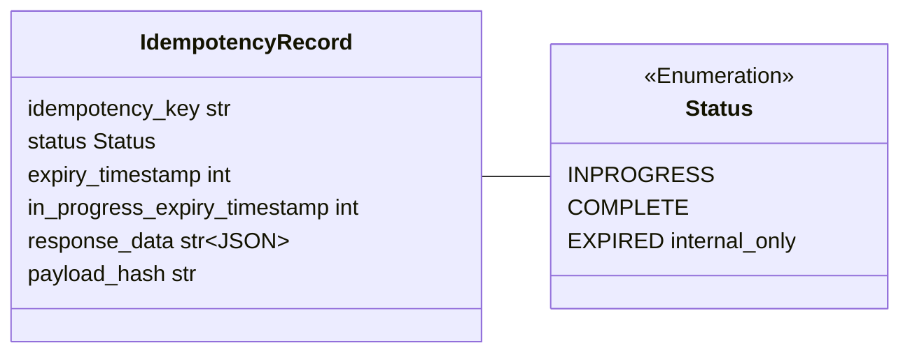
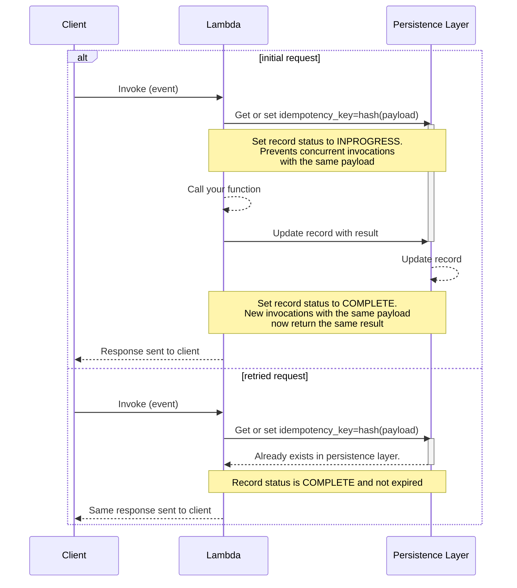
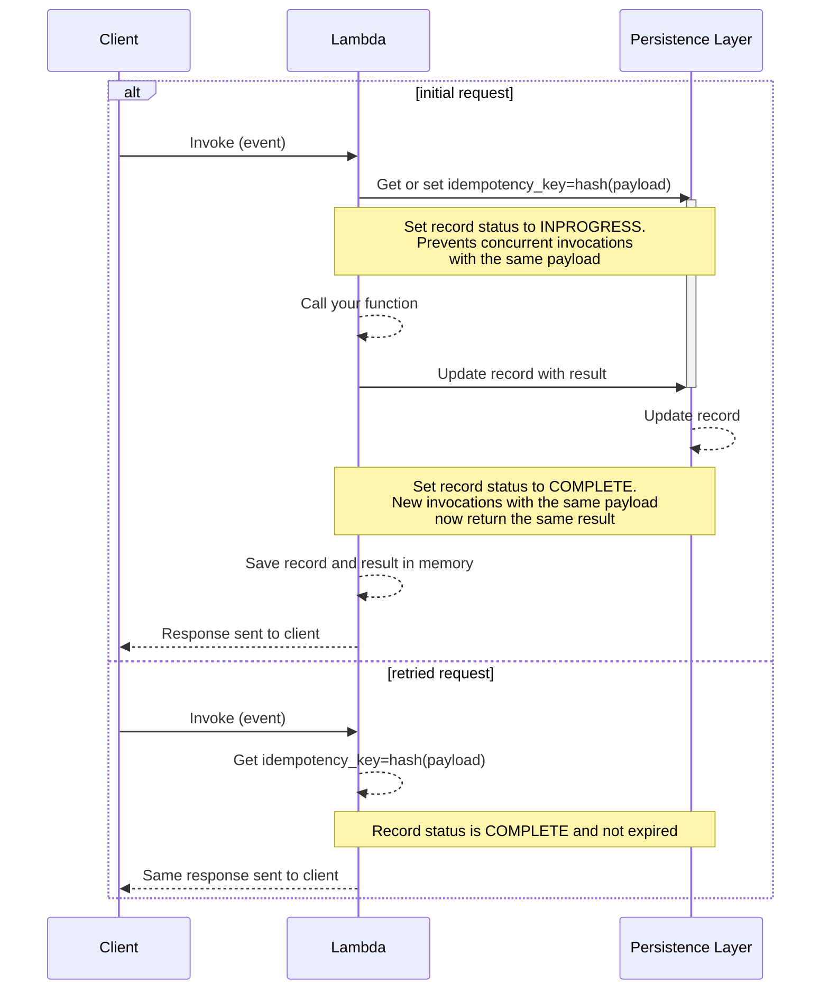
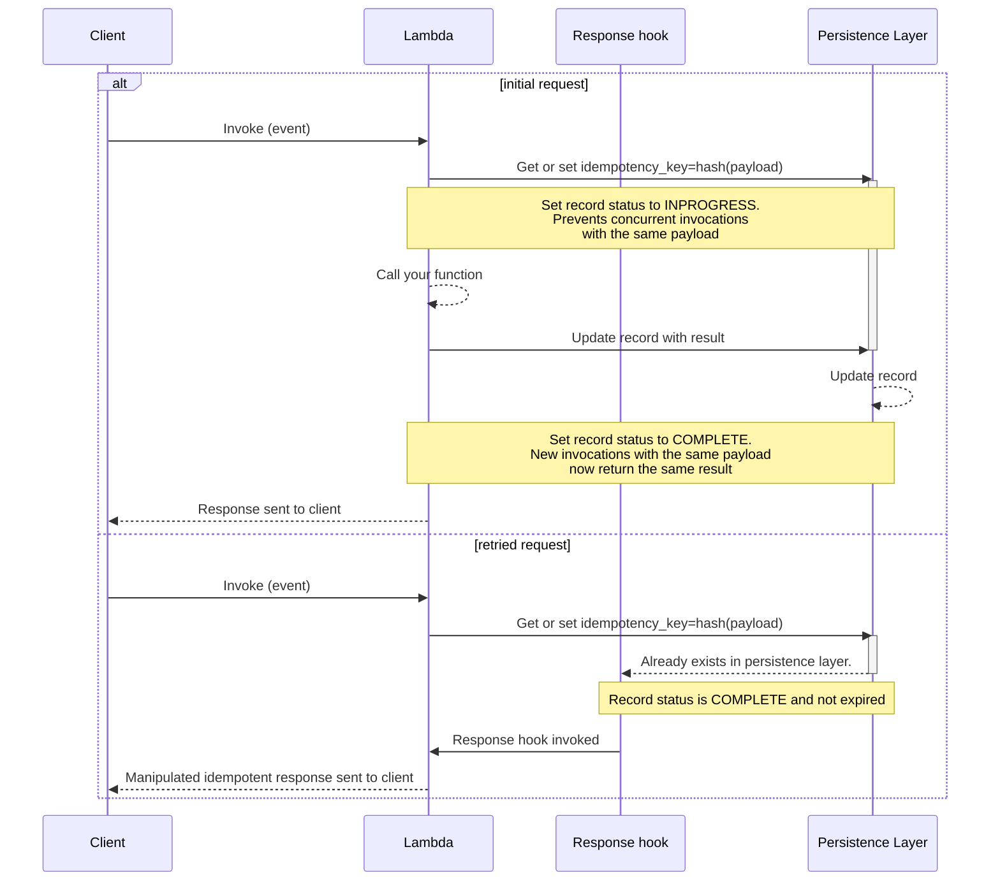
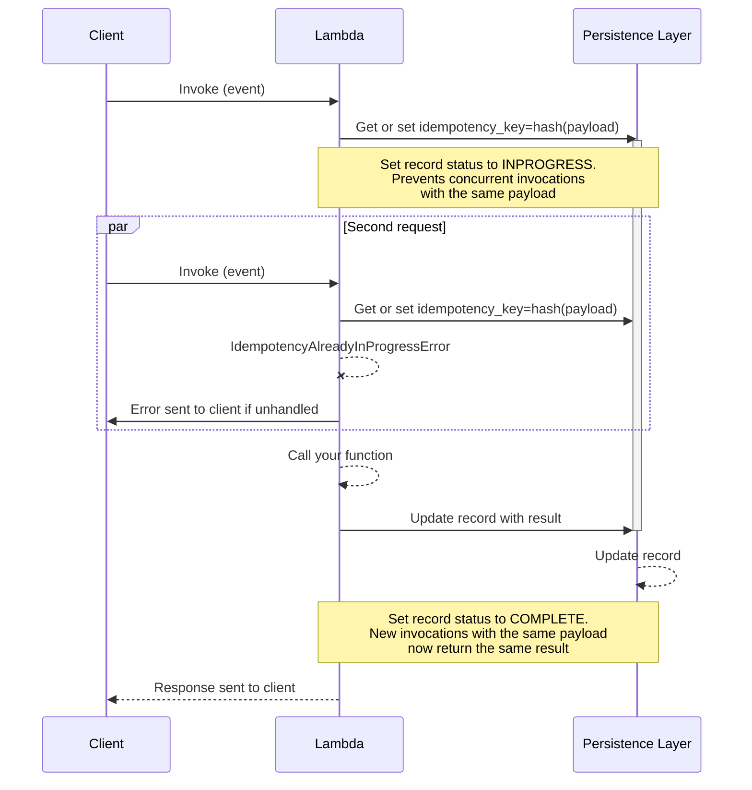
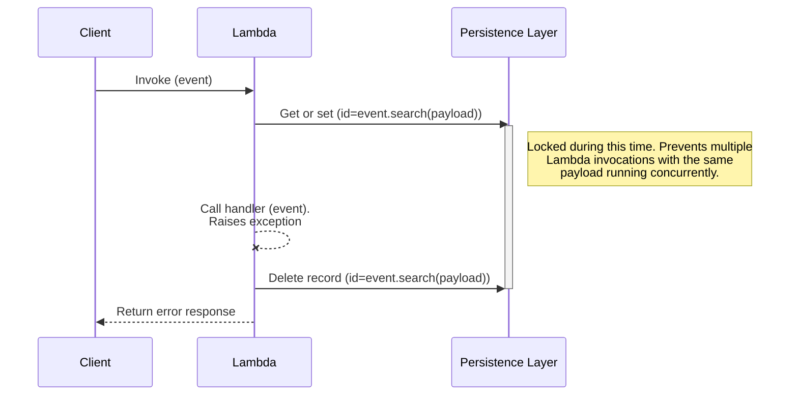
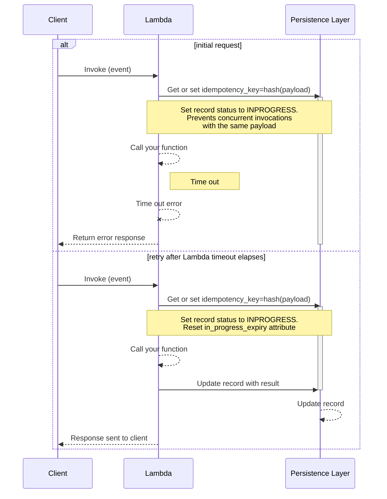
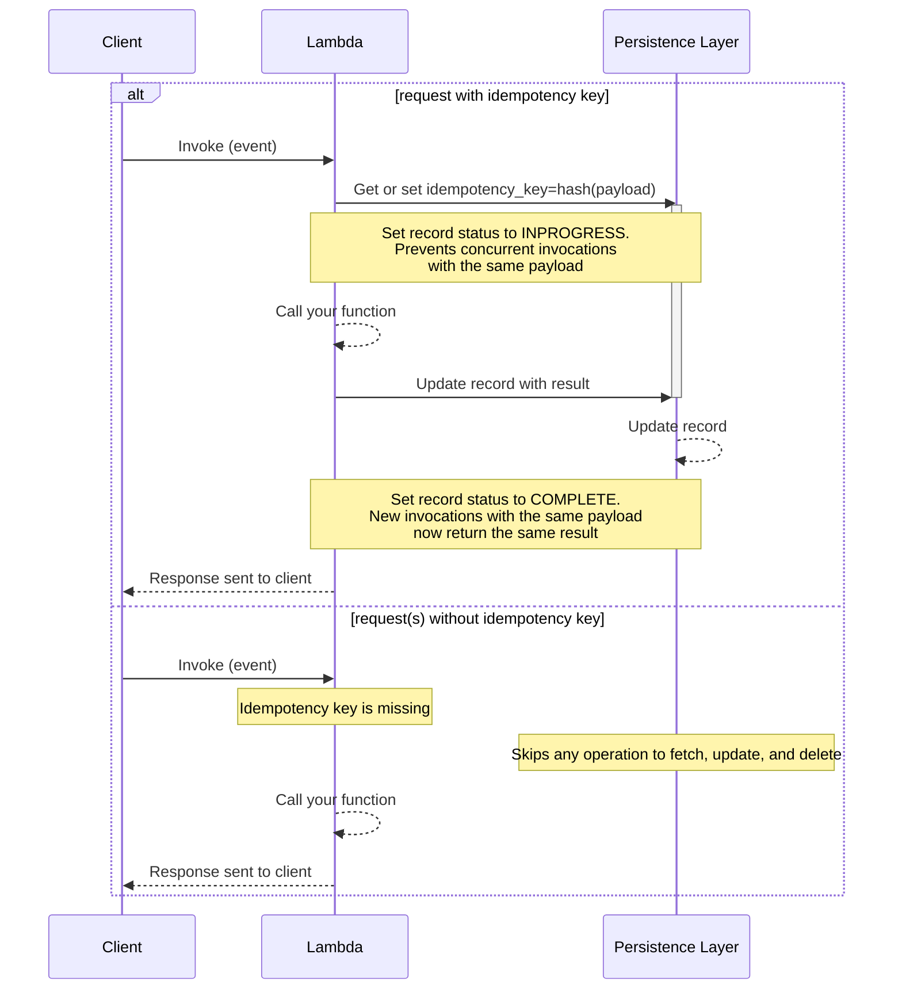
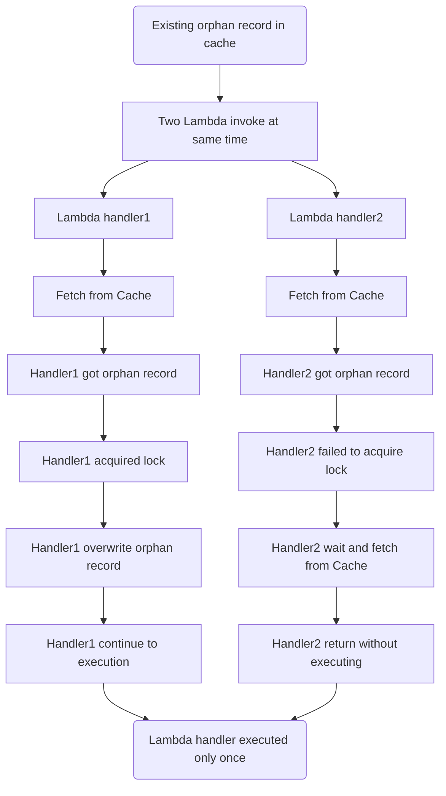

<!-- Generated by scripts/build_agent_skill_references.py from utilities/idempotency.md. Do not edit by hand. -->
# Idempotency

Source of truth: https://docs.powertools.aws.dev/lambda/python/latest/utilities/idempotency/

The idempotency utility allows you to retry operations within a time window with the same input, producing the same output.

## Key features

* Produces the previous successful result when a function is called repeatedly with the same idempotency key
* Choose your idempotency key from one or more fields, or entire payload
* Safeguard concurrent requests, timeouts, missing idempotency keys, and payload tampering
* Support for Amazon DynamoDB, Valkey, Redis OSS, or any Redis-compatible cache as the persistence layer

## Terminology

The property of idempotency means that an operation does not cause additional side effects if it is called more than once with the same input parameters.

**Idempotency key** By default, this is a combination of **(a)** Lambda function name, **(b)** fully qualified name of your function, and **(c)** a hash of the entire payload or part(s) of the payload you specify. However, you can customize the key generation by using **(a)** a [custom prefix name](#customizing-the-idempotency-key-generation), while still incorporating **(c)** a hash of the entire payload or part(s) of the payload you specify.

**Idempotent request** is an operation with the same input previously processed that is not expired in your persistent storage or in-memory cache.

**Persistence layer** is a storage we use to create, read, expire, and delete idempotency records.

**Idempotency record** is the data representation of an idempotent request saved in the persistent layer and in its various status. We use it to coordinate  whether **(a)** a request is idempotent, **(b)** it's not expired, **(c)** JSON response to return, and more.

<center>


<i>Idempotency record representation</i>
</center>

## Getting started

We use Amazon DynamoDB as the default persistence layer in the documentation. If you prefer Redis, you can learn more from [this section](#cache-database).

### IAM Permissions

When using Amazon DynamoDB as the persistence layer, you will need the following IAM permissions:

| IAM Permission                       | Operation                                                                |
| ------------------------------------ | ------------------------------------------------------------------------ |
| **`dynamodb:GetItem`**{: .copyMe}    | Retrieve idempotent record _(strong consistency)_                        |
| **`dynamodb:PutItem`**{: .copyMe}    | New idempotent records, replace expired idempotent records               |
| **`dynamodb:UpdateItem`**{: .copyMe} | Complete idempotency transaction, and/or update idempotent records state |
| **`dynamodb:DeleteItem`**{: .copyMe} | Delete idempotent records for unsuccessful idempotency transactions      |

**First time setting it up?**

We provide Infrastrucure as Code examples with [AWS Serverless Application Model (SAM)](#dynamodb-iac-examples), [AWS Cloud Development Kit (CDK)](#aws-cloud-development-kit-cdk), and [Terraform](#terraform) with the required permissions.

### Required resources

To start, you'll need:

<div class="grid cards" markdown>
*   **Persistent storage**

    ---

    [Amazon DynamoDB](#dynamodb-table) or [Valkey/Redis OSS/Redis compatible](#cache-database)

*   **AWS Lambda function**

    ---

    With permissions to use your persistent storage

</div>

> **Note: Primary key for any persistence storage**

We combine the Lambda function name and the [fully qualified name](https://peps.python.org/pep-3155/) for classes/functions to
prevent accidental reuse for similar code sharing input/output.

Primary key sample: `{lambda_fn_name}.{module_name}.{fn_qualified_name}#{idempotency_key_hash}`

#### DynamoDB table

Unless you're looking to use an [existing table or customize each attribute](#dynamodbpersistencelayer), you only need the following:

| Configuration      | Value        | Notes                                                        |
| ------------------ | ------------ | ------------------------------------------------------------ |
| Partition key      | `id`         |                                                              |
| TTL attribute name | `expiration` | Using AWS Console? This is configurable after table creation |

You **can** use a single DynamoDB table for all functions annotated with Idempotency.

##### DynamoDB IaC examples

**AWS Serverless Application Model (SAM) example**

```yaml
Transform: AWS::Serverless-2016-10-31
Resources:
  IdempotencyTable:
    Type: AWS::DynamoDB::Table
    Properties:
      AttributeDefinitions:
        - AttributeName: id
          AttributeType: S
      KeySchema:
        - AttributeName: id
          KeyType: HASH
      TimeToLiveSpecification:
        AttributeName: expiration
        Enabled: true
      BillingMode: PAY_PER_REQUEST

  HelloWorldFunction:
    Type: AWS::Serverless::Function
    Properties:
      Runtime: python3.12
      Handler: app.py
      Policies:
        - Statement:
            - Sid: AllowDynamodbReadWrite
              Effect: Allow
              Action:
                - dynamodb:PutItem
                - dynamodb:GetItem
                - dynamodb:UpdateItem
                - dynamodb:DeleteItem
              Resource: !GetAtt IdempotencyTable.Arn
      Environment:
        Variables:
          IDEMPOTENCY_TABLE: !Ref IdempotencyTable
```
**AWS Cloud Development Kit (CDK)**

```python
from aws_cdk import RemovalPolicy
from aws_cdk import aws_dynamodb as dynamodb
from aws_cdk import aws_iam as iam
from constructs import Construct

class IdempotencyConstruct(Construct):
    def __init__(self, scope: Construct, name: str, lambda_role: iam.Role) -> None:
        super().__init__(scope, name)
        self.idempotency_table = dynamodb.Table(
            self,
            "IdempotencyTable",
            partition_key=dynamodb.Attribute(name="id", type=dynamodb.AttributeType.STRING),
            billing_mode=dynamodb.BillingMode.PAY_PER_REQUEST,
            removal_policy=RemovalPolicy.DESTROY,
            time_to_live_attribute="expiration",
            point_in_time_recovery=True,
        )
        self.idempotency_table.grant(
            lambda_role,
            "dynamodb:PutItem",
            "dynamodb:GetItem",
            "dynamodb:UpdateItem",
            "dynamodb:DeleteItem",
        )
```

**Terraform**

```terraform
terraform {
  required_providers {
    aws = {
      source  = "hashicorp/aws"
      version = "~> 4.0"
    }
  }
}

provider "aws" {
  region = "us-east-1" # Replace with your desired AWS region
}

resource "aws_dynamodb_table" "IdempotencyTable" {
  name         = "IdempotencyTable"
  billing_mode = "PAY_PER_REQUEST"
  hash_key     = "id"
  attribute {
    name = "id"
    type = "S"
  }
  ttl {
    attribute_name = "expiration"
    enabled        = true
  }
}

resource "aws_lambda_function" "IdempotencyFunction" {
  function_name = "IdempotencyFunction"
  role          = aws_iam_role.IdempotencyFunctionRole.arn
  runtime       = "python3.12"
  handler       = "app.lambda_handler"
  filename      = "lambda.zip"

}

resource "aws_iam_role" "IdempotencyFunctionRole" {
  name = "IdempotencyFunctionRole"

  assume_role_policy = jsonencode({
    Version = "2012-10-17"
    Statement = [
      {
        Sid    = ""
        Effect = "Allow"
        Principal = {
          Service = "lambda.amazonaws.com"
        }
        Action = "sts:AssumeRole"
      },
    ]
  })
}

resource "aws_iam_policy" "LambdaDynamoDBPolicy" {
  name        = "LambdaDynamoDBPolicy"
  description = "IAM policy for Lambda function to access DynamoDB"
  policy = jsonencode({
    Version = "2012-10-17"
    Statement = [
      {
        Sid    = "AllowDynamodbReadWrite"
        Effect = "Allow"
        Action = [
          "dynamodb:PutItem",
          "dynamodb:GetItem",
          "dynamodb:UpdateItem",
          "dynamodb:DeleteItem",
        ]
        Resource = aws_dynamodb_table.IdempotencyTable.arn
      },
    ]
  })
}

resource "aws_iam_role_policy_attachment" "IdempotencyFunctionRoleAttachment" {
  role       = aws_iam_role.IdempotencyFunctionRole.name
  policy_arn = aws_iam_policy.LambdaDynamoDBPolicy.arn
}
```
`

##### Limitations

* **DynamoDB restricts [item sizes to 400KB](https://docs.aws.amazon.com/amazondynamodb/latest/developerguide/Limits.html#limits-items)**. This means that if your annotated function's response must be smaller than 400KB, otherwise your function will fail. Consider [Cache](#cache-database) as an alternative.

* **Expect 2 WCU per non-idempotent call**. During the first invocation, we use `PutItem` for locking and `UpdateItem` for completion. Consider reviewing [DynamoDB pricing documentation](https://aws.amazon.com/dynamodb/pricing/) to estimate cost.

* **Old boto3 versions can increase costs**. For cost optimization, we use a conditional `PutItem` to always lock a new idempotency record. If locking fails, it means we already have an idempotency record saving us an additional `GetItem` call. However, this is only supported in boto3 `1.26.194` and higher _([June 30th 2023](https://aws.amazon.com/about-aws/whats-new/2023/06/amazon-dynamodb-cost-failed-conditional-writes/))_.

#### Cache database

We recommend starting with a managed cache service, such as [Amazon ElastiCache for Valkey and for Redis OSS](https://aws.amazon.com/elasticache/redis/) or [Amazon MemoryDB](https://aws.amazon.com/memorydb/).

In both services, you'll need to configure [VPC access](https://docs.aws.amazon.com/lambda/latest/dg/configuration-vpc.html) to your AWS Lambda.

##### Cache configuration

**AWS CloudFormation example**

> **Tip: Prefer AWS Console/CLI?**

Follow the official tutorials for [Amazon ElastiCache for Redis](https://docs.aws.amazon.com/AmazonElastiCache/latest/red-ug/LambdaRedis.html) or [Amazon MemoryDB for Redis](https://aws.amazon.com/blogs/database/access-amazon-memorydb-for-redis-from-aws-lambda/)

```yaml
AWSTemplateFormatVersion: "2010-09-09"
Transform: AWS::Serverless-2016-10-31

Resources:
  CacheServerlessIdempotency:
    Type: AWS::ElastiCache::ServerlessCache
    Properties:
      Engine: redis
      ServerlessCacheName: redis-cache
      SecurityGroupIds: # (1)!
        - sg-07d998809154f9d88
      SubnetIds:
        - subnet-{your_subnet_id_1}
        - subnet-{your_subnet_id_2}

  IdempotencyFunction:
    Type: AWS::Serverless::Function
    Properties:
      Runtime: python3.13
      Handler: app.py
      VpcConfig: # (1)!
        SecurityGroupIds:
          - sg-07d998809154f9d88
        SubnetIds:
          - subnet-{your_subnet_id_1}
          - subnet-{your_subnet_id_2}
      Environment:
        Variables:
          POWERTOOLS_SERVICE_NAME: sample
          CACHE_HOST: !GetAtt CacheServerlessIdempotency.Endpoint.Address
          CACHE_PORT: !GetAtt CacheServerlessIdempotency.Endpoint.Port
```

1. Replace the Security Group ID and Subnet ID to match your VPC settings.
2. Replace the Security Group ID and Subnet ID to match your VPC settings.

Once setup, you can find a quick start and advanced examples for Cache in [the persistent layers section](#cachepersistencelayer).

### Idempotent decorator

For simple use cases, you can use the `idempotent` decorator on your Lambda handler function.

It will treat the entire event as an idempotency key. That is, the same event will return the previously stored result within a [configurable time window](#adjusting-expiration-window) _(1 hour, by default)_.

**Idempotent decorator**

> **Tip: You can also choose [one or more fields](#choosing-a-payload-subset) as an idempotency key.**

```python title="getting_started_with_idempotency.py"
import os
from dataclasses import dataclass, field
from uuid import uuid4

from aws_lambda_powertools.utilities.idempotency import (
    DynamoDBPersistenceLayer,
    idempotent,
)
from aws_lambda_powertools.utilities.typing import LambdaContext

table = os.getenv("IDEMPOTENCY_TABLE", "")
persistence_layer = DynamoDBPersistenceLayer(table_name=table)

@dataclass
class Payment:
    user_id: str
    product_id: str
    payment_id: str = field(default_factory=lambda: f"{uuid4()}")

class PaymentError(Exception): ...

@idempotent(persistence_store=persistence_layer)
def lambda_handler(event: dict, context: LambdaContext):
    try:
        payment: Payment = create_subscription_payment(event)
        return {
            "payment_id": payment.payment_id,
            "message": "success",
            "statusCode": 200,
        }
    except Exception as exc:
        raise PaymentError(f"Error creating payment {str(exc)}")

def create_subscription_payment(event: dict) -> Payment:
    return Payment(**event)
```

**Sample event**

```json title="getting_started_with_idempotency_payload.json"
{
  "user_id": "xyz",
  "product_id": "123456789"
}
```

### Idempotent_function decorator

For full flexibility, you can use the `idempotent_function` decorator for any synchronous Python function.

When using this decorator, you **must** call your decorated function using keyword arguments.

You can use `data_keyword_argument` to tell us the argument to extract an idempotency key.  We support JSON serializable data, [Dataclasses](https://docs.python.org/3.12/library/dataclasses.html), Pydantic Models, and [Event Source Data Classes](./data_classes.md)

When hashing dataclass or dictionary inputs, UUID and path values are encoded as strings, `datetime`, `date`, and `time` values use ISO 8601 strings, and enums use their values unless the existing encoder already supports the enum type. Existing encodings, including `Decimal` and enums based on strings, integers, floats, or `Decimal`, are preserved.

These conversions happen after evaluating `event_key_jmespath` and `payload_validation_jmespath`, so their expressions and custom functions receive the original field types. They apply to key and validation hashing; function results continue to use the [output serialization](#output-serialization) configuration.

**Using Dataclasses**

```python title="working_with_idempotent_function_dataclass.py"
import os
from dataclasses import dataclass

from aws_lambda_powertools.utilities.idempotency import (
    DynamoDBPersistenceLayer,
    IdempotencyConfig,
    idempotent_function,
)
from aws_lambda_powertools.utilities.typing import LambdaContext

table = os.getenv("IDEMPOTENCY_TABLE", "")
dynamodb = DynamoDBPersistenceLayer(table_name=table)
config = IdempotencyConfig(event_key_jmespath="order_id")  # see Choosing a payload subset section

@dataclass
class OrderItem:
    sku: str
    description: str

@dataclass
class Order:
    item: OrderItem
    order_id: int

@idempotent_function(data_keyword_argument="order", config=config, persistence_store=dynamodb)
def process_order(order: Order):  # (1)!
    return f"processed order {order.order_id}"

def lambda_handler(event: dict, context: LambdaContext):
    # see Lambda timeouts section
    config.register_lambda_context(context)  # (2)!

    order_item = OrderItem(sku="fake", description="sample")
    order = Order(item=order_item, order_id=1)

    # `order` parameter must be called as a keyword argument to work
    process_order(order=order)
```

1. Notice how **`data_keyword_argument`** matches the name of the parameter.
<br><br> This allows us to extract one or all fields as idempotency key.
2. Different from `idempotent` decorator, we must explicitly register the Lambda context to [protect against timeouts](#lambda-timeouts).

**Using Pydantic**

```python title="working_with_idempotent_function_pydantic.py"
import os

from aws_lambda_powertools.utilities.idempotency import (
    DynamoDBPersistenceLayer,
    IdempotencyConfig,
    idempotent_function,
)
from aws_lambda_powertools.utilities.parser import BaseModel
from aws_lambda_powertools.utilities.typing import LambdaContext

table = os.getenv("IDEMPOTENCY_TABLE", "")
dynamodb = DynamoDBPersistenceLayer(table_name=table)
config = IdempotencyConfig(event_key_jmespath="order_id")  # see Choosing a payload subset section

class OrderItem(BaseModel):
    sku: str
    description: str

class Order(BaseModel):
    item: OrderItem
    order_id: int

@idempotent_function(data_keyword_argument="order", config=config, persistence_store=dynamodb)
def process_order(order: Order):
    return f"processed order {order.order_id}"

def lambda_handler(event: dict, context: LambdaContext):
    config.register_lambda_context(context)  # see Lambda timeouts section
    order_item = OrderItem(sku="fake", description="sample")
    order = Order(item=order_item, order_id=1)

    # `order` parameter must be called as a keyword argument to work
    process_order(order=order)
```

#### Output serialization

By default, `idempotent_function` serializes, stores, and returns your annotated function's result as a JSON object. You can change this behavior using `output_serializer` parameter.

The output serializer supports any JSON serializable data, **Python Dataclasses** and **Pydantic Models**.

> **Info**

When using the `output_serializer` parameter, the data will continue to be stored in your persistent storage as a JSON string.

Function returns must be annotated with a single type, optionally wrapped in `Optional` or `Union` with `None`.

**Pydantic**

Use `PydanticSerializer` to automatically serialize what's retrieved from the persistent storage based on the return type annotated.

**Inferring via the return type**

```python
import os

from aws_lambda_powertools.utilities.idempotency import (
    DynamoDBPersistenceLayer,
    IdempotencyConfig,
    idempotent_function,
)
from aws_lambda_powertools.utilities.idempotency.serialization.pydantic import PydanticSerializer
from aws_lambda_powertools.utilities.parser import BaseModel
from aws_lambda_powertools.utilities.typing import LambdaContext

table = os.getenv("IDEMPOTENCY_TABLE", "")
dynamodb = DynamoDBPersistenceLayer(table_name=table)
config = IdempotencyConfig(event_key_jmespath="order_id")  # see Choosing a payload subset section

class OrderItem(BaseModel):
    sku: str
    description: str

class Order(BaseModel):
    item: OrderItem
    order_id: int

class OrderOutput(BaseModel):
    order_id: int

@idempotent_function(
    data_keyword_argument="order",
    config=config,
    persistence_store=dynamodb,
    output_serializer=PydanticSerializer,
)
# order output is inferred from return type
def process_order(order: Order) -> OrderOutput:  # (1)!
    return OrderOutput(order_id=order.order_id)

def lambda_handler(event: dict, context: LambdaContext):
    config.register_lambda_context(context)  # see Lambda timeouts section
    order_item = OrderItem(sku="fake", description="sample")
    order = Order(item=order_item, order_id=1)

    # `order` parameter must be called as a keyword argument to work
    process_order(order=order)
```

1. We'll use `OrderOutput` to instantiate a new object using the data retrieved from persistent storage as input. <br><br> This ensures the return of the function is not impacted when `@idempotent_function` is used.

**Explicit model type**

Alternatively, you can provide an explicit model as an input to `PydanticSerializer`.

```python
import os

from aws_lambda_powertools.utilities.idempotency import (
    DynamoDBPersistenceLayer,
    IdempotencyConfig,
    idempotent_function,
)
from aws_lambda_powertools.utilities.idempotency.serialization.pydantic import PydanticSerializer
from aws_lambda_powertools.utilities.parser import BaseModel
from aws_lambda_powertools.utilities.typing import LambdaContext

table = os.getenv("IDEMPOTENCY_TABLE", "")
dynamodb = DynamoDBPersistenceLayer(table_name=table)
config = IdempotencyConfig(event_key_jmespath="order_id")  # see Choosing a payload subset section

class OrderItem(BaseModel):
    sku: str
    description: str

class Order(BaseModel):
    item: OrderItem
    order_id: int

class OrderOutput(BaseModel):
    order_id: int

@idempotent_function(
    data_keyword_argument="order",
    config=config,
    persistence_store=dynamodb,
    output_serializer=PydanticSerializer(model=OrderOutput),
)
def process_order(order: Order):
    return OrderOutput(order_id=order.order_id)

def lambda_handler(event: dict, context: LambdaContext):
    config.register_lambda_context(context)  # see Lambda timeouts section
    order_item = OrderItem(sku="fake", description="sample")
    order = Order(item=order_item, order_id=1)

    # `order` parameter must be called as a keyword argument to work
    process_order(order=order)
```

> **Warning: Results are stored as JSON**

`PydanticSerializer` stores your model with `model_dump(mode="json")`, so fields such as `UUID`, `datetime`, `Enum`, `bytes` and `set` are saved as JSON values and validated back into the model on replay. Two cases need attention:

* `SecretStr` and `SecretBytes` fields are stored **masked** (`**********`), so a replayed result returns the masked value, not the secret. Keep secrets out of idempotent results.
* Models with `strict=True` and fields like `datetime` or `UUID` save correctly, but the replay fails validation because strict mode does not accept the stored strings. Use a non-strict model for the result, or a custom serializer.

**Dataclasses**

 Use `DataclassSerializer` to automatically serialize what's retrieved from the persistent storage based on the return type annotated.

**Inferring via the return type**

```python
import os
from dataclasses import dataclass

from aws_lambda_powertools.utilities.idempotency import (
    DynamoDBPersistenceLayer,
    IdempotencyConfig,
    idempotent_function,
)
from aws_lambda_powertools.utilities.idempotency.serialization.dataclass import DataclassSerializer
from aws_lambda_powertools.utilities.typing import LambdaContext

table = os.getenv("IDEMPOTENCY_TABLE", "")
dynamodb = DynamoDBPersistenceLayer(table_name=table)
config = IdempotencyConfig(event_key_jmespath="order_id")  # see Choosing a payload subset section

@dataclass
class OrderItem:
    sku: str
    description: str

@dataclass
class Order:
    item: OrderItem
    order_id: int

@dataclass
class OrderOutput:
    order_id: int

@idempotent_function(
    data_keyword_argument="order",
    config=config,
    persistence_store=dynamodb,
    output_serializer=DataclassSerializer,
)
# order output is inferred from return type
def process_order(order: Order) -> OrderOutput:  # (1)!
    return OrderOutput(order_id=order.order_id)

def lambda_handler(event: dict, context: LambdaContext):
    config.register_lambda_context(context)  # see Lambda timeouts section
    order_item = OrderItem(sku="fake", description="sample")
    order = Order(item=order_item, order_id=1)

    # `order` parameter must be called as a keyword argument to work
    process_order(order=order)
```

1. We'll use `OrderOutput` to instantiate a new object using the data retrieved from persistent storage as input. <br><br> This ensures the return of the function is not impacted when `@idempotent_function` is used.

**Explicit model type**

Alternatively, you can provide an explicit model as an input to `DataclassSerializer`.

```python
import os
from dataclasses import dataclass

from aws_lambda_powertools.utilities.idempotency import (
    DynamoDBPersistenceLayer,
    IdempotencyConfig,
    idempotent_function,
)
from aws_lambda_powertools.utilities.idempotency.serialization.dataclass import DataclassSerializer
from aws_lambda_powertools.utilities.typing import LambdaContext

table = os.getenv("IDEMPOTENCY_TABLE", "")
dynamodb = DynamoDBPersistenceLayer(table_name=table)
config = IdempotencyConfig(event_key_jmespath="order_id")  # see Choosing a payload subset section

@dataclass
class OrderItem:
    sku: str
    description: str

@dataclass
class Order:
    item: OrderItem
    order_id: int

@dataclass
class OrderOutput:
    order_id: int

@idempotent_function(
    data_keyword_argument="order",
    config=config,
    persistence_store=dynamodb,
    output_serializer=DataclassSerializer(model=OrderOutput),
)
def process_order(order: Order):
    return OrderOutput(order_id=order.order_id)

def lambda_handler(event: dict, context: LambdaContext):
    config.register_lambda_context(context)  # see Lambda timeouts section
    order_item = OrderItem(sku="fake", description="sample")
    order = Order(item=order_item, order_id=1)

    # `order` parameter must be called as a keyword argument to work
    process_order(order=order)
```

**Any type**

Use `CustomDictSerializer` to have full control over the serialization process for any type. It expects two functions:

* **to_dict**. Function to convert any type to a JSON serializable dictionary before it saves into the persistent storage.
* **from_dict**. Function to convert from a dictionary retrieved from persistent storage and serialize in its original form.

```python
import os

from aws_lambda_powertools.utilities.idempotency import (
    DynamoDBPersistenceLayer,
    IdempotencyConfig,
    idempotent_function,
)
from aws_lambda_powertools.utilities.idempotency.serialization.custom_dict import CustomDictSerializer
from aws_lambda_powertools.utilities.typing import LambdaContext

table = os.getenv("IDEMPOTENCY_TABLE", "")
dynamodb = DynamoDBPersistenceLayer(table_name=table)
config = IdempotencyConfig(event_key_jmespath="order_id")  # see Choosing a payload subset section

class OrderItem:
    def __init__(self, sku: str, description: str):
        self.sku = sku
        self.description = description

class Order:
    def __init__(self, item: OrderItem, order_id: int):
        self.item = item
        self.order_id = order_id

class OrderOutput:
    def __init__(self, order_id: int):
        self.order_id = order_id

def order_to_dict(x: type[OrderOutput]) -> dict:  # (1)!
    return dict(x.__dict__)

def dict_to_order(x: dict) -> OrderOutput:  # (2)!
    return OrderOutput(**x)

order_output_serializer = CustomDictSerializer(  # (3)!
    to_dict=order_to_dict,
    from_dict=dict_to_order,
)

@idempotent_function(
    data_keyword_argument="order",
    config=config,
    persistence_store=dynamodb,
    output_serializer=order_output_serializer,
)
def process_order(order: Order) -> OrderOutput:
    return OrderOutput(order_id=order.order_id)

def lambda_handler(event: dict, context: LambdaContext):
    config.register_lambda_context(context)  # see Lambda timeouts section
    order_item = OrderItem(sku="fake", description="sample")
    order = Order(item=order_item, order_id=1)

    # `order` parameter must be called as a keyword argument to work
    process_order(order=order)
```

1. This function does the following <br><br>**1**. Receives the return from `process_order`<br> **2**. Converts to dictionary before it can be saved into the persistent storage.
2. This function does the following <br><br>**1**. Receives the dictionary saved into the persistent storage <br>**1** Serializes to `OrderOutput` before `@idempotent` returns back to the caller.
3. This serializer receives both functions so it knows who to call when to serialize to and from dictionary.

### Using in-memory cache

> **Note: In-memory cache is local to each Lambda execution environment.**

You can enable caching with the `use_local_cache` parameter in `IdempotencyConfig`. When enabled, you can adjust cache capacity _(256)_ with `local_cache_max_items`.

By default, caching is disabled since we don't know how big your response could be in relation to your configured memory size.

**Enabling cache**

```python
import os

from aws_lambda_powertools.utilities.idempotency import (
    DynamoDBPersistenceLayer,
    IdempotencyConfig,
    idempotent,
)
from aws_lambda_powertools.utilities.typing import LambdaContext

table = os.getenv("IDEMPOTENCY_TABLE", "")
persistence_layer = DynamoDBPersistenceLayer(table_name=table)
config = IdempotencyConfig(
    event_key_jmespath="powertools_json(body)",
    # by default, it holds 256 items in a Least-Recently-Used (LRU) manner
    use_local_cache=True,  # (1)!
)

@idempotent(config=config, persistence_store=persistence_layer)
def lambda_handler(event, context: LambdaContext):
    return event
```

1. You can adjust cache capacity with [`local_cache_max_items`](#customizing-the-default-behavior) parameter.

**Sample event**

```json
{
  "body": "{\"user_id\":\"xyz\",\"product_id\":\"123456789\"}"
}
```

### Choosing a payload subset

> **Tip: Tip: Dealing with always changing payloads**

When dealing with a more elaborate payload, where parts of the payload always change, you should use **`event_key_jmespath`** parameter.

Use **`event_key_jmespath`** parameter in [`IdempotencyConfig`](#customizing-the-default-behavior) to select one or more payload parts as your idempotency key.

> **Example scenario**

In this example, we have a Lambda handler that creates a payment for a user subscribing to a product. We want to ensure that we don't accidentally charge our customer by subscribing them more than once.

Imagine the function runs successfully, but the client never receives the response due to a connection issue. It is safe to immediately retry in this instance, as the idempotent decorator will return a previously saved response.

We want to use `user_id` and `product_id` fields as our idempotency key. **If we were** to treat the entire request as our idempotency key, a simple HTTP header change would cause our function to run again.

> **Tip: Deserializing JSON strings in payloads for increased accuracy.**

The payload extracted by the `event_key_jmespath` is treated as a string by default.
This means there could be differences in whitespace even when the JSON payload itself is identical.

To alter this behaviour, we can use the [JMESPath built-in function](jmespath_functions.md#powertools_json-function) `powertools_json()` to treat the payload as a JSON object (dict) rather than a string.

**Payment function**

```python
import json
import os
from dataclasses import dataclass, field
from uuid import uuid4

from aws_lambda_powertools.utilities.idempotency import (
    DynamoDBPersistenceLayer,
    IdempotencyConfig,
    idempotent,
)
from aws_lambda_powertools.utilities.typing import LambdaContext

table = os.getenv("IDEMPOTENCY_TABLE", "")
persistence_layer = DynamoDBPersistenceLayer(table_name=table)

# Deserialize JSON string under the "body" key
# then extract "user" and "product_id" data
config = IdempotencyConfig(event_key_jmespath='powertools_json(body).["user_id", "product_id"]')

@dataclass
class Payment:
    user_id: str
    product_id: str
    payment_id: str = field(default_factory=lambda: f"{uuid4()}")

class PaymentError(Exception): ...

@idempotent(config=config, persistence_store=persistence_layer)
def lambda_handler(event: dict, context: LambdaContext):
    try:
        payment_info: str = event.get("body", "")
        payment: Payment = create_subscription_payment(json.loads(payment_info))
        return {
            "payment_id": payment.payment_id,
            "message": "success",
            "statusCode": 200,
        }
    except Exception as exc:
        raise PaymentError(f"Error creating payment {str(exc)}")

def create_subscription_payment(event: dict) -> Payment:
    return Payment(**event)
```

**Sample event**

```json
{
  "version": "2.0",
  "routeKey": "ANY /createpayment",
  "rawPath": "/createpayment",
  "rawQueryString": "",
  "headers": {
    "Header1": "value1",
    "Header2": "value2"
  },
  "requestContext": {
    "accountId": "123456789012",
    "apiId": "api-id",
    "domainName": "id.execute-api.us-east-1.amazonaws.com",
    "domainPrefix": "id",
    "http": {
      "method": "POST",
      "path": "/createpayment",
      "protocol": "HTTP/1.1",
      "sourceIp": "ip",
      "userAgent": "agent"
    },
    "requestId": "id",
    "routeKey": "ANY /createpayment",
    "stage": "$default",
    "time": "10/Feb/2021:13:40:43 +0000",
    "timeEpoch": 1612964443723
  },
  "body": "{\"user_id\":\"xyz\",\"product_id\":\"123456789\"}",
  "isBase64Encoded": false
}
```

### Adjusting expiration window

> **Note: By default, we expire idempotency records after **an hour** (3600 seconds). After that, a transaction with the same payload [will not be considered idempotent](#expired-idempotency-records).**

You can change this expiration window with the **`expires_after_seconds`** parameter. There is no limit on how long this expiration window can be set to.

**Adjusting expiration window**

```python
import os

from aws_lambda_powertools.utilities.idempotency import (
    DynamoDBPersistenceLayer,
    IdempotencyConfig,
    idempotent,
)
from aws_lambda_powertools.utilities.typing import LambdaContext

table = os.getenv("IDEMPOTENCY_TABLE", "")
persistence_layer = DynamoDBPersistenceLayer(table_name=table)
config = IdempotencyConfig(
    event_key_jmespath="body",
    expires_after_seconds=24 * 60 * 60,  # 24 hours
)

@idempotent(config=config, persistence_store=persistence_layer)
def lambda_handler(event, context: LambdaContext):
    return event
```

**Sample event**

```json
{
  "body": "{\"user_id\":\"xyz\",\"product_id\":\"123456789\"}"
}
```

> **Important: Idempotency record expiration vs DynamoDB time-to-live (TTL)**

[DynamoDB TTL is a feature](https://docs.aws.amazon.com/amazondynamodb/latest/developerguide/howitworks-ttl.html) to remove items after a certain period of time, it may occur within 48 hours of expiration.

We don't rely on DynamoDB or any persistence storage layer to determine whether a record is expired to avoid eventual inconsistency states.

Instead, Idempotency records saved in the storage layer contain timestamps that can be verified upon retrieval and double checked within Idempotency feature.

**Why?**

A record might still be valid (`COMPLETE`) when we retrieved, but in some rare cases it might expire a second later. A record could also be [cached in memory](#using-in-memory-cache). You might also want to have idempotent transactions that should expire in seconds.

### Customizing the Idempotency key generation

> **Warning: Warning: Changing the idempotency key generation will invalidate existing idempotency records**

Use **`key_prefix`** parameter in the `@idempotent` or `@idempotent_function` decorators to define a custom prefix for your Idempotency Key. This allows you to decouple idempotency key name from function names. It can be useful during application refactoring, for example.

**Using a custom prefix in Lambda Handler**

```python
import os
from dataclasses import dataclass, field
from uuid import uuid4

from aws_lambda_powertools.utilities.idempotency import (
    DynamoDBPersistenceLayer,
    idempotent,
)
from aws_lambda_powertools.utilities.typing import LambdaContext

table = os.getenv("IDEMPOTENCY_TABLE", "")
persistence_layer = DynamoDBPersistenceLayer(table_name=table)

@dataclass
class Payment:
    user_id: str
    product_id: str
    payment_id: str = field(default_factory=lambda: f"{uuid4()}")

class PaymentError(Exception): ...

@idempotent(persistence_store=persistence_layer, key_prefix="my_custom_prefix")  # (1)!
def lambda_handler(event: dict, context: LambdaContext):
    try:
        payment: Payment = create_subscription_payment(event)
        return {
            "payment_id": payment.payment_id,
            "message": "success",
            "statusCode": 200,
        }
    except Exception as exc:
        raise PaymentError(f"Error creating payment {str(exc)}")

def create_subscription_payment(event: dict) -> Payment:
    return Payment(**event)
```

1. The Idempotency record will be something like `my_custom_prefix#c4ca4238a0b923820dcc509a6f75849b`

**Using a custom prefix in standalone functions**

```python
import os
from dataclasses import dataclass

from aws_lambda_powertools.utilities.idempotency import (
    DynamoDBPersistenceLayer,
    IdempotencyConfig,
    idempotent_function,
)
from aws_lambda_powertools.utilities.typing import LambdaContext

table = os.getenv("IDEMPOTENCY_TABLE", "")
dynamodb = DynamoDBPersistenceLayer(table_name=table)
config = IdempotencyConfig(event_key_jmespath="order_id")  # see Choosing a payload subset section

@dataclass
class OrderItem:
    sku: str
    description: str

@dataclass
class Order:
    item: OrderItem
    order_id: int

@idempotent_function(
    data_keyword_argument="order",
    config=config,
    persistence_store=dynamodb,
    key_prefix="my_custom_prefix",  # (1)!
)
def process_order(order: Order):
    return f"processed order {order.order_id}"

def lambda_handler(event: dict, context: LambdaContext):
    # see Lambda timeouts section
    config.register_lambda_context(context)

    order_item = OrderItem(sku="fake", description="sample")
    order = Order(item=order_item, order_id=1)

    # `order` parameter must be called as a keyword argument to work
    process_order(order=order)
```

1. The Idempotency record will be something like `my_custom_prefix#c4ca4238a0b923820dcc509a6f75849b`

### Lambda timeouts

> **Note: You can skip this section if you are using the [`@idempotent` decorator](#idempotent-decorator)**

By default, we protect against [concurrent executions](#handling-concurrent-executions-with-the-same-payload) with the same payload using a locking mechanism. However, if your Lambda function times out before completing the first invocation it will only accept the same request when the [idempotency record expire](#adjusting-expiration-window).

To prevent extended failures, use **`register_lambda_context`** function from your idempotency config to calculate and include the remaining invocation time in your idempotency record.

```python title="working_with_lambda_timeout.py"
import os

from aws_lambda_powertools.utilities.data_classes.sqs_event import SQSRecord
from aws_lambda_powertools.utilities.idempotency import (
    DynamoDBPersistenceLayer,
    IdempotencyConfig,
    idempotent_function,
)
from aws_lambda_powertools.utilities.typing import LambdaContext

table = os.getenv("IDEMPOTENCY_TABLE", "")
persistence_layer = DynamoDBPersistenceLayer(table_name=table)

config = IdempotencyConfig()

@idempotent_function(data_keyword_argument="record", persistence_store=persistence_layer, config=config)
def record_handler(record: SQSRecord):
    return {"message": record["body"]}

def lambda_handler(event: dict, context: LambdaContext):
    config.register_lambda_context(context)

    return record_handler(event)
```

> **Example: Mechanics**

If a second invocation happens **after** this timestamp, and the record is marked as `INPROGRESS`, we will run the invocation again as if it was in the `EXPIRED` state.

This means that if an invocation expired during execution, it will be quickly executed again on the next retry.

### Handling exceptions

There are two failure modes that can cause new invocations to execute your code again despite having the same payload:

* **Unhandled exception**. We catch them to delete the idempotency record to prevent inconsistencies, then propagate them.
* **Persistent layer errors**. We raise **`IdempotencyPersistenceLayerError`** for any persistence layer errors _e.g., remove idempotency record_.

If an exception is handled or raised **outside** your decorated function, then idempotency will be maintained.

```python title="working_with_exceptions.py"
import os

import requests

from aws_lambda_powertools.utilities.idempotency import (
    DynamoDBPersistenceLayer,
    IdempotencyConfig,
    idempotent_function,
)
from aws_lambda_powertools.utilities.idempotency.exceptions import IdempotencyPersistenceLayerError
from aws_lambda_powertools.utilities.typing import LambdaContext

table = os.getenv("IDEMPOTENCY_TABLE", "")
persistence_layer = DynamoDBPersistenceLayer(table_name=table)

config = IdempotencyConfig()

@idempotent_function(data_keyword_argument="data", config=config, persistence_store=persistence_layer)
def call_external_service(data: dict):
    # Any exception raised will lead to idempotency record to be deleted
    result: requests.Response = requests.post(
        "https://jsonplaceholder.typicode.com/comments/",
        json=data,
    )
    return result.json()

def lambda_handler(event: dict, context: LambdaContext):
    try:
        call_external_service(data=event)
    except IdempotencyPersistenceLayerError as e:
        # No idempotency, but you can decide to error differently.
        raise RuntimeError(f"Oops, can't talk to persistence layer. Permissions? error: {e}")

    # This exception will not impact the idempotency of 'call_external_service'
    # because it happens in isolation, or outside their scope.
    raise SyntaxError("Oops, this shouldn't be here.")
```

### Persistence layers

#### DynamoDBPersistenceLayer

This persistence layer is built-in, allowing you to use an existing DynamoDB table or create a new one dedicated to idempotency state (recommended).

```python title="customize_persistence_layer.py"
import os

from aws_lambda_powertools.utilities.idempotency import (
    DynamoDBPersistenceLayer,
    idempotent,
)
from aws_lambda_powertools.utilities.typing import LambdaContext

table = os.getenv("IDEMPOTENCY_TABLE", "")
persistence_layer = DynamoDBPersistenceLayer(
    table_name=table,
    key_attr="idempotency_key",
    expiry_attr="expires_at",
    in_progress_expiry_attr="in_progress_expires_at",
    status_attr="current_status",
    data_attr="result_data",
    validation_key_attr="validation_key",
)

@idempotent(persistence_store=persistence_layer)
def lambda_handler(event: dict, context: LambdaContext) -> dict:
    return event
```

##### Using a composite primary key

Use `sort_key_attr` parameter when your table is configured with a composite primary key _(hash+range key)_.

When enabled, we will save the idempotency key in the sort key instead. By default, the primary key will now be set to `idempotency#{LAMBDA_FUNCTION_NAME}`.

You can optionally set a static value for the partition key using the `static_pk_value` parameter.

**Reusing a DynamoDB table that uses a composite primary key**

```python
import os

from aws_lambda_powertools.utilities.idempotency import (
    DynamoDBPersistenceLayer,
    idempotent,
)
from aws_lambda_powertools.utilities.typing import LambdaContext

table = os.getenv("IDEMPOTENCY_TABLE", "")
persistence_layer = DynamoDBPersistenceLayer(table_name=table, sort_key_attr="sort_key")

@idempotent(persistence_store=persistence_layer)
def lambda_handler(event: dict, context: LambdaContext) -> dict:
    user_id: str = event.get("body", "")["user_id"]
    return {"message": "success", "user_id": user_id}
```

**Sample Event**

```json
{
  "body": "{\"user_id\":\"xyz\",\"product_id\":\"123456789\"}"
}
```

> **Note: Click to expand and learn how table items would look like**

| id                           | sort_key                         | expiration | status      | data                                      |
| ---------------------------- | -------------------------------- | ---------- | ----------- | ----------------------------------------- |
| idempotency#MyLambdaFunction | 1e956ef7da78d0cb890be999aecc0c9e | 1636549553 | COMPLETED   | {"user_id": 12391, "message": "success"}  |
| idempotency#MyLambdaFunction | 2b2cdb5f86361e97b4383087c1ffdf27 | 1636549571 | COMPLETED   | {"user_id": 527212, "message": "success"} |
| idempotency#MyLambdaFunction | f091d2527ad1c78f05d54cc3f363be80 | 1636549585 | IN_PROGRESS |                                           |

##### DynamoDB attributes

You can customize the attribute names during initialization:

| Parameter                   | Required           | Default                              | Description                                                                                              |
| --------------------------- | ------------------ | ------------------------------------ | -------------------------------------------------------------------------------------------------------- |
| **table_name**              | :heavy_check_mark: |                                      | Table name to store state                                                                                |
| **key_attr**                |                    | `id`                                 | Partition key of the table. Hashed representation of the payload (unless **sort_key_attr** is specified) |
| **expiry_attr**             |                    | `expiration`                         | Unix timestamp of when record expires                                                                    |
| **in_progress_expiry_attr** |                    | `in_progress_expiration`             | Unix timestamp of when record expires while in progress (in case of the invocation times out)            |
| **status_attr**             |                    | `status`                             | Stores status of the lambda execution during and after invocation                                        |
| **data_attr**               |                    | `data`                               | Stores results of successfully executed Lambda handlers                                                  |
| **validation_key_attr**     |                    | `validation`                         | Hashed representation of the parts of the event used for validation                                      |
| **sort_key_attr**           |                    |                                      | Sort key of the table (if table is configured with a sort key).                                          |
| **static_pk_value**         |                    | `idempotency#{LAMBDA_FUNCTION_NAME}` | Static value to use as the partition key. Only used when **sort_key_attr** is set.                       |

#### CachePersistenceLayer

The `CachePersistenceLayer` enables you to use Valkey, Redis OSS, or any Redis-compatible cache as the persistence layer for idempotency state.

We recommend using [`valkey-glide`](https://pypi.org/project/valkey-glide/) for Valkey or [`redis`](https://pypi.org/project/redis/) for Redis. However, any Redis OSS-compatible client should work.

For simple setups, initialize `CachePersistenceLayer` with your Cache endpoint and port to connect. Note that for security, we enforce SSL connections by default; to disable it, set `ssl=False`.

**Cache quick start**

```python title="getting_started_with_idempotency_cache_config.py"
import os
from dataclasses import dataclass, field
from uuid import uuid4

from aws_lambda_powertools.utilities.idempotency import (
    idempotent,
)
from aws_lambda_powertools.utilities.idempotency.persistence.cache import (
    CachePersistenceLayer,
)
from aws_lambda_powertools.utilities.typing import LambdaContext

redis_endpoint = os.getenv("CACHE_CLUSTER_ENDPOINT", "localhost")
persistence_layer = CachePersistenceLayer(host=redis_endpoint, port=6379)

@dataclass
class Payment:
    user_id: str
    product_id: str
    payment_id: str = field(default_factory=lambda: f"{uuid4()}")

class PaymentError(Exception): ...

@idempotent(persistence_store=persistence_layer)
def lambda_handler(event: dict, context: LambdaContext):
    try:
        payment: Payment = create_subscription_payment(event)
        return {
            "payment_id": payment.payment_id,
            "message": "success",
            "statusCode": 200,
        }
    except Exception as exc:
        raise PaymentError(f"Error creating payment {str(exc)}") from exc

def create_subscription_payment(event: dict) -> Payment:
    return Payment(**event)
```

**Using an existing Valkey Glide client**

```python title="getting_started_with_idempotency_valkey_client.py"
import os
from dataclasses import dataclass, field
from uuid import uuid4

from glide import GlideClient, GlideClientConfiguration, NodeAddress

from aws_lambda_powertools.utilities.idempotency import (
    idempotent,
)
from aws_lambda_powertools.utilities.idempotency.persistence.cache import (
    CachePersistenceLayer,
)
from aws_lambda_powertools.utilities.typing import LambdaContext

cache_endpoint = os.getenv("CACHE_CLUSTER_ENDPOINT", "localhost")
client_config = GlideClientConfiguration(
    addresses=[
        NodeAddress(
            host="localhost",
            port=6379,
        ),
    ],
)
client = GlideClient.create(config=client_config)

persistence_layer = CachePersistenceLayer(client=client)  # type: ignore[arg-type]

@dataclass
class Payment:
    user_id: str
    product_id: str
    payment_id: str = field(default_factory=lambda: f"{uuid4()}")

class PaymentError(Exception): ...

@idempotent(persistence_store=persistence_layer)
def lambda_handler(event: dict, context: LambdaContext):
    try:
        payment: Payment = create_subscription_payment(event)
        return {
            "payment_id": payment.payment_id,
            "message": "success",
            "statusCode": 200,
        }
    except Exception as exc:
        raise PaymentError(f"Error creating payment {str(exc)}")

def create_subscription_payment(event: dict) -> Payment:
    return Payment(**event)
```

**Using an existing Redis client**

```python title="getting_started_with_idempotency_redis_client.py"
import os
from dataclasses import dataclass, field
from uuid import uuid4

from redis import Redis

from aws_lambda_powertools.utilities.idempotency import (
    idempotent,
)
from aws_lambda_powertools.utilities.idempotency.persistence.cache import (
    CachePersistenceLayer,
)
from aws_lambda_powertools.utilities.typing import LambdaContext

cache_endpoint = os.getenv("CACHE_CLUSTER_ENDPOINT", "localhost")
client = Redis(
    host=cache_endpoint,
    port=6379,
    socket_connect_timeout=5,
    socket_timeout=5,
    max_connections=1000,
)

persistence_layer = CachePersistenceLayer(client=client)  # type: ignore[arg-type]

@dataclass
class Payment:
    user_id: str
    product_id: str
    payment_id: str = field(default_factory=lambda: f"{uuid4()}")

class PaymentError(Exception): ...

@idempotent(persistence_store=persistence_layer)
def lambda_handler(event: dict, context: LambdaContext):
    try:
        payment: Payment = create_subscription_payment(event)
        return {
            "payment_id": payment.payment_id,
            "message": "success",
            "statusCode": 200,
        }
    except Exception as exc:
        raise PaymentError(f"Error creating payment {str(exc)}")

def create_subscription_payment(event: dict) -> Payment:
    return Payment(**event)
```

**Sample event**

```json title="getting_started_with_idempotency_payload.json"
{
  "user_id": "xyz",
  "product_id": "123456789"
}
```

##### Cache SSL connections

We recommend using AWS Secrets Manager to store and rotate certificates safely, and the [Parameters feature](./parameters.md) to fetch and cache optimally.

For advanced configurations, we recommend using an existing Valkey client for optimal compatibility like SSL certificates and timeout.

**Advanced configuration using AWS Secrets**

```python title="using_cache_client_with_aws_secrets.py"
from __future__ import annotations

from typing import Any

from glide import BackoffStrategy, GlideClient, GlideClientConfiguration, NodeAddress, ServerCredentials

from aws_lambda_powertools.utilities import parameters
from aws_lambda_powertools.utilities.idempotency import IdempotencyConfig, idempotent
from aws_lambda_powertools.utilities.idempotency.persistence.cache import (
    CachePersistenceLayer,
)

cache_values: dict[str, Any] = parameters.get_secret("cache_info", transform="json")  # (1)!

client_config = GlideClientConfiguration(
    addresses=[
        NodeAddress(
            host=cache_values.get("CACHE_HOST", "localhost"),
            port=cache_values.get("CACHE_PORT", 6379),
        ),
    ],
    credentials=ServerCredentials(
        password=cache_values.get("CACHE_PASSWORD", ""),
    ),
    request_timeout=10,
    use_tls=True,
    reconnect_strategy=BackoffStrategy(num_of_retries=10, factor=2, exponent_base=1),
)
valkey_client = GlideClient.create(config=client_config)

persistence_layer = CachePersistenceLayer(client=valkey_client)  # type: ignore[arg-type]
config = IdempotencyConfig(
    expires_after_seconds=2 * 60,  # 2 minutes
)

@idempotent(config=config, persistence_store=persistence_layer)
def lambda_handler(event, context):
    return {"message": "Hello"}
```

1. JSON stored:
```json
{
"CACHE_HOST": "127.0.0.1",
"CACHE_PORT": "6379",
"CACHE_PASSWORD": "cache-secret"
}
```

**Advanced configuration with local certificates**

```python title="using_redis_client_with_local_certs.py"
from __future__ import annotations

from typing import Any

from redis import Redis

from aws_lambda_powertools.shared.functions import abs_lambda_path
from aws_lambda_powertools.utilities import parameters
from aws_lambda_powertools.utilities.idempotency import IdempotencyConfig, idempotent
from aws_lambda_powertools.utilities.idempotency.persistence.cache import (
    CachePersistenceLayer,
)

cache_values: dict[str, Any] = parameters.get_secret("cache_info", transform="json")  # (1)!

redis_client = Redis(
    host=cache_values.get("REDIS_HOST", "localhost"),
    port=cache_values.get("REDIS_PORT", 6379),
    password=cache_values.get("REDIS_PASSWORD"),
    decode_responses=True,
    socket_timeout=10.0,
    ssl=True,
    retry_on_timeout=True,
    ssl_certfile=f"{abs_lambda_path()}/certs/cache_user.crt",  # (2)!
    ssl_keyfile=f"{abs_lambda_path()}/certs/cache_user_private.key",  # (3)!
    ssl_ca_certs=f"{abs_lambda_path()}/certs/cache_ca.pem",  # (4)!
)

persistence_layer = CachePersistenceLayer(client=redis_client)  # type: ignore[arg-type]
config = IdempotencyConfig(
    expires_after_seconds=2 * 60,  # 2 minutes
)

@idempotent(config=config, persistence_store=persistence_layer)
def lambda_handler(event, context):
    return {"message": "Hello"}
```

1. JSON stored:
```json
{
"CACHE_HOST": "127.0.0.1",
"CACHE_PORT": "6379",
"CACHE_PASSWORD": "cache-secret"
}
```
2. cache_user.crt file stored in the "certs" directory of your Lambda function
3. cache_user_private.key file stored in the "certs" directory of your Lambda function
4. cache_ca.pem file stored in the "certs" directory of your Lambda function

##### Cache attributes

You can customize the attribute names during initialization:

| Parameter                   | Required | Default                  | Description                                                                                   |
| --------------------------- | -------- | ------------------------ | --------------------------------------------------------------------------------------------- |
| **in_progress_expiry_attr** |          | `in_progress_expiration` | Unix timestamp of when record expires while in progress (in case of the invocation times out) |
| **status_attr**             |          | `status`                 | Stores status of the Lambda execution during and after invocation                             |
| **data_attr**               |          | `data`                   | Stores results of successfully executed Lambda handlers                                       |
| **validation_key_attr**     |          | `validation`             | Hashed representation of the parts of the event used for validation                           |

```python title="customize_persistence_layer_redis.py"
import os

from aws_lambda_powertools.utilities.idempotency import (
    idempotent,
)
from aws_lambda_powertools.utilities.idempotency.persistence.redis import (
    RedisCachePersistenceLayer,
)
from aws_lambda_powertools.utilities.typing import LambdaContext

redis_endpoint = os.getenv("REDIS_CLUSTER_ENDPOINT", "localhost")
persistence_layer = RedisCachePersistenceLayer(
    host=redis_endpoint,
    port=6379,
    in_progress_expiry_attr="in_progress_expiration",
    status_attr="status",
    data_attr="data",
    validation_key_attr="validation",
)

@idempotent(persistence_store=persistence_layer)
def lambda_handler(event: dict, context: LambdaContext) -> dict:
    return event
```

### Common use cases

#### Batch processing

You can can easily integrate with [Batch](batch.md) using the [idempotent_function decorator](#idempotent_function-decorator) to handle idempotency per message/record in a given batch.

> **Note: Choosing an unique batch record attribute**

In this example, we choose `messageId` as our idempotency key since we know it'll be unique.

Depending on your use case, it might be more accurate [to choose another field](#choosing-a-payload-subset) your producer intentionally set to define uniqueness.

**Integration with Batch Processor**

```python title="integrate_idempotency_with_batch_processor.py"
import os
from typing import Any

from aws_lambda_powertools.utilities.batch import BatchProcessor, EventType, process_partial_response
from aws_lambda_powertools.utilities.data_classes.sqs_event import SQSRecord
from aws_lambda_powertools.utilities.idempotency import (
    DynamoDBPersistenceLayer,
    IdempotencyConfig,
    idempotent_function,
)
from aws_lambda_powertools.utilities.typing import LambdaContext

processor = BatchProcessor(event_type=EventType.SQS)

table = os.getenv("IDEMPOTENCY_TABLE", "")
dynamodb = DynamoDBPersistenceLayer(table_name=table)
config = IdempotencyConfig(event_key_jmespath="messageId")

@idempotent_function(data_keyword_argument="record", config=config, persistence_store=dynamodb)
def record_handler(record: SQSRecord):
    return {"message": record.body}

def lambda_handler(event: dict[str, Any], context: LambdaContext):
    config.register_lambda_context(context)  # see Lambda timeouts section

    return process_partial_response(
        event=event,
        context=context,
        processor=processor,
        record_handler=record_handler,
    )
```

**Sample event**

```json title="integrate_idempotency_with_batch_processor_payload.json"
{
  "Records": [
    {
      "messageId": "059f36b4-87a3-44ab-83d2-661975830a7d",
      "receiptHandle": "AQEBwJnKyrHigUMZj6rYigCgxlaS3SLy0a...",
      "body": "Test message.",
      "attributes": {
        "ApproximateReceiveCount": "1",
        "SentTimestamp": "1545082649183",
        "SenderId": "replace-to-pass-gitleak",
        "ApproximateFirstReceiveTimestamp": "1545082649185"
      },
      "messageAttributes": {
        "testAttr": {
          "stringValue": "100",
          "binaryValue": "base64Str",
          "dataType": "Number"
        }
      },
      "md5OfBody": "e4e68fb7bd0e697a0ae8f1bb342846b3",
      "eventSource": "aws:sqs",
      "eventSourceARN": "arn:aws:sqs:us-east-2:123456789012:my-queue",
      "awsRegion": "us-east-2"
    }
  ]
}
```

### Idempotency request flow

The following sequence diagrams explain how the Idempotency feature behaves under different scenarios.

#### Successful request

<center>

<i>Idempotent successful request</i>
</center>

#### Successful request with cache enabled

> **Note: [In-memory cache is disabled by default](#using-in-memory-cache).**

<center>

<i>Idempotent successful request cached</i>
</center>

#### Successful request with response_hook configured

<center>

<i>Successful idempotent request with a response hook</i>
</center>

#### Expired idempotency records

```mermaid
sequenceDiagram
    participant Client
    participant Lambda
    participant Persistence Layer
    alt initial request
        Client->>Lambda: Invoke (event)
        Lambda->>Persistence Layer: Get or set idempotency_key=hash(payload)
        activate Persistence Layer
        Note over Lambda,Persistence Layer: Set record status to INPROGRESS. <br> Prevents concurrent invocations <br> with the same payload
        Lambda-->>Lambda: Call your function
        Lambda->>Persistence Layer: Update record with result
        deactivate Persistence Layer
        Persistence Layer-->>Persistence Layer: Update record
        Note over Lambda,Persistence Layer: Set record status to COMPLETE. <br> New invocations with the same payload <br> now return the same result
        Lambda-->>Client: Response sent to client
    else retried request
        Client->>Lambda: Invoke (event)
        Lambda->>Persistence Layer: Get or set idempotency_key=hash(payload)
        activate Persistence Layer
        Persistence Layer-->>Lambda: Already exists in persistence layer.
        deactivate Persistence Layer
        Note over Lambda,Persistence Layer: Record status is COMPLETE but expired hours ago
        loop Repeat initial request process
            Note over Lambda,Persistence Layer: 1. Set record to INPROGRESS, <br> 2. Call your function, <br> 3. Set record to COMPLETE
        end
        Lambda-->>Client: Same response sent to client
    end
```

<center>

<i>Previous Idempotent request expired</i>
</center>

#### Concurrent identical in-flight requests

<center>

<i>Concurrent identical in-flight requests</i>
</center>

#### Unhandled exception

<center>

<i>Idempotent sequence exception</i>
</center>

#### Lambda request timeout

<center>

<i>Idempotent request during and after Lambda timeouts</i>
</center>

#### Optional idempotency key

<center>

<i>Optional idempotency key</i>
</center>

#### Race condition with Cache

<center>

<i>Race condition with Cache</i>
</center>

## Advanced

### Customizing the default behavior

You can override and further extend idempotency behavior via **`IdempotencyConfig`** with the following options:

| Parameter                       | Default | Description                                                                                                                                                                                                                                |
| ------------------------------- | ------- | ------------------------------------------------------------------------------------------------------------------------------------------------------------------------------------------------------------------------------------------ |
| **event_key_jmespath**          | `""`    | JMESPath expression to extract the idempotency key from the event record using [built-in functions](./jmespath_functions.md#built-in-jmespath-functions)                                                                  |
| **payload_validation_jmespath** | `""`    | JMESPath expression to validate that the specified fields haven't changed across requests for the same idempotency key _e.g., payload tampering._                                                                                          |
| **raise_on_no_idempotency_key** | `False` | Raise exception if no idempotency key was found in the request                                                                                                                                                                             |
| **expires_after_seconds**       | 3600    | The number of seconds to wait before a record is expired, allowing a new transaction with the same idempotency key                                                                                                                         |
| **use_local_cache**             | `False` | Whether to cache idempotency results in-memory to save on persistence storage latency and costs                                                                                                                                            |
| **local_cache_max_items**       | 256     | Max number of items to store in local cache                                                                                                                                                                                                |
| **hash_function**               | `md5`   | Function to use for calculating hashes, as provided by [hashlib](https://docs.python.org/3/library/hashlib.html) in the standard library.                                                                  |
| **response_hook**               | `None`  | Function to use for processing the stored Idempotent response. This function hook is called when an existing idempotent response is found. See [Manipulating The Idempotent Response](idempotency.md#manipulating-the-idempotent-response) |

### Handling concurrent executions with the same payload

This utility will raise an **`IdempotencyAlreadyInProgressError`** exception if you receive **multiple invocations with the same payload while the first invocation hasn't completed yet**.

> **Info**

If you receive `IdempotencyAlreadyInProgressError`, you can safely retry the operation.

This is a locking mechanism for correctness. Since we don't know the result from the first invocation yet, we can't safely allow another concurrent execution.

### Payload validation

> **Question: Question: What if your function is invoked with the same payload except some outer parameters have changed?**

Example: A payment transaction for a given productID was requested twice for the same customer, **however the amount to be paid has changed in the second transaction**.

By default, we will return the same result as it returned before, however in this instance it may be misleading; we provide a fail fast payload validation to address this edge case.

With **`payload_validation_jmespath`**, you can provide an additional JMESPath expression to specify which part of the event body should be validated against previous idempotent invocations

**Payload validation**

```python
import os
from dataclasses import dataclass, field
from uuid import uuid4

from aws_lambda_powertools import Logger
from aws_lambda_powertools.utilities.idempotency import (
    DynamoDBPersistenceLayer,
    IdempotencyConfig,
    idempotent,
)
from aws_lambda_powertools.utilities.idempotency.exceptions import IdempotencyValidationError
from aws_lambda_powertools.utilities.typing import LambdaContext

logger = Logger()

table = os.getenv("IDEMPOTENCY_TABLE", "")
persistence_layer = DynamoDBPersistenceLayer(table_name=table)
config = IdempotencyConfig(
    event_key_jmespath='["user_id", "product_id"]',
    payload_validation_jmespath="amount",
)

@dataclass
class Payment:
    user_id: str
    product_id: str
    charge_type: str
    amount: int
    payment_id: str = field(default_factory=lambda: f"{uuid4()}")

class PaymentError(Exception): ...

@idempotent(config=config, persistence_store=persistence_layer)
def lambda_handler(event: dict, context: LambdaContext):
    try:
        payment: Payment = create_subscription_payment(event)
        return {
            "payment_id": payment.payment_id,
            "message": "success",
            "statusCode": 200,
        }
    except IdempotencyValidationError:
        logger.exception("Payload tampering detected", payment=payment, failure_type="validation")
        return {
            "message": "Unable to process payment at this time. Try again later.",
            "statusCode": 500,
        }
    except Exception as exc:
        raise PaymentError(f"Error creating payment {str(exc)}")

def create_subscription_payment(event: dict) -> Payment:
    return Payment(**event)
```

**Sample event 1**

```json
{
  "user_id": 1,
  "product_id": 1500,
  "charge_type": "subscription",
  "amount": 500
}
```

**Sample event 2**

```json
{
  "user_id": 1,
  "product_id": 1500,
  "charge_type": "subscription",
  "amount": 10
}
```

In this example, the **`user_id`** and **`product_id`** keys are used as the payload to generate the idempotency key, as per **`event_key_jmespath`** parameter.

> **Note**

If we try to send the same request but with a different amount, we will raise **`IdempotencyValidationError`**.

Without payload validation, we would have returned the same result as we did for the initial request. Since we're also returning an amount in the response, this could be quite confusing for the client.

By using **`payload_validation_jmespath="amount"`**, we prevent this potentially confusing behavior and instead raise an Exception.

### Making idempotency key required

If you want to enforce that an idempotency key is required, you can set **`raise_on_no_idempotency_key`** to `True`.

This means that we will raise **`IdempotencyKeyError`** if the evaluation of **`event_key_jmespath`** is `None`.

> **Warning**

To prevent errors, transactions will not be treated as idempotent if **`raise_on_no_idempotency_key`** is set to `False` and the evaluation of **`event_key_jmespath`** is `None`. Therefore, no data will be fetched, stored, or deleted in the idempotency storage layer.

**Idempotency key required**

```python
import os

from aws_lambda_powertools.utilities.idempotency import (
    DynamoDBPersistenceLayer,
    IdempotencyConfig,
    idempotent,
)
from aws_lambda_powertools.utilities.typing import LambdaContext

table = os.getenv("IDEMPOTENCY_TABLE", "")
persistence_layer = DynamoDBPersistenceLayer(table_name=table)
config = IdempotencyConfig(
    event_key_jmespath='["user.uid", "order_id"]',
    raise_on_no_idempotency_key=True,
)

@idempotent(config=config, persistence_store=persistence_layer)
def lambda_handler(event: dict, context: LambdaContext) -> dict:
    return event
```

**Success Event**

```json
{
  "user": {
    "uid": "BB0D045C-8878-40C8-889E-38B3CB0A61B1",
    "name": "Foo"
  },
  "order_id": 10000
}
```

**Failure Event**

```json
{
  "user": {
    "uid": "BB0D045C-8878-40C8-889E-38B3CB0A61B1",
    "name": "Foo",
    "order_id": 10000
  }
}
```

### Customizing boto configuration

The **`boto_config`** and **`boto3_session`** parameters enable you to pass in a custom [botocore config object](https://botocore.amazonaws.com/v1/documentation/api/latest/reference/config.html) or a custom [boto3 session](https://boto3.amazonaws.com/v1/documentation/api/latest/reference/core/session.html) when constructing the persistence store.

**Custom session**

```python
import os

import boto3

from aws_lambda_powertools.utilities.idempotency import (
    DynamoDBPersistenceLayer,
    IdempotencyConfig,
    idempotent,
)
from aws_lambda_powertools.utilities.typing import LambdaContext

# See: https://boto3.amazonaws.com/v1/documentation/api/latest/reference/core/session.html#module-boto3.session
boto3_session = boto3.session.Session()

table = os.getenv("IDEMPOTENCY_TABLE", "")
persistence_layer = DynamoDBPersistenceLayer(table_name=table, boto3_session=boto3_session)

config = IdempotencyConfig(event_key_jmespath="body")

@idempotent(persistence_store=persistence_layer, config=config)
def lambda_handler(event: dict, context: LambdaContext) -> dict:
    return event
```

**Custom config**

```python
import os

from botocore.config import Config

from aws_lambda_powertools.utilities.idempotency import (
    DynamoDBPersistenceLayer,
    IdempotencyConfig,
    idempotent,
)
from aws_lambda_powertools.utilities.typing import LambdaContext

# See: https://botocore.amazonaws.com/v1/documentation/api/latest/reference/config.html#botocore-config
boto_config = Config()

table = os.getenv("IDEMPOTENCY_TABLE", "")
persistence_layer = DynamoDBPersistenceLayer(table_name=table, boto_config=boto_config)

config = IdempotencyConfig(event_key_jmespath="body")

@idempotent(persistence_store=persistence_layer, config=config)
def lambda_handler(event: dict, context: LambdaContext) -> dict:
    return event
```

**Sample Event**

```json
{
  "body": "{\"user_id\":\"xyz\",\"product_id\":\"123456789\"}"
}
```

### Bring your own persistent store

This utility provides an abstract base class (ABC), so that you can implement your choice of persistent storage layer.

You can create your own persistent store from scratch by inheriting the `BasePersistenceLayer` class, and implementing `_get_record()`, `_put_record()`, `_update_record()` and `_delete_record()`.

* **`_get_record()`** – Retrieves an item from the persistence store using an idempotency key and returns it as a `DataRecord` instance.
* **`_put_record()`** – Adds a `DataRecord` to the persistence store if it doesn't already exist with that key. Raises an `ItemAlreadyExists` exception if a non-expired entry already exists.
* **`_update_record()`** – Updates an item in the persistence store.
* **`_delete_record()`** – Removes an item from the persistence store.

```python title="bring_your_own_persistent_store.py"
import datetime as dt
import logging
from typing import Any

import boto3
from botocore.config import Config

from aws_lambda_powertools.utilities.idempotency import BasePersistenceLayer
from aws_lambda_powertools.utilities.idempotency.exceptions import (
    IdempotencyItemAlreadyExistsError,
    IdempotencyItemNotFoundError,
)
from aws_lambda_powertools.utilities.idempotency.persistence.base import DataRecord

logger = logging.getLogger(__name__)

class MyOwnPersistenceLayer(BasePersistenceLayer):
    def __init__(
        self,
        table_name: str,
        key_attr: str = "id",
        expiry_attr: str = "expiration",
        status_attr: str = "status",
        data_attr: str = "data",
        validation_key_attr: str = "validation",
        boto_config: Config | None = None,
        boto3_session: boto3.session.Session | None = None,
    ):
        boto3_session = boto3_session or boto3.session.Session()
        self._ddb_resource = boto3_session.resource("dynamodb", config=boto_config)
        self.table_name = table_name
        self.table = self._ddb_resource.Table(self.table_name)
        self.key_attr = key_attr
        self.expiry_attr = expiry_attr
        self.status_attr = status_attr
        self.data_attr = data_attr
        self.validation_key_attr = validation_key_attr
        super().__init__()

    def _item_to_data_record(self, item: dict[str, Any]) -> DataRecord:
        """
        Translate raw item records from DynamoDB to DataRecord

        Parameters
        ----------
        item: Dict[str, Union[str, int]]
                Item format from dynamodb response

        Returns
        -------
        DataRecord
                representation of item

        """
        return DataRecord(
            idempotency_key=item[self.key_attr],
            status=item[self.status_attr],
            expiry_timestamp=item[self.expiry_attr],
            response_data=item.get(self.data_attr, ""),
            payload_hash=item.get(self.validation_key_attr, ""),
        )

    def _get_record(self, idempotency_key) -> DataRecord:
        response = self.table.get_item(Key={self.key_attr: idempotency_key}, ConsistentRead=True)

        try:
            item = response["Item"]
        except KeyError:
            raise IdempotencyItemNotFoundError
        return self._item_to_data_record(item)

    def _put_record(self, data_record: DataRecord) -> None:
        item = {
            self.key_attr: data_record.idempotency_key,
            self.expiry_attr: data_record.expiry_timestamp,
            self.status_attr: data_record.status,
        }

        if self.payload_validation_enabled:
            item[self.validation_key_attr] = data_record.payload_hash

        now = dt.datetime.now()
        try:
            logger.debug(f"Putting record for idempotency key: {data_record.idempotency_key}")
            self.table.put_item(
                Item=item,
                ConditionExpression=f"attribute_not_exists({self.key_attr}) OR {self.expiry_attr} < :now",
                ExpressionAttributeValues={":now": int(now.timestamp())},
            )
        except self._ddb_resource.meta.client.exceptions.ConditionalCheckFailedException:
            logger.debug(f"Failed to put record for already existing idempotency key: {data_record.idempotency_key}")
            raise IdempotencyItemAlreadyExistsError

    def _update_record(self, data_record: DataRecord):
        logger.debug(f"Updating record for idempotency key: {data_record.idempotency_key}")
        update_expression = "SET #response_data = :response_data, #expiry = :expiry, #status = :status"
        expression_attr_values = {
            ":expiry": data_record.expiry_timestamp,
            ":response_data": data_record.response_data,
            ":status": data_record.status,
        }
        expression_attr_names = {
            "#response_data": self.data_attr,
            "#expiry": self.expiry_attr,
            "#status": self.status_attr,
        }

        if self.payload_validation_enabled:
            update_expression += ", #validation_key = :validation_key"
            expression_attr_values[":validation_key"] = data_record.payload_hash
            expression_attr_names["#validation_key"] = self.validation_key_attr

        self.table.update_item(
            Key={self.key_attr: data_record.idempotency_key},
            UpdateExpression=update_expression,
            ExpressionAttributeValues=expression_attr_values,
            ExpressionAttributeNames=expression_attr_names,
        )

    def _delete_record(self, data_record: DataRecord) -> None:
        logger.debug(f"Deleting record for idempotency key: {data_record.idempotency_key}")
        self.table.delete_item(
            Key={self.key_attr: data_record.idempotency_key},
        )
```

> **Danger**

Pay attention to the documentation for each - you may need to perform additional checks inside these methods to ensure the idempotency guarantees remain intact.

For example, the `_put_record` method needs to raise an exception if a non-expired record already exists in the data store with a matching key.

### Manipulating the Idempotent Response

With a DynamoDB composite key, `DataRecord.idempotency_key` contains the sort key value identifying the operation, rather than the shared static partition key. Replayed records use this same key for local caching.

You can set up a `response_hook` in the `IdempotentConfig` class to manipulate the returned data when an operation is idempotent. The hook function will be called with the current deserialized response object and the Idempotency record.

**Using an Idempotent Response Hook**

```python
import os
import uuid

from aws_lambda_powertools import Logger
from aws_lambda_powertools.utilities.idempotency import (
    DynamoDBPersistenceLayer,
    IdempotencyConfig,
    idempotent_function,
)
from aws_lambda_powertools.utilities.idempotency.persistence.datarecord import (
    DataRecord,
)
from aws_lambda_powertools.utilities.typing import LambdaContext

logger = Logger()

def my_response_hook(response: dict, idempotent_data: DataRecord) -> dict:
    # With a composite key, this is the operation's sort key, not the shared partition key
    response["x-idempotent-key"] = idempotent_data.idempotency_key

    # expiry_timestamp can be None so include if set
    expiry_timestamp = idempotent_data.get_expiration_datetime()
    if expiry_timestamp:
        response["x-idempotent-expiration"] = expiry_timestamp.isoformat()

    # Must return the response here
    return response

table = os.getenv("IDEMPOTENCY_TABLE", "")
dynamodb = DynamoDBPersistenceLayer(table_name=table)
config = IdempotencyConfig(response_hook=my_response_hook)

@idempotent_function(data_keyword_argument="order", config=config, persistence_store=dynamodb)
def process_order(order: dict) -> dict:
    # create the order_id
    order_id = str(uuid.uuid4())

    # create your logic to save the order
    # append the order_id created
    order["order_id"] = order_id

    # return the order
    return {"order": order}

def lambda_handler(event: dict, context: LambdaContext):
    config.register_lambda_context(context)  # see Lambda timeouts section
    try:
        logger.info(f"Processing order id {event.get('order_id')}")
        return process_order(order=event.get("order"))
    except Exception as err:
        return {"status_code": 400, "error": f"Error processing {str(err)}"}
```

**Sample event**

```json
{
  "order" : {
    "user_id": "xyz",
    "product_id": "123456789",
    "quantity": 2,
    "value": 30
  }
}
```

> **Info: Info: Using custom de-serialization?**

The response_hook is called after the custom de-serialization so the payload you process will be the de-serialized version.

#### Being a good citizen

When using response hooks to manipulate returned data from idempotent operations, it's important to follow best practices to avoid introducing complexity or issues. Keep these guidelines in mind:

1. **Response hook works exclusively when operations are idempotent.** The hook will not be called when an operation is not idempotent, or when the idempotent logic fails.

2. **Catch and Handle Exceptions.** Your response hook code should catch and handle any exceptions that may arise from your logic. Unhandled exceptions will cause the Lambda function to fail unexpectedly.

3. **Keep Hook Logic Simple** Response hooks should consist of minimal and straightforward logic for manipulating response data. Avoid complex conditional branching and aim for hooks that are easy to reason about.

## Compatibility with other utilities

### JSON Schema Validation

The idempotency utility can be used with the `validator` decorator. Ensure that idempotency is the innermost decorator.

> **Warning**

If you use an envelope with the validator, the event received by the idempotency utility will be the unwrapped
event - not the "raw" event Lambda was invoked with.

	Make sure to account for this behavior, if you set the `event_key_jmespath`.

**Using Idempotency with validation utility**

```python
import os

from aws_lambda_powertools.utilities.idempotency import (
    DynamoDBPersistenceLayer,
    IdempotencyConfig,
    idempotent,
)
from aws_lambda_powertools.utilities.typing import LambdaContext
from aws_lambda_powertools.utilities.validation import envelopes, validator

table = os.getenv("IDEMPOTENCY_TABLE", "")
config = IdempotencyConfig(event_key_jmespath='["message", "username"]')
persistence_layer = DynamoDBPersistenceLayer(table_name=table)

@validator(envelope=envelopes.API_GATEWAY_HTTP)
@idempotent(config=config, persistence_store=persistence_layer)
def lambda_handler(event, context: LambdaContext):
    return {"message": event["message"], "statusCode": 200}
```

**Sample Event**

```json
{
  "version": "2.0",
  "routeKey": "$default",
  "rawPath": "/my/path",
  "rawQueryString": "parameter1=value1&parameter1=value2&parameter2=value",
  "cookies": [
    "cookie1",
    "cookie2"
  ],
  "headers": {
    "Header1": "value1",
    "Header2": "value1,value2"
  },
  "queryStringParameters": {
    "parameter1": "value1,value2",
    "parameter2": "value"
  },
  "requestContext": {
    "accountId": "123456789012",
    "apiId": "api-id",
    "authentication": {
      "clientCert": {
        "clientCertPem": "CERT_CONTENT",
        "subjectDN": "www.example.com",
        "issuerDN": "Example issuer",
        "serialNumber": "a1:a1:a1:a1:a1:a1:a1:a1:a1:a1:a1:a1:a1:a1:a1:a1",
        "validity": {
          "notBefore": "May 28 12:30:02 2019 GMT",
          "notAfter": "Aug  5 09:36:04 2021 GMT"
        }
      }
    },
    "authorizer": {
      "jwt": {
        "claims": {
          "claim1": "value1",
          "claim2": "value2"
        },
        "scopes": [
          "scope1",
          "scope2"
        ]
      }
    },
    "domainName": "id.execute-api.us-east-1.amazonaws.com",
    "domainPrefix": "id",
    "http": {
      "method": "POST",
      "path": "/my/path",
      "protocol": "HTTP/1.1",
      "sourceIp": "192.168.0.1/32",
      "userAgent": "agent"
    },
    "requestId": "id",
    "routeKey": "$default",
    "stage": "$default",
    "time": "12/Mar/2020:19:03:58 +0000",
    "timeEpoch": 1583348638390
  },
  "body": "{\"message\": \"hello world\", \"username\": \"tom\"}",
  "pathParameters": {
    "parameter1": "value1"
  },
  "isBase64Encoded": false,
  "stageVariables": {
    "stageVariable1": "value1",
    "stageVariable2": "value2"
  }
}
```

> **Tip: Tip: JMESPath Powertools for AWS Lambda (Python) functions are also available**

Built-in functions known in the validation utility like `powertools_json`, `powertools_base64`, `powertools_base64_gzip` are also available to use in this utility.

### Tracer

The idempotency utility can be used with the `tracer` decorator. Ensure that idempotency is the innermost decorator.

#### First execution

During the first execution with a payload, Lambda performs a `PutItem` followed by an `UpdateItem` operation to persist the record in DynamoDB.


#### Subsequent executions

On subsequent executions with the same payload, Lambda optimistically tries to save the record in DynamoDB. If the record already exists, DynamoDB returns the item.

Explore how to handle conditional write errors in high-concurrency scenarios with DynamoDB in this [blog post](https://aws.amazon.com/pt/blogs/database/handle-conditional-write-errors-in-high-concurrency-scenarios-with-amazon-dynamodb/).


## Extra resources

If you're interested in a deep dive on how Amazon uses idempotency when building our APIs, check out
[this article](https://aws.amazon.com/builders-library/making-retries-safe-with-idempotent-APIs/).
