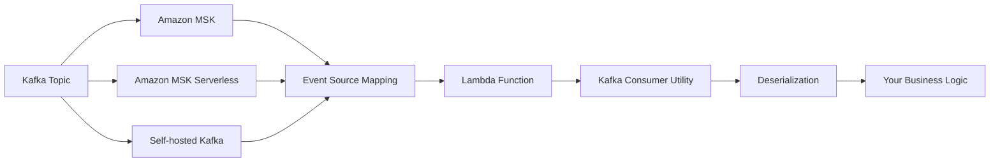
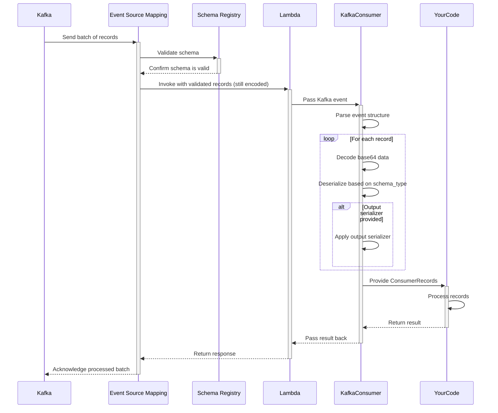
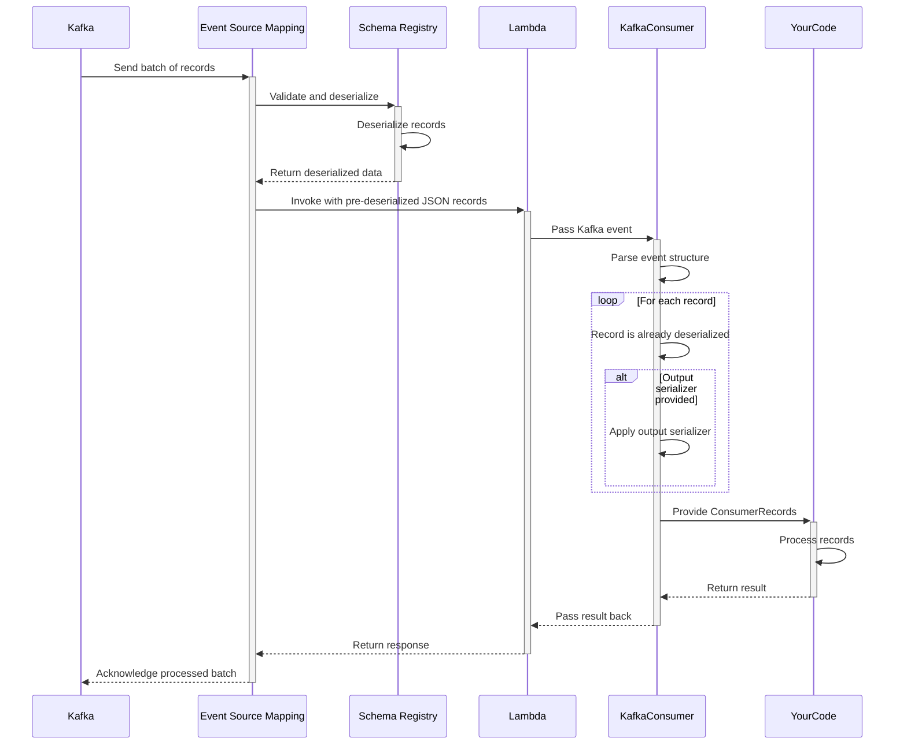
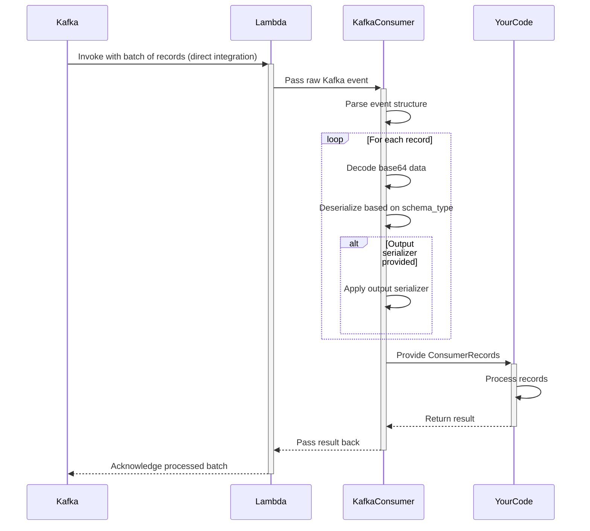

<!-- Generated by scripts/build_agent_skill_references.py from utilities/kafka.md. Do not edit by hand. -->
# Kafka

Source of truth: https://docs.powertools.aws.dev/lambda/python/latest/utilities/kafka/

The Kafka Consumer utility transparently handles message deserialization, provides an intuitive developer experience, and integrates seamlessly with the rest of the Powertools for AWS Lambda ecosystem.



## Key features

* Automatic deserialization of Kafka messages (JSON, Avro, and Protocol Buffers)
* Simplified event record handling with intuitive interface
* Support for key and value deserialization
* Support for custom output serializers (e.g., dataclasses, Pydantic models)
* Support for ESM with and without Schema Registry integration
* Support for offline Avro schemas with schema-registry wire-format prefixes (Confluent only)
* Proper error handling for deserialization issues

## Terminology

**Event Source Mapping (ESM)**  A Lambda feature that reads from streaming sources (like Kafka) and invokes your Lambda function. It manages polling, batching, and error handling automatically, eliminating the need for consumer management code.

**Record Key and Value** A Kafka messages contain two important parts: an optional key that determines the partition and a value containing the actual message data. Both are base64-encoded in Lambda events and can be independently deserialized.

**Deserialization** Is the process of converting binary data (base64-encoded in Lambda events) into usable Python objects according to a specific format like JSON, Avro, or Protocol Buffers. Powertools handles this conversion automatically.

**SchemaConfig class** Contains parameters that tell Powertools how to interpret message data, including the format type (JSON, Avro, Protocol Buffers) and optional schema definitions needed for binary formats.

**Output Serializer** A Pydantic model, Python dataclass, or any custom function that helps structure data for your business logic.

**Schema Registry** Is a centralized service that stores and validates schemas, ensuring producers and consumers maintain compatibility when message formats evolve over time.

## Moving from traditional Kafka consumers

Lambda processes Kafka messages as discrete events rather than continuous streams, requiring a different approach to consumer development that Powertools for AWS helps standardize.

| Aspect | Traditional Kafka Consumers | Lambda Kafka Consumer |
| ------ | --------------------------- | --------------------- |
| **Model** | Pull-based (you poll for messages) | Push-based (Lambda invoked with messages) |
| **Scaling** | Manual scaling configuration | Automatic scaling to partition count |
| **State** | Long-running application with state | Stateless, ephemeral executions |
| **Offsets** | Manual offset management | Automatic offset commitment |
| **Schema Validation** | Client-side schema validation | Optional Schema Registry integration with Event Source Mapping |
| **Error Handling** | Per-message retry control | Batch-level retry policies |

## Getting started

### Installation

Install the Powertools for AWS Lambda package with the appropriate extras for your use case:

**JSON**

	```bash
	pip install aws-lambda-powertools
	```

**Avro**

	```bash
	pip install 'aws-lambda-powertools[kafka-consumer-avro]'
	```

**Protobuf**

	```bash
	pip install 'aws-lambda-powertools[kafka-consumer-protobuf]'
	```

### Required resources

To use the Kafka consumer utility, you need an AWS Lambda function configured with a Kafka event source. This can be Amazon MSK, MSK Serverless, or a self-hosted Kafka cluster.

**getting_started_with_msk.yaml**

```yaml
AWSTemplateFormatVersion: '2010-09-09'
Transform: AWS::Serverless-2016-10-31
Resources:
  KafkaConsumerFunction:
    Type: AWS::Serverless::Function
    Properties:
      Handler: app.lambda_handler
      Runtime: python3.13
      Timeout: 30
      Events:
        MSKEvent:
          Type: MSK
          Properties:
            StartingPosition: LATEST
            Stream: "arn:aws:lambda:eu-west-3:123456789012:event-source-mapping:11a2c814-dda3-4df8-b46f-4eeafac869ac"
            Topics:
              - my-topic-1
      Policies:
        - AWSLambdaMSKExecutionRole
```

### Using ESM with Schema Registry

The Event Source Mapping configuration determines which mode is used. With `JSON`, Lambda converts all messages to JSON before invoking your function. With `SOURCE` mode, Lambda preserves the original format, requiring you function to handle the appropriate deserialization.

Powertools for AWS supports both Schema Registry integration modes in your Event Source Mapping configuration.

For simplicity, we will use a simple schema containing `name` and `age` in all our examples. You can also copy the payload example with the expected Kafka event to test your code.

**JSON**

	```json
    {
        "name": "...",
        "age": "..."
    }
    ```

**Payload JSON**

	```json
    {
       "eventSource":"aws:kafka",
       "eventSourceArn":"arn:aws:kafka:eu-west-3:123456789012:cluster/powertools-kafka-esm/f138df86-9253-4d2a-b682-19e132396d4f-s3",
       "bootstrapServers":"boot-z3majaui.c3.kafka-serverless.eu-west-3.amazonaws.com:9098",
       "records":{
          "python-with-avro-doc-5":[
             {
                "topic":"python-with-avro-doc",
                "partition":5,
                "offset":0,
                "timestamp":1750547462087,
                "timestampType":"CREATE_TIME",
                "key":"MTIz",
                "value":"eyJuYW1lIjogIlBvd2VydG9vbHMiLCAiYWdlIjogNX0=",
                "headers":[

                ]
             }
          ]
       }
    }
    ```

**Avro Schema**

	```json
    {
        "type": "record",
        "name": "User",
        "namespace": "com.example",
        "fields": [
            {"name": "name", "type": "string"},
            {"name": "age", "type": "int"}
        ]
    }
    ```

**Payload AVRO**

	```json
    {
       "eventSource":"aws:kafka",
       "eventSourceArn":"arn:aws:kafka:eu-west-3:123456789012:cluster/powertools-kafka-esm/f138df86-9253-4d2a-b682-19e132396d4f-s3",
       "bootstrapServers":"boot-z3majaui.c3.kafka-serverless.eu-west-3.amazonaws.com:9098",
       "records":{
          "python-with-avro-doc-3":[
             {
                "topic":"python-with-avro-doc",
                "partition":3,
                "offset":0,
                "timestamp":1750547105187,
                "timestampType":"CREATE_TIME",
                "key":"MTIz",
                "value":"AwBXT2qalUhN6oaj2CwEeaEWFFBvd2VydG9vbHMK",
                "headers":[

                ]
             }
          ]
       }
    }
    ```

**Protobuf Schema**

	```protobuf
    syntax = "proto3";

    package com.example;

    message User {
      string name = 1;
      int32 age = 2;
    }
    ```

**Payload Protobuf**

	```json
    {
       "eventSource":"aws:kafka",
       "eventSourceArn":"arn:aws:kafka:eu-west-3:992382490249:cluster/powertools-kafka-esm/f138df86-9253-4d2a-b682-19e132396d4f-s3",
       "bootstrapServers":"boot-z3majaui.c3.kafka-serverless.eu-west-3.amazonaws.com:9098",
       "records":{
          "python-with-avro-doc-5":[
             {
                "topic":"python-with-avro-doc",
                "partition":5,
                "offset":1,
                "timestamp":1750624373324,
                "timestampType":"CREATE_TIME",
                "key":"MTIz",
                "value":"Cgpwb3dlcnRvb2xzEAU=",
                "headers":[

                ]
             }
          ]
       }
    }
    ```

### Processing Kafka events

The Kafka consumer utility transforms raw Lambda Kafka events into an intuitive format for processing. To handle messages effectively, you'll need to configure a schema that matches your data format.

> **Tip: Using Avro is recommended**

We recommend Avro for production Kafka implementations due to its schema evolution capabilities, compact binary format, and integration with Schema Registry. This offers better type safety and forward/backward compatibility compared to JSON.

**Avro Messages**

```python
from aws_lambda_powertools import Logger
from aws_lambda_powertools.utilities.kafka import ConsumerRecords, SchemaConfig, kafka_consumer
from aws_lambda_powertools.utilities.typing import LambdaContext

logger = Logger()

# Define the Avro schema
avro_schema = """
{
    "type": "record",
    "name": "User",
    "namespace": "com.example",
    "fields": [
        {"name": "name", "type": "string"},
        {"name": "age", "type": "int"}
    ]
}
"""

# Configure schema
schema_config = SchemaConfig(
    value_schema_type="AVRO",
    value_schema=avro_schema,
)

@kafka_consumer(schema_config=schema_config)
def lambda_handler(event: ConsumerRecords, context: LambdaContext):
    for record in event.records:
        user = record.value  # Dictionary from avro message

        logger.info(f"Processing user: {user['name']}, age {user['age']}")

    return {"statusCode": 200}
```

**Protocol Buffers**

```python
from aws_lambda_powertools import Logger
from aws_lambda_powertools.utilities.kafka import ConsumerRecords, SchemaConfig, kafka_consumer
from aws_lambda_powertools.utilities.typing import LambdaContext

# Import generated protobuf class
from .user_pb2 import User  # type: ignore[import-not-found]

logger = Logger()

# Configure schema for protobuf
schema_config = SchemaConfig(
    value_schema_type="PROTOBUF",
    value_schema=User,  # The protobuf message class
)

@kafka_consumer(schema_config=schema_config)
def lambda_handler(event: ConsumerRecords, context: LambdaContext):
    for record in event.records:
        user = record.value  # Dictionary from avro message

        logger.info(f"Processing user: {user['name']}, age {user['age']}")

    return {"statusCode": 200}
```

**JSON Messages**

```python
from aws_lambda_powertools import Logger
from aws_lambda_powertools.utilities.kafka import ConsumerRecords, SchemaConfig, kafka_consumer
from aws_lambda_powertools.utilities.typing import LambdaContext

logger = Logger()

# Configure schema
schema_config = SchemaConfig(value_schema_type="JSON")

@kafka_consumer(schema_config=schema_config)
def lambda_handler(event: ConsumerRecords, context: LambdaContext):
    for record in event.records:
        user = record.value  # Dictionary from avro message

        logger.info(f"Processing user: {user['name']}, age {user['age']}")

    return {"statusCode": 200}
```

### Deserializing key and value

The `@kafka_consumer` decorator can deserialize both key and value fields independently based on your schema configuration. This flexibility allows you to work with different data formats in the same message.

**Key and Value Deserialization**

```python
from aws_lambda_powertools import Logger
from aws_lambda_powertools.utilities.kafka import ConsumerRecords, SchemaConfig, kafka_consumer
from aws_lambda_powertools.utilities.typing import LambdaContext

logger = Logger()

# Define schemas for both components
key_schema = """
{
    "type": "record",
    "name": "ProductKey",
    "fields": [
        {"name": "region_name", "type": "string"}
    ]
}
"""

value_schema = """
{
    "type": "record",
    "name": "User",
    "namespace": "com.example",
    "fields": [
        {"name": "name", "type": "string"},
        {"name": "age", "type": "int"}
    ]
}
"""

# Configure both key and value schemas
schema_config = SchemaConfig(
    key_schema_type="AVRO",
    key_schema=key_schema,
    value_schema_type="AVRO",
    value_schema=value_schema,
)

@kafka_consumer(schema_config=schema_config)
def lambda_handler(event: ConsumerRecords, context: LambdaContext):
    for record in event.records:
        # Access both deserialized components
        key = record.key
        value = record.value

        logger.info(f"Processing key: {key['region_name']}")
        logger.info(f"Processing value: {value['name']}")

    return {"statusCode": 200}
```

**Key-only Deserialization**

```python
from aws_lambda_powertools import Logger
from aws_lambda_powertools.utilities.kafka import ConsumerRecords, SchemaConfig, kafka_consumer
from aws_lambda_powertools.utilities.typing import LambdaContext

logger = Logger()

# Define schemas for key
key_schema = """
{
    "type": "record",
    "name": "ProductKey",
    "fields": [
        {"name": "region_name", "type": "string"}
    ]
}
"""

# Configure key schema
schema_config = SchemaConfig(
    key_schema_type="AVRO",
    key_schema=key_schema,
)

@kafka_consumer(schema_config=schema_config)
def lambda_handler(event: ConsumerRecords, context: LambdaContext):
    for record in event.records:
        # Access deserialized key
        key = record.key

        logger.info(f"Processing key: {key}")

    return {"statusCode": 200}
```

**Value-only Deserialization**

```python
from aws_lambda_powertools import Logger
from aws_lambda_powertools.utilities.kafka import ConsumerRecords, SchemaConfig, kafka_consumer
from aws_lambda_powertools.utilities.typing import LambdaContext

logger = Logger()

# Define schemas for value
value_schema = """
{
    "type": "record",
    "name": "User",
    "namespace": "com.example",
    "fields": [
        {"name": "name", "type": "string"},
        {"name": "age", "type": "int"}
    ]
}
"""

# Configure value schema
schema_config = SchemaConfig(
    value_schema_type="AVRO",
    value_schema=value_schema,
)

@kafka_consumer(schema_config=schema_config)
def lambda_handler(event: ConsumerRecords, context: LambdaContext):
    for record in event.records:
        # Access deserialized value
        value = record.value

        logger.info(f"Processing value: {value['name']}")

    return {"statusCode": 200}
```

### Handling primitive types

When working with primitive data types (strings, integers, etc.) rather than structured objects, you can simplify your configuration by omitting the schema specification for that component. Powertools for AWS will deserialize the value always as a string.

> **Tip: Common pattern: Keys with primitive values**

Using primitive types (strings, integers) as Kafka message keys is a common pattern for partitioning and identifying messages. Powertools automatically handles these primitive keys without requiring special configuration, making it easy to implement this popular design pattern.

**Primitive key**

```python
from aws_lambda_powertools import Logger
from aws_lambda_powertools.utilities.kafka import ConsumerRecords, SchemaConfig, kafka_consumer
from aws_lambda_powertools.utilities.typing import LambdaContext

logger = Logger()

# Only configure value schema
schema_config = SchemaConfig(value_schema_type="JSON")

@kafka_consumer(schema_config=schema_config)
def lambda_handler(event: ConsumerRecords, context: LambdaContext):
    for record in event.records:
        # Key is automatically decoded as UTF-8 string
        key = record.key

        # Value is deserialized as JSON
        value = record.value

        logger.info(f"Processing key: {key}")
        logger.info(f"Processing value: {value['name']}")

    return {"statusCode": 200}
```

**Primitive key and value**

```python
from aws_lambda_powertools import Logger
from aws_lambda_powertools.utilities.kafka import ConsumerRecords, kafka_consumer
from aws_lambda_powertools.utilities.typing import LambdaContext

logger = Logger()

@kafka_consumer
def lambda_handler(event: ConsumerRecords, context: LambdaContext):
    for record in event.records:
        # Key is automatically decoded as UTF-8 string
        key = record.key

        # Value is automatically decoded as UTF-8 string
        value = record.value

        logger.info(f"Processing key: {key}")
        logger.info(f"Processing value: {value}")

    return {"statusCode": 200}
```

### Message format support and comparison

The Kafka consumer utility supports multiple serialization formats to match your existing Kafka implementation. Choose the format that best suits your needs based on performance, schema evolution requirements, and ecosystem compatibility.

> **Tip: Selecting the right format**

For new applications, consider Avro or Protocol Buffers over JSON. Both provide schema validation, evolution support, and significantly better performance with smaller message sizes. Avro is particularly well-suited for Kafka due to its built-in schema evolution capabilities.

**Supported Formats**

| Format | Schema Type | Description | Required Parameters |
|--------|-------------|-------------|---------------------|
| **JSON** | `"JSON"` | Human-readable text format | None |
| **Avro** | `"AVRO"` | Compact binary format with schema | `value_schema` (Avro schema string) |
| **Protocol Buffers** | `"PROTOBUF"` | Efficient binary format | `value_schema` (Proto message class) |

**Format Comparison**

| Feature | JSON | Avro | Protocol Buffers |
|---------|------|------|-----------------|
| **Schema Definition** | Optional | Required JSON schema | Required .proto file |
| **Schema Evolution** | None | Strong support | Strong support |
| **Size Efficiency** | Low | High | Highest |
| **Processing Speed** | Slower | Fast | Fastest |
| **Human Readability** | High | Low | Low |
| **Implementation Complexity** | Low | Medium | Medium |
| **Additional Dependencies** | None | `avro` package | `protobuf` package |

Choose the serialization format that best fits your needs:

* **JSON**: Best for simplicity and when schema flexibility is important
* **Avro**: Best for systems with evolving schemas and when compatibility is critical
* **Protocol Buffers**: Best for performance-critical systems with structured data

## Advanced

### Accessing record metadata

Each Kafka record contains important metadata that you can access alongside the deserialized message content. This metadata helps with message processing, troubleshooting, and implementing advanced patterns like exactly-once processing.

**Accessing record metadata**

```python
from aws_lambda_powertools import Logger
from aws_lambda_powertools.utilities.kafka import ConsumerRecords, SchemaConfig, kafka_consumer
from aws_lambda_powertools.utilities.typing import LambdaContext

logger = Logger()

# Define Avro schema
avro_schema = """
{
    "type": "record",
    "name": "User",
    "namespace": "com.example",
    "fields": [
        {"name": "name", "type": "string"},
        {"name": "age", "type": "int"}
    ]
}
"""

schema_config = SchemaConfig(
    value_schema_type="AVRO",
    value_schema=avro_schema,
)

@kafka_consumer(schema_config=schema_config)
def lambda_handler(event: ConsumerRecords, context: LambdaContext):
    for record in event.records:
        # Log record coordinates for tracing
        logger.info(f"Processing message from topic '{record.topic}'")
        logger.info(f"Partition: {record.partition}, Offset: {record.offset}")
        logger.info(f"Produced at: {record.timestamp}")

        # Process message headers
        logger.info(f"Headers: {record.headers}")

        # Access the Avro deserialized message content
        value = record.value
        logger.info(f"Deserialized value: {value['name']}")

        # For debugging, you can access the original raw data
        logger.info(f"Raw message: {record.original_value}")

    return {"statusCode": 200}
```

#### Available metadata properties

| Property | Description | Example Use Case |
| -------- | ----------- | ---------------- |
| `topic` | Topic name the record was published to | Routing logic in multi-topic consumers |
| `partition` | Kafka partition number | Tracking message distribution |
| `offset` | Position in the partition | De-duplication, exactly-once processing |
| `timestamp` | Unix timestamp when record was created | Event timing analysis |
| `timestamp_type` | Timestamp type (CREATE_TIME or LOG_APPEND_TIME) | Data lineage verification |
| `headers` | Key-value pairs attached to the message | Cross-cutting concerns like correlation IDs |
| `key` | Deserialized message key | Customer ID or entity identifier |
| `value` | Deserialized message content | The actual business data |
| `original_value` | Base64-encoded original message value | Debugging or custom deserialization |
| `original_key` | Base64-encoded original message key | Debugging or custom deserialization |
| `value_schema_metadata` | Metadata about the value schema like `schemaId` and `dataFormat` | Data format and schemaId propagated when integrating with Schema Registry |
| `key_schema_metadata` | Metadata about the key schema like `schemaId` and `dataFormat` | Data format and schemaId propagated when integrating with Schema Registry |

### Using an offline Avro schema with a schema-registry wire-format prefix

When Confluent serializes messages with its schema-registry-aware Avro serializer (for example, `KafkaAvroSerializer`), each payload carries a wire-format header before the Avro body.
The header is 5 bytes long: 1-byte magic byte (`0x00`) followed by a 4-byte big-endian schema ID.

When the ESM Schema Registry integration is enabled, Lambda strips those bytes and populates the record's schema metadata. When you use an **offline Avro schema** without the ESM Schema Registry integration, the header reaches the function and prevents plain Avro deserialization.

Set `value_schema_wire_format` or `key_schema_wire_format` on `SchemaConfig` to `"CONFLUENT"`. Powertools validates the magic byte and strips the 5-byte header before running the Avro decoder.

> **Info: When do I need this?**

Use this option when you supply the Avro schema and the producer uses the Confluent wire format. If ESM Schema Registry integration has already removed the header, leave the option as `None`.

**Offline Avro schema with a Confluent prefix**

```python
from aws_lambda_powertools.utilities.kafka import SchemaConfig, kafka_consumer
from aws_lambda_powertools.utilities.kafka.consumer_records import ConsumerRecords
from aws_lambda_powertools.utilities.typing import LambdaContext

AVRO_SCHEMA = open("user.avsc").read()

schema_config = SchemaConfig(
    value_schema_type="AVRO",
    value_schema=AVRO_SCHEMA,
    value_schema_wire_format="CONFLUENT",
)

@kafka_consumer(schema_config=schema_config)
def lambda_handler(event: ConsumerRecords, context: LambdaContext):
    for record in event.records:
        # record.value is the deserialized Avro payload
        # with the validated 5-byte wire-format header removed.
        ...
```

> **Warning: Scope**

`value_schema_wire_format` and `key_schema_wire_format` apply only to **Avro** payloads. Leave them as `None` when ESM Schema Registry integration has already removed the wire-format header.

### Custom output serializers

Transform deserialized data into your preferred object types using output serializers. This can help you integrate Kafka data with your domain models and application architecture, providing type hints, validation, and structured data access.

> **Tip: Choosing the right output serializer**

- **Pydantic models** offer robust data validation at runtime and excellent IDE support
- **Dataclasses** provide lightweight type hints with better performance than Pydantic
- **Custom functions** give complete flexibility for complex transformations and business logic

**Pydantic models**

```python
from pydantic import BaseModel

from aws_lambda_powertools import Logger
from aws_lambda_powertools.utilities.kafka import ConsumerRecords, SchemaConfig, kafka_consumer
from aws_lambda_powertools.utilities.typing import LambdaContext

logger = Logger()

# Define Pydantic model for strong validation
class User(BaseModel):
    name: str
    age: int

# Configure with Avro schema and Pydantic output
schema_config = SchemaConfig(value_schema_type="JSON", value_output_serializer=User)

@kafka_consumer(schema_config=schema_config)
def lambda_handler(event: ConsumerRecords, context: LambdaContext):
    for record in event.records:
        # record.value is now a User instance
        value: User = record.value

        logger.info(f"Name: '{value.name}'")
        logger.info(f"Age: '{value.age}'")

    return {"statusCode": 200}
```

**Dataclasses**

```python
from dataclasses import dataclass

from aws_lambda_powertools import Logger
from aws_lambda_powertools.utilities.kafka import ConsumerRecords, SchemaConfig, kafka_consumer
from aws_lambda_powertools.utilities.typing import LambdaContext

logger = Logger()

# Define Dataclass model
@dataclass
class User:
    name: str
    age: int

# Configure with Avro schema and Dataclass output
schema_config = SchemaConfig(value_schema_type="JSON", value_output_serializer=User)

@kafka_consumer(schema_config=schema_config)
def lambda_handler(event: ConsumerRecords, context: LambdaContext):
    for record in event.records:
        # record.value is now a User instance
        value: User = record.value

        logger.info(f"Name: '{value.name}'")
        logger.info(f"Age: '{value.age}'")

    return {"statusCode": 200}
```

**Custom function**

```python
from aws_lambda_powertools import Logger
from aws_lambda_powertools.utilities.kafka import ConsumerRecords, SchemaConfig, kafka_consumer
from aws_lambda_powertools.utilities.typing import LambdaContext

logger = Logger()

# Define custom serializer
def custom_serializer(data: dict):
    del data["age"]  # Remove age key just for example
    return data

# Configure with Avro schema and function serializer
schema_config = SchemaConfig(value_schema_type="JSON", value_output_serializer=custom_serializer)

@kafka_consumer(schema_config=schema_config)
def lambda_handler(event: ConsumerRecords, context: LambdaContext):
    for record in event.records:
        # record.value now only contains the key "name"
        value = record.value

        logger.info(f"Name: '{value['name']}'")

    return {"statusCode": 200}
```

### Error handling

Handle errors gracefully when processing Kafka messages to ensure your application maintains resilience and provides clear diagnostic information. The Kafka consumer utility provides specific exception types to help you identify and handle deserialization issues effectively.

> **Info**

Fields like `value`, `key`, and `headers` are decoded lazily, meaning they are only deserialized when accessed. This allows you to handle deserialization errors at the point of access rather than when the record is first processed.

**Basic Error Handling**

```python
from aws_lambda_powertools import Logger
from aws_lambda_powertools.utilities.kafka import ConsumerRecords, SchemaConfig, kafka_consumer
from aws_lambda_powertools.utilities.kafka.exceptions import KafkaConsumerDeserializationError
from aws_lambda_powertools.utilities.typing import LambdaContext

logger = Logger()

schema_config = SchemaConfig(value_schema_type="JSON")

def process_customer_data(customer_data: dict):
    # Simulate processing logic
    if customer_data.get("name") == "error":
        raise ValueError("Simulated processing error")

@kafka_consumer(schema_config=schema_config)
def lambda_handler(event: ConsumerRecords, context: LambdaContext):
    successful_records = 0
    failed_records = 0

    for record in event.records:
        try:
            # Process each record individually to isolate failures
            process_customer_data(record.value)
            successful_records += 1

        except KafkaConsumerDeserializationError as e:
            failed_records += 1
            logger.error(
                "Failed to deserialize Kafka message",
                extra={"topic": record.topic, "partition": record.partition, "offset": record.offset, "error": str(e)},
            )
            # Optionally send to DLQ or error topic

        except Exception as e:
            failed_records += 1
            logger.error("Error processing Kafka message", extra={"error": str(e), "topic": record.topic})

    return {"statusCode": 200, "body": f"Processed {successful_records} records successfully, {failed_records} failed"}
```

**Handling Schema Errors**

```python
from aws_lambda_powertools import Logger, Metrics
from aws_lambda_powertools.metrics import MetricUnit
from aws_lambda_powertools.utilities.kafka import ConsumerRecords, SchemaConfig, kafka_consumer
from aws_lambda_powertools.utilities.kafka.exceptions import (
    KafkaConsumerAvroSchemaParserError,
    KafkaConsumerDeserializationError,
)
from aws_lambda_powertools.utilities.typing import LambdaContext

logger = Logger()
metrics = Metrics()

schema_config = SchemaConfig(value_schema_type="JSON")

def process_order(order):
    # Simulate processing logic
    return order

def send_to_dlq(record):
    # Simulate sending to DLQ
    logger.error("Sending to DLQ", record=record)

@kafka_consumer(schema_config=schema_config)
def lambda_handler(event: ConsumerRecords, context: LambdaContext):
    metrics.add_metric(name="TotalRecords", unit=MetricUnit.Count, value=len(list(event.records)))

    for record in event.records:
        try:
            order = record.value
            process_order(order)
            metrics.add_metric(name="ProcessedRecords", unit=MetricUnit.Count, value=1)

        except KafkaConsumerAvroSchemaParserError as exc:
            logger.error("Invalid Avro schema configuration", error=str(exc))
            metrics.add_metric(name="SchemaErrors", unit=MetricUnit.Count, value=1)
            # This requires fixing the schema - might want to raise to stop processing
            raise

        except KafkaConsumerDeserializationError as exc:
            logger.warning("Message format doesn't match schema", topic=record.topic, error=str(exc))
            metrics.add_metric(name="DeserializationErrors", unit=MetricUnit.Count, value=1)
            # Send to dead-letter queue for analysis
            send_to_dlq(record)

    return {"statusCode": 200, "metrics": metrics.serialize_metric_set()}
```

#### Exception types

| Exception | Description | Common Causes |
| --------- | ----------- | ------------- |
| `KafkaConsumerDeserializationError` | Raised when message deserialization fails | Corrupted message data, schema mismatch, or wrong schema type configuration |
| `KafkaConsumerAvroSchemaParserError` | Raised when parsing Avro schema definition fails | Syntax errors in schema JSON, invalid field types, or malformed schema |
| `KafkaConsumerMissingSchemaError` | Raised when a required schema is not provided | Missing schema for AVRO or PROTOBUF formats (required parameter) |
| `KafkaConsumerOutputSerializerError` | Raised when output serializer fails | Error in custom serializer function, incompatible data, or validation failures in Pydantic models |
| `KafkaConsumerDeserializationFormatMismatch` | Raised when SchemaConfig format is wrong | When integrating with Schema Registry, the data format is propagated, so Powertools for AWS catches this error if the format is different from the configured one. |

### Integrating with Idempotency

When processing Kafka messages in Lambda, failed batches can result in message reprocessing. The [idempotency utility](idempotency.md) prevents duplicate processing by tracking which messages have already been handled, ensuring each message is processed exactly once.

The [idempotency utility](idempotency.md) automatically stores the result of each successful operation, returning the cached result if the same message is processed again, which prevents potentially harmful duplicate operations like double-charging customers or double-counting metrics.

**Idempotent Kafka Processing**

```python
from aws_lambda_powertools import Logger
from aws_lambda_powertools.utilities.idempotency import DynamoDBPersistenceLayer, IdempotencyConfig, idempotent_function
from aws_lambda_powertools.utilities.kafka import ConsumerRecords, SchemaConfig, kafka_consumer
from aws_lambda_powertools.utilities.typing import LambdaContext

# Configure persistence layer for idempotency
persistence_layer = DynamoDBPersistenceLayer(table_name="IdempotencyTable")
logger = Logger()
idempotency_config = IdempotencyConfig()

# Configure Kafka schema
avro_schema = """
{
    "type": "record",
    "name": "Payment",
    "fields": [
        {"name": "payment_id", "type": "string"},
        {"name": "customer_id", "type": "string"},
        {"name": "amount", "type": "double"},
        {"name": "status", "type": "string"}
    ]
}
"""

schema_config = SchemaConfig(value_schema_type="AVRO", value_schema=avro_schema)

@kafka_consumer(schema_config=schema_config)
def lambda_handler(event: ConsumerRecords, context: LambdaContext):
    idempotency_config.register_lambda_context(context)

    for record in event.records:
        # Process each message with idempotency protection
        process_payment(payment=record.value, topic=record.topic, partition=record.partition, offset=record.offset)

    return {"statusCode": 200}

@idempotent_function(
    data_keyword_argument="payment",
    persistence_store=persistence_layer,
)
def process_payment(payment, topic, partition, offset):
    """Process a payment exactly once"""
    logger.info(f"Processing payment {payment['payment_id']} from {topic}-{partition}-{offset}")

    # Execute payment logic

    return {"success": True, "payment_id": payment["payment_id"]}
```

TIP: By using the Kafka record's unique coordinates (topic, partition, offset) as the idempotency key, you ensure that even if a batch fails and Lambda retries the messages, each message will be processed exactly once.

### Handling partial batch failures

When processing Kafka messages, individual records may fail while others succeed. By default, Lambda retries the entire batch when any record fails. To retry only the failed records, use the [Batch Processing utility](batch.md#processing-messages-from-kafka) with `EventType.Kafka`.

This feature allows Lambda to checkpoint successful records and only retry the failed ones, significantly improving processing efficiency and reducing duplicate processing.

**Kafka with Batch Processing**

```python
from aws_lambda_powertools import Logger, Tracer
from aws_lambda_powertools.utilities.batch import (
    BatchProcessor,
    EventType,
    process_partial_response,
)
from aws_lambda_powertools.utilities.data_classes.kafka_event import (
    KafkaEventRecord,
)
from aws_lambda_powertools.utilities.typing import LambdaContext

processor = BatchProcessor(event_type=EventType.Kafka)  # (1)!
tracer = Tracer()
logger = Logger()

@tracer.capture_method
def record_handler(record: KafkaEventRecord):
    logger.info(f"Processing record from topic: {record.topic}, partition: {record.partition}, offset: {record.offset}")
    payload: dict = record.json_value
    logger.info(payload)

@logger.inject_lambda_context
@tracer.capture_lambda_handler
def lambda_handler(event, context: LambdaContext):
    return process_partial_response(event=event, record_handler=record_handler, processor=processor, context=context)
```

> **Note: Using with deserialization**

The Batch Processing utility uses the basic `KafkaEventRecord` data class. For advanced deserialization (Avro, Protobuf), you can use the Kafka Consumer's deserialization utilities inside your record handler function.

### Best practices

#### Handling large messages

When processing large Kafka messages in Lambda, be mindful of memory limitations. Although the Kafka consumer utility optimizes memory usage, large deserialized messages can still exhaust Lambda's resources.

**Handling Large Messages**

```python
from aws_lambda_powertools import Logger
from aws_lambda_powertools.utilities.kafka import ConsumerRecords, SchemaConfig, kafka_consumer
from aws_lambda_powertools.utilities.typing import LambdaContext

logger = Logger()

schema_config = SchemaConfig(value_schema_type="JSON")

def process_standard_message(message):
    # Simulate processing logic
    logger.info(f"Processing standard message: {message}")

def process_catalog_from_s3(bucket, key):
    # Simulate processing logic
    return {"bucket": bucket, "key": key}

@kafka_consumer(schema_config=schema_config)
def lambda_handler(event: ConsumerRecords, context: LambdaContext):
    for record in event.records:
        # Example: Handle large product catalog updates differently
        if "large-product-update" in record.headers:
            logger.info("Detected large product catalog update")

            # Example: Extract S3 reference from message
            catalog_ref = record.value.get("s3_reference")
            logger.info(f"Processing catalog from S3: {catalog_ref}")

            # Process via S3 reference instead of direct message content
            result = process_catalog_from_s3(bucket=catalog_ref["bucket"], key=catalog_ref["key"])
            logger.info(f"Processed {result['product_count']} products from S3")
        else:
            # Regular processing for standard-sized messages
            process_standard_message(record.value)

    return {"statusCode": 200}
```

For large messages, consider these proven approaches:

* **Store the data**: use Amazon S3 and include only the S3 reference in your Kafka message
* **Split large payloads**: use multiple smaller messages with sequence identifiers
* **Increase memory** Increase your Lambda function's memory allocation, which also increases CPU capacity

#### Batch size configuration

The number of Kafka records processed per Lambda invocation is controlled by your Event Source Mapping configuration. Properly sized batches optimize cost and performance.

**Batch size configuration**

```yaml
AWSTemplateFormatVersion: '2010-09-09'
Transform: AWS::Serverless-2016-10-31
Resources:
  KafkaConsumerFunction:
    Type: AWS::Serverless::Function
    Properties:
      Handler: app.lambda_handler
      Runtime: python3.13
      Timeout: 30
      Events:
        MSKEvent:
          Type: MSK
          Properties:
            StartingPosition: LATEST
            Stream: "arn:aws:lambda:eu-west-3:123456789012:event-source-mapping:11a2c814-dda3-4df8-b46f-4eeafac869ac"
            Topics:
              - my-topic-1
            BatchSize: 100
            MaximumBatchingWindowInSeconds: 5
      Policies:
        - AWSLambdaMSKExecutionRole
```

Different workloads benefit from different batch configurations:

* **High-volume, simple processing**: Use larger batches (100-500 records) with short timeout
* **Complex processing with database operations**: Use smaller batches (10-50 records)
* **Mixed message sizes**: Set appropriate batching window (1-5 seconds) to handle variability

#### Cross-language compatibility

When using binary serialization formats across multiple programming languages, ensure consistent schema handling to prevent deserialization failures.

**Using Java naming convention**

```python
from datetime import datetime

from aws_lambda_powertools import Logger
from aws_lambda_powertools.utilities.kafka import ConsumerRecords, SchemaConfig, kafka_consumer
from aws_lambda_powertools.utilities.typing import LambdaContext

logger = Logger()

# Define schema that matches Java producer
avro_schema = """
{
    "namespace": "com.example.orders",
    "type": "record",
    "name": "OrderEvent",
    "fields": [
        {"name": "orderId", "type": "string"},
        {"name": "customerId", "type": "string"},
        {"name": "totalAmount", "type": "double"},
        {"name": "orderDate", "type": "long", "logicalType": "timestamp-millis"}
    ]
}
"""

# Configure schema with field name normalization for Python style
def normalize_field_name(data: dict):
    data["order_id"] = data["orderId"]
    data["customer_id"] = data["customerId"]
    data["total_amount"] = data["totalAmount"]
    data["order_date"] = datetime.fromtimestamp(data["orderDate"] / 1000)
    return data

schema_config = SchemaConfig(
    value_schema_type="AVRO",
    value_schema=avro_schema,
    value_output_serializer=normalize_field_name,
)

@kafka_consumer(schema_config=schema_config)
def lambda_handler(event: ConsumerRecords, context: LambdaContext):
    for record in event.records:
        order = record.value  # OrderProcessor instance
        logger.info(f"Processing order {order['order_id']}")
```

Common cross-language challenges to address:

* **Field naming conventions**: camelCase in Java vs snake_case in Python
* **Date/time**: representation differences
* **Numeric precision handling**: especially decimals

### Troubleshooting common errors

### Troubleshooting

#### Deserialization failures

When encountering deserialization errors with your Kafka messages, follow this systematic troubleshooting approach to identify and resolve the root cause.

First, check that your schema definition exactly matches the message format. Even minor discrepancies can cause deserialization failures, especially with binary formats like Avro and Protocol Buffers.

For binary messages that fail to deserialize, examine the raw encoded data:

```python
# DO NOT include this code in production handlers
# For troubleshooting purposes only
import base64

raw_bytes = base64.b64decode(record.original_value)
print(f"Message size: {len(raw_bytes)} bytes")
print(f"First 50 bytes (hex): {raw_bytes[:50].hex()}")
```

#### Schema compatibility issues

Schema compatibility issues often manifest as successful connections but failed deserialization. Common causes include:

* **Schema evolution without backward compatibility**: New producer schema is incompatible with consumer schema
* **Field type mismatches**: For example, a field changed from string to integer across systems
* **Missing required fields**: Fields required by the consumer schema but absent in the message
* **Default value discrepancies**: Different handling of default values between languages

When using Schema Registry, verify schema compatibility rules are properly configured for your topics and that all applications use the same registry.

#### Memory and timeout optimization

Lambda functions processing Kafka messages may encounter resource constraints, particularly with large batches or complex processing logic.

For memory errors:

* Increase Lambda memory allocation, which also provides more CPU resources
* Process fewer records per batch by adjusting the `BatchSize` parameter in your event source mapping
* Consider optimizing your message format to reduce memory footprint

For timeout issues:

* Extend your Lambda function timeout setting to accommodate processing time
* Implement chunked or asynchronous processing patterns for time-consuming operations
* Monitor and optimize database operations, external API calls, or other I/O operations in your handler

> **Tip: Monitoring memory usage**

Use CloudWatch metrics to track your function's memory utilization. If it consistently exceeds 80% of allocated memory, consider increasing the memory allocation or optimizing your code.

## Kafka consumer workflow

### Using ESM with Schema Registry validation (SOURCE)

<center>

</center>

### Using ESM with Schema Registry deserialization (JSON)

<center>

</center>

### Using ESM without Schema Registry integration

<center>

</center>
