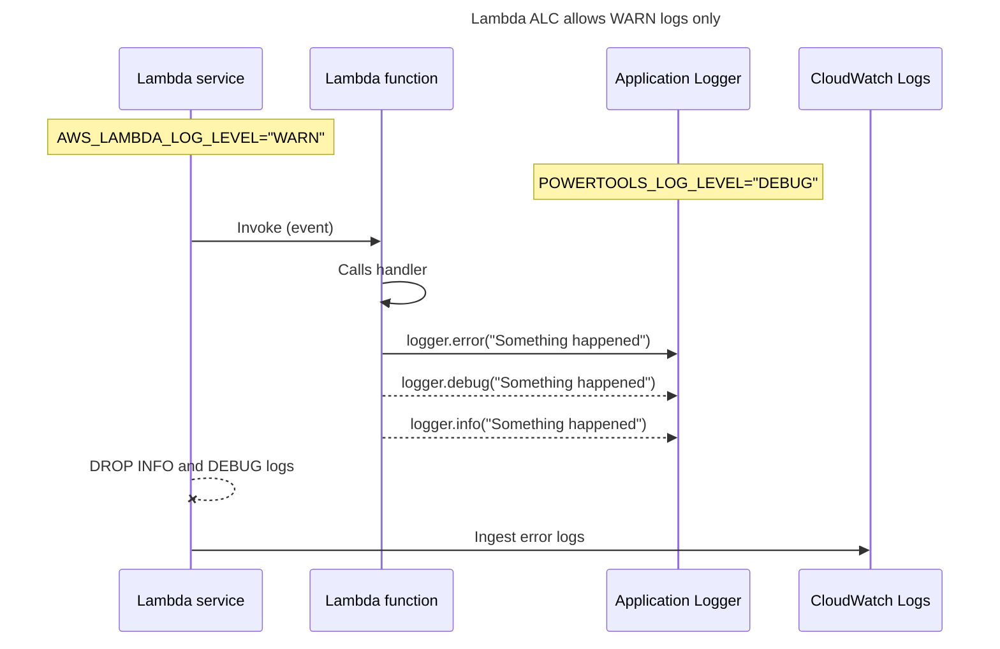
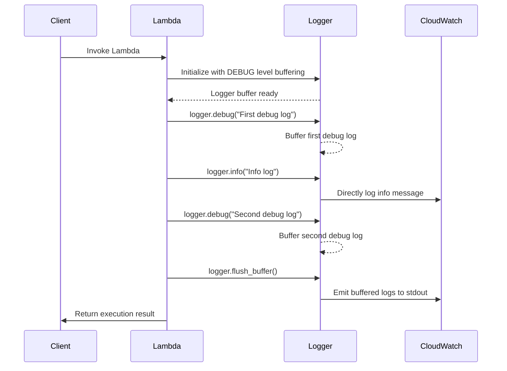
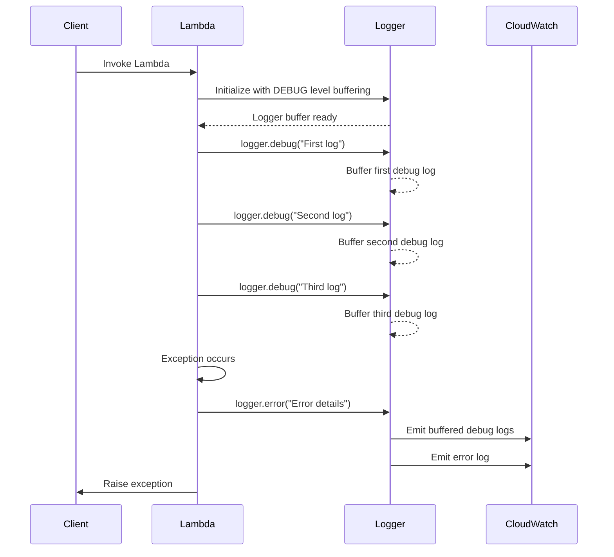
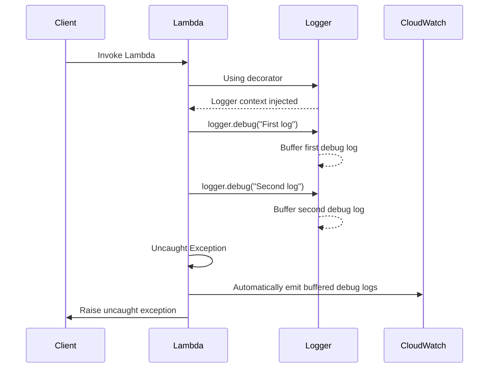
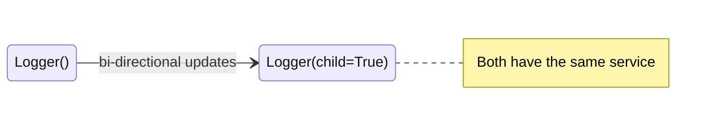

<!-- Generated by scripts/build_agent_skill_references.py from core/logger.md. Do not edit by hand. -->
# Logger

Source of truth: https://docs.powertools.aws.dev/lambda/python/latest/core/logger/

Logger provides an opinionated logger with output structured as JSON.

## Key features

* Capture key fields from Lambda context, cold start and structures logging output as JSON
* Log Lambda event when instructed (disabled by default)
* Log sampling enables DEBUG log level for a percentage of requests (disabled by default)
* Append additional keys to structured log at any point in time
* Buffering logs for a specific request or invocation, and flushing them automatically on error or manually as needed.

## Getting started

> **Tip**

All examples shared in this documentation are available within the [project repository](https://github.com/aws-powertools/powertools-lambda-python/tree/develop/examples).

Logger requires two settings:

| Setting           | Description                                                         | Environment variable      | Constructor parameter |
| ----------------- | ------------------------------------------------------------------- | ------------------------- | --------------------- |
| **Logging level** | Sets how verbose Logger should be (INFO, by default)                | `POWERTOOLS_LOG_LEVEL`    | `level`               |
| **Service**       | Sets **service** key that will be present across all log statements | `POWERTOOLS_SERVICE_NAME` | `service`             |

There are some [other environment variables](#environment-variables) which can be set to modify Logger's settings at a global scope.

```yaml title="AWS Serverless Application Model (SAM) example"
AWSTemplateFormatVersion: "2010-09-09"
Transform: AWS::Serverless-2016-10-31
Description: Powertools for AWS Lambda (Python) version

Globals:
  Function:
    Timeout: 5
    Runtime: python3.12
    Tracing: Active
    Environment:
      Variables:
        POWERTOOLS_SERVICE_NAME: payment
        POWERTOOLS_LOG_LEVEL: INFO
    Layers:
      # Find the latest Layer version in the official documentation
      # https://docs.powertools.aws.dev/lambda/python/latest/#lambda-layer
      - !Sub arn:aws:lambda:${AWS::Region}:017000801446:layer:AWSLambdaPowertoolsPythonV3-python312-x86_64:43

Resources:
  LoggerLambdaHandlerExample:
    Type: AWS::Serverless::Function
    Properties:
      CodeUri: ../src
      Handler: inject_lambda_context.handler
```

### Standard structured keys

Your Logger will include the following keys to your structured logging:

| Key                        | Example                               | Note                                                                                                                                 |
| -------------------------- | ------------------------------------- | ------------------------------------------------------------------------------------------------------------------------------------ |
| **level**: `str`           | `INFO`                                | Logging level                                                                                                                        |
| **location**: `str`        | `collect.handler:1`                   | Source code location where statement was executed                                                                                    |
| **message**: `Any`         | `Collecting payment`                  | Unserializable JSON values are casted as `str`                                                                                       |
| **timestamp**: `str`       | `2021-05-03 10:20:19,650+0000`        | Timestamp with milliseconds, by default uses default AWS Lambda timezone (UTC)                                                       |
| **service**: `str`         | `payment`                             | Service name defined, by default `service_undefined`                                                                                 |
| **xray_trace_id**: `str`   | `1-5759e988-bd862e3fe1be46a994272793` | When [tracing is enabled](https://docs.aws.amazon.com/lambda/latest/dg/services-xray.html), it shows X-Ray Trace ID |
| **sampling_rate**: `float` | `0.1`                                 | When enabled, it shows sampling rate in percentage e.g. 10%                                                                          |
| **exception_name**: `str`  | `ValueError`                          | When `logger.exception` is used and there is an exception                                                                            |
| **exception**: `str`       | `Traceback (most recent call last)..` | When `logger.exception` is used and there is an exception                                                                            |

### Capturing Lambda context info

You can enrich your structured logs with key Lambda context information via `inject_lambda_context`.

**inject_lambda_context.py**

```python
from aws_lambda_powertools import Logger
from aws_lambda_powertools.utilities.typing import LambdaContext

logger = Logger()

@logger.inject_lambda_context
def lambda_handler(event: dict, context: LambdaContext) -> str:
    logger.info("Collecting payment")

    # You can log entire objects too
    logger.info({"operation": "collect_payment", "charge_id": event["charge_id"]})
    return "hello world"
```

**inject_lambda_context_output.json**

```json
[
    {
        "level": "INFO",
        "location": "collect.handler:9",
        "message": "Collecting payment",
        "timestamp": "2021-05-03 11:47:12,494+0000",
        "service": "payment",
        "cold_start": true,
        "function_name": "test",
        "function_memory_size": 128,
        "function_arn": "arn:aws:lambda:eu-west-1:12345678910:function:test",
        "function_request_id": "52fdfc07-2182-154f-163f-5f0f9a621d72"
    },
    {
        "level": "INFO",
        "location": "collect.handler:12",
        "message": {
            "operation": "collect_payment",
            "charge_id": "ch_AZFlk2345C0"
        },
        "timestamp": "2021-05-03 11:47:12,494+0000",
        "service": "payment",
        "cold_start": true,
        "function_name": "test",
        "function_memory_size": 128,
        "function_arn": "arn:aws:lambda:eu-west-1:12345678910:function:test",
        "function_request_id": "52fdfc07-2182-154f-163f-5f0f9a621d72"
    }
]
```

When used, this will include the following keys:

| Key                             | Example                                                                                              |
| ------------------------------- | ---------------------------------------------------------------------------------------------------- |
| **cold_start**: `bool`          | `false`                                                                                              |
| **function_name** `str`         | `example-powertools-HelloWorldFunction-1P1Z6B39FLU73`                                                |
| **function_memory_size**: `int` | `128`                                                                                                |
| **function_arn**: `str`         | `arn:aws:lambda:eu-west-1:012345678910:function:example-powertools-HelloWorldFunction-1P1Z6B39FLU73` |
| **function_request_id**: `str`  | `899856cb-83d1-40d7-8611-9e78f15f32f4`                                                               |

### Logging incoming event

When debugging in non-production environments, you can instruct Logger to log the incoming event with `log_event` param or via `POWERTOOLS_LOGGER_LOG_EVENT` env var.

> **Warning**

	This is disabled by default to prevent sensitive info being logged

```python title="Logging incoming event"
from aws_lambda_powertools import Logger
from aws_lambda_powertools.utilities.typing import LambdaContext

logger = Logger()

@logger.inject_lambda_context(log_event=True)
def lambda_handler(event: dict, context: LambdaContext) -> str:
    return "hello world"
```

### Setting a Correlation ID

You can set a Correlation ID using `correlation_id_path` param by passing a [JMESPath expression](https://jmespath.org/tutorial.html), including [our custom JMESPath Functions](../utilities/jmespath_functions.md#powertools_json-function).

> **Tip**

	You can retrieve correlation IDs via `get_correlation_id` method.

**set_correlation_id.py**

```python
from aws_lambda_powertools import Logger
from aws_lambda_powertools.utilities.typing import LambdaContext

logger = Logger()

@logger.inject_lambda_context(correlation_id_path="headers.my_request_id_header")
def lambda_handler(event: dict, context: LambdaContext) -> str:
    logger.debug(f"Correlation ID => {logger.get_correlation_id()}")
    logger.info("Collecting payment")

    return "hello world"
```

**set_correlation_id_event.json**

```json
{
    "headers": {
        "my_request_id_header": "correlation_id_value"
    }
}
```

**set_correlation_id_output.json**

```json
{
    "level": "INFO",
    "location": "collect.handler:10",
    "message": "Collecting payment",
    "timestamp": "2021-05-03 11:47:12,494+0000",
    "service": "payment",
    "cold_start": true,
    "function_name": "test",
    "function_memory_size": 128,
    "function_arn": "arn:aws:lambda:eu-west-1:12345678910:function:test",
    "function_request_id": "52fdfc07-2182-154f-163f-5f0f9a621d72",
    "correlation_id": "correlation_id_value"
}
```

#### set_correlation_id method

You can also use `set_correlation_id` method to inject it anywhere else in your code. Example below uses [Event Source Data Classes utility](../utilities/data_classes.md) to easily access events properties.

**set_correlation_id_method.py**

```python
from aws_lambda_powertools import Logger
from aws_lambda_powertools.utilities.data_classes import APIGatewayProxyEvent
from aws_lambda_powertools.utilities.typing import LambdaContext

logger = Logger()

def lambda_handler(event: dict, context: LambdaContext) -> str:
    request = APIGatewayProxyEvent(event)

    logger.set_correlation_id(request.request_context.request_id)
    logger.info("Collecting payment")

    return "hello world"
```

**set_correlation_id_method.json**

```json
{
    "requestContext": {
        "requestId": "correlation_id_value"
    }
}
```

**set_correlation_id_method_output.json**

```json
{
    "level": "INFO",
    "location": "collect.handler:13",
    "message": "Collecting payment",
    "timestamp": "2021-05-03 11:47:12,494+0000",
    "service": "payment",
    "correlation_id": "correlation_id_value"
}
```

#### Known correlation IDs

To ease routine tasks like extracting correlation ID from popular event sources, we provide [built-in JMESPath expressions](#built-in-correlation-id-expressions).

**set_correlation_id_jmespath.py**

```python
from aws_lambda_powertools import Logger
from aws_lambda_powertools.logging import correlation_paths
from aws_lambda_powertools.utilities.typing import LambdaContext

logger = Logger()

@logger.inject_lambda_context(correlation_id_path=correlation_paths.API_GATEWAY_REST)
def lambda_handler(event: dict, context: LambdaContext) -> str:
    logger.debug(f"Correlation ID => {logger.get_correlation_id()}")
    logger.info("Collecting payment")

    return "hello world"
```

**set_correlation_id_jmespath.json**

```json
{
    "requestContext": {
        "requestId": "correlation_id_value"
    }
}
```

**set_correlation_id_jmespath_output.json**

```json
{
    "level": "INFO",
    "location": "collect.handler:11",
    "message": "Collecting payment",
    "timestamp": "2021-05-03 11:47:12,494+0000",
    "service": "payment",
    "cold_start": true,
    "function_name": "test",
    "function_memory_size": 128,
    "function_arn": "arn:aws:lambda:eu-west-1:12345678910:function:test",
    "function_request_id": "52fdfc07-2182-154f-163f-5f0f9a621d72",
    "correlation_id": "correlation_id_value"
}
```

### Appending additional keys

> **Info: Info: Custom keys are persisted across warm invocations**

Always set additional keys as part of your handler to ensure they have the latest value, or explicitly clear them with [`clear_state=True`](#clearing-all-state).

You can append additional keys using either mechanism:

* New keys persist across all future log messages via `append_keys` method
* Add additional keys on a per log message basis as a keyword=value, or via `extra` parameter
* New keys persist across all future logs in a specific thread via `thread_safe_append_keys` method. Check [Working with thread-safe keys](#working-with-thread-safe-keys) section.

#### append_keys method

> **Warning**

`append_keys` is not thread-safe, use [thread_safe_append_keys](#appending-thread-safe-additional-keys) instead

You can append your own keys to your existing Logger via `append_keys(**additional_key_values)` method.

**append_keys.py**

```python
from aws_lambda_powertools import Logger
from aws_lambda_powertools.utilities.typing import LambdaContext

logger = Logger()

def lambda_handler(event: dict, context: LambdaContext) -> str:
    order_id = event.get("order_id")

    # this will ensure order_id key always has the latest value before logging
    # alternative, you can use `clear_state=True` parameter in @inject_lambda_context
    logger.append_keys(order_id=order_id)
    logger.info("Collecting payment")

    return "hello world"
```

**append_keys_output.json**

```json
{
    "level": "INFO",
    "location": "collect.handler:11",
    "message": "Collecting payment",
    "timestamp": "2021-05-03 11:47:12,494+0000",
    "service": "payment",
    "order_id": "order_id_value"
}
```

> **Tip: Tip: Logger will automatically reject any key with a None value**

If you conditionally add keys depending on the payload, you can follow the example above.

This example will add `order_id` if its value is not empty, and in subsequent invocations where `order_id` might not be present it'll remove it from the Logger.

#### append_context_keys method

> **Warning**

	`append_context_keys` is not thread-safe.

The append_context_keys method allows temporary modification of a Logger instance's context without creating a new logger. It's useful for adding context keys to specific workflows while maintaining the logger's overall state and simplicity.

> **Danger: Important: Keys are removed on context exit, even if they existed before**

	All keys added within the context are removed when exiting, **including keys that already existed with the same name**.

	If you need to temporarily override a key's value while preserving the original, use `append_keys()` for persistent keys and avoid key name collisions with `append_context_keys()`.

	**Example of key collision:**
	```python
	logger.append_keys(order_id="ORD-123")  # Persistent key
	logger.info("Order received")  # Has order_id="ORD-123"

	with logger.append_context_keys(order_id="ORD-CHILD"):  # Overwrites
	    logger.info("Processing")  # Has order_id="ORD-CHILD"

	logger.info("Order completed")  # order_id key is now MISSING!
	```

**append_context_keys.py**

```python
from aws_lambda_powertools import Logger
from aws_lambda_powertools.utilities.typing import LambdaContext

logger = Logger(service="example_service")

def lambda_handler(event: dict, context: LambdaContext) -> str:
    with logger.append_context_keys(user_id="123", operation="process"):
        logger.info("Log with context")

    logger.info("Log without context")

    return "hello world"
```

**append_context_keys_output.json**

```json
[
    {
        "level": "INFO",
        "location": "lambda_handler:8",
        "message": "Log with context",
        "timestamp": "2024-03-21T10:30:00.123Z",
        "service": "example_service",
        "user_id": "123",
        "operation": "process"
    },
    {
        "level": "INFO",
        "location": "lambda_handler:10",
        "message": "Log without context",
        "timestamp": "2024-03-21T10:30:00.124Z",
        "service": "example_service"
    }
]
```

#### ephemeral metadata

You can pass an arbitrary number of keyword arguments (kwargs) to all log level's methods, e.g. `logger.info, logger.warning`.

Two common use cases for this feature is to enrich log statements with additional metadata, or only add certain keys conditionally.

> **Info: Any keyword argument added will not be persisted in subsequent messages.**

**append_keys_kwargs.py**

```python
from aws_lambda_powertools import Logger
from aws_lambda_powertools.utilities.typing import LambdaContext

logger = Logger()

def lambda_handler(event: dict, context: LambdaContext) -> str:
    logger.info("Collecting payment", request_id="1123")

    return "hello world"
```

**append_keys_kwargs_output.json**

```json
{
    "level": "INFO",
    "location": "collect.handler:8",
    "message": "Collecting payment",
    "timestamp": "2022-11-26 11:47:12,494+0000",
    "service": "payment",
    "request_id": "1123"
}
```

#### extra parameter

Extra parameter is available for all log levels' methods, as implemented in the standard logging library - e.g. `logger.info, logger.warning`.

It accepts any dictionary, and all keyword arguments will be added as part of the root structure of the logs for that log statement.

> **Info: Any keyword argument added using `extra` will not be persisted in subsequent messages.**

**append_keys_extra.py**

```python
from aws_lambda_powertools import Logger
from aws_lambda_powertools.utilities.typing import LambdaContext

logger = Logger()

def lambda_handler(event: dict, context: LambdaContext) -> str:
    fields = {"request_id": "1123"}
    logger.info("Collecting payment", extra=fields)

    return "hello world"
```

**append_keys_extra_output.json**

```json
{
    "level": "INFO",
    "location": "collect.handler:9",
    "message": "Collecting payment",
    "timestamp": "2021-05-03 11:47:12,494+0000",
    "service": "payment",
    "request_id": "1123"
}
```

### Removing additional keys

You can remove additional keys using either mechanism:

* Remove new keys across all future log messages via `remove_keys` method
* Remove keys persist across all future logs in a specific thread via `thread_safe_remove_keys` method. Check [Working with thread-safe keys](#working-with-thread-safe-keys) section.

> **Danger**

Keys added by `append_keys` can only be removed by `remove_keys` and thread-local keys added by `thread_safe_append_keys` can only be removed by `thread_safe_remove_keys` or `thread_safe_clear_keys`. Thread-local and normal logger keys are distinct values and can't be manipulated interchangeably.

#### remove_keys method

You can remove any additional key from Logger state using `remove_keys`.

**remove_keys.py**

```python
from aws_lambda_powertools import Logger
from aws_lambda_powertools.utilities.typing import LambdaContext

logger = Logger()

def lambda_handler(event: dict, context: LambdaContext) -> str:
    logger.append_keys(sample_key="value")
    logger.info("Collecting payment")

    logger.remove_keys(["sample_key"])
    logger.info("Collecting payment without sample key")

    return "hello world"
```

**remove_keys_output.json**

```json
[
    {
        "level": "INFO",
        "location": "collect.handler:9",
        "message": "Collecting payment",
        "timestamp": "2021-05-03 11:47:12,494+0000",
        "service": "payment",
        "sample_key": "value"
    },
    {
        "level": "INFO",
        "location": "collect.handler:12",
        "message": "Collecting payment without sample key",
        "timestamp": "2021-05-03 11:47:12,494+0000",
        "service": "payment"
    }
]
```

#### Clearing all state

##### Decorator with clear_state

Logger is commonly initialized in the global scope. Due to [Lambda Execution Context reuse](https://docs.aws.amazon.com/lambda/latest/dg/runtimes-context.html), this means that custom keys can be persisted across invocations. If you want all custom keys to be deleted, you can use `clear_state=True` param in `inject_lambda_context` decorator.

> **Tip: Tip: When is this useful?**

It is useful when you add multiple custom keys conditionally, instead of setting a default `None` value if not present. Any key with `None` value is automatically removed by Logger.

> **Danger: Danger: This can have unintended side effects if you use Layers**

Lambda Layers code is imported before the Lambda handler. When a Lambda function starts, it first imports and executes all code in the Layers (including any global scope code) before proceeding to the function's own code.

This means that `clear_state=True` will instruct Logger to remove any keys previously added before Lambda handler execution proceeds.

You can either avoid running any code as part of Lambda Layers global scope, or override keys with their latest value as part of handler's execution.

**clear_state.py**

```python
from aws_lambda_powertools import Logger
from aws_lambda_powertools.utilities.typing import LambdaContext

logger = Logger()

@logger.inject_lambda_context(clear_state=True)
def lambda_handler(event: dict, context: LambdaContext) -> str:
    if event.get("special_key"):
        # Should only be available in the first request log
        # as the second request doesn't contain `special_key`
        logger.append_keys(debugging_key="value")

    logger.info("Collecting payment")

    return "hello world"
```

**clear_state_event_one.json**

```json
{
    "level": "INFO",
    "location": "collect.handler:10",
    "message": "Collecting payment",
    "timestamp": "2021-05-03 11:47:12,494+0000",
    "service": "payment",
    "special_key": "debug_key",
    "cold_start": true,
    "function_name": "test",
    "function_memory_size": 128,
    "function_arn": "arn:aws:lambda:eu-west-1:12345678910:function:test",
    "function_request_id": "52fdfc07-2182-154f-163f-5f0f9a621d72"
}
```

**clear_state_event_two.json**

```json
{
    "level": "INFO",
    "location": "collect.handler:10",
    "message": "Collecting payment",
    "timestamp": "2021-05-03 11:47:12,494+0000",
    "service": "payment",
    "cold_start": false,
    "function_name": "test",
    "function_memory_size": 128,
    "function_arn": "arn:aws:lambda:eu-west-1:12345678910:function:test",
    "function_request_id": "52fdfc07-2182-154f-163f-5f0f9a621d72"
}
```

##### clear_state method

You can call `clear_state()` as a method explicitly within your code to clear appended keys at any point during the execution of your Lambda invocation.

**clear_state_method.py**

```python
from aws_lambda_powertools import Logger
from aws_lambda_powertools.utilities.typing import LambdaContext

logger = Logger(service="payment", level="DEBUG")

def lambda_handler(event: dict, context: LambdaContext) -> str:
    try:
        logger.append_keys(order_id="12345")
        logger.info("Starting order processing")
    finally:
        logger.info("Final state before clearing")
        logger.clear_state()
        logger.info("State after clearing - only show default keys")
    return "Completed"
```
**Output before clear_state()**

```json
{
    "logs": [
        {
            "level": "INFO",
            "location": "lambda_handler:122",
            "message": "Starting order processing",
            "timestamp": "2025-01-30 13:56:03,157-0300",
            "service": "payment",
            "order_id": "12345"
        },
        {
            "level": "INFO",
            "location": "lambda_handler:124",
            "message": "Final state before clearing",
            "timestamp": "2025-01-30 13:56:03,157-0300",
            "service": "payment",
            "order_id": "12345"
        }
    ]
}
```

**Output after clear_state()**

```json
{
    "level": "INFO",
    "location": "lambda_handler:126",
    "message": "State after clearing - only show default keys",
    "timestamp": "2025-01-30 13:56:03,158-0300",
    "service": "payment"
}
```

### Accessing currently configured keys

You can view all currently configured keys from the Logger state using the `get_current_keys()` method. This method is useful when you need to avoid overwriting keys that are already configured.

**get_current_keys.py**

```python
from aws_lambda_powertools import Logger
from aws_lambda_powertools.utilities.typing import LambdaContext

logger = Logger()

@logger.inject_lambda_context
def lambda_handler(event: dict, context: LambdaContext) -> str:
    logger.info("Collecting payment")

    if "order" not in logger.get_current_keys():
        logger.append_keys(order=event.get("order"))

    return "hello world"
```

> **Info**

For thread-local additional logging keys, use `get_current_thread_keys` instead

### Log levels

The default log level is `INFO`. It can be set using the `level` constructor option, `setLevel()` method or by using the `POWERTOOLS_LOG_LEVEL` environment variable.

We support the following log levels:

| Level      | Numeric value | Standard logging   |
| ---------- | ------------- | ------------------ |
| `DEBUG`    | 10            | `logging.DEBUG`    |
| `INFO`     | 20            | `logging.INFO`     |
| `WARNING`  | 30            | `logging.WARNING`  |
| `ERROR`    | 40            | `logging.ERROR`    |
| `CRITICAL` | 50            | `logging.CRITICAL` |

If you want to access the numeric value of the current log level, you can use the `log_level` property. For example, if the current log level is `INFO`, `logger.log_level` property will return `20`.

**setting_log_level_constructor.py**

```python
from aws_lambda_powertools import Logger

logger = Logger(level="ERROR")

print(logger.log_level)  # returns 40 (ERROR)
```

**setting_log_level_programmatically.py**

```python
from aws_lambda_powertools import Logger

logger = Logger()

# print default log level
print(logger.log_level)  # returns 20 (INFO)

# Setting programmatic log level
logger.setLevel("DEBUG")

# print new log level
print(logger.log_level)  # returns 10 (DEBUG)
```

#### AWS Lambda Advanced Logging Controls (ALC)

> **Question: When is it useful?**

When you want to set a logging policy to drop informational or verbose logs for one or all AWS Lambda functions, regardless of runtime and logger used.

With [AWS Lambda Advanced Logging Controls (ALC)](https://docs.aws.amazon.com/lambda/latest/dg/monitoring-cloudwatchlogs-log-level.html#monitoring-cloudwatchlogs-log-level-setting), you can enforce a minimum log level that Lambda will accept from your application code.

When enabled, you should keep `Logger` and ALC log level in sync to avoid data loss.

Here's a sequence diagram to demonstrate how ALC will drop both `INFO` and `DEBUG` logs emitted from `Logger`, when ALC log level is stricter than `Logger`.



**Priority of log level settings in Powertools for AWS Lambda**

We prioritise log level settings in this order:

1. `AWS_LAMBDA_LOG_LEVEL` environment variable
2. Explicit log level in `Logger` constructor, or by calling the `logger.setLevel()` method
3. `POWERTOOLS_LOG_LEVEL` environment variable

> **Info: AWS CDK and Advanced Logging Controls**

When using AWS CDK's `applicationLogLevelV2` parameter or setting log levels through the Lambda console, AWS Lambda automatically sets the `AWS_LAMBDA_LOG_LEVEL` environment variable. This means Lambda's log level takes precedence over Powertools for AWS configuration, potentially overriding both `POWERTOOLS_LOG_LEVEL` and sampling settings.

**Example**: If you set `applicationLogLevelV2=DEBUG` in CDK while having `POWERTOOLS_LOG_LEVEL=INFO`, the DEBUG level will be used because Lambda automatically sets the environment variable `AWS_LAMBDA_LOG_LEVEL` to the debug level.

If you set `Logger` level lower than ALC, we will emit a warning informing you that your messages will be discarded by Lambda.

> **NOTE**
>
> With ALC enabled, we are unable to increase the minimum log level below the `AWS_LAMBDA_LOG_LEVEL` environment variable value, see [AWS Lambda service documentation](https://docs.aws.amazon.com/lambda/latest/dg/monitoring-cloudwatchlogs.html#monitoring-cloudwatchlogs-log-level) for more details.

### Logging exceptions

Use `logger.exception` method to log contextual information about exceptions. Logger will include `exception_name` and `exception` keys to aid troubleshooting and error enumeration.

> **Tip**

You can use your preferred Log Analytics tool to enumerate and visualize exceptions across all your services using `exception_name` key.

**logging_exceptions.py**

```python
import requests

from aws_lambda_powertools import Logger
from aws_lambda_powertools.utilities.typing import LambdaContext

ENDPOINT = "https://httpbin.org/status/500"
logger = Logger(serialize_stacktrace=False)

def lambda_handler(event: dict, context: LambdaContext) -> str:
    try:
        ret = requests.get(ENDPOINT)
        ret.raise_for_status()
    except requests.HTTPError as e:
        logger.exception("Received a HTTP 5xx error")
        raise RuntimeError("Unable to fullfil request") from e

    return "hello world"
```

**logging_exceptions_output.json**

```json
{
    "level": "ERROR",
    "location": "collect.handler:15",
    "message": "Received a HTTP 5xx error",
    "timestamp": "2021-05-03 11:47:12,494+0000",
    "service": "payment",
    "exception_name": "RuntimeError",
    "exception": "Traceback (most recent call last):\n  File \"<input>\", line 2, in <module> RuntimeError: Unable to fullfil request"
}
```

#### Uncaught exceptions

> **Warning: CAUTION: some users reported a problem that causes this functionality not to work in the Lambda runtime. We recommend that you don't use this feature for the time being.**

Logger can optionally log uncaught exceptions by setting `log_uncaught_exceptions=True` at initialization.

> **Info: Logger will replace any exception hook previously registered via [sys.excepthook](https://docs.python.org/3/library/sys.html#sys.excepthook).**

> **Question: What are uncaught exceptions?**

It's any raised exception that wasn't handled by the [`except` statement](https://docs.python.org/3.14/tutorial/errors.html#handling-exceptions), leading a Python program to a non-successful exit.

They are typically raised intentionally to signal a problem (`raise ValueError`), or a propagated exception from elsewhere in your code that you didn't handle it willingly or not (`KeyError`, `jsonDecoderError`, etc.).

**logging_uncaught_exceptions.py**

```python
import requests

from aws_lambda_powertools import Logger
from aws_lambda_powertools.utilities.typing import LambdaContext

ENDPOINT = "http://httpbin.org/status/500"
logger = Logger(log_uncaught_exceptions=True)

def lambda_handler(event: dict, context: LambdaContext) -> str:
    ret = requests.get(ENDPOINT)
    # HTTP 4xx/5xx status will lead to requests.HTTPError
    # Logger will log this exception before this program exits non-successfully
    ret.raise_for_status()

    return "hello world"
```

**logging_uncaught_exceptions_output.json**

```json
{
    "level": "ERROR",
    "location": "log_uncaught_exception_hook:756",
    "message": "500 Server Error: INTERNAL SERVER ERROR for url: http://httpbin.org/status/500",
    "timestamp": "2022-11-16 13:51:29,198+0000",
    "service": "payment",
    "exception": "Traceback (most recent call last):\n  File \"<input>\", line 52, in <module>\n    handler({}, {})\n  File \"<input>\", line 17, in handler\n    ret.raise_for_status()\n  File \"<input>/lib/python3.13/site-packages/requests/models.py\", line 1021, in raise_for_status\n    raise HTTPError(http_error_msg, response=self)\nrequests.exceptions.HTTPError: 500 Server Error: INTERNAL SERVER ERROR for url: http://httpbin.org/status/500",
    "exception_name": "HTTPError"
}
```

#### Stack trace logging

By default, the Logger will automatically include the full stack trace in JSON format when using `logger.exception`. If you want to disable this feature, set `serialize_stacktrace=False` during initialization."

**logging_stacktrace.py**

```python
import requests

from aws_lambda_powertools import Logger
from aws_lambda_powertools.utilities.typing import LambdaContext

ENDPOINT = "https://httpbin.org/status/500"
logger = Logger(serialize_stacktrace=True)

def lambda_handler(event: dict, context: LambdaContext) -> str:
    try:
        ret = requests.get(ENDPOINT)
        ret.raise_for_status()
    except requests.HTTPError as e:
        logger.exception(e)
        raise RuntimeError("Unable to fullfil request") from e

    return "hello world"
```

**logging_stacktrace_output.json**

```json
{
    "level":"ERROR",
    "location":"lambda_handler:16",
    "message":"500 Server Error: INTERNAL SERVER ERROR for url: http://httpbin.org/status/500",
    "timestamp":"2023-10-09 17:47:50,191+0000",
    "service":"service_undefined",
    "exception":"Traceback (most recent call last):\n  File \"/var/task/app.py\", line 14, in lambda_handler\n    ret.raise_for_status()\n  File \"/var/task/requests/models.py\", line 1021, in raise_for_status\n    raise HTTPError(http_error_msg, response=self)\nrequests.exceptions.HTTPError: 500 Server Error: INTERNAL SERVER ERROR for url: http://httpbin.org/status/500",
    "exception_name":"HTTPError",
    "stack_trace":{
       "type":"HTTPError",
       "value":"500 Server Error: INTERNAL SERVER ERROR for url: http://httpbin.org/status/500",
       "module":"requests.exceptions",
       "frames":[
          {
             "file":"/var/task/app.py",
             "line":14,
             "function":"lambda_handler",
             "statement":"ret.raise_for_status()"
          },
          {
             "file":"/var/task/requests/models.py",
             "line":1021,
             "function":"raise_for_status",
             "statement":"raise HTTPError(http_error_msg, response=self)"
          }
       ]
    }
 }
```

#### Adding exception notes

You can add notes to exceptions, which `logger.exception` propagates via a new `exception_notes` key in the log line. This works only in [Python 3.11 and later](https://peps.python.org/pep-0678/).

**logging_exception_notes.py**

```python
import requests

from aws_lambda_powertools import Logger
from aws_lambda_powertools.utilities.typing import LambdaContext

ENDPOINT = "https://httpbin.org/status/500"
logger = Logger(serialize_stacktrace=False)

def lambda_handler(event: dict, context: LambdaContext) -> str:
    try:
        ret = requests.get(ENDPOINT)
        ret.raise_for_status()
    except requests.HTTPError as e:
        e.add_note("Can't connect to the endpoint")  # type: ignore[attr-defined]
        logger.exception(e)
        raise RuntimeError("Unable to fullfil request") from e

    return "hello world"
```

**logging_exception_notes_output.json**

```json
{
    "level": "ERROR",
    "location": "collect.handler:15",
    "message": "Received a HTTP 5xx error",
    "timestamp": "2021-05-03 11:47:12,494+0000",
    "service": "payment",
    "exception_name": "RuntimeError",
    "exception": "Traceback (most recent call last):\n  File \"<input>\", line 2, in <module> RuntimeError: Unable to fullfil request",
    "exception_notes":[
       "Can't connect to the endpoint"
    ]
}
```

### Date formatting

Logger uses Python's standard logging date format with the addition of timezone: `2021-05-03 11:47:12,494+0000`.

You can easily change the date format using one of the following parameters:

* **`datefmt`**. You can pass any [strftime format codes](https://strftime.org/). Use `%F` if you need milliseconds.
* **`use_rfc3339`**. This flag will use a format compliant with both RFC3339 and ISO8601: `2022-10-27T16:27:43.738+00:00`

> **Tip: Prefer using [datetime string formats](https://docs.python.org/3/library/datetime.html#strftime-and-strptime-format-codes)?**

	Use `use_datetime_directive` flag along with `datefmt` to instruct Logger to use `datetime` instead of `time.strftime`.

**date_formatting.py**

```python
from aws_lambda_powertools import Logger

date_format = "%m/%d/%Y %I:%M:%S %p"

logger = Logger(service="payment", use_rfc3339=True)
logger.info("Collecting payment")

logger_custom_format = Logger(service="loyalty", datefmt=date_format)
logger_custom_format.info("Calculating points")
```

**date_formatting_output.json**

```json
[
    {
        "level": "INFO",
        "location": "<module>:6",
        "message": "Collecting payment",
        "timestamp": "2022-10-28T14:35:03.210+00:00",
        "service": "payment"
    },
    {
        "level": "INFO",
        "location": "<module>:9",
        "message": "Calculating points",
        "timestamp": "10/28/2022 02:35:03 PM",
        "service": "loyalty"
    }
]
```

### Environment variables

The following environment variables are available to configure Logger at a global scope:

| Setting                   | Description                                                                                            | Environment variable                    | Default      |
| ------------------------- | ------------------------------------------------------------------------------------------------------ | --------------------------------------- | ------------ |
| **Event Logging**         | Whether to log the incoming event.                                                                     | `POWERTOOLS_LOGGER_LOG_EVENT`           | `false`      |
| **Debug Sample Rate**     | Sets the debug log sampling.                                                                           | `POWERTOOLS_LOGGER_SAMPLE_RATE`         | `0`          |
| **Disable Deduplication** | Disables log deduplication filter protection to use Pytest Live Log feature.                           | `POWERTOOLS_LOG_DEDUPLICATION_DISABLED` | `false`      |
| **TZ**                    | Sets timezone when using Logger, e.g., `US/Eastern`. Timezone is defaulted to UTC when `TZ` is not set | `TZ`                                    | `None` (UTC) |

[`POWERTOOLS_LOGGER_LOG_EVENT`](#logging-incoming-event) can also be set on a per-method basis, and [`POWERTOOLS_LOGGER_SAMPLE_RATE`](#sampling-debug-logs) on a per-instance basis. These parameter values will override the environment variable value.

## Advanced

### Buffering logs

Log buffering enables you to buffer logs for a specific request or invocation. Enable log buffering by passing `logger_buffer` when initializing a Logger instance. You can buffer logs at the `WARNING`, `INFO` or `DEBUG` level, and flush them automatically on error or manually as needed.

> **Tip: This is useful when you want to reduce the number of log messages emitted while still having detailed logs when needed, such as when troubleshooting issues.**

**getting_started_with_buffering_logs.py**

```python
from aws_lambda_powertools import Logger
from aws_lambda_powertools.logging.buffer import LoggerBufferConfig
from aws_lambda_powertools.utilities.typing import LambdaContext

logger_buffer_config = LoggerBufferConfig(max_bytes=20480, flush_on_error_log=True)
logger = Logger(level="INFO", buffer_config=logger_buffer_config)

def lambda_handler(event: dict, context: LambdaContext):
    logger.debug("a debug log")  # this is buffered
    logger.info("an info log")  # this is not buffered

    # do stuff

    logger.flush_buffer()
```

#### Configuring the buffer

When configuring log buffering, you have options to fine-tune how logs are captured, stored, and emitted. You can configure the following parameters in the `LoggerBufferConfig` constructor:

| Parameter             | Description                                     | Configuration                |
|---------------------- |------------------------------------------------ |----------------------------- |
| `max_bytes`           | Maximum size of the log buffer in bytes         | `int` (default: 20480 bytes) |
| `buffer_at_verbosity` | Minimum log level to buffer                     | `DEBUG`, `INFO`, `WARNING`   |
| `flush_on_error_log`  | Automatically flush buffer when an error occurs | `True` (default), `False`    |

> **Note: When `flush_on_error_log` is enabled, it automatically flushes for `logger.exception()`, `logger.error()`, and `logger.critical()` statements.**

**working_with_buffering_logs_different_levels.py**

```python
from aws_lambda_powertools import Logger
from aws_lambda_powertools.logging.buffer import LoggerBufferConfig
from aws_lambda_powertools.utilities.typing import LambdaContext

logger_buffer_config = LoggerBufferConfig(buffer_at_verbosity="WARNING")  # (1)!
logger = Logger(level="INFO", buffer_config=logger_buffer_config)

def lambda_handler(event: dict, context: LambdaContext):
    logger.warning("a warning log")  # this is buffered
    logger.info("an info log")  # this is buffered
    logger.debug("a debug log")  # this is buffered

    # do stuff

    logger.flush_buffer()
```

1. Setting `minimum_log_level="WARNING"` configures log buffering for `WARNING` and lower severity levels (`INFO`, `DEBUG`).

**working_with_buffering_logs_disable_on_error.py**

```python
from aws_lambda_powertools import Logger
from aws_lambda_powertools.logging.buffer import LoggerBufferConfig
from aws_lambda_powertools.utilities.typing import LambdaContext

logger_buffer_config = LoggerBufferConfig(flush_on_error_log=False)  # (1)!
logger = Logger(level="INFO", buffer_config=logger_buffer_config)

class MyException(Exception):
    pass

def lambda_handler(event: dict, context: LambdaContext):
    logger.debug("a debug log")  # this is buffered

    # do stuff

    try:
        raise MyException
    except MyException as error:
        logger.error("An error ocurrend", exc_info=error)  # Logs won't be flushed here

    # Need to flush logs manually
    logger.flush_buffer()
```

1. Disabling `flush_on_error_log` will not flush the buffer when logging an error. This is useful when you want to control when the buffer is flushed by calling the `logger.flush_buffer()` method.

#### Flushing on exceptions

Use the `@logger.inject_lambda_context` decorator to automatically flush buffered logs when an exception is raised in your Lambda function. This is done by setting the `flush_buffer_on_uncaught_error` option to `True` in the decorator.

**working_with_buffering_logs_when_raise_exception.py**

```python
from aws_lambda_powertools import Logger
from aws_lambda_powertools.logging.buffer import LoggerBufferConfig
from aws_lambda_powertools.utilities.typing import LambdaContext

logger_buffer_config = LoggerBufferConfig(max_bytes=20480, flush_on_error_log=False)
logger = Logger(level="INFO", buffer_config=logger_buffer_config)

class MyException(Exception):
    pass

@logger.inject_lambda_context(flush_buffer_on_uncaught_error=True)
def lambda_handler(event: dict, context: LambdaContext):
    logger.debug("a debug log")  # this is buffered

    # do stuff

    raise MyException  # Logs will be flushed here
```

#### Reutilizing same logger instance

If you are using log buffering, we recommend sharing the same log instance across your code/modules, so that the same buffer is also shared. Doing this you can centralize logger instance creation and prevent buffer configuration drift.

> **Note: Buffer Inheritance**

Loggers created with the same `service_name` automatically inherit the buffer configuration from the first initialized logger with a buffer configuration.

Child loggers instances inherit their parent's buffer configuration but maintain a separate buffer.

**working_with_buffering_logs_creating_instance.py**

```python
from aws_lambda_powertools import Logger
from aws_lambda_powertools.logging.buffer import LoggerBufferConfig

logger_buffer_config = LoggerBufferConfig(max_bytes=20480, buffer_at_verbosity="WARNING")
logger = Logger(level="INFO", buffer_config=logger_buffer_config)
```

**working_with_buffering_logs_reusing_handler.py**

```python
from working_with_buffering_logs_creating_instance import logger  # reusing same instance
from working_with_buffering_logs_reusing_function import my_function

from aws_lambda_powertools.utilities.typing import LambdaContext

def lambda_handler(event: dict, context: LambdaContext):
    logger.debug("a debug log")  # this is buffered

    my_function()

    logger.flush_buffer()
```

**working_with_buffering_logs_reusing_function.py**

```python
from working_with_buffering_logs_creating_instance import logger  # reusing same instance

def my_function():
    logger.debug("This will be buffered")
    # do stuff
```

#### Buffering workflows

##### Manual flush

<center>

<i>Flushing buffer manually</i>
</center>

##### Flushing when logging an error

<center>

<i>Flushing buffer when an error happens</i>
</center>

##### Flushing on exception

This works only when decorating your Lambda handler with the decorator `@logger.inject_lambda_context(flush_buffer_on_uncaught_error=True)`

<center>

<i>Flushing buffer when an uncaught exception happens</i>
</center>

#### Buffering FAQs

1. **Does the buffer persist across Lambda invocations?** No, each Lambda invocation has its own buffer. The buffer is initialized when the Lambda function is invoked and is cleared after the function execution completes or when flushed manually.

2. **Are my logs buffered during cold starts?** No, we never buffer logs during cold starts. This is because we want to ensure that logs emitted during this phase are always available for debugging and monitoring purposes. The buffer is only used during the execution of the Lambda function.

3. **How can I prevent log buffering from consuming excessive memory?** You can limit the size of the buffer by setting the `max_bytes` option in the `LoggerBufferConfig` constructor parameter. This will ensure that the buffer does not grow indefinitely and consume excessive memory.

4. **What happens if the log buffer reaches its maximum size?** Older logs are removed from the buffer to make room for new logs. This means that if the buffer is full, you may lose some logs if they are not flushed before the buffer reaches its maximum size. When this happens, we emit a warning when flushing the buffer to indicate that some logs have been dropped.

5. **How is the log size of a log line calculated?**
The log size is calculated based on the size of the log line in bytes. This includes the size of the log message, any exception (if present), the log line location, additional keys, and the timestamp.

6. **What timestamp is used when I flush the logs?** The timestamp preserves the original time when the log record was created. If you create a log record at 11:00:10 and flush it at 11:00:25, the log line will retain its original timestamp of 11:00:10.

7. **What happens if I try to add a log line that is bigger than max buffer size?** The log will be emitted directly to standard output and not buffered. When this happens, we emit a warning to indicate that the log line was too big to be buffered.

8. **What happens if Lambda times out without flushing the buffer?** Logs that are still in the buffer will be lost.

9. **Do child loggers inherit the buffer?**  No, child loggers do not inherit the buffer from their parent logger but only the buffer configuration. This means that if you create a child logger, it will have its own buffer and will not share the buffer with the parent logger.

### Built-in Correlation ID expressions

You can use any of the following built-in JMESPath expressions as part of [inject_lambda_context decorator](#setting-a-correlation-id).

> **Note: Note: Any object key named with `-` must be escaped**

For example, **`request.headers."x-amzn-trace-id"`**.

| Name                          | Expression                            | Description                     |
| ----------------------------- | ------------------------------------- | ------------------------------- |
| **API_GATEWAY_REST**          | `"requestContext.requestId"`          | API Gateway REST API request ID |
| **API_GATEWAY_HTTP**          | `"requestContext.requestId"`          | API Gateway HTTP API request ID |
| **APPSYNC_RESOLVER**          | `'request.headers."x-amzn-trace-id"'` | AppSync X-Ray Trace ID          |
| **APPLICATION_LOAD_BALANCER** | `'headers."x-amzn-trace-id"'`         | ALB X-Ray Trace ID              |
| **EVENT_BRIDGE**              | `"id"`                                | EventBridge Event ID            |

### Working with thread-safe keys

#### Appending thread-safe additional keys

You can append your own thread-local keys in your existing Logger via the `thread_safe_append_keys` method

**thread_safe_append_keys.py**

```python
import threading

from aws_lambda_powertools import Logger
from aws_lambda_powertools.utilities.typing import LambdaContext

logger = Logger()

def threaded_func(order_id: str):
    logger.thread_safe_append_keys(order_id=order_id, thread_id=threading.get_ident())
    logger.info("Collecting payment")

def lambda_handler(event: dict, context: LambdaContext) -> str:
    order_ids: list[str] = event["order_ids"]

    threading.Thread(target=threaded_func, args=(order_ids[0],)).start()
    threading.Thread(target=threaded_func, args=(order_ids[1],)).start()

    return "hello world"
```

**thread_safe_append_keys_output.json**

```json
[
    {
        "level": "INFO",
        "location": "threaded_func:11",
        "message": "Collecting payment",
        "timestamp": "2024-09-08 03:04:11,316-0400",
        "service": "payment",
        "order_id": "order_id_value_1",
        "thread_id": "3507187776085958"
    },
    {
        "level": "INFO",
        "location": "threaded_func:11",
        "message": "Collecting payment",
        "timestamp": "2024-09-08 03:04:11,316-0400",
        "service": "payment",
        "order_id": "order_id_value_2",
        "thread_id": "140718447808512"
    }
]
```

#### Removing thread-safe additional keys

You can remove any additional thread-local keys from Logger using either `thread_safe_remove_keys` or `thread_safe_clear_keys`.

Use the `thread_safe_remove_keys` method to remove a list of thread-local keys that were previously added using the `thread_safe_append_keys` method.

**thread_safe_remove_keys.py**

```python
import threading

from aws_lambda_powertools import Logger
from aws_lambda_powertools.utilities.typing import LambdaContext

logger = Logger()

def threaded_func(order_id: str):
    logger.thread_safe_append_keys(order_id=order_id, thread_id=threading.get_ident())
    logger.info("Collecting payment")
    logger.thread_safe_remove_keys(["order_id"])
    logger.info("Exiting thread")

def lambda_handler(event: dict, context: LambdaContext) -> str:
    order_ids: list[str] = event["order_ids"]

    threading.Thread(target=threaded_func, args=(order_ids[0],)).start()
    threading.Thread(target=threaded_func, args=(order_ids[1],)).start()

    return "hello world"
```

**thread_safe_remove_keys_output.json**

```json
[
    {
        "level": "INFO",
        "location": "threaded_func:11",
        "message": "Collecting payment",
        "timestamp": "2024-09-08 12:26:10,648-0400",
        "service": "payment",
        "order_id": "order_id_value_1",
        "thread_id": 140077070292544
    },
    {
        "level": "INFO",
        "location": "threaded_func:11",
        "message": "Collecting payment",
        "timestamp": "2024-09-08 12:26:10,649-0400",
        "service": "payment",
        "order_id": "order_id_value_2",
        "thread_id": 140077061899840
    },
    {
        "level": "INFO",
        "location": "threaded_func:13",
        "message": "Exiting thread",
        "timestamp": "2024-09-08 12:26:10,649-0400",
        "service": "payment",
        "thread_id": 140077070292544
    },
    {
        "level": "INFO",
        "location": "threaded_func:13",
        "message": "Exiting thread",
        "timestamp": "2024-09-08 12:26:10,649-0400",
        "service": "payment",
        "thread_id": 140077061899840
    }
]
```

#### Clearing thread-safe additional keys

Use the `thread_safe_clear_keys` method to remove all thread-local keys that were previously added using the `thread_safe_append_keys` method.

**thread_safe_clear_keys.py**

```python
import threading

from aws_lambda_powertools import Logger
from aws_lambda_powertools.utilities.typing import LambdaContext

logger = Logger()

def threaded_func(order_id: str):
    logger.thread_safe_append_keys(order_id=order_id, thread_id=threading.get_ident())
    logger.info("Collecting payment")
    logger.thread_safe_clear_keys()
    logger.info("Exiting thread")

def lambda_handler(event: dict, context: LambdaContext) -> str:
    order_ids: list[str] = event["order_ids"]

    threading.Thread(target=threaded_func, args=(order_ids[0],)).start()
    threading.Thread(target=threaded_func, args=(order_ids[1],)).start()

    return "hello world"
```

**thread_safe_clear_keys_output.json**

```json
[
    {
        "level": "INFO",
        "location": "threaded_func:11",
        "message": "Collecting payment",
        "timestamp": "2024-09-08 12:26:10,648-0400",
        "service": "payment",
        "order_id": "order_id_value_1",
        "thread_id": 140077070292544
    },
    {
        "level": "INFO",
        "location": "threaded_func:11",
        "message": "Collecting payment",
        "timestamp": "2024-09-08 12:26:10,649-0400",
        "service": "payment",
        "order_id": "order_id_value_2",
        "thread_id": 140077061899840
    },
    {
        "level": "INFO",
        "location": "threaded_func:13",
        "message": "Exiting thread",
        "timestamp": "2024-09-08 12:26:10,649-0400",
        "service": "payment"
    },
    {
        "level": "INFO",
        "location": "threaded_func:13",
        "message": "Exiting thread",
        "timestamp": "2024-09-08 12:26:10,649-0400",
        "service": "payment"
    }
]
```

#### Accessing thread-safe currently keys

You can view all currently thread-local keys from the Logger state using the `thread_safe_get_current_keys()` method. This method is useful when you need to avoid overwriting keys that are already configured.

**thread_safe_get_current_keys.py**

```python
from aws_lambda_powertools import Logger
from aws_lambda_powertools.utilities.typing import LambdaContext

logger = Logger()

@logger.inject_lambda_context
def lambda_handler(event: dict, context: LambdaContext) -> str:
    logger.info("Collecting payment")

    if "order" not in logger.thread_safe_get_current_keys():
        logger.thread_safe_append_keys(order=event.get("order"))

    return "hello world"
```

### Reusing Logger across your code

Similar to [Tracer](./tracer.md#reusing-tracer-across-your-code), a new instance that uses the same `service` name will reuse a previous Logger instance.

Notice in the CloudWatch Logs output how `payment_id` appears as expected when logging in `collect.py`.

**logger_reuse.py**

```python
from logger_reuse_payment import inject_payment_id

from aws_lambda_powertools import Logger
from aws_lambda_powertools.utilities.typing import LambdaContext

logger = Logger()

@logger.inject_lambda_context
def lambda_handler(event: dict, context: LambdaContext) -> str:
    inject_payment_id(context=event)
    logger.info("Collecting payment")
    return "hello world"
```

**logger_reuse_payment.py**

```python
from aws_lambda_powertools import Logger

logger = Logger()

def inject_payment_id(context):
    logger.append_keys(payment_id=context.get("payment_id"))
```

**logger_reuse_output.json**

```json
{
    "level": "INFO",
    "location": "collect.handler:12",
    "message": "Collecting payment",
    "timestamp": "2021-05-03 11:47:12,494+0000",
    "service": "payment",
    "cold_start": true,
    "function_name": "test",
    "function_memory_size": 128,
    "function_arn": "arn:aws:lambda:eu-west-1:12345678910:function:test",
    "function_request_id": "52fdfc07-2182-154f-163f-5f0f9a621d72",
    "payment_id": "968adaae-a211-47af-bda3-eed3ca2c0ed0"
}
```
> **Note: Note: About Child Loggers**

Coming from standard library, you might be used to use `logging.getLogger(__name__)`. This will create a new instance of a Logger with a different name.

In Powertools, you can have the same effect by using `child=True` parameter: `Logger(child=True)`. This creates a new Logger instance named after `service.<module>`. All state changes will be propagated bi-directionally between Child and Parent.

For that reason, there could be side effects depending on the order the Child Logger is instantiated, because Child Loggers don't have a handler.

For example, if you instantiated a Child Logger and immediately used `logger.append_keys/remove_keys/set_correlation_id` to update logging state, this might fail if the Parent Logger wasn't instantiated.

In this scenario, you can either ensure any calls manipulating state are only called when a Parent Logger is instantiated (example above), or refrain from using `child=True` parameter altogether.

### Sampling debug logs

Use sampling when you want to dynamically change your log level to **DEBUG** based on a **percentage of the Lambda function invocations**.

You can use values ranging from `0.0` to `1` (100%) when setting `POWERTOOLS_LOGGER_SAMPLE_RATE` env var, or `sampling_rate` parameter in Logger.

**AWS Lambda Advanced Logging Controls (ALC)** settings can affect Sampling behavior. See [how it works](#aws-lambda-advanced-logging-controls-alc).

> **Tip: Tip: When is this useful?**

Log sampling allows you to capture debug information for a fraction of your requests, helping you diagnose rare or intermittent issues without increasing the overall verbosity of your logs.

Example: Imagine an e-commerce checkout process where you want to understand rare payment gateway errors. With 10% sampling, you'll log detailed information for a small subset of transactions, making troubleshooting easier without generating excessive logs.

The sampling decision happens automatically with each invocation when using `@logger.inject_lambda_context` decorator.  When not using the decorator, you're in charge of refreshing it via `refresh_sample_rate_calculation` method. Skipping both may lead to unexpected sampling results.

**sampling_debug_logs_with_decorator.py**

```python
from aws_lambda_powertools import Logger
from aws_lambda_powertools.utilities.typing import LambdaContext

# Sample 10% of debug logs e.g. 0.1
logger = Logger(service="payment", sampling_rate=0.1)

@logger.inject_lambda_context
def lambda_handler(event: dict, context: LambdaContext):
    logger.debug("Verifying whether order_id is present")
    logger.info("Collecting payment")

    return "hello world"
```

**sampling_debug_logs_with_standalone_function.py**

```python
from aws_lambda_powertools import Logger
from aws_lambda_powertools.utilities.typing import LambdaContext

# Sample 10% of debug logs e.g. 0.1
logger = Logger(service="payment", sampling_rate=0.1)

def lambda_handler(event: dict, context: LambdaContext):
    logger.debug("Verifying whether order_id is present")
    logger.info("Collecting payment")

    logger.refresh_sample_rate_calculation()

    return "hello world"
```

**sampling_debug_logs_output.json**

```json
[
    {
        "level": "DEBUG",
        "location": "collect.handler:7",
        "message": "Verifying whether order_id is present",
        "timestamp": "2021-05-03 11:47:12,494+0000",
        "service": "payment",
        "cold_start": true,
        "function_name": "test",
        "function_memory_size": 128,
        "function_arn": "arn:aws:lambda:eu-west-1:12345678910:function:test",
        "function_request_id": "52fdfc07-2182-154f-163f-5f0f9a621d72",
        "sampling_rate": 0.1
    },
    {
        "level": "INFO",
        "location": "collect.handler:7",
        "message": "Collecting payment",
        "timestamp": "2021-05-03 11:47:12,494+0000",
        "service": "payment",
        "cold_start": true,
        "function_name": "test",
        "function_memory_size": 128,
        "function_arn": "arn:aws:lambda:eu-west-1:12345678910:function:test",
        "function_request_id": "52fdfc07-2182-154f-163f-5f0f9a621d72",
        "sampling_rate": 0.1
    }
]
```

### LambdaPowertoolsFormatter

Logger propagates a few formatting configurations to the built-in `LambdaPowertoolsFormatter` logging formatter.

If you prefer configuring it separately, or you'd want to bring this JSON Formatter to another application, these are the supported settings:

| Parameter                    | Description                                                                                                              | Default                                                       |
| ---------------------------- | ------------------------------------------------------------------------------------------------------------------------ | ------------------------------------------------------------- |
| **`json_serializer`**        | function to serialize `obj` to a JSON formatted `str`                                                                    | `json.dumps`                                                  |
| **`json_deserializer`**      | function to deserialize `str`, `bytes`, `bytearray` containing a JSON document to a Python obj                           | `json.loads`                                                  |
| **`json_default`**           | function to coerce unserializable values, when no custom serializer/deserializer is set                                  | `str`                                                         |
| **`datefmt`**                | string directives (strftime) to format log timestamp                                                                     | `%Y-%m-%d %H:%M:%S,%F%z`, where `%F` is a custom ms directive |
| **`use_datetime_directive`** | format the `datefmt` timestamps using `datetime`, not `time`  (also supports the custom `%F` directive for milliseconds) | `False`                                                       |
| **`utc`**                    | enforce logging timestamp to UTC (ignore `TZ` environment variable)                                                      | `False`                                                       |
| **`log_record_order`**       | set order of log keys when logging                                                                                       | `["level", "location", "message", "timestamp"]`               |
| **`kwargs`**                 | key-value to be included in log messages                                                                                 | `None`                                                        |

> **Info**

When `POWERTOOLS_DEV` env var is present and set to `"true"`, Logger's default serializer (`json.dumps`) will pretty-print log messages for easier readability.

```python title="Pre-configuring Powertools for AWS Lambda (Python) Formatter"
from aws_lambda_powertools import Logger
from aws_lambda_powertools.logging.formatter import LambdaPowertoolsFormatter

# NOTE: Check docs for all available options
# https://docs.powertools.aws.dev/lambda/python/latest/core/logger/#lambdapowertoolsformatter

formatter = LambdaPowertoolsFormatter(utc=True, log_record_order=["message"])
logger = Logger(service="example", logger_formatter=formatter)
```

### Observability providers

> **Note: In this context, an observability provider is an [AWS Lambda Partner](https://go.aws/3HtU6CZ) offering a platform for logging, metrics, traces, etc.**

You can send logs to the observability provider of your choice via [Lambda Extensions](https://aws.amazon.com/blogs/compute/using-aws-lambda-extensions-to-send-logs-to-custom-destinations/). In most cases, you shouldn't need any custom Logger configuration, and logs will be shipped async without any performance impact.

#### Built-in formatters

In rare circumstances where JSON logs are not parsed correctly by your provider, we offer built-in formatters to make this transition easier.

| Provider | Formatter             | Notes                                                |
| -------- | --------------------- | ---------------------------------------------------- |
| Datadog  | `DatadogLogFormatter` | Modifies default timestamp to use RFC3339 by default |

You can use import and use them as any other Logger formatter via `logger_formatter` parameter:

```python title="Using built-in Logger Formatters"
from aws_lambda_powertools import Logger
from aws_lambda_powertools.logging.formatters.datadog import DatadogLogFormatter

logger = Logger(service="payment", logger_formatter=DatadogLogFormatter())
logger.info("hello")
```

### CloudWatch Omni

[CloudWatch Omni](https://aws.amazon.com/cloudwatch/omni/) is the unified observability experience built on top of Amazon CloudWatch. It works on the telemetry you already send to CloudWatch, so there is nothing to configure in Logger: every log line goes to CloudWatch Logs as structured JSON and is available in your Omni space from there.

What makes those lines useful in Omni is the shape Logger gives them. Each record is a single JSON object, and the [standard structured keys](#standard-structured-keys) are the fields you filter and correlate on:

| Key | Set by | Use it to |
| --- | --- | --- |
| `service` | `Logger(service=...)` or `POWERTOOLS_SERVICE_NAME` | group logs of one service and tie them to the metrics emitted with the same `service` dimension |
| `correlation_id` | `inject_lambda_context(correlation_id_path=...)` or `set_correlation_id()` | follow one request across functions |
| `xray_trace_id` | automatically when tracing is active | jump from a log line to its X-Ray trace |
| `function_name`, `function_request_id`, `cold_start` | `inject_lambda_context` | slice by function, invocation and cold starts |

Keys you add with `append_keys()` or as `extra` become fields too, so prefer stable, flat names such as `order_id` over nested or free-form values when you plan to query them.

> **Tip: Keep `service` consistent across Logger, Metrics and Tracer**

Omni correlates logs, metrics and traces by service. Use the same value in `Logger(service=...)`, `Metrics(service=...)` and `Tracer(service=...)`, or set `POWERTOOLS_SERVICE_NAME` once for all three.

### Migrating from other Loggers

If you're migrating from other Loggers, there are few key points to be aware of: [Service parameter](#the-service-parameter), [Child Loggers](#child-loggers), [Overriding Log records](#overriding-log-records), and [Logging exceptions](#logging-exceptions).

#### The service parameter

Service is what defines the Logger name, including what the Lambda function is responsible for, or part of (e.g payment service).

For Logger, the `service` is the logging key customers can use to search log operations for one or more functions - For example, **search for all errors, or messages like X, where service is payment**.

#### Child Loggers

<center>

</center>

For inheritance, Logger uses `child` parameter to ensure we don't compete with its parents config. We name child Loggers following Python's convention: _`{service}`.`{filename}`_.

Changes are bidirectional between parents and loggers. That is, appending a key in a child or parent will ensure both have them. This means, having the same `service` name is important when instantiating them.

**logging_inheritance_good.py**

```python
from logging_inheritance_module import inject_payment_id

from aws_lambda_powertools import Logger
from aws_lambda_powertools.utilities.typing import LambdaContext

# NOTE: explicit service name matches any new Logger
# because we're using POWERTOOLS_SERVICE_NAME env var
# but we could equally use the same string as service value, e.g. "payment"
logger = Logger()

@logger.inject_lambda_context
def lambda_handler(event: dict, context: LambdaContext) -> str:
    inject_payment_id(context=event)

    return "hello world"
```

**logging_inheritance_module.py**

```python
from aws_lambda_powertools import Logger

logger = Logger(child=True)

def inject_payment_id(context):
    logger.append_keys(payment_id=context.get("payment_id"))
```

There are two important side effects when using child loggers:

1. **Service name mismatch**. Logging messages will be dropped as child loggers don't have logging handlers.
    * Solution: use `POWERTOOLS_SERVICE_NAME` env var. Alternatively, use the same service explicit value.
2. **Changing state before a parent instantiate**. Using `logger.append_keys` or `logger.remove_keys` without a parent Logger will lead to `OrphanedChildLoggerError` exception.
    * Solution: always initialize parent Loggers first. Alternatively, move calls to `append_keys`/`remove_keys` from the child at a later stage.

**logging_inheritance_bad.py**

```python
from logging_inheritance_module import inject_payment_id

from aws_lambda_powertools import Logger
from aws_lambda_powertools.utilities.typing import LambdaContext

# NOTE: explicit service name differs from Child
# meaning we will have two Logger instances with different state
# and an orphan child logger who won't be able to manipulate state
logger = Logger(service="payment")

@logger.inject_lambda_context
def lambda_handler(event: dict, context: LambdaContext) -> str:
    inject_payment_id(context=event)

    return "hello world"
```

**logging_inheritance_module.py**

```python
from aws_lambda_powertools import Logger

logger = Logger(child=True)

def inject_payment_id(context):
    logger.append_keys(payment_id=context.get("payment_id"))
```

#### Overriding Log records

You might want to continue to use the same date formatting style, or override `location` to display the `package.function_name:line_number` as you previously had.

Logger allows you to either change the format or suppress the following keys at initialization: `location`, `timestamp`, `xray_trace_id`.

**overriding_log_records.py**

```python
from aws_lambda_powertools import Logger

location_format = "[%(funcName)s] %(module)s"

# override location and timestamp format
logger = Logger(service="payment", location=location_format)
logger.info("Collecting payment")

# suppress keys with a None value
logger_two = Logger(service="loyalty", location=None)
logger_two.info("Calculating points")
```

**overriding_log_records_output.json**

```json
[
    {
        "level": "INFO",
        "location": "[<module>] overriding_log_records",
        "message": "Collecting payment",
        "timestamp": "2022-10-28 14:40:43,801+0000",
        "service": "payment"
    },
    {
        "level": "INFO",
        "message": "Calculating points",
        "timestamp": "2022-10-28 14:40:43,801+0000",
        "service": "loyalty"
    }
]
```

#### Reordering log keys position

You can change the order of [standard Logger keys](#standard-structured-keys) or any keys that will be appended later at runtime via the `log_record_order` parameter.

**reordering_log_keys.py**

```python
from aws_lambda_powertools import Logger

# make message as the first key
logger = Logger(service="payment", log_record_order=["message"])

# make request_id that will be added later as the first key
logger_two = Logger(service="order", log_record_order=["request_id"])
logger_two.append_keys(request_id="123")

logger.info("hello world")
logger_two.info("hello world")
```

**reordering_log_keys_output.json**

```json
[
    {
        "message": "hello world",
        "level": "INFO",
        "location": "<module>:11",
        "timestamp": "2022-06-24 11:25:40,143+0000",
        "service": "payment"
    },
    {
        "request_id": "123",
        "level": "INFO",
        "location": "<module>:12",
        "timestamp": "2022-06-24 11:25:40,144+0000",
        "service": "order",
        "message": "hello universe"
    }
]
```

#### Setting timestamp to custom Timezone

By default, this Logger and the standard logging library emit records with the default AWS Lambda timestamp in **UTC**.

If you prefer to log in a specific timezone, you can configure it by setting the `TZ` environment variable. You can do this either as an AWS Lambda environment variable or directly within your Lambda function settings. See the [Lambda environment variables documentation](https://docs.aws.amazon.com/lambda/latest/dg/configuration-envvars.html#configuration-envvars-runtime) for a comprehensive list of available options.

> **Tip**

`TZ` environment variable will be ignored if `utc` is set to `True`

**setting_custom_timezone.py**

```python
import os
import time

from aws_lambda_powertools import Logger

logger_in_utc = Logger(service="payment")
logger_in_utc.info("Logging with default AWS Lambda timezone: UTC time")

os.environ["TZ"] = "US/Eastern"
time.tzset()  # (1)!

logger = Logger(service="order")
logger.info("Logging with US Eastern timezone")
```

1.  if you set TZ in your Lambda function, `time.tzset()` need to be called. You don't need it when setting TZ in AWS Lambda environment variable

**setting_custom_timezone_output.json**

```json
[
    {
        "level":"INFO",
        "location":"<module>:7",
        "message":"Logging with default AWS Lambda timezone: UTC time",
        "timestamp":"2023-10-09 21:33:55,733+0000",
        "service":"payment"
    },
    {
        "level":"INFO",
        "location":"<module>:13",
        "message":"Logging with US Eastern timezone",
        "timestamp":"2023-10-09 17:33:55,734-0400",
        "service":"order"
    }
]
```

#### Custom function for unserializable values

By default, Logger uses `str` to handle values non-serializable by JSON. You can override this behavior via `json_default` parameter by passing a Callable:

**unserializable_values.py**

```python
from datetime import date, datetime

from aws_lambda_powertools import Logger

def custom_json_default(value: object) -> str:
    if isinstance(value, (datetime, date)):
        return value.isoformat()

    return f"<non-serializable: {type(value).__name__}>"

class Unserializable:
    pass

logger = Logger(service="payment", json_default=custom_json_default)

logger.info({"ingestion_time": datetime.utcnow(), "serialize_me": Unserializable()})
```

**unserializable_values_output.json**

```json
{
    "level": "INFO",
    "location": "<module>:19",
    "message": {
        "ingestion_time": "2022-06-24T10:12:09.526365",
        "serialize_me": "<non-serializable: Unserializable>"
    },
    "timestamp": "2022-06-24 12:12:09,526+0000",
    "service": "payment"
}
```

#### Bring your own handler

By default, Logger uses StreamHandler and logs to standard output. You can override this behavior via `logger_handler` parameter:

```python title="Configure Logger to output to a file"
import logging
from pathlib import Path

from aws_lambda_powertools import Logger

log_file = Path("/tmp/log.json")
log_file_handler = logging.FileHandler(filename=log_file)

logger = Logger(service="payment", logger_handler=log_file_handler)

logger.info("hello world")
```

#### Bring your own formatter

By default, Logger uses [LambdaPowertoolsFormatter](#lambdapowertoolsformatter) that persists its custom structure between non-cold start invocations. There could be scenarios where the existing feature set isn't sufficient to your formatting needs.

> **Info**

The most common use cases are remapping keys by bringing your existing schema, and redacting sensitive information you know upfront.

For these, you can override the `serialize` method from [LambdaPowertoolsFormatter](#lambdapowertoolsformatter).

**bring_your_own_formatter.py**

```python
from aws_lambda_powertools import Logger
from aws_lambda_powertools.logging.formatter import LambdaPowertoolsFormatter
from aws_lambda_powertools.logging.types import LogRecord

class CustomFormatter(LambdaPowertoolsFormatter):
    def serialize(self, log: LogRecord) -> str:
        """Serialize final structured log dict to JSON str"""
        # in this example, log["message"] is a required field
        # but we want to remap to "event" and delete "message", hence mypy ignore checks
        log["event"] = log.pop("message")  # type: ignore[typeddict-unknown-key,misc]
        return self.json_serializer(log)

logger = Logger(service="payment", logger_formatter=CustomFormatter())
logger.info("hello")
```

**bring_your_own_formatter_output.json**

	```json
    {
        "level": "INFO",
        "location": "<module>:16",
        "timestamp": "2021-12-30 13:41:53,413+0000",
        "service": "payment",
        "event": "hello"
    }
	```

The `log` argument is the final log record containing [our standard keys](#standard-structured-keys), optionally [Lambda context keys](#capturing-lambda-context-info), and any custom key you might have added via [append_keys](#append_keys-method) or the [extra parameter](#extra-parameter).

For exceptional cases where you want to completely replace our formatter logic, you can subclass `BasePowertoolsFormatter`.

> **Warning**

You will need to implement `append_keys`, `clear_state`, override `format`, and optionally `get_current_keys`, and `remove_keys` to keep the same feature set Powertools for AWS Lambda (Python) Logger provides. This also means tracking the added logging keys.

**bring_your_own_formatter_from_scratch.py**

```python
import json
import logging
from collections.abc import Iterable
from typing import Any

from aws_lambda_powertools import Logger
from aws_lambda_powertools.logging.formatter import BasePowertoolsFormatter

class CustomFormatter(BasePowertoolsFormatter):
    def __init__(self, log_record_order: list[str] | None = None, *args, **kwargs):
        self.log_record_order = log_record_order or ["level", "location", "message", "timestamp"]
        self.log_format = dict.fromkeys(self.log_record_order)
        super().__init__(*args, **kwargs)

    def append_keys(self, **additional_keys):
        # also used by `inject_lambda_context` decorator
        self.log_format.update(additional_keys)

    def current_keys(self) -> dict[str, Any]:
        return self.log_format

    def remove_keys(self, keys: Iterable[str]):
        for key in keys:
            self.log_format.pop(key, None)

    def clear_state(self):
        self.log_format = dict.fromkeys(self.log_record_order)

    def format(self, record: logging.LogRecord) -> str:  # noqa: A003
        """Format logging record as structured JSON str"""
        return json.dumps(
            {
                "event": super().format(record),
                "timestamp": self.formatTime(record),
                "my_default_key": "test",
                **self.log_format,
            },
        )

logger = Logger(service="payment", logger_formatter=CustomFormatter())

@logger.inject_lambda_context
def lambda_handler(event, context):
    logger.info("Collecting payment")
```

**bring_your_own_formatter_from_scratch_output.json**

```json
{
    "event": "Collecting payment",
    "timestamp": "2021-05-03 11:47:12,494",
    "my_default_key": "test",
    "cold_start": true,
    "function_name": "test",
    "function_memory_size": 128,
    "function_arn": "arn:aws:lambda:eu-west-1:12345678910:function:test",
    "function_request_id": "52fdfc07-2182-154f-163f-5f0f9a621d72"
}
```

#### Bring your own JSON serializer

By default, Logger uses `json.dumps` and `json.loads` as serializer and deserializer respectively. There could be scenarios where you are making use of alternative JSON libraries like [orjson](https://github.com/ijl/orjson).

As parameters don't always translate well between them, you can pass any callable that receives a `dict` and return a `str`:

```python title="Using Rust orjson library as serializer"
import functools

import orjson

from aws_lambda_powertools import Logger

custom_serializer = orjson.dumps
custom_deserializer = orjson.loads

logger = Logger(service="payment", json_serializer=custom_serializer, json_deserializer=custom_deserializer)

# NOTE: when using parameters, you can pass a partial
custom_serializer_with_parameters = functools.partial(orjson.dumps, option=orjson.OPT_SERIALIZE_NUMPY)

logger_two = Logger(
    service="payment",
    json_serializer=custom_serializer_with_parameters,
    json_deserializer=custom_deserializer,
)
```
