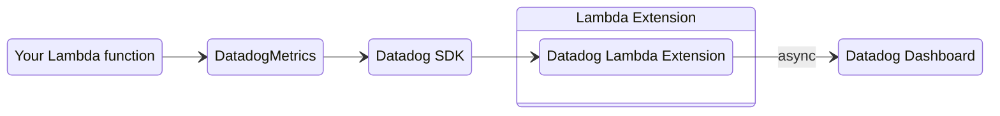

<!-- Generated by scripts/build_agent_skill_references.py from core/metrics/index.md, core/metrics/datadog.md. Do not edit by hand. -->
# Metrics

Source of truth: https://docs.powertools.aws.dev/lambda/python/latest/core/metrics/, https://docs.powertools.aws.dev/lambda/python/latest/core/metrics/datadog/

Metrics creates custom metrics asynchronously by logging metrics to standard output following [Amazon CloudWatch Embedded Metric Format (EMF)](https://docs.aws.amazon.com/AmazonCloudWatch/latest/monitoring/CloudWatch_Embedded_Metric_Format.html).

These metrics can be visualized through [Amazon CloudWatch Console](https://console.aws.amazon.com/cloudwatch/).

## Key features

* Aggregate up to 100 metrics using a single CloudWatch EMF object (large JSON blob)
* Validate against common metric definitions mistakes (metric unit, values, max dimensions, max metrics, etc)
* Metrics are created asynchronously by CloudWatch service, no custom stacks needed
* Context manager to create a one off metric with a different dimension

## Terminologies

If you're new to Amazon CloudWatch, there are five terminologies you must be aware of before using this utility:

* **Namespace**. It's the highest level container that will group multiple metrics from multiple services for a given application, for example `ServerlessEcommerce`.
* **Dimensions**. Metrics metadata in key-value format. They help you slice and dice metrics visualization, for example `ColdStart` metric by Payment `service`.
* **Metric**. It's the name of the metric, for example: `SuccessfulBooking` or `UpdatedBooking`.
* **Unit**. It's a value representing the unit of measure for the corresponding metric, for example: `Count` or `Seconds`.
* **Resolution**. It's a value representing the storage resolution for the corresponding metric. Metrics can be either Standard or High resolution. Read more in the [high-resolution metrics documentation](https://docs.aws.amazon.com/AmazonCloudWatch/latest/monitoring/publishingMetrics.html#high-resolution-metrics).

<figure>
  
  <figcaption>Metric terminology, visually explained</figcaption>
</figure>

## Getting started

> **Tip**

All examples shared in this documentation are available within the [project repository](https://github.com/aws-powertools/powertools-lambda-python/tree/develop/examples).

Metric has two global settings that will be used across all metrics emitted:

| Setting                         | Description                                                                     | Environment variable           | Constructor parameter |
| ------------------------------- | ------------------------------------------------------------------------------- | ------------------------------ | --------------------- |
| **Metric namespace**            | Logical container where all metrics will be placed e.g. `ServerlessAirline`     | `POWERTOOLS_METRICS_NAMESPACE` | `namespace`           |
| **Service**                     | Optionally, sets **service** metric dimension across all metrics e.g. `payment` | `POWERTOOLS_SERVICE_NAME`      | `service`             |

> **Info**

`POWERTOOLS_METRICS_DISABLED` will not disable default metrics created by AWS services.

> **Tip**

Use your application or main service as the metric namespace to easily group all metrics.

```yaml title="AWS Serverless Application Model (SAM) example"
AWSTemplateFormatVersion: "2010-09-09"
Transform: AWS::Serverless-2016-10-31
Description: Powertools for AWS Lambda (Python) version

Globals:
  Function:
    Timeout: 5
    Runtime: python3.12
    Tracing: Active
    Environment:
      Variables:
        POWERTOOLS_SERVICE_NAME: booking
        POWERTOOLS_METRICS_NAMESPACE: ServerlessAirline
        POWERTOOLS_METRICS_FUNCTION_NAME: my-function-name

    Layers:
      # Find the latest Layer version in the official documentation
      # https://docs.powertools.aws.dev/lambda/python/latest/#lambda-layer
      - !Sub arn:aws:lambda:${AWS::Region}:017000801446:layer:AWSLambdaPowertoolsPythonV3-python312-x86_64:42

Resources:
  CaptureLambdaHandlerExample:
    Type: AWS::Serverless::Function
    Properties:
      CodeUri: ../src
      Handler: capture_lambda_handler.handler
```

> **Note**

For brevity, all code snippets in this page will rely on environment variables above being set.

This ensures we instantiate `metrics = Metrics()` over `metrics = Metrics(service="booking", namespace="ServerlessAirline")`, etc.

### Creating metrics

You can create metrics using `add_metric`, and you can create dimensions for all your aggregate metrics using `add_dimension` method.

> **Tip**

	You can initialize Metrics in any other module too. It'll keep track of your aggregate metrics in memory to optimize costs (one blob instead of multiples).

**add_metrics.py**

```python
from aws_lambda_powertools import Metrics
from aws_lambda_powertools.metrics import MetricUnit
from aws_lambda_powertools.utilities.typing import LambdaContext

metrics = Metrics()

@metrics.log_metrics  # ensures metrics are flushed upon request completion/failure
def lambda_handler(event: dict, context: LambdaContext):
    metrics.add_metric(name="SuccessfulBooking", unit=MetricUnit.Count, value=1)
```

**add_dimension.py**

```python
import os

from aws_lambda_powertools import Metrics
from aws_lambda_powertools.metrics import MetricUnit
from aws_lambda_powertools.utilities.typing import LambdaContext

STAGE = os.getenv("STAGE", "dev")
metrics = Metrics()

@metrics.log_metrics  # ensures metrics are flushed upon request completion/failure
def lambda_handler(event: dict, context: LambdaContext):
    metrics.add_dimension(name="environment", value=STAGE)
    metrics.add_metric(name="SuccessfulBooking", unit=MetricUnit.Count, value=1)
```

> **Tip: Tip: Autocomplete Metric Units**

`MetricUnit` enum facilitate finding a supported metric unit by CloudWatch. Alternatively, you can pass the value as a string if you already know them _e.g. `unit="Count"`_.

> **Note: Note: Metrics overflow**

CloudWatch EMF supports a max of 100 metrics per batch. Metrics utility will flush all metrics when adding the 100th metric. Subsequent metrics (101th+) will be aggregated into a new EMF object, for your convenience.

> **Note: Note: Non-finite values**

CloudWatch EMF only accepts finite numbers. `add_metric` skips a `NaN` or infinite value and emits a `PowertoolsUserWarning`, so the other metrics in the batch are still published.

> **Warning: Warning: Do not create metrics or dimensions outside the handler**

Metrics or dimensions added in the global scope will only be added during cold start. Disregard if that's the intended behavior.

### Adding high-resolution metrics

You can create [high-resolution metrics](https://aws.amazon.com/about-aws/whats-new/2023/02/amazon-cloudwatch-high-resolution-metric-extraction-structured-logs/) passing `resolution` parameter to `add_metric`.

> **Tip: When is it useful?**

High-resolution metrics are data with a granularity of one second and are very useful in several situations such as telemetry, time series, real-time incident management, and others.

**add_high_resolution_metrics.py**

```python
from aws_lambda_powertools import Metrics
from aws_lambda_powertools.metrics import MetricResolution, MetricUnit
from aws_lambda_powertools.utilities.typing import LambdaContext

metrics = Metrics()

@metrics.log_metrics  # ensures metrics are flushed upon request completion/failure
def lambda_handler(event: dict, context: LambdaContext):
    metrics.add_metric(name="SuccessfulBooking", unit=MetricUnit.Count, value=1, resolution=MetricResolution.High)
```

> **Tip: Tip: Autocomplete Metric Resolutions**

`MetricResolution` enum facilitates finding a supported metric resolution by CloudWatch. Alternatively, you can pass the values 1 or 60 (must be one of them) as an integer _e.g. `resolution=1`_.

### Adding multi-value metrics

You can call `add_metric()` with the same metric name multiple times. The values will be grouped together in a list.

**add_multi_value_metrics.py**

```python
import os

from aws_lambda_powertools import Metrics
from aws_lambda_powertools.metrics import MetricUnit
from aws_lambda_powertools.utilities.typing import LambdaContext

STAGE = os.getenv("STAGE", "dev")
metrics = Metrics()

@metrics.log_metrics  # ensures metrics are flushed upon request completion/failure
def lambda_handler(event: dict, context: LambdaContext):
    metrics.add_dimension(name="environment", value=STAGE)
    metrics.add_metric(name="TurbineReads", unit=MetricUnit.Count, value=1)
    metrics.add_metric(name="TurbineReads", unit=MetricUnit.Count, value=8)
```

**add_multi_value_metrics_output.json**

```python
{
    "_aws": {
        "Timestamp": 1656685750622,
        "CloudWatchMetrics": [
            {
                "Namespace": "ServerlessAirline",
                "Dimensions": [
                    [
                        "environment",
                        "service"
                    ]
                ],
                "Metrics": [
                    {
                        "Name": "TurbineReads",
                        "Unit": "Count"
                    }
                ]
            }
        ]
    },
    "environment": "dev",
    "service": "booking",
    "TurbineReads": [
        1.0,
        8.0
    ]
}
```

### Adding default dimensions

You can use `set_default_dimensions` method, or `default_dimensions` parameter in `log_metrics` decorator, to persist dimensions across Lambda invocations.

If you'd like to remove them at some point, you can use `clear_default_dimensions` method.

**set_default_dimensions.py**

```python
import os

from aws_lambda_powertools import Metrics
from aws_lambda_powertools.metrics import MetricUnit
from aws_lambda_powertools.utilities.typing import LambdaContext

STAGE = os.getenv("STAGE", "dev")
metrics = Metrics()
metrics.set_default_dimensions(environment=STAGE, another="one")

@metrics.log_metrics  # ensures metrics are flushed upon request completion/failure
def lambda_handler(event: dict, context: LambdaContext):
    metrics.add_metric(name="TurbineReads", unit=MetricUnit.Count, value=1)
    metrics.add_metric(name="TurbineReads", unit=MetricUnit.Count, value=8)
```

**set_default_dimensions_log_metrics.py**

```python
import os

from aws_lambda_powertools import Metrics
from aws_lambda_powertools.metrics import MetricUnit
from aws_lambda_powertools.utilities.typing import LambdaContext

STAGE = os.getenv("STAGE", "dev")
metrics = Metrics()
DEFAULT_DIMENSIONS = {"environment": STAGE, "another": "one"}

# ensures metrics are flushed upon request completion/failure
@metrics.log_metrics(default_dimensions=DEFAULT_DIMENSIONS)
def lambda_handler(event: dict, context: LambdaContext):
    metrics.add_metric(name="TurbineReads", unit=MetricUnit.Count, value=1)
    metrics.add_metric(name="TurbineReads", unit=MetricUnit.Count, value=8)
```

**Note:** Dimensions with empty values will not be included.

### Adding multiple dimension sets

You can use `add_dimensions` method to create multiple dimension sets in a single EMF blob. This allows you to aggregate metrics across different dimension combinations without emitting separate metric blobs.

Each call to `add_dimensions` creates a new dimension array in the CloudWatch EMF output, enabling different views of the same metric data.

**add_dimensions.py**

```python
from aws_lambda_powertools import Metrics
from aws_lambda_powertools.metrics import MetricUnit
from aws_lambda_powertools.utilities.typing import LambdaContext

metrics = Metrics()

@metrics.log_metrics
def lambda_handler(event: dict, context: LambdaContext):
    # Add primary dimension
    metrics.add_dimension(name="service", value="booking")

    # Add multiple dimension sets for different aggregation views
    metrics.add_dimensions(environment="prod", region="us-east-1")
    metrics.add_dimensions(environment="prod")

    metrics.add_metric(name="SuccessfulBooking", unit=MetricUnit.Count, value=1)
```

**add_dimensions_output.json**

```json
{
    "_aws": {
        "Timestamp": 1656620400000,
        "CloudWatchMetrics": [
            {
                "Namespace": "ServerlessAirline",
                "Dimensions": [
                    ["service"],
                    ["environment", "region"],
                    ["environment"]
                ],
                "Metrics": [
                    {
                        "Name": "SuccessfulBooking",
                        "Unit": "Count"
                    }
                ]
            }
        ]
    },
    "service": "booking",
    "environment": "prod",
    "region": "us-east-1",
    "SuccessfulBooking": [1.0]
}
```

> **Tip: When to use multiple dimension sets**

Use `add_dimensions` when you need to query the same metric with different dimension combinations. For example, you might want to see `SuccessfulBooking` aggregated by `environment` alone, or by both `environment` and `region`.

### Changing default timestamp

When creating metrics, we use the current timestamp. If you want to change the timestamp of all the metrics you create, utilize the `set_timestamp` function. You can specify a datetime object or an integer representing an epoch timestamp in milliseconds.

Note that when specifying the timestamp using an integer, it must adhere to the epoch timezone format in milliseconds.

> **Info**

If you need to use different timestamps across multiple metrics, opt for [single_metric](#working-with-different-timestamp).

**set_custom_timestamp_log_metrics.py**

```python
import datetime as dt

from aws_lambda_powertools import Metrics
from aws_lambda_powertools.metrics import MetricUnit
from aws_lambda_powertools.utilities.typing import LambdaContext

metrics = Metrics()

@metrics.log_metrics  # ensures metrics are flushed upon request completion/failure
def lambda_handler(event: dict, context: LambdaContext):
    metrics.add_metric(name="SuccessfulBooking", unit=MetricUnit.Count, value=1)

    metric_timestamp = int((dt.datetime.now() - dt.timedelta(days=2)).timestamp() * 1000)
    metrics.set_timestamp(metric_timestamp)
```

### Flushing metrics

As you finish adding all your metrics, you need to serialize and flush them to standard output. You can do that automatically with the `log_metrics` decorator.

This decorator also **validates**, **serializes**, and **flushes** all your metrics. During metrics validation, if no metrics are provided then a warning will be logged, but no exception will be raised.

**add_metrics.py**

```python
from aws_lambda_powertools import Metrics
from aws_lambda_powertools.metrics import MetricUnit
from aws_lambda_powertools.utilities.typing import LambdaContext

metrics = Metrics()

@metrics.log_metrics  # ensures metrics are flushed upon request completion/failure
def lambda_handler(event: dict, context: LambdaContext):
    metrics.add_metric(name="SuccessfulBooking", unit=MetricUnit.Count, value=1)
```

**log_metrics_output.json**

```json
{
    "_aws": {
        "Timestamp": 1656686788803,
        "CloudWatchMetrics": [
            {
                "Namespace": "ServerlessAirline",
                "Dimensions": [
                    [
                        "service"
                    ]
                ],
                "Metrics": [
                    {
                        "Name": "SuccessfulBooking",
                        "Unit": "Count"
                    }
                ]
            }
        ]
    },
    "service": "booking",
    "SuccessfulBooking": [
        1.0
    ]
}
```

> **Tip: Tip: Metric validation**

If metrics are provided, and any of the following criteria are not met, **`SchemaValidationError`** exception will be raised:

* Maximum of 29 user-defined dimensions
* Namespace is set, and no more than one
* Metric units must be [supported by CloudWatch](https://docs.aws.amazon.com/AmazonCloudWatch/latest/APIReference/API_MetricDatum.html)

#### Raising SchemaValidationError on empty metrics

If you want to ensure at least one metric is always emitted, you can pass `raise_on_empty_metrics` to the **log_metrics** decorator:

```python title="Raising SchemaValidationError exception if no metrics are added"
from aws_lambda_powertools.metrics import Metrics
from aws_lambda_powertools.utilities.typing import LambdaContext

metrics = Metrics()

@metrics.log_metrics(raise_on_empty_metrics=True)
def lambda_handler(event: dict, context: LambdaContext):
    # no metrics being created will now raise SchemaValidationError
    ...
```

> **Tip: Suppressing warning messages on empty metrics**

If you expect your function to execute without publishing metrics every time, you can suppress the warning with **`warnings.filterwarnings("ignore", "No application metrics to publish*")`**.

### Capturing cold start metric

You can optionally capture cold start metrics with `log_metrics` decorator via `capture_cold_start_metric` param.

**capture_cold_start_metric.py**

```python
from aws_lambda_powertools import Metrics
from aws_lambda_powertools.utilities.typing import LambdaContext

metrics = Metrics()

@metrics.log_metrics(capture_cold_start_metric=True)
def lambda_handler(event: dict, context: LambdaContext): ...
```

**capture_cold_start_metric_output.json**

```json
{
    "_aws": {
        "Timestamp": 1656687493142,
        "CloudWatchMetrics": [
            {
                "Namespace": "ServerlessAirline",
                "Dimensions": [
                    [
                        "function_name",
                        "service"
                    ]
                ],
                "Metrics": [
                    {
                        "Name": "ColdStart",
                        "Unit": "Count"
                    }
                ]
            }
        ]
    },
    "function_name": "test",
    "service": "booking",
    "ColdStart": [
        1.0
    ]
}
```

If it's a cold start invocation, this feature will:

* Create a separate EMF blob solely containing a metric named `ColdStart`
* Add `function_name` and `service` dimensions

This has the advantage of keeping cold start metric separate from your application metrics, where you might have unrelated dimensions.

> **Info**

We do not emit 0 as a value for ColdStart metric for cost reasons. [Let us know](https://github.com/aws-powertools/powertools-lambda-python/issues/new?assignees=&labels=feature-request%2C+triage&template=feature_request.md&title=) if you'd prefer a flag to override it.

#### Customizing function name for cold start metrics

When emitting cold start metrics, the `function_name` dimension defaults to `context.function_name`. If you want to change the value you can set the `function_name` parameter in the metrics constructor, or define the environment variable `POWERTOOLS_METRICS_FUNCTION_NAME`.

The priority of the `function_name` dimension value is defined as:

1. `function_name` constructor option
2. `POWERTOOLS_METRICS_FUNCTION_NAME` environment variable
3. `context.function_name` property

**working_with_custom_cold_start_function_name.py**

```python
from aws_lambda_powertools import Metrics
from aws_lambda_powertools.utilities.typing import LambdaContext

metrics = Metrics(function_name="my-function-name")

@metrics.log_metrics(capture_cold_start_metric=True)
def lambda_handler(event: dict, context: LambdaContext): ...
```

### Environment variables

The following environment variable is available to configure Metrics at a global scope:

| Setting                        | Description                                                         | Environment variable               | Default |
| ------------------------------ | ------------------------------------------------------------------- | ---------------------------------- | ------- |
| **Namespace Name**             | Sets **namespace** used for metrics.                                | `POWERTOOLS_METRICS_NAMESPACE`     | `None`  |
| **Service**                    | Sets **service** metric dimension across all metrics e.g. `payment` | `POWERTOOLS_SERVICE_NAME`          | `None`  |
| **Function Name**              | Function name used as dimension for the **ColdStart** metric.       | `POWERTOOLS_METRICS_FUNCTION_NAME` | `None`  |
| **Disable Powertools Metrics** | **Disables** all metrics emitted by Powertools.                     | `POWERTOOLS_METRICS_DISABLED`      | `None`  |

`POWERTOOLS_METRICS_NAMESPACE` is also available on a per-instance basis with the `namespace` parameter, which will consequently override the environment variable value.

## Advanced

### Adding metadata

You can add high-cardinality data as part of your Metrics log with `add_metadata` method. This is useful when you want to search highly contextual information along with your metrics in your logs.

> **Info**

**This will not be available during metrics visualization** - Use **dimensions** for this purpose

**add_metadata.py**

```python
from uuid import uuid4

from aws_lambda_powertools import Metrics
from aws_lambda_powertools.metrics import MetricUnit
from aws_lambda_powertools.utilities.typing import LambdaContext

metrics = Metrics()

@metrics.log_metrics
def lambda_handler(event: dict, context: LambdaContext):
    metrics.add_metric(name="SuccessfulBooking", unit=MetricUnit.Count, value=1)
    metrics.add_metadata(key="booking_id", value=f"{uuid4()}")
```

**add_metadata_output.json**

```json
{
    "_aws": {
        "Timestamp": 1656688250155,
        "CloudWatchMetrics": [
            {
                "Namespace": "ServerlessAirline",
                "Dimensions": [
                    [
                        "service"
                    ]
                ],
                "Metrics": [
                    {
                        "Name": "SuccessfulBooking",
                        "Unit": "Count"
                    }
                ]
            }
        ]
    },
    "service": "booking",
    "booking_id": "00347014-341d-4b8e-8421-a89d3d588ab3",
    "SuccessfulBooking": [
        1.0
    ]
}
```

### Single metric

CloudWatch EMF uses the same dimensions and timestamp across all your metrics. Use `single_metric` if you have a metric that should have different dimensions or timestamp.

#### Working with different dimensions

Generally, using different dimensions would be an edge case since you [pay for unique metric](https://aws.amazon.com/cloudwatch/pricing).

Keep the following formula in mind: **unique metric = (metric_name + dimension_name + dimension_value)**

**single_metric.py**

```python
import os

from aws_lambda_powertools import single_metric
from aws_lambda_powertools.metrics import MetricUnit
from aws_lambda_powertools.utilities.typing import LambdaContext

STAGE = os.getenv("STAGE", "dev")

def lambda_handler(event: dict, context: LambdaContext):
    with single_metric(name="MySingleMetric", unit=MetricUnit.Count, value=1) as metric:
        metric.add_dimension(name="environment", value=STAGE)
```

**single_metric_output.json**

```json
{
    "_aws": {
        "Timestamp": 1656689267834,
        "CloudWatchMetrics": [
            {
                "Namespace": "ServerlessAirline",
                "Dimensions": [
                    [
                        "environment",
                        "service"
                    ]
                ],
                "Metrics": [
                    {
                        "Name": "MySingleMetric",
                        "Unit": "Count"
                    }
                ]
            }
        ]
    },
    "environment": "dev",
    "service": "booking",
    "MySingleMetric": [
        1.0
    ]
}
```

By default it will skip all previously defined dimensions including default dimensions. Use `default_dimensions` keyword argument if you want to reuse default dimensions or specify custom dimensions from a dictionary.

**single_metric_default_dimensions_inherit.py**

```python
import os

from aws_lambda_powertools import single_metric
from aws_lambda_powertools.metrics import Metrics, MetricUnit
from aws_lambda_powertools.utilities.typing import LambdaContext

STAGE = os.getenv("STAGE", "dev")

metrics = Metrics()
metrics.set_default_dimensions(environment=STAGE)

def lambda_handler(event: dict, context: LambdaContext):
    with single_metric(
        name="RecordsCount",
        unit=MetricUnit.Count,
        value=10,
        default_dimensions=metrics.default_dimensions,
    ) as metric:
        metric.add_dimension(name="TableName", value="Users")
```

**single_metric_default_dimensions.py**

```python
import os

from aws_lambda_powertools import single_metric
from aws_lambda_powertools.metrics import MetricUnit
from aws_lambda_powertools.utilities.typing import LambdaContext

STAGE = os.getenv("STAGE", "dev")

def lambda_handler(event: dict, context: LambdaContext):
    with single_metric(
        name="RecordsCount",
        unit=MetricUnit.Count,
        value=10,
        default_dimensions={"environment": STAGE},
    ) as metric:
        metric.add_dimension(name="TableName", value="Users")
```

#### Working with different timestamp

When working with multiple metrics, customers may need different timestamps between them. In such cases, utilize `single_metric` to flush individual metrics with specific timestamps.

**single_metric_with_different_timestamp.py**

```python
from aws_lambda_powertools import Logger, single_metric
from aws_lambda_powertools.metrics import MetricUnit
from aws_lambda_powertools.utilities.typing import LambdaContext

logger = Logger()

def lambda_handler(event: dict, context: LambdaContext):
    for record in event:
        record_id: str = record.get("record_id")
        amount: int = record.get("amount")
        timestamp: int = record.get("timestamp")

        with single_metric(name="Orders", unit=MetricUnit.Count, value=amount, namespace="Powertools") as metric:
            logger.info(f"Processing record id {record_id}")
            metric.set_timestamp(timestamp)
```

**single_metric_with_different_timestamp_payload.json**

```json
[
    {
        "record_id": "6ba7b810-9dad-11d1-80b4-00c04fd430c8",
        "amount": 10,
        "timestamp": 1648195200000
    },
    {
        "record_id": "6ba7b811-9dad-11d1-80b4-00c04fd430c8",
        "amount": 30,
        "timestamp": 1648224000000
    },
    {
        "record_id": "6ba7b812-9dad-11d1-80b4-00c04fd430c8",
        "amount": 25,
        "timestamp": 1648209600000
    },
    {
        "record_id": "6ba7b813-9dad-11d1-80b4-00c04fd430c8",
        "amount": 40,
        "timestamp": 1648177200000
    },
    {
        "record_id": "6ba7b814-9dad-11d1-80b4-00c04fd430c8",
        "amount": 32,
        "timestamp": 1648216800000
    }
]
```

### Flushing metrics manually

If you are using the [AWS Lambda Web Adapter](https://github.com/awslabs/aws-lambda-web-adapter) project, or a middleware with custom metric logic, you can use `flush_metrics()`. This method will serialize, print metrics available to standard output, and clear in-memory metrics data.

> **Warning**

This does not capture Cold Start metrics, and metric data validation still applies.

Contrary to the `log_metrics` decorator, you are now also responsible to flush metrics in the event of an exception.

```python title="Manually flushing and clearing metrics from memory"
from aws_lambda_powertools import Metrics
from aws_lambda_powertools.metrics import MetricUnit
from aws_lambda_powertools.utilities.typing import LambdaContext

metrics = Metrics()

def book_flight(flight_id: str, **kwargs):
    # logic to book flight
    ...
    metrics.add_metric(name="SuccessfulBooking", unit=MetricUnit.Count, value=1)

def lambda_handler(event: dict, context: LambdaContext):
    try:
        book_flight(flight_id=event.get("flight_id", ""))
    finally:
        metrics.flush_metrics()
```

### Metrics isolation

You can use `EphemeralMetrics` class when looking to isolate multiple instances of metrics with distinct namespaces and/or dimensions.

> **Note: This is a typical use case is for multi-tenant, or emitting same metrics for distinct applications.**

```python title="EphemeralMetrics usage"
from aws_lambda_powertools.metrics import EphemeralMetrics, MetricUnit
from aws_lambda_powertools.utilities.typing import LambdaContext

metrics = EphemeralMetrics()

@metrics.log_metrics
def lambda_handler(event: dict, context: LambdaContext):
    metrics.add_metric(name="SuccessfulBooking", unit=MetricUnit.Count, value=1)
```

**Differences between `EphemeralMetrics` and `Metrics`**

`EphemeralMetrics` has only one difference while keeping nearly the exact same set of features:

| Feature                                                               | Metrics | EphemeralMetrics |
| --------------------------------------------------------------------- | ------- | ---------------- |
| **Share data across instances** (metrics, dimensions, metadata, etc.) | Yes     | -                |

> **Question: Why not changing the default `Metrics` behaviour to not share data across instances?**

This is an intentional design to prevent accidental data deduplication or data loss issues due to [CloudWatch EMF](https://docs.aws.amazon.com/AmazonCloudWatch/latest/monitoring/CloudWatch_Embedded_Metric_Format_Specification.html) metric dimension constraint.

In CloudWatch, there are two metric ingestion mechanisms: [EMF (async)](https://docs.aws.amazon.com/AmazonCloudWatch/latest/monitoring/CloudWatch_Embedded_Metric_Format_Specification.html) and [`PutMetricData` API (sync)](https://boto3.amazonaws.com/v1/documentation/api/latest/reference/services/cloudwatch.html#CloudWatch.Client.put_metric_data).

The former creates metrics asynchronously via CloudWatch Logs, and the latter uses a synchronous and more flexible ingestion API.

> **Important: Key concept**

CloudWatch [considers a metric unique](https://docs.aws.amazon.com/AmazonCloudWatch/latest/monitoring/cloudwatch_concepts.html#Metric) by a combination of metric **name**, metric **namespace**, and zero or more metric **dimensions**.

With EMF, metric dimensions are shared with any metrics you define. With `PutMetricData` API, you can set a [list](https://docs.aws.amazon.com/AmazonCloudWatch/latest/APIReference/API_MetricDatum.html) defining one or more metrics with distinct dimensions.

This is a subtle yet important distinction. Imagine you had the following metrics to emit:

| Metric Name            | Dimension                                 | Intent             |
| ---------------------- | ----------------------------------------- | ------------------ |
| **SuccessfulBooking**  | service="booking", **tenant_id**="sample" | Application metric |
| **IntegrationLatency** | service="booking", function_name="sample" | Operational metric |
| **ColdStart**          | service="booking", function_name="sample" | Operational metric |

The `tenant_id` dimension could vary leading to two common issues:

1. `ColdStart` metric will be created multiple times (N * number of unique tenant_id dimension value), despite the `function_name` being the same
2. `IntegrationLatency` metric will be also created multiple times due to `tenant_id` as well as `function_name` (may or not be intentional)

These issues are exacerbated when you create **(A)** metric dimensions conditionally, **(B)** multiple metrics' instances throughout your code  instead of reusing them (globals). Subsequent metrics' instances will have (or lack) different metric dimensions resulting in different metrics and data points with the same name.

> **Note: Intentional design to address these scenarios**

**On 1**, when you enable [capture_start_metric feature](#capturing-cold-start-metric), we transparently create and flush an additional EMF JSON Blob that is independent from your application metrics. This prevents data pollution.

**On 2**, you can use `EphemeralMetrics` to create an additional EMF JSON Blob from your application metric (`SuccessfulBooking`). This ensures that `IntegrationLatency` operational metric data points aren't tied to any dynamic dimension values like `tenant_id`.

That is why `Metrics` shares data across instances by default, as that covers 80% of use cases and different personas using Powertools. This allows them to instantiate `Metrics` in multiple places throughout their code - be a separate file, a middleware, or an abstraction that sets default dimensions.

### Observability providers

> An observability provider is an [AWS Lambda Partner](https://docs.aws.amazon.com/lambda/latest/dg/extensions-api-partners.html) offering a platform for logging, metrics, traces, etc.

We provide a thin-wrapper on top of the most requested observability providers. We strive to keep a similar UX as close as possible while keeping our value add features.

> **Tip: Missing your preferred provider? Please create a [feature request](https://github.com/aws-powertools/powertools-lambda-python/issues/new?assignees=&labels=feature-request%2Ctriage&projects=&template=feature_request.yml&title=Feature+request%3A+TITLE).**

Current providers:

| Provider                                 | Notes                                                    |
| ---------------------------------------- | -------------------------------------------------------- |
| [Datadog](./datadog.md) | Uses Datadog SDK and Datadog Lambda Extension by default |

### CloudWatch Omni

[CloudWatch Omni](https://aws.amazon.com/cloudwatch/omni/) reads the same metrics you already publish to CloudWatch, so metrics emitted with this utility are available in your Omni space without changes. The EMF blob Metrics writes to the log is turned into CloudWatch metrics by the Lambda service, and those are what Omni dashboards and alerts use.

Two things help on the Omni side:

* Keep the `service` dimension set, through `Metrics(service=...)` or `POWERTOOLS_SERVICE_NAME`, and use the same value in Logger and Tracer. Omni correlates telemetry by service.
* Use the `namespace` and dimension names you would want to see in a query. Omni queries metrics by namespace and dimensions, the same way CloudWatch does.

This observability provider creates custom metrics by flushing metrics to [Datadog Lambda extension](https://docs.datadoghq.com/serverless/installation/python/?tab=datadogcli), or to standard output via [Datadog Forwarder](https://docs.datadoghq.com/logs/guide/forwarder/?tab=cloudformation). These metrics can be visualized in the [Datadog console](https://app.datadoghq.com/metric/explore).



## Key features

* Flush metrics to Datadog extension or standard output
* Validate against common metric definitions mistakes
* Support to add default tags

## Terminologies

If you're new to Datadog Metrics, there are three terminologies you must be aware of before using this utility:

* **Namespace**. It's the highest level container that will group multiple metrics from multiple services for a given application, for example `ServerlessEcommerce`.
* **Metric**. It's the name of the metric, for example: SuccessfulBooking or UpdatedBooking.
* **Tags**. Metrics metadata in key-value pair format. They help provide contextual information, and filter org organize metrics.

You can read more details in the [Datadog official documentation](https://docs.datadoghq.com/metrics/custom_metrics/).

## Getting started

> **Tip**

All examples shared in this documentation are available within the [project repository](https://github.com/aws-powertools/powertools-lambda-python/tree/develop/examples).

### Install

> **Using Datadog Forwarder?** You can skip this step.

We recommend using [Datadog SDK](https://docs.datadoghq.com/serverless/installation/python/) and Datadog Lambda Extension with this feature for optimal results.

For Datadog SDK, you can add `aws-lambda-powertools[datadog]` as a dependency in your preferred tool, or as a Lambda Layer in the following example:

```yaml title="AWS Serverless Application Model (SAM) example"
AWSTemplateFormatVersion: "2010-09-09"
Transform: AWS::Serverless-2016-10-31
Description: Powertools for AWS Lambda (Python) version

Globals:
  Function:
    Timeout: 5
    Runtime: python3.12
    Tracing: Active
    Environment:
      Variables:
        POWERTOOLS_METRICS_NAMESPACE: ServerlessAirline
        # [Production setup]
        # DATADOG_API_KEY_SECRET_ARN: "<AWS Secrets Manager Secret ARN containing Datadog API key>"
        # [Development only]
        DD_API_KEY: "<YOUR DATADOG API KEY>"
        # Configuration details: https://docs.datadoghq.com/serverless/installation/python/?tab=datadogcli
        DD_SITE: datadoghq.com

    Layers:
      # Find the latest Layer version in the official documentation
      # https://docs.powertools.aws.dev/lambda/python/latest/#lambda-layer
      - !Sub arn:aws:lambda:${AWS::Region}:017000801446:layer:AWSLambdaPowertoolsPythonV3-python312-x86_64:42
      # Find the latest Layer version in the Datadog official documentation

      # Datadog SDK
      # Latest versions: https://github.com/DataDog/datadog-lambda-python/releases
      - !Sub arn:aws:lambda:${AWS::Region}:464622532012:layer:Datadog-Python312:78

      # Datadog Lambda Extension
      # Latest versions: https://github.com/DataDog/datadog-lambda-extension/releases
      - !Sub arn:aws:lambda:${AWS::Region}:464622532012:layer:Datadog-Extension:45

Resources:
  CaptureLambdaHandlerExample:
    Type: AWS::Serverless::Function
    Properties:
      CodeUri: ../src
      Handler: capture_lambda_handler.handler
```

### Creating metrics

You can create metrics using `add_metric`.

By default, we will generate the current timestamp for you. Alternatively, you can use the `timestamp` parameter to set a custom one in epoch time.

**add_datadog_metrics.py**

```python
from aws_lambda_powertools.metrics.provider.datadog import DatadogMetrics
from aws_lambda_powertools.utilities.typing import LambdaContext

metrics = DatadogMetrics()

@metrics.log_metrics  # ensures metrics are flushed upon request completion/failure
def lambda_handler(event: dict, context: LambdaContext):
    metrics.add_metric(name="SuccessfulBooking", value=1)
```

**add_metrics_with_timestamp.py**

```python
import time

from aws_lambda_powertools.metrics.provider.datadog import DatadogMetrics
from aws_lambda_powertools.utilities.typing import LambdaContext

metrics = DatadogMetrics()

@metrics.log_metrics  # ensures metrics are flushed upon request completion/failure
def lambda_handler(event: dict, context: LambdaContext):
    metrics.add_metric(name="SuccessfulBooking", value=1, timestamp=int(time.time()))
```

> **Warning: Warning: Do not create metrics outside the handler**

Metrics added in the global scope will only be added during cold start. Disregard if you that's the intended behavior.

### Adding tags

You can add any number of tags to your metrics via keyword arguments (`key=value`). They are helpful to filter, organize, and aggregate your metrics later.

> **Info: We will emit a warning for tags [beyond the 200 chars limit](https://docs.datadoghq.com/getting_started/tagging/).**

**add_metrics_with_tags.py**

```python
from aws_lambda_powertools.metrics.provider.datadog import DatadogMetrics
from aws_lambda_powertools.utilities.typing import LambdaContext

metrics = DatadogMetrics()

@metrics.log_metrics  # ensures metrics are flushed upon request completion/failure
def lambda_handler(event: dict, context: LambdaContext):
    metrics.add_metric(name="SuccessfulBooking", value=1, tag1="powertools", tag2="python")
```

### Adding default tags

You can persist tags across Lambda invocations and `DatadogMetrics` instances via `set_default_tags` method, or `default_tags` parameter in the `log_metrics` decorator.

If you'd like to remove them at some point, you can use the `clear_default_tags` method.

> **Note: Metric tag takes precedence over default tags of the same name**

When adding tags with the same name via `add_metric` and `set_default_tags`, `add_metric` takes precedence.

**set_default_tags.py**

```python
from aws_lambda_powertools.metrics.provider.datadog import DatadogMetrics
from aws_lambda_powertools.utilities.typing import LambdaContext

metrics = DatadogMetrics()
metrics.set_default_tags(tag1="powertools", tag2="python")

@metrics.log_metrics  # ensures metrics are flushed upon request completion/failure
def lambda_handler(event: dict, context: LambdaContext):
    metrics.add_metric(name="SuccessfulBooking", value=1)
```

**set_default_tags_log_metrics.py**

```python
from aws_lambda_powertools.metrics.provider.datadog import DatadogMetrics
from aws_lambda_powertools.utilities.typing import LambdaContext

metrics = DatadogMetrics()

default_tags = {"tag1": "powertools", "tag2": "python"}

@metrics.log_metrics(default_tags=default_tags)  # ensures metrics are flushed upon request completion/failure
def lambda_handler(event: dict, context: LambdaContext):
    metrics.add_metric(name="SuccessfulBooking", value=1)
```

### Flushing metrics

Use `log_metrics` decorator to automatically serialize and flush your metrics (SDK or Forwarder) at the end of your invocation.

This decorator also ensures metrics are flushed in the event of an exception, including warning you in case you forgot to add metrics.

**add_metrics.py**

```python
from aws_lambda_powertools.metrics.provider.datadog import DatadogMetrics
from aws_lambda_powertools.utilities.typing import LambdaContext

metrics = DatadogMetrics()

@metrics.log_metrics  # ensures metrics are flushed upon request completion/failure
def lambda_handler(event: dict, context: LambdaContext):
    metrics.add_metric(name="SuccessfulBooking", value=1, tag1="powertools", tag2="python")
```

**log_metrics_output.json**

```json
{
   "m":"SuccessfulBooking",
   "v":1,
   "e":1691707076,
   "t":[
      "tag1:powertools",
      "tag2:python"
   ]
}
```

#### Raising SchemaValidationError on empty metrics

Use `raise_on_empty_metrics=True` if you want to ensure at least one metric is always emitted.

```python title="Failing fast if no metrics are added"
from aws_lambda_powertools.metrics.provider.datadog import DatadogMetrics
from aws_lambda_powertools.utilities.typing import LambdaContext

metrics = DatadogMetrics()

@metrics.log_metrics(raise_on_empty_metrics=True)  # ensures metrics are flushed upon request completion/failure
def lambda_handler(event: dict, context: LambdaContext):
    # no metrics being created will now raise SchemaValidationError
    return
```

> **Tip: Suppressing warning messages on empty metrics**

If you expect your function to execute without publishing metrics every time, you can suppress the warning with **`warnings.filterwarnings("ignore", "No application metrics to publish*")`**.

### Capturing cold start metric

You can optionally capture cold start metrics with `log_metrics` decorator via `capture_cold_start_metric` param.

**capture_cold_start_metric.py**

```python
from aws_lambda_powertools.metrics.provider.datadog import DatadogMetrics
from aws_lambda_powertools.utilities.typing import LambdaContext

metrics = DatadogMetrics()

@metrics.log_metrics(capture_cold_start_metric=True)
def lambda_handler(event: dict, context: LambdaContext):
    return
```

**capture_cold_start_metric_output.json**

```json
{
    "m":"ColdStart",
    "v":1,
    "e":1691707488,
    "t":[
       "function_name:HelloWorldFunction"
    ]
 }
```

If it's a cold start invocation, this feature will:

* Create a separate Datadog metric solely containing a metric named `ColdStart`
* Add `function_name` metric tag

This has the advantage of keeping cold start metric separate from your application metrics, where you might have unrelated tags.

> **Info**

We do not emit 0 as a value for ColdStart metric for cost reasons. [Let us know](https://github.com/aws-powertools/powertools-lambda-python/issues/new?assignees=&labels=feature-request%2C+triage&template=feature_request.md&title=) if you'd prefer a flag to override it.

### Environment variables

You can use any of the following environment variables to configure `DatadogMetrics`:

| Setting                        | Description                                                                      | Environment variable           | Constructor parameter |
| ------------------------------ | -------------------------------------------------------------------------------- | ------------------------------ | --------------------- |
| **Metric namespace**           | Logical container where all metrics will be placed e.g. `ServerlessAirline`      | `POWERTOOLS_METRICS_NAMESPACE` | `namespace`           |
| **Flush to log**               | Use this when you want to flush metrics to be exported through Datadog Forwarder | `DD_FLUSH_TO_LOG`              | `flush_to_log`        |
| **Disable Powertools Metrics** | Optionally, disables all Powertools metrics.	                                    | `POWERTOOLS_METRICS_DISABLED`  | N/A                   |

> **Info**

`POWERTOOLS_METRICS_DISABLED` will not disable default metrics created by AWS services.

## Advanced

### Flushing metrics manually

If you are using the [AWS Lambda Web Adapter](https://github.com/awslabs/aws-lambda-web-adapter) project, or a middleware with custom metric logic, you can use `flush_metrics()`. This method will serialize, print metrics available to standard output, and clear in-memory metrics data.

> **Warning**

This does not capture Cold Start metrics, and metric data validation still applies.

Contrary to the `log_metrics` decorator, you are now also responsible to flush metrics in the event of an exception.

```python title="Manually flushing and clearing metrics from memory"
from aws_lambda_powertools.metrics.provider.datadog import DatadogMetrics
from aws_lambda_powertools.utilities.typing import LambdaContext

metrics = DatadogMetrics()

def book_flight(flight_id: str, **kwargs):
    # logic to book flight
    ...
    metrics.add_metric(name="SuccessfulBooking", value=1)

def lambda_handler(event: dict, context: LambdaContext):
    try:
        book_flight(flight_id=event.get("flight_id", ""))
    finally:
        metrics.flush_metrics()
```

### Integrating with Datadog Forwarder

Use `flush_to_log=True` in `DatadogMetrics` to integrate with the legacy [Datadog Forwarder](https://docs.datadoghq.com/logs/guide/forwarder/?tab=cloudformation).

This will serialize and flush metrics to standard output.

**flush_metrics_to_standard_output.py**

```python
from aws_lambda_powertools.metrics.provider.datadog import DatadogMetrics
from aws_lambda_powertools.utilities.typing import LambdaContext

metrics = DatadogMetrics(flush_to_log=True)

@metrics.log_metrics  # ensures metrics are flushed upon request completion/failure
def lambda_handler(event: dict, context: LambdaContext):
    metrics.add_metric(name="SuccessfulBooking", value=1)
```

**log_metrics_standard_output.json**

```json
{
   "m":"SuccessfulBooking",
   "v":1,
   "e":1691768022,
   "t":[

   ]
}
```
